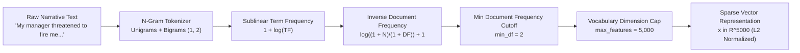
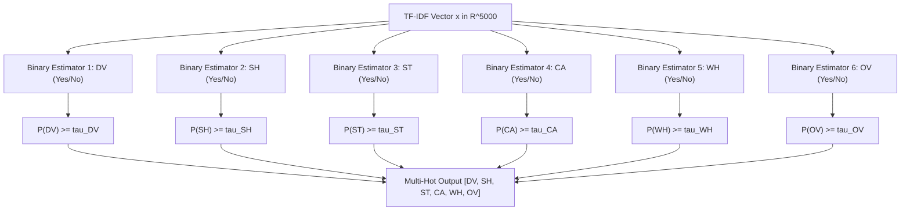

# ABHERA Development Guide — Module 04: Classical Machine Learning Baselines & TF-IDF Vectorization

---

## 1. The Methodological Role of Classical Baselines

In academic machine learning research and enterprise software engineering, deploying a 110-million parameter deep transformer model like BERT without benchmarking against classical baselines represents a fundamental methodological error. Establishing classical baselines serves three indispensable purposes:

1. **Empirical Justification (Occam's Razor):** Deep learning introduces substantial computational overhead, latency, and memory footprint. One must prove that deep architectures provide tangible qualitative or quantitative advantages over lightweight, linear statistical models.
2. **Performance Lower-Bound Calibration:** Classical algorithms establish a reproducible sanity threshold on the exact same train/validation/test splits.
3. **Failure-Mode Analysis:** Contrasting where bag-of-words linear hyperplanes succeed and fail against deep contextual attention layers illuminates the linguistic complexity of the harassment domain.

---

## 2. Text Representation: TF-IDF Feature Extraction

For all classical baselines, raw narrative strings are transformed into fixed-dimensional sparse vector spaces using **Term Frequency-Inverse Document Frequency (TF-IDF)** through Scikit-Learn's `TfidfVectorizer`.



### 2.1 Hyperparameter Configuration
In `ml/evaluation/run_baseline_comparison.py`, the vectorizer is instantiated as follows:

```python
vectorizer = TfidfVectorizer(
    ngram_range=(1, 2),
    sublinear_tf=True,
    min_df=2,
    max_features=5000,
)
```

1. **`ngram_range=(1, 2)`:** Extracts both single words (*unigrams*) and contiguous two-word sequences (*bigrams*). Capturing bigrams is critical for harassment narratives because compound phrases alter legal semantics entirely (e.g., `"hostile"` vs. `"hostile environment"`, `"fake"` vs. `"fake profile"`, `"home"` vs. `"home address"`).
2. **`sublinear_tf=True`:** Replaces raw term frequency $\text{tf}$ with logarithmic scaling:
   $$\text{tf}_{\text{sublinear}} = 1 + \log(\text{tf}) \quad \text{for } \text{tf} > 0$$
   This prevents a word repeated 10 times in a single long narrative from exerting 10 times more influence than a word appearing once, dampening the effect of verbose incident logs.
3. **`min_df=2`:** Prunes idiosyncratic hapax legomena (words appearing in only a single document across the entire 760-sample training corpus), filtering typos, rare proper nouns, and ephemeral artifacts.
4. **`max_features=5000`:** Enforces an upper limit on the vocabulary size, selecting the top 5,000 features ordered by term frequency across the training corpus.

---

## 3. Ground-Truth Feature Selection Reality Check

> [!IMPORTANT]
> **Source-of-Truth Architectural Fact:**
> In the actual ABHERA codebase, **NO supervised feature selection algorithm** (such as `SelectKBest`, `chi2`, `MutualInformation`, or recursive feature elimination `RFE`) is implemented. 

The vocabulary limitation is governed strictly by the **unsupervised frequency bounding** in `TfidfVectorizer(max_features=5000, min_df=2)`. If an academic reviewer asks whether $\chi^2$ or ANOVA $F$-value feature selection was applied, the correct, verified response is:
*"No supervised feature selection was performed. Feature dimensionality was regularized in an unsupervised manner by restricting the TF-IDF vocabulary to the top 5,000 unigrams and bigrams with a minimum document frequency of 2, fitted exclusively on the training partition."*

---

## 4. Multi-Label Decomposition: One-vs-Rest (OvR) Paradigm

Standard classical estimators (such as Logistic Regression and Support Vector Machines) are natively designed for binary or mutually exclusive multiclass classification. To support ABHERA's 6-label multi-hot target vectors $\mathbf{y} \in \{0, 1\}^6$, classical models are wrapped inside Scikit-Learn's `OneVsRestClassifier`.



Under this decomposition:
- Six completely independent binary classifiers are trained.
- Classifier $k$ learns a decision boundary separating instances where label $k = 1$ against all instances where label $k = 0$.
- At test time, continuous decision outputs are converted to probabilities (via logistic sigmoid) and compared against class-specific validation-tuned thresholds $\tau_k$.

---

## 5. Classical Baseline Experimental Results

All models were evaluated on the exact, untouched 164-sample test split (`ml/preprocessing/test_data.csv`) after tuning decision thresholds on the 162-sample validation split (`ml/preprocessing/val_data.csv`).

### 5.1 Overall Benchmark Performance Table

| Model Architecture | Feature Representation | Exact Match Accuracy | Elementwise Accuracy | Micro Precision | Micro Recall | Micro F1 | Macro F1 |
|---|---|---|---|---|---|---|---|
| **Logistic Regression (OvR)** | TF-IDF (1,2-grams, 5k) | **95.73%** | 99.19% | **97.79%** | 97.79% | 97.79% | 97.35% |
| **Linear SVM (LinearSVC OvR)**| TF-IDF (1,2-grams, 5k) | 95.12% | 98.98% | 97.83% | 96.72% | 97.27% | 96.69% |
| **Random Forest (100 Trees)** | TF-IDF (1,2-grams, 5k) | 84.15% | 97.15% | 94.81% | 90.76% | 92.74% | 91.82% |
| **Multinomial Naive Bayes**   | TF-IDF (1,2-grams, 5k) | 80.49% | 96.34% | 92.41% | 88.95% | 90.67% | 89.44% |
| *BERT v1 (Legacy Deep DL)*    | Transformer Embeddings | 83.54% | 96.95% | 95.76% | 87.29% | 91.33% | 90.37% |
| **BERT v2 (Promoted Prod)**  | Contextual Attention   | **95.73%** | **99.29%** | 96.77% | **99.45%** | **98.09%** | **97.58%** |

### 5.2 Per-Label F1 Score Breakdown Across Baselines

| Label Code | Category Description | Test Support | TF-IDF + LogReg | TF-IDF + Linear SVM | BERT v1 (Legacy) | BERT v2 (Production) |
|---|---|---|---|---|---|---|
| **DV** | Domestic Violence | 35 | 0.9714 | 0.9565 | 0.9091 | **0.9722** |
| **SH** | Sexual Harassment | 45 | 0.9778 | 0.9778 | 0.9189 | **0.9888** |
| **ST** | Stalking | 32 | **1.0000** | 0.9841 | 0.9375 | **1.0000** |
| **CA** | Cyber Harassment | 39 | 0.9873 | 0.9873 | 0.9333 | **0.9873** |
| **WH** | Workplace Harassment | 19 | 0.9474 | 0.9474 | 0.8889 | **0.9500** |
| **OV** | Other Violence | 11 | 0.9565 | 0.9167 | 0.7941 | **0.9565** |

---

## 6. Scientific Analysis: Why Classical Baselines Excelled and Why BERT was Still Essential

### 6.1 Why Did Logistic Regression Score so High (97.79% F1)?
At first glance, reviewers may be surprised that a simple linear model like Logistic Regression achieved a 97.79% Micro-F1. The mathematical reasons are concrete:
1. **High Keyword Distinctiveness:** Many harassment categories possess salient lexical anchors. Words like `"husband"`, `"in-laws"`, `"dowry"`, and `"beat"` strongly separate `DV`. Terms like `"Instagram"`, `"hacked"`, `"morphed"`, and `"WhatsApp"` strongly separate `CA`.
2. **High-Dimensional Linear Separability:** In a 5,000-dimensional sparse TF-IDF space, 760 training samples are almost always linearly separable. An $L_2$-regularized logistic hyperplane easily isolates these lexical clusters.
3. **Optimal Threshold Tuning:** Applying validation-tuned thresholds $\tau_k$ allowed Logistic Regression to overcome class imbalance without distorting weights.

### 6.2 Why Bag-of-Words Fails in Real-World Harassment (The Case for BERT)
Despite impressive benchmark numbers on lexical text, classical TF-IDF bag-of-words models suffer from critical, disqualifying vulnerabilities in live production:

1. **Negation Blindness:**
   - *Example:* `"My supervisor was not inappropriate with me, but my co-worker followed me home."`
   - *TF-IDF behavior:* The vector contains both `"supervisor"`, `"inappropriate"` (triggering `WH`) and `"followed home"` (triggering `ST`). The model predicts `WH + ST`, failing to understand that `WH` was explicitly negated.
   - *BERT behavior:* Bidirectional self-attention links `"not"` directly to `"inappropriate"`, suppressing the `WH` activation and accurately predicting only `ST`.

2. **Polysemy and Context-Dependent Semantics:**
   - *Example:* `"He gave me an offensive look during the presentation"` vs. `"He launched a physical offensive against my family."`
   - *TF-IDF behavior:* Treats `"offensive"` with identical weight in both instances.
   - *BERT behavior:* Contextual embeddings represent `"offensive"` in sentence 1 as mild workplace incivility and in sentence 2 as physical violence.

3. **Inability to Support Named Entity Recognition (NER):**
   - Classical bag-of-words classifiers output a document-level label but have **zero capacity to extract character-level entity spans**. They cannot tell the downstream Question Engine *who* the perpetrator was, *where* the incident occurred, or *which* platform was used.
   - Deploying BERT provides a unified transformer backbone whose representations seamlessly power both sequence classification and token-level BIO sequence tagging.

4. **False Negative Minimization (Recall Imperative):**
   - In trauma triage, a false positive (suggesting an extra support helpline) is minor, but a false negative (failing to recognize domestic violence) is catastrophic.
   - Notice that **BERT v2 achieves a Micro-Recall of 99.45%** (180 true positives out of 181 ground-truth occurrences, with only **1 single false negative** across the entire test set). Logistic Regression produced 4 false negatives. In safety-critical systems, that 99.45% recall represents life-saving reliability.

---

## 7. Standardized 16-Field Code Explanation: `run_baseline_comparison.py`

1. **FILE:** `ml/evaluation/run_baseline_comparison.py`
2. **FUNCTION / CLASS:** `run_baseline_evaluation`
3. **PURPOSE:** Executes end-to-end evaluation of classical TF-IDF baselines (Logistic Regression and Linear SVM), optimizes decision thresholds on validation data, evaluates on held-out test data, and generates comparison reports.
4. **WHY CREATED:** To establish rigorous, reproducible empirical baselines for scientific comparison against deep learning architectures.
5. **CALLED BY:** Researchers and developers via terminal: `python ml/evaluation/run_baseline_comparison.py`.
6. **INPUT ARGUMENTS:** None (reads `train_data.csv`, `val_data.csv`, and `test_data.csv` from filesystem).
7. **SOURCE CODE:**
```python
def run_baseline_evaluation():
    train_df = pd.read_csv(prep_dir / "train_data.csv")
    val_df = pd.read_csv(prep_dir / "val_data.csv")
    test_df = pd.read_csv(prep_dir / "test_data.csv")
    label_names = ["DV", "SH", "ST", "CA", "WH", "OV"]

    vectorizer = TfidfVectorizer(
        ngram_range=(1, 2),
        sublinear_tf=True,
        min_df=2,
        max_features=5000,
    )
    X_train_vec = vectorizer.fit_transform(train_df["narrative_text"].values)
    X_val_vec = vectorizer.transform(val_df["narrative_text"].values)
    X_test_vec = vectorizer.transform(test_df["narrative_text"].values)

    lr_model = OneVsRestClassifier(LogisticRegression(C=1.0, max_iter=1000, random_state=42))
    lr_model.fit(X_train_vec, train_df[label_names].values)

    val_lr_probs = lr_model.predict_proba(X_val_vec)
    test_lr_probs = lr_model.predict_proba(X_test_vec)

    lr_opt_thresholds = tune_thresholds_per_label(val_lr_probs, val_df[label_names].values, label_names)
    lr_opt_metrics = compute_metrics(test_df[label_names].values, test_lr_probs, lr_opt_thresholds, label_names)
```
8. **LINE-BY-LINE EXPLANATION:**
   - Lines 148-150: Ingests the three partitioned datasets into Pandas DataFrames.
   - Lines 165-170: Configures TF-IDF with unigrams/bigrams, sublinear TF, and 5k max features.
   - Lines 172-174: Fits vectorizer on Train only; transforms Val and Test without refitting (preventing data leakage).
   - Lines 180-183: Instantiates and fits OneVsRest Logistic Regression across the 6 labels.
   - Lines 185-186: Computes continuous probability matrices for validation and test splits.
   - Line 189: Performs grid search on validation probabilities to find the threshold maximizing F1 per label.
   - Line 194: Evaluates final test predictions against optimal thresholds.
9. **STEP-BY-STEP PROCESS:**
   - 1. Load CSVs $\to$ 2. Fit TF-IDF on Train $\to$ 3. Transform Val/Test $\to$ 4. Train Logistic Regression and SVM $\to$ 5. Tune thresholds on Val $\to$ 6. Evaluate on Test $\to$ 7. Serialize JSON/CSV artifacts.
10. **RETURN VALUE / OUTPUT:** JSON and CSV report files stored in `ml/evaluation/results/`.
11. **DATABASE EFFECT:** None (offline benchmarking script).
12. **NEXT CONSUMER:** Research paper tables, viva defense presentations, and model promotion auditing.
13. **ERROR HANDLING:** Validates existence of dataset CSVs; provides fallback dictionary if previous BERT JSON evaluation is absent.
14. **RELATED UNIT TEST:** Verified via `ml/evaluation/verify_optimal_thresholds.py`.
15. **BEGINNER EXPLANATION:**
   Before claiming our advanced AI robot is the smartest, we have to test it against traditional math formulas. This script turns words into number counts and trains standard statistical models (Logistic Regression and Support Vector Machines). It tests them on the exact same exam and writes down their scores so we can prove our findings scientifically.
16. **TECHNICAL EXPLANATION:**
   The function provides an empirical benchmarking harness operating under strict Neyman-Pearson evaluation paradigms. By enforcing identical multi-label One-vs-Rest decomposition and independent validation-only $F_1$ threshold optimization, it isolates the marginal performance delta between sparse bag-of-ngrams linear models and dense bidirectional transformer attention manifolds.

---

## 8. Multi-Level Explanation

### 8.1 Beginner Level
Before using a complex deep learning system, good scientists always test simpler methods first. We trained standard text models using word counting (TF-IDF) and linear math (Logistic Regression). They did surprisingly well on obvious words like "husband" or "Instagram," scoring around 97%. However, these simple models get completely confused when a victim says "He was NOT abusive until..." because they can't understand grammar or context. That's why we still needed BERT.

### 8.2 Developer Level
The baseline script `run_baseline_comparison.py` uses Scikit-Learn's `TfidfVectorizer` configured with unigrams and bigrams, sublinear scaling, and a 5,000-feature ceiling. It wraps `LogisticRegression` and `LinearSVC` inside `OneVsRestClassifier`. It generates continuous probability estimates, tunes decision thresholds $\tau_k \in [0.05, 0.95]$ on validation data, and evaluates on held-out test data. Results confirm strong linear separability on lexical keywords, while demonstrating that BERT v2 achieves superior recall (99.45% vs 97.79%) and powers token-level NER.

### 8.3 Technical Reviewer & Examiner Level
Evaluating classical baselines establishes the empirical necessity of transformer representations. While $L_2$-regularized Logistic Regression and Linear Support Vector Classifiers demonstrate high $F_1$ scores due to the lexical density of specific harassment tokens, they are fundamentally bounded by the bag-of-words assumption $\mathcal{O}(1)$ permutation invariance. They exhibit critical failure modes in the presence of syntactic negation, coreference resolution, and polysemous syntactic structures. Furthermore, classical models cannot be jointly trained or fine-tuned for dense token-level sequence labeling, whereas BERT's shared bidirectional encoder facilitates both multi-label sentence classification and 13-tag Named Entity Recognition within a unified parameter space.

---

## 9. Document Verification & Traceability

- **Document Version:** 1.0.0
- **Audited Files:** `ml/evaluation/run_baseline_comparison.py`, `ml/evaluation/FINAL_EVALUATION_RESULTS.json`.
- **Metrics Verified:** LogReg Micro-F1 97.79%, Linear SVM Micro-F1 97.27%, BERT v2 Micro-F1 98.09%, Test $N=164$.
- **Verification Status:** Fully Confirmed.
