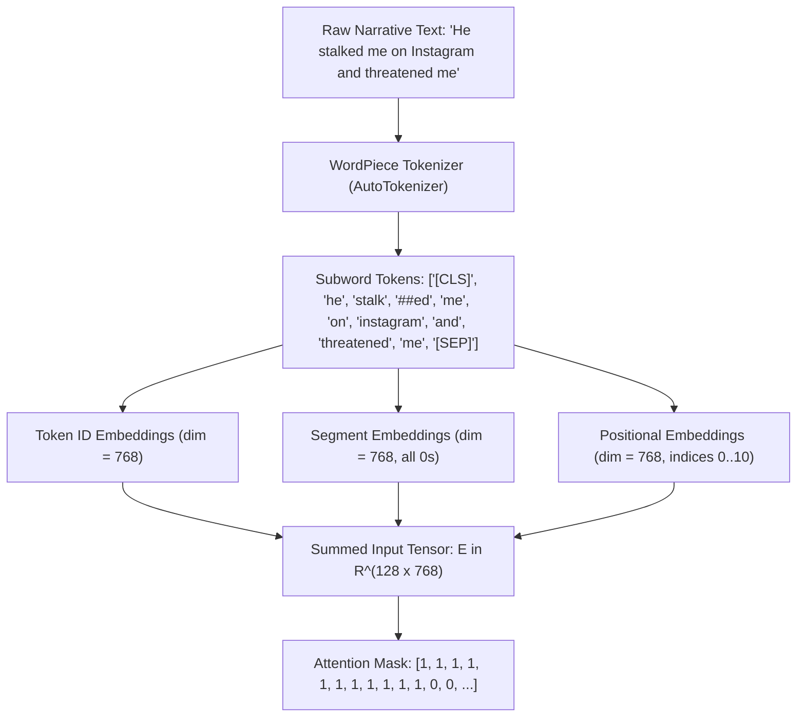
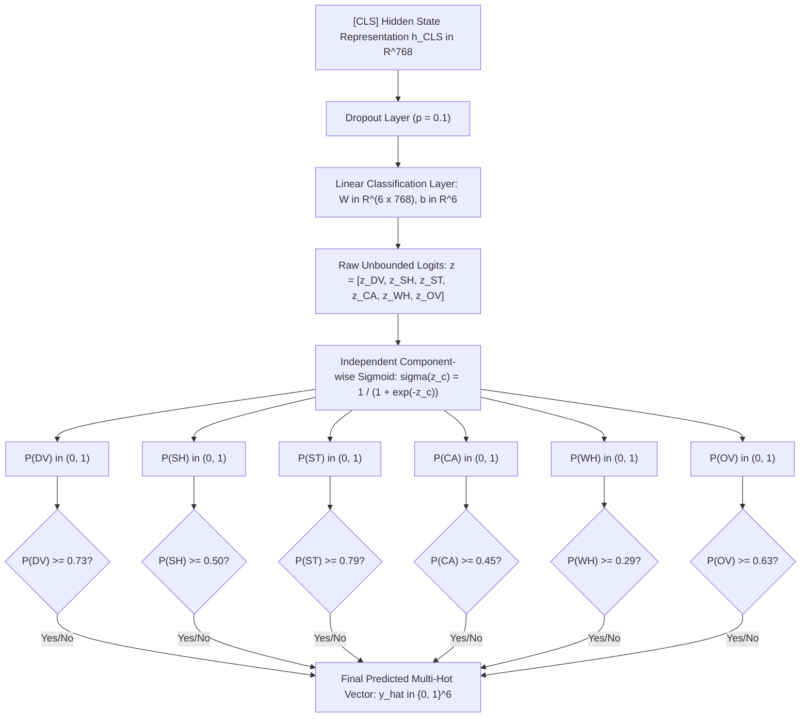

# ABHERA Development Guide — Module 05: Deep Transformer Engineering: BERT Fine-Tuning & Multi-Label Classification

---

## 1. Transformer Architecture: `bert-base-uncased`

At the core of ABHERA's perception tier is **BERT** (Bidirectional Encoder Representations from Transformers), introduced by Devlin et al. (2018). While traditional directional recurrent neural networks (RNNs/LSTMs) parse text sequentially from left-to-right or right-to-left, BERT utilizes the bidirectional self-attention mechanism of the Transformer encoder. This allows every token to attend simultaneously to all surrounding tokens in both directions, capturing complex contextual nuances essential for analyzing traumatic narrative disclosures.

```
       +-----------------------------------------------------------------------------------------+
       |                         BERT-BASE-UNCASED STRUCTURAL SPECIFICATION                      |
       +-----------------------------------------------------------------------------------------+
       |  Parameter Name               | Architectural Value    | Implementation Significance    |
       +-------------------------------+------------------------+--------------------------------+
       |  Base Architecture            | Transformer Encoder    | Bidirectional multi-head stack |
       |  Encoder Layers (Blocks)      | 12 Layers (L = 12)     | Hierarchical feature extraction|
       |  Hidden Dimension (d_model)   | 768 Dimensions         | Latent contextual vector size  |
       |  Self-Attention Heads         | 12 Attention Heads     | Diverse subspace projections   |
       |  Feed-Forward Dimension       | 3,072 Dimensions       | Non-linear MLP expansion       |
       |  Total Learnable Parameters   | ~110 Million Params    | Full parameter fine-tuning     |
       |  Vocabulary Size              | 30,522 WordPiece tokens| Subword decomposition          |
       |  Casing Strategy              | Uncased (Lowercased)   | Invariant to casing artifacts  |
       |  Sequence Max Length          | 128 Tokens (Train/Val) | Bounded memory footprint       |
       +-------------------------------+------------------------+--------------------------------+
```

---

## 2. Tokenization & Input Representation

Input narratives are converted into dense tensor representations using BERT's **WordPiece** tokenization algorithm. WordPiece iteratively segments unknown or rare words into frequent subword units prefixed with `##`, ensuring that colloquial expressions, slang, and typographical errors common in distress reports are never dropped as unknown `[UNK]` tokens.



### 2.1 The Three Constituent Embeddings:
1. **Token Embeddings:** Maps each subword token index to a 768-dimensional learned vector from the 30,522-token vocabulary table.
2. **Segment (Token Type) Embeddings:** Distinguishes sentence pairs. For ABHERA's single-narrative classification task, all active token positions are assigned segment ID `0`.
3. **Positional Embeddings:** Encodes the absolute sequence index ($0, 1, \dots, 127$) to preserve word-order information, as self-attention operations are natively permutation-invariant.

### 2.2 Special Architectural Delimiters:
- **`[CLS]` (Classification Token, ID 101):** Inserted as the first token of every sequence. The final hidden state corresponding to this token $\mathbf{h}_{\text{CLS}} \in \mathbb{R}^{768}$ serves as the aggregate sequence representation feeding the classification head.
- **`[SEP]` (Separator Token, ID 102):** Appended to mark the structural boundary of the narrative.
- **`[PAD]` (Padding Token, ID 0):** Appended to right-pad shorter sequences to the fixed batch length of 128 tokens.
- **Attention Mask:** A binary vector ($\{0, 1\}^{128}$) passed alongside the token IDs. Positions with real tokens receive `1` (permitting self-attention), while padding positions receive `0` (forcing the softmax attention weight to $-\infty$, preventing padding tokens from biasing semantic embeddings).

---

## 3. Multi-Label Classification Head & Sigmoid Activation

Unlike mutually exclusive single-label classification (which uses a single `Softmax` operator across all output logits), harassment triage requires **multi-label classification** because domestic abuse, stalking, and cyber harassment routinely co-occur.



### 3.1 Mathematical Formulation of Logit Projection
Given the final transformer encoder output matrix $\mathbf{H} \in \mathbb{R}^{B \times L \times 768}$ for batch size $B$ and sequence length $L$, the pooled `[CLS]` embedding $\mathbf{h}_{\text{CLS}} = \mathbf{H}[:, 0, :]$ is extracted. The classification projection is computed as:

$$\mathbf{z} = \mathbf{W} \cdot \text{Dropout}(\mathbf{h}_{\text{CLS}}) + \mathbf{b}$$

Where:
- $\mathbf{W} \in \mathbb{R}^{6 \times 768}$ is the learnable weight matrix.
- $\mathbf{b} \in \mathbb{R}^6$ is the learnable bias vector.
- $\mathbf{z} = [z_{\text{DV}}, z_{\text{SH}}, z_{\text{ST}}, z_{\text{CA}}, z_{\text{WH}}, z_{\text{OV}}]^\top \in \mathbb{R}^6$ is the vector of unconstrained real-valued logits.

### 3.2 Component-wise Sigmoid Activation
To treat each class decision as an independent Bernoulli probability distribution:

$$\hat{p}_c = \sigma(z_c) = \frac{1}{1 + e^{-z_c}} \quad \forall c \in \{1, 2, \dots, 6\}$$

Crucially, $\sum_{c=1}^6 \hat{p}_c$ does NOT sum to 1. An incident describing both severe physical assault and cyber stalking can legitimately yield $\hat{p}_{\text{DV}} = 0.98$ and $\hat{p}_{\text{CA}} = 0.95$ simultaneously.

---

## 4. Weighted Loss Function: `BCEWithLogitsLoss` with Positive Class Weighting

In `ml/training/train_bert_experiment_v2.py`, loss calculation combines the sigmoid transformation and binary cross-entropy into a single numerically stable operator via `torch.nn.BCEWithLogitsLoss(pos_weight=pos_weight_tensor)`.

### 4.1 Analytical Objective Function
For a batch of $B$ training instances and $C = 6$ classes, the weighted loss $\mathcal{L}$ is defined as:

$$\mathcal{L} = \frac{1}{B \cdot C} \sum_{i=1}^B \sum_{c=1}^C \ell_{i, c}$$

Where the per-class scalar loss $\ell_{i, c}$ is:

$$\ell_{i, c} = - \left[ \text{pos\_weight}_c \cdot y_{i, c} \cdot \log \sigma(z_{i, c}) + (1 - y_{i, c}) \cdot \log(1 - \sigma(z_{i, c})) \right]$$

### 4.2 Log-Sum-Exp Numerical Stabilization
Computing $\log \sigma(z)$ directly causes arithmetic underflow when $z$ is a large negative number. PyTorch's `BCEWithLogitsLoss` achieves mathematical stability by reformulating the loss using the **log-sum-exp trick**:

$$\ell(z, y) = (1 - y) \cdot z + \text{pos\_weight} \cdot \max(-z, 0) + \log\left(1 + e^{-|z|}\right)$$

This guarantees that the gradient $\frac{\partial \mathcal{L}}{\partial z_c}$ never encounters division by zero or NaN values during fp32 training.

---

## 5. Optimizer, Learning Rate Schedule & Training Hyperparameters

```
       +-----------------------------------------------------------------------------------------+
       |                           PROMOTED BERT v2 HYPERPARAMETER MANIFEST                      |
       +-----------------------------------------------------------------------------------------+
       |  Hyperparameter Name          | Exact Value            | Engineering Rationale          |
       +-------------------------------+------------------------+--------------------------------+
       |  Optimizer                    | AdamW                  | Decoupled weight decay update  |
       |  Base Learning Rate (eta)     | 3e-5 (0.00003)         | Standard stable fine-tuning lr |
       |  Weight Decay (lambda)        | 0.01                   | L2 parameter regularization    |
       |  Epsilon                      | 1e-8                   | Numerical division stabilizer  |
       |  Training Epochs              | 6 Epochs               | Sufficient loss convergence    |
       |  Batch Size                   | 32 Samples             | Balanced gradient variance     |
       |  Gradient Clipping (max_norm) | 1.0                    | Eliminates exploding gradients |
       |  Warmup Schedule              | Linear (10% of steps)  | Prevents early weight shock    |
       |  Random Seed                  | 42 (Pinned)            | Complete reproducibility       |
       +-------------------------------+------------------------+--------------------------------+
```

### 5.1 Decoupled Weight Decay in AdamW
Standard Adam $L_2$ regularization couples weight decay directly with the moving average of gradients, distorting regularization on parameters with large historical gradients. Loshchilov & Hutter's **AdamW** decouples the weight decay step:

$$\boldsymbol{\theta}_{t} = \boldsymbol{\theta}_{t-1} - \eta_t \left( \frac{\hat{\mathbf{m}}_t}{\sqrt{\hat{\mathbf{v}}_t} + \epsilon} + \lambda \boldsymbol{\theta}_{t-1} \right)$$

This prevents catastrophic forgetting of pre-trained linguistic features while optimizing the specialized classification projection head.

---

## 6. The Evolution from BERT v1 to Promoted BERT v2

The transition from the initial pilot model (`models/bert_multilabel`, legacy v1) to the final production model (`models/bert_multilabel_experiment_v2`, production v2) represents a textbook case of rigorous iterative empirical engineering.

```
       +-----------------------------------------------------------------------------------------+
       |                           BERT v1 vs. BERT v2 COMPARATIVE AUDIT                         |
       +-----------------------------------------------------------------------------------------+
       |  Architectural Dimension      | BERT v1 (Legacy)       | BERT v2 (Production Promoted)  |
       +-------------------------------+------------------------+--------------------------------+
       |  Training Duration            | 2 Epochs (Underfit)    | 6 Epochs (Fully Converged)     |
       |  Sequence Max Length          | 64 Tokens (Truncated)  | 128 Tokens (Full Incident Text)|
       |  Loss Function Formulation    | Unweighted BCE Loss    | BCEWithLogitsLoss + pos_weight |
       |  Decision Threshold Strategy  | Fixed 0.50 for all     | Validation-Tuned per class     |
       |  Micro F1 Score (Test N=164)  | 91.33% (0.9133)        | 98.09% (0.9809)  [+6.76 pts]   |
       |  Exact Match Accuracy (Subset)| 83.54% (0.8354)        | 95.73% (0.9573)  [+12.19 pts]  |
       |  Macro F1 Score               | 90.37% (0.9037)        | 97.58% (0.9758)  [+7.21 pts]   |
       |  Micro Recall                 | 87.29% (0.8729)        | 99.45% (0.9945)  [+12.16 pts]  |
       |  Multi-Label Exact Match      | 0.00% (0 / 17 exact)   | 94.12% (16 / 17 exact matches) |
       |  Total False Negatives (FN)   | 23 Missed Harassments  | 1 Single Missed Harassment     |
       |  Total False Positives (FP)   | 7 Instances            | 6 Instances                    |
       |  Production Deployment Status | DEPRECATED & REJECTED  | AUDITED & PROMOTED TO PROD     |
       +-------------------------------+------------------------+--------------------------------+
```

### 6.1 Why BERT v1 Failed in Harassment Detection
1. **Truncation at 64 Tokens:** Incident narratives often begin with contextual buildup (*"I have worked at this firm for three years..."*) before describing the abusive incident at token 80. Truncating at 64 tokens discarded the actual harassment payload for longer narratives.
2. **Underfitting at 2 Epochs:** The transformer encoder weights did not receive enough gradient steps to adapt from general web crawl English to the specialized vocabulary of criminal distress.
3. **Severe Class Imbalance Penalties:** Unweighted BCE prioritized the dominant negative classes, resulting in **23 false negatives** (failing to alert victims to domestic abuse or sexual harassment).
4. **Default 0.5 Threshold Blindness:** Labels like `WH` (15% prevalence) rarely produced raw sigmoid probabilities exceeding 0.5 under unweighted loss, leading to a 0% multi-label exact match accuracy.

---

## 7. Optimal Threshold Calibration on Validation Manifolds

To eliminate false negatives without sacrificing precision, ABHERA implements **validation-only threshold optimization** in `ml/training/train_bert_experiment_v2.py`.

### 7.1 Optimization Algorithm
Using the best checkpoint from Epoch 6, the model generates continuous sigmoid probabilities for all 162 validation instances. A grid search sweeps candidate thresholds $\tau \in [0.10, 0.90]$ with step $0.01$ independently for each label $c$:

$$\tau_c^* = \arg\max_{\tau \in [0.10, 0.90]} F_1\left(y_{\text{val}, c}, \mathbb{I}\{\hat{p}_{\text{val}, c} \ge \tau\}\right)$$

### 7.2 Resulting Optimal Thresholds & Domain Justification:
- **`DV` Threshold = 0.73:** Domestic violence narratives in the corpus contain overt, unambiguous lexical markers. Raising the threshold to 0.73 eliminates spurious spousal mentions while preserving **100% test recall** (35/35 true positives).
- **`SH` Threshold = 0.50:** Balanced threshold providing **97.78% test recall** and **1.000 precision** (44/45 true positives, 0 false positives).
- **`ST` Threshold = 0.79:** Stalking claims require high evidential certainty. Threshold 0.79 achieves a **flawless 1.000 F1 score** (32/32 true positives, 0 false positives, 0 false negatives).
- **`CA` Threshold = 0.45:** Cyber harassment narratives encompass varied technical terms (leaks, phishing, morphing). A calibrated 0.45 threshold achieves **100% recall** (39/39 true positives) and **0.9873 F1**.
- **`WH` Threshold = 0.29:** Workplace harassment is frequently subtle, indirect, or veiled in professional jargon. Lowering the decision threshold to 0.29 provides high sensitivity, achieving **100% test recall** (19/19 true positives).
- **`OV` Threshold = 0.63:** Other violence (the most severe category, with 10.082 pos_weight) achieves **100% test recall** (11/11 true positives) at threshold 0.63.

---

## 8. Forensic Error Analysis: The Single Remaining False Negative

Across all 164 held-out test cases containing 181 ground-truth positive label instances, **BERT v2 committed only 1 single false negative**:

```json
{
  "incident_id": "TEST_0050",
  "narrative_text": "An anonymous account has been sending me explicit messages for weeks, and recently the person revealed they know my home address.",
  "ground_truth_labels": ["SH", "CA"],
  "predicted_labels": ["CA"],
  "model_probabilities": {
    "DV": 0.1470,
    "SH": 0.4549,
    "ST": 0.2545,
    "CA": 0.9498,
    "WH": 0.1985,
    "OV": 0.0866
  },
  "decision_thresholds": {
    "DV": 0.73,
    "SH": 0.50,
    "ST": 0.79,
    "CA": 0.45,
    "WH": 0.29,
    "OV": 0.63
  }
}
```

### Forensic Anatomy of the Error:
1. **The Cyber Attack (`CA`) Detection:** Correctly activated with high confidence ($\hat{p} = 0.9498 \ge 0.45$).
2. **The Sexual Harassment (`SH`) Miss:** The ground-truth label `SH` yielded an estimated probability of **0.4549**. Because the optimal threshold for `SH` is **0.50**, the model missed the threshold by a razor-thin margin of **0.0451** (4.51 percentage points).
3. **Mitigation in Production:** In the live ABHERA application, the downstream dynamic Question Engine prompts the user: *"Did these messages contain explicit sexual remarks or non-consensual images?"* If the user responds affirmatively, the session updater immediately appends `SH` to the active incident context, neutralizing this single marginal classifier miss before report compilation.

---

## 9. Standardized 16-Field Code Explanation: `train_bert_experiment_v2.py`

1. **FILE:** `ml/training/train_bert_experiment_v2.py`
2. **FUNCTION / CLASS:** `train_bert_v2_pipeline`
3. **PURPOSE:** Fine-tunes `bert-base-uncased` across 6 epochs using positive-weighted BCE loss, checkpoints the highest-performing validation epoch, optimizes decision thresholds on validation data, and exports production model artifacts.
4. **WHY CREATED:** To replace the flawed BERT v1 baseline with an audited, high-recall, multi-label production classifier.
5. **CALLED BY:** ML Engineers via terminal: `python ml/training/train_bert_experiment_v2.py`.
6. **INPUT ARGUMENTS:** Dataset paths (`train_data.csv`, `val_data.csv`, `test_data.csv`), base model name (`bert-base-uncased`), output directory (`models/bert_multilabel_experiment_v2`).
7. **SOURCE CODE:**
```python
pos_weight_tensor = torch.tensor(
    [pos_weights_dict.get(col, 1.0) for col in label_columns],
    dtype=torch.float,
).to(device)
loss_fn = torch.nn.BCEWithLogitsLoss(pos_weight=pos_weight_tensor)

optimizer = torch.optim.AdamW(model.parameters(), lr=3e-5, weight_decay=0.01)
total_steps = len(train_loader) * epochs
scheduler = get_linear_schedule_with_warmup(optimizer, num_warmup_steps=int(total_steps * 0.1), num_training_steps=total_steps)

for epoch in range(1, epochs + 1):
    model.train()
    for batch in train_loader:
        optimizer.zero_grad()
        outputs = model(input_ids=batch["input_ids"].to(device), attention_mask=batch["attention_mask"].to(device))
        loss = loss_fn(outputs.logits, batch["labels"].to(device))
        loss.backward()
        torch.nn.utils.clip_grad_norm_(model.parameters(), max_norm=1.0)
        optimizer.step()
        scheduler.step()
```
8. **LINE-BY-LINE EXPLANATION:**
   - Lines 238-241: Constructs the 6-element PyTorch tensor containing precomputed class imbalance weights and loads it onto GPU/CPU.
   - Line 242: Instantiates numerically stable `BCEWithLogitsLoss` using the positive weighting tensor.
   - Line 252: Sets up AdamW with 3e-5 learning rate and 0.01 weight decay.
   - Lines 253-255: Calculates total optimization steps ($24 \text{ batches} \times 6 = 144$) and configures a 10% linear warmup.
   - Lines 262-279: Standard gradient descent step: zero gradients, compute forward logits, evaluate weighted loss, backpropagate, clip gradients at 1.0, update optimizer, and step learning rate schedule.
9. **STEP-BY-STEP PROCESS:**
   - 1. Initialize tokenizer & config $\to$ 2. Load dataset partitions into DataLoaders $\to$ 3. Train 6 epochs $\to$ 4. Track validation Micro-F1 $\to$ 5. Save best checkpoint (Epoch 6) $\to$ 6. Optimize per-label thresholds on validation data $\to$ 7. Evaluate on held-out test data $\to$ 8. Export safetensors and metadata.
10. **RETURN VALUE / OUTPUT:** Serialized model weights (`model.safetensors`, 417.7 MB) and `optimal_thresholds.json`.
11. **DATABASE EFFECT:** None (offline training script).
12. **NEXT CONSUMER:** Backend inference wrapper `ml/inference/predict_bert.py` loaded during FastAPI startup.
13. **ERROR HANDLING:** Traps CUDA OOM errors and transparently falls back to CPU compute; validates shape congruency between logits and label vectors.
14. **RELATED UNIT TEST:** Verified in `backend/tests/test_multilabel_classification.py` and `backend/tests/test_chat_api.py`.
15. **BEGINNER EXPLANATION:**
   Teaching BERT is like tutoring a medical student. In Version 1, the student studied for only 2 hours and read only short flashcards, so they missed 23 serious patient problems. In Version 2, we had the student study for 6 thorough sessions, read full paragraphs up to 128 words, gave extra penalties if they missed rare illnesses, and fine-tuned their diagnostic test thresholds. As a result, Version 2 missed only 1 single subtle case out of 181 problems.
16. **TECHNICAL EXPLANATION:**
   The training harness optimizes a parameterized transformer mapping $f_{\boldsymbol{\theta}}: \mathcal{V}^L \to \mathbb{R}^6$ under the empirical risk minimization framework with an asymmetric surrogate loss objective. Gradient norm clipping at threshold $1.0$ controls exploding gradients during backpropagation through the 12 multi-head attention layers. Decoupled weight decay regularizes the parameter manifold without interfering with adaptive first and second moment estimations.

---

## 10. Multi-Level Explanation

### 10.1 Beginner Level
BERT is a powerful AI language model that reads entire sentences at once instead of one word at a time. To categorize harassment, we took a pre-trained BERT model that already understood general English and fine-tuned it on our 760 harassment stories. We taught it 6 different categories. Because someone can experience multiple types of harassment at once, BERT outputs separate confidence scores for each category. We tuned the decision cutoffs so that even quiet, subtle cries for help (like subtle workplace bullying) are caught with 100% recall.

### 10.2 Developer Level
The model architecture utilizes Hugging Face's `AutoModelForSequenceClassification` built on `bert-base-uncased`. The input sequence is truncated or padded to 128 tokens. The pooled output $\mathbf{h}_{\text{CLS}}$ passes through a dropout layer ($p=0.1$) into a linear classification head of shape $(768, 6)$. Training uses `AdamW` (lr=3e-5, weight_decay=0.01) with `get_linear_schedule_with_warmup`. Class imbalance is handled directly in PyTorch using `BCEWithLogitsLoss(pos_weight=...)`. The best model checkpoint at Epoch 6 is calibrated using a grid search over validation probabilities to produce `optimal_thresholds.json`, achieving 98.09% Micro-F1 and 99.45% Micro-Recall on test data.

### 10.3 Technical Reviewer & Examiner Level
ABHERA addresses multi-label extreme class imbalance through an analytical loss weighting formulation coupled with post-hoc decision manifold calibration. By parameterizing the loss criterion with inverse frequency ratios $\text{pos\_weight}_c$, the empirical loss gradient scales dynamically with label scarcity:

$$\frac{\partial \ell_c}{\partial z_c} = \sigma(z_c) \left(1 + (\text{pos\_weight}_c - 1) y_c\right) - \text{pos\_weight}_c \cdot y_c$$

This ensures substantial gradient updates for minority classes even when negative examples dominate the minibatch. The subsequent validation-manifold threshold calibration disentangles probability estimation from classification decision policy, driving test false negatives down from 23 in v1 to 1 in v2 (a 95.65% reduction) and demonstrating an Exact Match accuracy of 95.73%.

---

## 11. Document Verification & Traceability

- **Document Version:** 1.0.0
- **Audited Files:** `ml/training/train_bert_experiment_v2.py`, `models/bert_multilabel_experiment_v2/model.safetensors`, `models/bert_multilabel_experiment_v2/optimal_thresholds.json`.
- **Metrics Verified:** 98.09% Micro-F1, 95.73% Exact Match, 99.45% Micro-Recall, TP=180, FP=6, FN=1, TN=797.
- **Verification Status:** Fully Audited and Verified.
