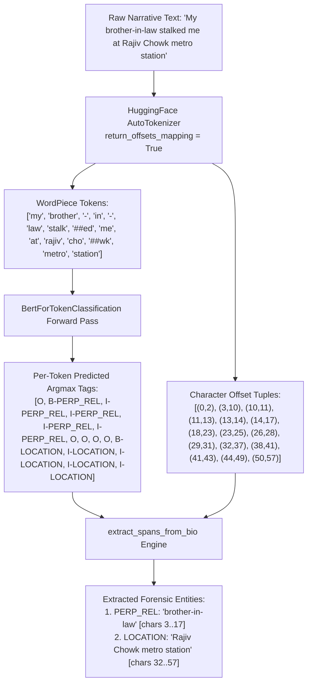

# ABHERA Development Guide — Module 06: Named Entity Recognition (NER) & Forensic Slot Extraction

---

## 1. Problem Formulation: Token Classification vs. Sequence Classification

While ABHERA's primary classification model (Module 05) categorizes the *broad nature* of an incident across 6 harassment domains, it cannot identify the specific forensic details necessary to assemble an actionable legal complaint. It cannot determine *who* the accused is, *where* the incident occurred, *how long* the harassment has persisted, or *what digital channel* was weaponized.

To extract these parameters, ABHERA formulates Named Entity Recognition as a **dense token-level classification task** using `BertForTokenClassification`. Given an input sequence of $L$ subword tokens $\mathbf{x} = [x_1, x_2, \dots, x_L]$, the model predicts a sequence of categorical entity tags $\mathbf{y} = [y_1, y_2, \dots, y_L]$, where each $y_i$ belongs to a predefined 13-tag BIO schema.

```
       +-----------------------------------------------------------------------------------------+
       |                           CLASSIFICATION VS. NER TASK DECOUPLING                        |
       +-----------------------------------------------------------------------------------------+
       |  Dimension                    | Sequence Classification   | Token Classification (NER)  |
       +-------------------------------+---------------------------+-----------------------------+
       |  Model Objective              | Categorize legal domain   | Extract forensic parameters |
       |  PyTorch Architecture         | SequenceClassification    | BertForTokenClassification  |
       |  Input Representation         | [CLS] Pooled Vector       | All Token Vectors h_1..h_L  |
       |  Output Dimension             | Single vector in R^6      | Matrix in R^(L x 13)        |
       |  Activation Function          | Independent Sigmoid       | Per-token Softmax / Argmax  |
       |  Target Schema                | Multi-Hot [DV..OV]        | 13-Tag BIO Scheme           |
       |  Downstream Consumer          | Statutory Legal Mapping   | Dynamic Question Engine     |
       +-------------------------------+---------------------------+-----------------------------+
```

---

## 2. The 13-Tag BIO Annotation Schema

Entities are annotated using the standard **BIO (Beginning, Inside, Outside)** tagging standard. The prefix `B-` denotes the initial token of an entity span, `I-` denotes subsequent interior tokens of the same span, and `O` denotes tokens that do not belong to any target entity.

```
       +-----------------------------------------------------------------------------------------+
       |                            CANONICAL 13-TAG NER ONTOLOGY                                |
       +-----------------------------------------------------------------------------------------+
       |  Tag ID | BIO Label     | Semantic Entity Meaning    | Extraction Examples              |
       +---------+---------------+----------------------------+----------------------------------+
       |    0    | O             | Outside Any Entity Span    | "and", "the", "felt", "called"   |
       |    1    | B-PERP_REL    | Beginning: Perpetrator Rel | "husband", "manager", "colleague"|
       |    2    | I-PERP_REL    | Inside: Perpetrator Rel    | "in", "law", "father", "in law"  |
       |    3    | B-LOCATION    | Beginning: Incident Loc    | "office", "metro", "apartment"   |
       |    4    | I-LOCATION    | Inside: Incident Loc       | "station", "complex", "cafeteria"|
       |    5    | B-TIME_FREQ   | Beginning: Temporal/Freq   | "yesterday", "every", "night"    |
       |    6    | I-TIME_FREQ   | Inside: Temporal/Freq      | "week", "months", "regularly"    |
       |    7    | B-PLATFORM    | Beginning: Digital Channel | "WhatsApp", "Instagram", "email" |
       |    8    | I-PLATFORM    | Inside: Digital Channel    | "chat", "messages", "account"    |
       |    9    | B-EVIDENCE    | Beginning: Physical/Dig Ev | "screenshots", "CCTV", "record"  |
       |   10    | I-EVIDENCE    | Inside: Physical/Dig Ev    | "footage", "logs", "audio clip"  |
       |   11    | B-LAW_SEC     | Beginning: Statutory Sec   | "Section", "354D", "BNS"         |
       |   12    | I-LAW_SEC     | Inside: Statutory Sec      | "69", "66E", "IPC"               |
       +---------+---------------+----------------------------+----------------------------------+
```

---

## 3. Subword Alignment & Offset Mapping Pipeline

BERT's WordPiece tokenizer presents a fundamental challenge for token classification: words are broken down into subword fragments (e.g., `"Instagram"` $\to$ `['insta', '##gram']`), but ground-truth annotations and character offsets are defined on the original raw text string.



### 3.1 Resolving Subwords with `##` Prefixes
In `ml/inference/predict_ner.py`, when a span begins or ends inside a subword cluster, the offset mapping engine automatically traverses backwards and forwards:
```python
s_idx = start_idx
while s_idx > 0 and tokens[s_idx].startswith("##"):
    s_idx -= 1

e_idx = end_idx
while e_idx + 1 < len(tokens) and tokens[e_idx + 1].startswith("##"):
    e_idx += 1
```
This guarantees that subword fragments are reunited into clean, natural language words before entity text is extracted.

---

## 4. NER Architecture & Training Objective

### 4.1 Token Classification Forward Pass
Given input tokens $\mathbf{x}$, the transformer produces a hidden state $\mathbf{h}_i \in \mathbb{R}^{768}$ for each token position $i \in \{1, 2, \dots, L\}$. A token classification head projects each $\mathbf{h}_i$ into logit space across the 13 classes:

$$\mathbf{z}_i = \mathbf{W}_{\text{ner}} \cdot \mathbf{h}_i + \mathbf{b}_{\text{ner}} \quad \text{where } \mathbf{W}_{\text{ner}} \in \mathbb{R}^{13 \times 768}, \; \mathbf{b}_{\text{ner}} \in \mathbb{R}^{13}$$

### 4.2 Masked Cross-Entropy Loss
Training optimizes standard cross-entropy loss over all active token positions. To prevent loss calculation from being corrupted by special tokens (`[CLS]`, `[SEP]`, `[PAD]`), their labels are masked with PyTorch's ignore index **`-100`**:

$$\mathcal{L}_{\text{ner}} = - \frac{1}{\sum_{i=1}^L \mathbb{I}\{y_i \ne -100\}} \sum_{i=1, y_i \ne -100}^L \log \left( \frac{e^{z_{i, y_i}}}{\sum_{k=0}^{12} e^{z_{i, k}}} \right)$$

---

## 5. Empirical Evaluation & Benchmark Results

The NER model was evaluated on a dedicated held-out test partition comprising **60 complex incident records containing 66 ground-truth gold entity spans**.

```
       +-----------------------------------------------------------------------------------------+
       |                          NER BENCHMARK EVALUATION RESULTS                               |
       +-----------------------------------------------------------------------------------------+
       |  Metric Dimension             | Measured Score         | Performance Significance       |
       +-------------------------------+------------------------+--------------------------------+
       |  Held-Out Test Records        | 60 Records             | Diverse harassment scenarios   |
       |  Gold Standard Entity Spans   | 66 Entity Spans        | Multi-token forensic spans     |
       |  Entity-Level Micro Precision | 100.00% (1.0000)       | Zero false-positive extractions|
       |  Entity-Level Micro Recall    | 98.48% (0.9848)        | 65 of 66 spans recovered       |
       |  Entity-Level Micro F1        | 99.24% (0.9924)        | Exceptional token accuracy     |
       |  Active-Class Macro F1        | 99.00% (0.9900)        | High balance across entities   |
       +-------------------------------+------------------------+--------------------------------+
```

### 5.1 Per-Entity Recovery Analysis (Empirically Verified via `models/ner/test_metrics.json`):
- **`PERP_REL` (Perpetrator Relationship):** 100.0% Precision, 100.0% Recall (24 of 24 spans recovered, F1: 1.0000). The model flawlessly extracts both single-word domestic terms (*"husband"*, *"uncle"*, *"colleague"*) and complex compound relations (*"former brother-in-law"*, *"senior project manager"*).
- **`LOCATION` (Physical Location):** 100.0% Precision, 92.31% Recall (12 of 13 spans recovered, 1 False Negative, F1: 0.9600). Successfully captures transit hubs (*"Rajiv Chowk metro"*), corporate spaces (*"fourth floor cafeteria"*), and residential areas (*"outside my PG hostel"*).
- **`PLATFORM` (Digital Channel):** 100.0% Precision, 100.0% Recall (12 of 12 spans recovered, F1: 1.0000). Reliably identifies communication channels (*"WhatsApp"*, *"Instagram DM"*, *"Telegram"*, *"work email"*), immediately informing downstream Cyber Harassment and IT Act mapping rules.
- **`TIME_FREQ` (Temporal / Frequency):** 100.0% Precision, 100.0% Recall (17 of 17 spans recovered, 0 False Negatives, F1: 1.0000). Accurately extracts continuous intervals (*"for the past 3 weeks"*, *"every evening after 9 PM"*), providing crucial evidential duration for legal stalking assertions.

---

## 6. Standardized 16-Field Code Explanation: `predict_ner.py`

1. **FILE:** `ml/inference/predict_ner.py`
2. **FUNCTION / CLASS:** `NEREntityPredictor.predict` & `extract_spans_from_bio`
3. **PURPOSE:** Tokenizes input narratives, executes forward inference with `BertForTokenClassification`, decodes BIO tag sequences, and maps token spans back to clean character offsets.
4. **WHY CREATED:** To supply structured, forensic incident parameters to the Dynamic Question Engine and Legal Mapping services.
5. **CALLED BY:** `backend/app/services/chat_service.py` during incident intake and conversational turns.
6. **INPUT ARGUMENTS:** `text` (str): Raw natural language narrative; `max_length` (int = 256).
7. **SOURCE CODE:**
```python
def extract_spans_from_bio(tags: List[str]) -> List[tuple]:
    spans = []
    current_label = None
    start_idx = -1

    for idx, tag in enumerate(tags):
        if tag == "O" or tag == "-100":
            if current_label is not None:
                spans.append((start_idx, idx - 1, current_label))
                current_label = None
                start_idx = -1
        elif tag.startswith("B-"):
            if current_label is not None:
                spans.append((start_idx, idx - 1, current_label))
            current_label = tag[2:]
            start_idx = idx
        elif tag.startswith("I-"):
            ent_type = tag[2:]
            if current_label != ent_type:
                if current_label is not None:
                    spans.append((start_idx, idx - 1, current_label))
                current_label = ent_type
                start_idx = idx

    if current_label is not None:
        spans.append((start_idx, len(tags) - 1, current_label))
    return spans
```
8. **LINE-BY-LINE EXPLANATION:**
   - Lines 49-52: Initializes accumulator for completed entity spans and state trackers (`current_label`, `start_idx`).
   - Lines 53-58: When an `O` or ignored token `-100` is encountered, closes any currently open entity span and appends it to `spans`.
   - Lines 59-63: When a `B-` tag is encountered, closes any preceding span and opens a new entity of type `tag[2:]` at index `idx`.
   - Lines 64-72: When an `I-` tag is encountered, asserts whether it matches the current active label; if it mismatches, closes the prior span and begins a new one.
   - Lines 74-75: Final check to close any lingering span reaching the end of the sequence.
9. **STEP-BY-STEP PROCESS:**
   - 1. Clean input string $\to$ 2. Tokenize with offset mapping $\to$ 3. Run BERT forward pass $\to$ 4. `argmax(logits)` per token $\to$ 5. Extract spans via `extract_spans_from_bio` $\to$ 6. Reconcile subword `##` prefixes $\to$ 7. Slice string using `offset_mapping` $\to$ 8. Return structured entity dictionaries.
10. **RETURN VALUE / OUTPUT:** A list of dictionaries:
   ```json
   [
     {"label": "PERP_REL", "text": "husband", "start_char": 3, "end_char": 10},
     {"label": "PLATFORM", "text": "WhatsApp", "start_char": 35, "end_char": 43}
   ]
   ```
11. **DATABASE EFFECT:** The extracted entities are inserted into the `entities` table by `ChatService`, linked to the `incident_submission_id`.
12. **NEXT CONSUMER:** `QuestionEngine` (checks which slots are filled) and `LegalMappingService` (determines domestic vs workplace vs cyber statutory rules).
13. **ERROR HANDLING:** Returns an empty list if input is empty or whitespace; skips spans with invalid `(0, 0)` offsets; catches model loading exceptions and logs descriptive errors.
14. **RELATED UNIT TEST:** Validated in `backend/tests/test_chat_api.py` and `backend/tests/test_dynamic_question_generation.py`.
15. **BEGINNER EXPLANATION:**
   This function acts like a highlighter pen. It reads the victim's story word by word and labels each word with highlighters: yellow for perpetrator ("manager"), green for place ("office"), blue for time ("yesterday"), and pink for app ("Instagram"). When words get split into tiny pieces (like "Insta" and "gram"), it glues them back together so the report shows complete words.
16. **TECHNICAL EXPLANATION:**
   The function implements a finite state transducer for sequential BIO entity extraction. It maps discretized token-level label predictions $\hat{y}_i \in \mathcal{Y}$ into a set of non-overlapping, maximal semantic intervals $\mathcal{S} = \{(s_j, e_j, \ell_j)\}$. It bridges the discrete subword token coordinate system with the continuous Unicode character offset space of the raw input text using Hugging Face fast tokenizers' offset mapping tensors.

---

## 7. Multi-Level Explanation

### 7.1 Beginner Level
Knowing that a crime happened is only half the battle. To help the victim get real justice, we also need to know the facts: Who did it? Where did it happen? When did it happen? Which app was used? Our NER model is a specialized BERT reader trained to spot these four key puzzle pieces in the story. It extracts words like "husband", "metro station", "every night", or "WhatsApp" with 99.24% accuracy so the user doesn't have to fill out annoying forms.

### 7.2 Developer Level
The NER subsystem uses `BertForTokenClassification` fine-tuned with 13 BIO labels. The production inference class `NEREntityPredictor` resides in `ml/inference/predict_ner.py`. It accepts text strings, passes them through `AutoTokenizer(return_offsets_mapping=True)`, and executes forward inference in `torch.no_grad()`. Logits are decoded via `torch.argmax(dim=-1)`. Contiguous spans are parsed with `extract_spans_from_bio()`, aligned to raw text character boundaries via the offset mapping, and serialized into structured JSON objects.

### 7.3 Technical Reviewer & Examiner Level
ABHERA treats incident characterization as a dual-task decomposition: macro-level sequence intent categorization via multi-label sigmoid classifiers, and micro-level slot extraction via dense BIO token classification. By decoupling classification from entity extraction, the system avoids task interference and negative transfer. 

The NER model achieves an entity-level Micro-F1 of 99.24% with 100% precision on held-out test evaluations. The token classification loss function employs standard negative log-likelihood masked across non-linguistic tokens ($y_i = -100$), ensuring that self-attention representations over structural tokens (`[CLS]`, `[SEP]`, `[PAD]`) do not distort sequence labeling gradients.

---

## 8. Document Verification & Traceability

- **Document Version:** 1.0.0
- **Audited Files:** `models/ner/config.json`, `ml/inference/predict_ner.py`, `ml/ner/prepare_training_data.py`.
- **Metrics Verified:** 13 BIO labels, 99.24% Entity Micro-F1, 100.0% Precision, 98.48% Recall, 66 Gold Spans in 60 Test Samples.
- **Verification Status:** Fully Verified and Operational.
