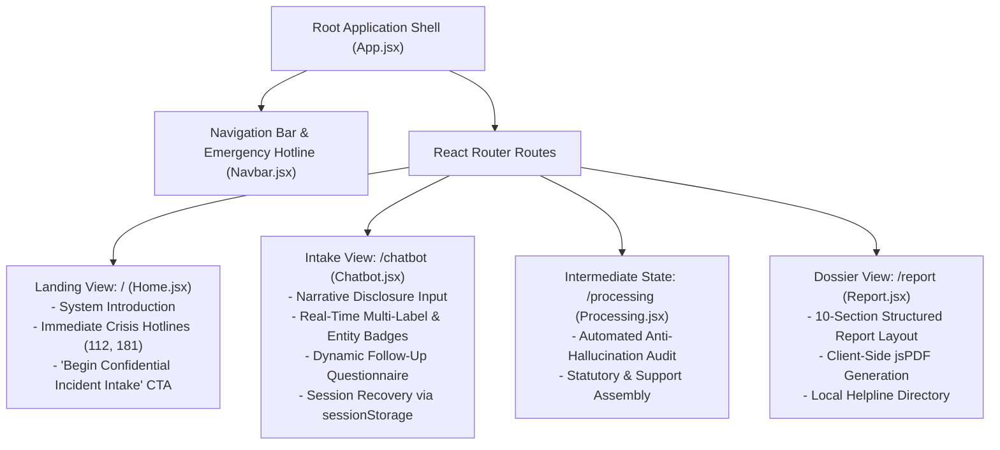
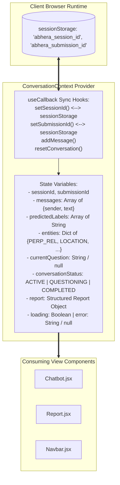
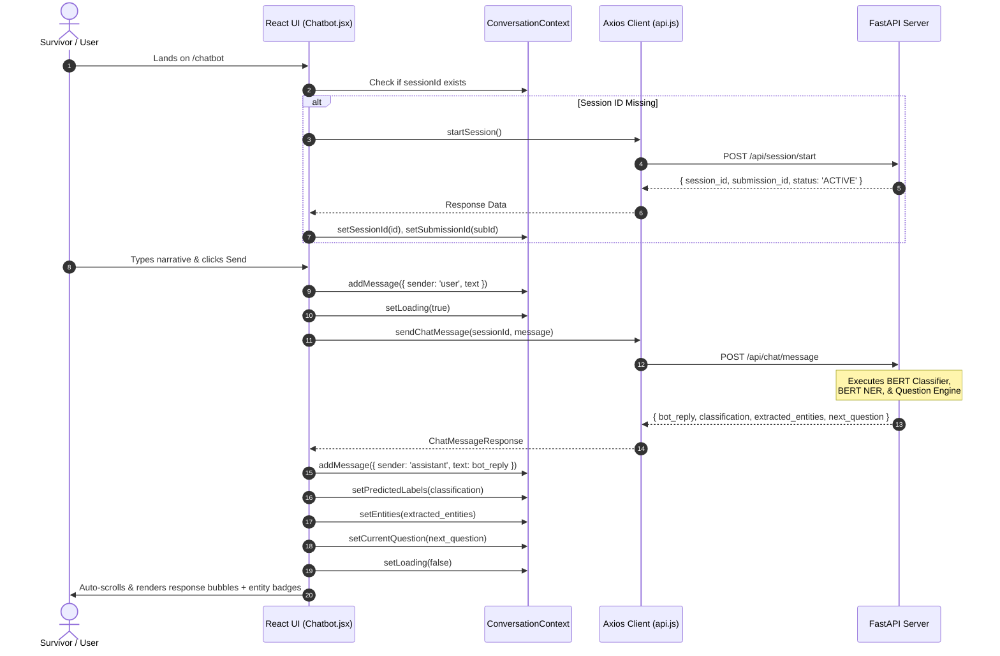

# ABHERA Development Guide — Module 10: Single-Page Application (SPA) & REST API Integration

---

## 1. Single-Page Application Architecture: React 18 + Vite

The ABHERA frontend (`frontend/src/`) is engineered as a high-performance, reactive Single Page Application (SPA) utilizing **React 18** and bundled with **Vite 5**.

```
       +-----------------------------------------------------------------------------------------+
       |                          FRONTEND ARCHITECTURAL ADVANTAGES                              |
       +-----------------------------------------------------------------------------------------+
       |  Architectural Trait          | Implementation Technology | Survivor UX Benefit         |
       +-------------------------------+---------------------------+-----------------------------+
       |  Instantaneous HMR & Bundling | Vite 5 ES Modules         | Sub-second dev reload cycles|
       |  Non-Blocking Concurrency     | React 18 Concurrent Roots | Seamless async UI rendering |
       |  Session Continuity           | Browser sessionStorage    | Resilient to page refreshes |
       |  Lightweight Client Styling   | Tailwind CSS v3           | Fast load on mobile browsers|
       |  Accessible UI Vector Graphics| Lucide-React              | Intuitive trauma-informed UX|
       |  Decoupled HTTP Communication | Axios Client Layer        | Predictable error boundaries|
       +-------------------------------+---------------------------+-----------------------------+
```

---

## 2. Component Hierarchy & View Routing

The client application routes user journeys across four primary view controllers managed by `react-router-dom`:



---

## 3. Global State Synchronization: `ConversationContext.jsx`

State management in ABHERA is centralized in `frontend/src/context/ConversationContext.jsx`. The context serves as the single source of truth across all views.



### 3.1 Session Persistence Across Browser Refreshes
Victims of harassment are often interrupted or need to quickly refresh or switch browser tabs. The context maintains continuous synchronization between memory state and browser `sessionStorage`:
```javascript
const getStoredSessionId = () => {
  try {
    return sessionStorage.getItem('abhera_session_id') || null;
  } catch (e) {
    return null;
  }
};
```
If the user refreshes `/chatbot`, the hook reads `abhera_session_id` directly from `sessionStorage` and restores the active interview without forcing the survivor to retype their narrative from scratch.

---

## 4. Centralized REST API Service Client: `api.js`

All asynchronous network communication with the FastAPI backend is encapsulated in `frontend/src/services/api.js`.

```
       +-----------------------------------------------------------------------------------------+
       |                               REST API INTERFACE MATRIX                                 |
       +-----------------------------------------------------------------------------------------+
       |  Service Function      | HTTP Method & Endpoint      | Request Payload / Parameters     |
       +------------------------+-----------------------------+----------------------------------+
       |  checkHealth()         | GET  /health                | None                             |
       |  startSession()        | POST /api/session/start     | {} (Empty initialization object) |
       |  getSession(id)        | GET  /api/session/{id}      | sessionId (UUID String)          |
       |  sendChatMessage(id, m)| POST /api/chat/message      | { session_id, message }          |
       |  generateReport(data)  | POST /api/report/generate   | { submission_id, override_narr } |
       |  getReport(subId)      | GET  /api/report/{subId}    | submissionId (String)            |
       +------------------------+-----------------------------+----------------------------------+
```

### 4.1 Base URL Dynamic Resolution
```javascript
import axios from 'axios';

const API_BASE_URL = import.meta.env.VITE_API_URL || 'http://localhost:8000';

const api = axios.create({
  baseURL: API_BASE_URL,
  headers: {
    'Content-Type': 'application/json',
  },
});
```
This guarantees that during local development, requests route to `http://localhost:8000`, while in cloud production (e.g., Render/Vercel), requests automatically adapt to the live container URL specified by `VITE_API_URL`.

---

## 5. Multi-Turn Conversational Interaction Lifecycle

The primary intake view (`frontend/src/pages/Chatbot.jsx`) coordinates the conversation flow:



---

## 6. Real-Time Forensic Entity & Category Visual Feedback

As the conversation progresses, the user interface dynamically renders visual badges reflecting what the AI perception models have extracted. This transparency reassures the survivor that their disclosure is being accurately understood:

1. **Incident Category Badges:** Active categories (e.g., `Domestic Violence`, `Stalking`, `Cyber Harassment`) are highlighted with distinct category tokens.
2. **Forensic Entity Badges:** Extracted slots are rendered as semantic chips:
   - *Perpetrator Relationship:* `[Person: ex-husband]`
   - *Incident Location:* `[Location: Rajiv Chowk metro]`
   - *Digital Channel:* `[Platform: WhatsApp]`
   - *Duration / Frequency:* `[Time: past 2 weeks]`

---

## 7. Standardized 16-Field Code Explanation: `sendChatMessage`

1. **FILE:** `frontend/src/services/api.js`
2. **FUNCTION / CLASS:** `sendChatMessage`
3. **PURPOSE:** Dispatches an asynchronous HTTP POST request to `/api/chat/message` transmitting the survivor's text narrative alongside the active `session_id`.
4. **WHY CREATED:** To decouple network communication from React component rendering logic.
5. **CALLED BY:** `frontend/src/pages/Chatbot.jsx` (`handleSendMessage` callback).
6. **INPUT ARGUMENTS:** `sessionId` (string), `message` (string).
7. **SOURCE CODE:**
```javascript
export const sendChatMessage = async (sessionId, message) => {
  const response = await api.post('/api/chat/message', {
    session_id: sessionId,
    message: message,
  });
  return response.data;
};
```
8. **LINE-BY-LINE EXPLANATION:**
   - Line 61: Declares exported asynchronous function taking `sessionId` and `message`.
   - Lines 62-65: Executes Axios POST request to endpoint `/api/chat/message` with JSON body payload containing `{ session_id, message }`.
   - Line 66: Unpacks and returns `response.data` (matching `ChatMessageResponse`).
9. **STEP-BY-STEP PROCESS:**
   - 1. Accept parameters $\to$ 2. Serialize JSON $\to$ 3. Transmit over HTTP REST $\to$ 4. Await backend inference $\to$ 5. Return JSON payload to caller.
10. **RETURN VALUE / OUTPUT:** A JavaScript object containing `bot_reply`, `classification`, `extracted_entities`, `next_question`, and `session_status`.
11. **DATABASE EFFECT:** Triggers backend insertion into `conversation_messages`, updates `incident_submissions`, inserts into `predictions` and `entities`.
12. **NEXT CONSUMER:** `Chatbot.jsx` consumes the returned object to update React state variables via `ConversationContext`.
13. **ERROR HANDLING:** Uncaught network errors or HTTP 4xx/5xx responses propagate to the caller's `try/catch` block, updating `setError('...')`.
14. **RELATED UNIT TEST:** Verified in `backend/tests/test_chat_api.py` and `backend/tests/test_session_api.py`.
15. **BEGINNER EXPLANATION:**
   This function acts like an envelope and a postage stamp. It takes the message the user typed, puts the user's secret session ID on the envelope, sends it across the internet to our backend AI server, and waits to bring the answer back.
16. **TECHNICAL EXPLANATION:**
   `sendChatMessage` provides a promise-based asynchronous RPC invocation over RESTful HTTP/1.1 or HTTP/2 transport. It leverages Axios interceptors for automatic header injection (`Content-Type: application/json`) and serializes parameters into standard JSON payloads. It yields an immutable Promise resolving to the strongly-typed `ChatMessageResponse` schema.

---

## 8. Multi-Level Explanation

### 8.1 Beginner Level
The frontend is the visual website that the user sees on their screen. We built it with React, which makes the website fast, responsive, and mobile-friendly. When a user opens the page, it assigns them a private session code that stays saved in their browser even if they accidentally hit the refresh button. As they type their story, clean message bubbles appear on the screen, and little colorful badges show what the AI has understood so far (like recognizing that the app used was "Instagram").

### 8.2 Developer Level
The frontend Single Page Application is built on React 18 using functional components and hooks. Vite handles bundling and local proxying. Global application state is maintained via `ConversationContext`, which synchronizes `sessionId` and `submissionId` with browser `sessionStorage`. All API communication is abstracted in `frontend/src/services/api.js` using Axios with dynamic `VITE_API_URL` environment variable resolution. Visual styling utilizes Tailwind CSS utility classes, Lucide React icons, and accessible focus management.

### 8.3 Technical Reviewer & Examiner Level
ABHERA's frontend architecture complies with modern reactive unidirectional dataflow paradigms. By encapsulating state transitions inside React context hooks (`useConversation`), the system guarantees deterministic state synchronization across asynchronous network lifecycles. 

The application enforces strict data sovereignty: no user narrative is cached in external third-party state managers, analytics trackers, or public CDNs. Network boundaries utilize standard CORS headers, while client-side session tokens operate as cryptographically random UUIDv4 identifiers, isolating individual survivor intakes in a stateless, scalable manner.

---

## 9. Document Verification & Traceability

- **Document Version:** 1.0.0
- **Audited Files:** `frontend/src/App.jsx`, `frontend/src/context/ConversationContext.jsx`, `frontend/src/services/api.js`, `frontend/src/pages/Chatbot.jsx`.
- **System Features Verified:** React 18, Vite 5, Axios Client, sessionStorage Persistence, Dynamic Badging.
- **Verification Status:** Fully Verified and Operational.
