# ABHERA Development Guide — Module 15: Chronological Development History, 16-Phase Developer Reconstruction Guide, Demonstration Script & Comprehensive 150+ Viva Defense Guide

---

## 1. Reconstructed Chronological Development History

The development of ABHERA spanned 16 distinct engineering phases, evolving from sociological problem formulation to a fully audited, production-grade neuro-symbolic platform.

```mermaid
flowchart TD
    P1["Phase 1: Problem Definition & Legal Grounding"] --> P2["Phase 2: Corpus Curation & 70/15/15 Data Partitioning"]
    P2 --> P3["Phase 3: TF-IDF & Classical ML Benchmarks (LogReg, SVM)"]
    P3 --> P4["Phase 4: Pilot BERT v1 Fine-Tuning & Diagnostic Error Audit"]
    P4 --> P5["Phase 5: Production BERT v2 (BCE pos_weight + Threshold Tuning)"]
    P5 --> P6["Phase 6: 13-Tag BIO Token Classification (NER) Development"]
    P6 --> P7["Phase 7: Symbolic Dynamic Question Engine & Priority Queue"]
    P7 --> P8["Phase 8: Statutory Legal Mapping (BNS, IT, POSH, DV Acts)"]
    P8 --> P9["Phase 9: 3-Tier Geospatial Support Service Matcher (300/200/100)"]
    P9 --> P10["Phase 10: Anti-Hallucination Gating & Provenance Firewall"]
    P10 --> P11["Phase 11: PostgreSQL Relational Database (11 Tables Schema)"]
    P11 --> P12["Phase 12: FastAPI Asynchronous Backend & Service Orchestration"]
    P12 --> P13["Phase 13: React 18 + Vite Single Page Application & Context Sync"]
    P13 --> P14["Phase 14: Client-Side jsPDF Vector Compiler & 10-Section Schema"]
    P14 --> P15["Phase 15: 154 Backend Automated Unit Tests Suite"]
    P15 --> P16["Phase 16: 11-Subsystem End-to-End Validation & Cloud Blueprint"]
```



---

## 2. The 16-Phase Developer Reconstruction Guide

If an engineer needs to reproduce the entire ABHERA platform from scratch starting from an empty directory, they must follow this exact sequential procedure:

### Phase 1: Environment & Repository Skeleton
1. Initialize Git repository: `git init`.
2. Establish directory structure:
   - `data/`, `models/`, `ml/preprocessing/`, `ml/training/`, `ml/ner/`, `ml/inference/`, `ml/evaluation/`, `backend/app/`, `backend/tests/`, `frontend/src/`.
3. Create Python virtual environment (`python -m venv venv`) and install core dependencies: PyTorch, Transformers, Scikit-Learn, FastAPI, Uvicorn, SQLAlchemy, Psycopg2-binary, Pydantic.

### Phase 2: Corpus Ingestion & Data Preparation
1. Place the 1,086-sample raw incident dataset in `data/womens_safety_dataset.csv`.
2. Author `ml/preprocessing/prepare_classification.py`.
3. Execute data preparation with fixed random seed `42`:
   ```powershell
   python ml/preprocessing/prepare_classification.py
   ```
4. Verify generation of `train_data.csv` (760 rows), `val_data.csv` (162 rows), `test_data.csv` (164 rows), and `label_mapping.json`.

### Phase 3: Classical ML Baselines Benchmark
1. Author `ml/evaluation/run_baseline_comparison.py`.
2. Configure `TfidfVectorizer(ngram_range=(1,2), sublinear_tf=True, min_df=2, max_features=5000)`.
3. Wrap `LogisticRegression` and `LinearSVC` in `OneVsRestClassifier`.
4. Fit exclusively on Train; tune thresholds $\tau_k \in [0.05, 0.95]$ on Validation; benchmark on held-out Test.
5. Record baseline scores: Logistic Regression Micro-F1 = 97.79%, Linear SVM Micro-F1 = 97.27%.

### Phase 4: Pilot Deep Learning Experiment (BERT v1)
1. Fine-tune `bert-base-uncased` for 2 epochs with sequence length 64 using unweighted `BCEWithLogitsLoss`.
2. Evaluate on test partition: discover Micro-F1 = 91.33%, Exact Match = 83.54%, and **23 False Negatives**.
3. Document root causes: sequence truncation at 64 tokens, underfitting at 2 epochs, and unweighted penalty on minority classes (`OV`, `WH`).

### Phase 5: Promoted Deep Learning Pipeline (BERT v2)
1. Author `ml/training/train_bert_experiment_v2.py`.
2. Increase sequence length to 128 tokens; extend training to 6 epochs.
3. Compute analytical positive class weights $\text{pos\_weight}_c = \frac{N - N_c}{N_c}$ and inject into `torch.nn.BCEWithLogitsLoss`.
4. Optimize using `AdamW(lr=3e-5, weight_decay=0.01)` with 10% linear warmup.
5. Checkpoint the best epoch on validation micro-F1 (Epoch 6).
6. Run validation-only grid search to compute `optimal_thresholds.json` (`DV: 0.73`, `SH: 0.50`, `ST: 0.79`, `CA: 0.45`, `WH: 0.29`, `OV: 0.63`).
7. Evaluate on held-out test data: achieve Micro-F1 = 98.09%, Exact Match = 95.73%, Micro-Recall = 99.45%, False Negatives = 1.
8. Save artifacts to `models/bert_multilabel_experiment_v2/`.

### Phase 6: Named Entity Recognition (NER) Development
1. Author `ml/ner/prepare_training_data.py` establishing 13-tag BIO schema (`O`, `B/I-PERP_REL`, `B/I-LOCATION`, `B/I-TIME_FREQ`, `B/I-PLATFORM`, `B/I-EVIDENCE`, `B/I-LAW_SEC`).
2. Fine-tune `BertForTokenClassification` on annotated harassment sequences with offset mapping alignment.
3. Evaluate on 60 test records (66 gold spans): achieve Entity Micro-F1 = 99.24%, Precision = 100%, Recall = 98.48%.
4. Save model to `models/ner/` and author production inference wrapper `ml/inference/predict_ner.py`.

### Phase 7: Symbolic Dynamic Question Engine
1. Author `backend/app/question_engine/rules.py` mapping categories to required forensic slots.
2. Establish canonical priority order: `SAFETY_STATUS` $\succ$ `PERP_REL` $\succ$ `LOCATION` $\succ$ `TIME_FREQ` $\succ$ `PLATFORM` $\succ$ `INCIDENT_DETAILS`.
3. Author `question_selector.py` to extract known slots from NER entities, previous answers, and regex heuristics.
4. Author `dynamic_generator.py` for contextual phrasing and `engine.py` as the main orchestrator with anti-looping duplicate checks.

### Phase 8: Statutory Legal Mapping Engine
1. Curate `data/laws.csv` with 32 audited Indian statutes across BNS 2023, IT Act 2000, POSH Act 2013, and PWDVA 2005.
2. Author `backend/app/services/legal_mapping.py` with `normalize_to_applicable_label()` and parameterized SQL lookups.

### Phase 9: Hyperlocal Support Service Matcher
1. Curate `data/support_services.csv` with 12 verified crisis centers, One Stop Centres (Sakhi), and national hotlines.
2. Author `backend/app/services/support_mapping.py` implementing the 3-tier scoring algorithm: District (+300), State (+200), National (+100).

### Phase 10: Anti-Hallucination Gating Layer
1. Author `backend/app/services/anti_hallucination.py`.
2. Implement `validate_legal_record()` and `validate_support_record()` enforcing verbatim string matching and primary-key existence against PostgreSQL tables.

### Phase 11: Relational Database Schema & Seeding
1. Install PostgreSQL 15/16 and create database `abhera_db`.
2. Author the 11 SQLAlchemy models in `backend/app/models/`: `User`, `Session`, `IncidentSubmission`, `ConversationMessage`, `Prediction`, `Entity`, `Question`, `SubmissionQuestionAnswer`, `Law`, `SupportService`, `Report`.
3. Author database bootstrap scripts: `init_db.py`, `seed_questions.py`, `import_laws.py`, `import_support_services.py`.
4. Run migrations to initialize and populate all 11 tables.

### Phase 12: FastAPI Backend Application
1. Author `backend/app/config.py` using Pydantic `BaseSettings`.
2. Author REST API routers: `backend/app/routes/health.py`, `backend/app/routes/session.py`, `backend/app/routes/chat.py`, `backend/app/routes/report.py`.
3. Author `backend/app/services/chat_service.py` coordinating intake, predictions, questions, and responses.
4. Mount routers, CORS middleware, and error handlers in `backend/app/main.py`.

### Phase 13: React 18 + Vite Frontend Application
1. Scaffold frontend in `frontend/` using Vite React template: `npm create vite@latest frontend -- --template react`.
2. Install dependencies: `tailwindcss`, `lucide-react`, `axios`, `jspdf`, `react-router-dom`.
3. Configure `tailwind.config.js` and `vite.config.js` with proxy rules for `/api`.
4. Author global state manager `ConversationContext.jsx` with `sessionStorage` synchronization.
5. Author Axios API client `frontend/src/services/api.js` and views: `Home.jsx`, `Chatbot.jsx`, `Processing.jsx`, `Report.jsx`.

### Phase 14: Structured Report & Client-Side PDF Generation
1. Author `backend/app/services/report_generator.py` assembling the 10-section JSON report schema.
2. Author client-side PDF compiler in `frontend/src/pages/Report.jsx` using `jsPDF`.
3. Implement `ABHERA_COLORS` design tokens, vector checkmark rendering (`targetDoc.line`), and dynamic A4 pagination coordinate geometry.

### Phase 15: Automated Backend Regression Suite
1. Author unit tests across 7 test suites in `backend/tests/`.
2. Run test discovery:
   ```powershell
   cd backend
   python -m unittest discover tests
   ```
3. Assert that all 154 unit tests pass with zero failures.

### Phase 16: End-to-End Validation & Cloud Deployment Blueprint
1. Execute `ml/evaluation/abhera_end_to_end_validation.json` auditing all 11 subsystems.
2. Configure Render Web Service (`backend/`), Render PostgreSQL 16 (`abhera_db`), and Vercel (`frontend/`).
3. Set environment variables, execute remote seed scripts, and verify live URL.

---

## 3. 10–15 Minute Project Demonstration & Viva Presentation Script

```
========================================================================================
ABHERA PROJECT DEMONSTRATION & VIVA SCRIPT (TOTAL TIME: 12-14 MINUTES)
========================================================================================

[00:00 - 02:00] INTRODUCING THE PROBLEM & ABHERA'S PHILOSOPHY
Speaker:
"Respected examiners and committee members, good morning. Today I am presenting ABHERA: 
Adaptive BERT-based Harassment Entity Recognition & Assistance.

In India, over 400,000 crimes against women are reported annually, but criminological 
audits indicate that up to 90% of actual incidents go unreported due to trauma, fear of 
retaliation, and severe legal illiteracy—especially following the recent transition from 
the IPC to the Bharatiya Nyaya Sanhita (BNS) 2023.

Existing technological interventions suffer from two extremes: rigid 30-field government 
webforms that intimidate victims, or commercial generative LLMs like GPT-4 that suffer 
from hallucinations—fabricating fake penal code sections and disconnected helpline numbers.

ABHERA solves this through a Neuro-Symbolic Hybrid Architecture: deep neural models 
(BERT) are used strictly for language perception (multi-label classification and entity 
extraction), while all statutory citations, legal rights, and crisis helplines are 
derived deterministically from an audited relational PostgreSQL database with a mathematical 
guarantee of zero hallucination."

----------------------------------------------------------------------------------------
[02:00 - 04:00] ARCHITECTURAL WALKTHROUGH & DESIGN
[Action: Show System Topology Mermaid Diagram / Slide]
Speaker:
"The platform is completely decoupled:
1. Frontend: A reactive React 18 Single Page Application styled with Tailwind CSS.
2. Backend: An asynchronous FastAPI ASGI service running on Python 3.10.
3. Database: PostgreSQL 16 managing 11 relational tables in Third Normal Form.
4. Perception Tier: Two fine-tuned BERT transformer models:
   - BERT v2 Multi-Label Classifier achieving 98.09% Micro-F1 and 99.45% Recall on test data.
   - BERT NER Token Classifier using a 13-tag BIO schema achieving 99.24% Entity Micro-F1.
5. Symbolic Tier: A priority-queued Dynamic Question Engine, a 3-tier geospatial support 
   matcher (300/200/100 points), and an Anti-Hallucination verification gatekeeper."

----------------------------------------------------------------------------------------
[04:00 - 08:30] LIVE APPLICATION WALKTHROUGH: THE INTAKE JOURNEY
[Action: Switch browser to http://localhost:5173/]
Speaker:
"Let us demonstrate a live, end-to-end incident intake. We land on the home page. Notice the 
prominent emergency red banner offering immediate one-click redirection to national 
dispatch helplines 112 and 181.

I click 'Begin Confidential Incident Intake'. The URL routes to /chatbot. Notice in the 
browser's Developer Tools under Application -> sessionStorage that a unique, anonymous 
UUID session token (SESS_...) has already been created. If I accidentally refresh the 
page right now, the intake is preserved.

Now, let us input a realistic, complex, compound distress narrative:
'My ex-husband has been stalking me and sending threatening messages on WhatsApp, and 
yesterday he posted my morphed private photos on Instagram and threatened to leak my home 
address in Mumbai.'

I click 'Send'. In under 400 milliseconds, the backend executes dual BERT inference:
1. Multi-Label Classification: Identifies both 'Domestic Violence' (p=0.88 >= 0.73) and 
   'Cyber Harassment' (p=0.95 >= 0.45). Notice the visual category badges that appear 
   above the chat interface.
2. NER Extraction: Pulls out 'ex-husband' as PERP_REL, 'WhatsApp' and 'Instagram' as 
   PLATFORM, and 'Mumbai' as LOCATION. Notice the entity chips displayed to the survivor.
3. The Dynamic Question Engine: Evaluates required slots. For DV + Cyber Harassment, 
   required slots are Safety, Perpetrator, Location, Time, and Platform. The engine detects 
   that SAFETY_STATUS and TIME_FREQ are missing.
   Following our canonical priority queue, Safety Status is Rank 1. The assistant replies:
   'Your safety is our top priority. Given that your ex-husband is threatening you, are you 
   currently in a safe place, or are you in immediate physical danger?'

The survivor replies:
'I am currently safe at my parents' house, but he keeps calling every few hours.'

The engine registers SAFETY_STATUS = 'safe' and TIME_FREQ = 'every few hours'. All 
forensic slots are now satisfied. The engine halts questioning gracefully and invites the 
survivor to generate their report."

----------------------------------------------------------------------------------------
[08:30 - 11:00] REPORT GENERATION, ANTI-HALLUCINATION & CLIENT-SIDE PDF
[Action: Click 'Generate Incident Report' button]
Speaker:
"I click 'Generate Incident Report'. The screen routes to /report. 
The backend ReportGeneratorService assembles our 10-section JSON dossier. Notice:
1. Section 1 & 2: Complete verbatim narrative disclosure and identified incident categories.
2. Section 3 & 4: Structured forensic entities and the full Q&A audit trail.
3. Section 5 — Statutory Legal Information: The engine cites Section 85 & 86 of the 
   Bharatiya Nyaya Sanhita 2023 (formerly 498A IPC for marital cruelty), civil protection 
   orders under the Domestic Violence Act 2005, and Section 66E and 67 of the Information 
   Technology Act 2000 for publishing private images.
   Crucially, every single section was verified verbatim against PostgreSQL by the 
   AntiHallucinationService before serialization.
4. Section 7 — Hyperlocal Support Services: Because the incident occurred in Mumbai, our 
   3-tier geospatial scoring awarded 300 points to the local Sakhi One Stop Centre in Mumbai, 
   200 points to the Maharashtra State Commission for Women, and 100 points to the 
   National Cyber Crime Helpline (1930).

Now watch what happens when I click 'Download Official Incident Report PDF'.
The document is compiled client-side in the browser using jsPDF in 250 milliseconds. 
Notice the Navy Black header banner, the gold accent line, and the crimson 'Confidential 
Assistance Document' badge. Notice that checkmarks are rendered as vector line primitives, 
preventing font corruption. Most importantly, the PDF was compiled entirely in local browser 
memory canvas—no sensitive victim document was ever stored on an external server."

----------------------------------------------------------------------------------------
[11:00 - 13:30] MODEL BENCHMARKING & EMPIRICAL SCIENTIFIC RIGOR
[Action: Show Baseline Comparison & Model Progression Charts]
Speaker:
"Finally, let us review our scientific evaluation. We evaluated our model against classical 
baselines: TF-IDF with Logistic Regression achieved 97.79% Micro-F1 due to high keyword 
distinctiveness, but fails on syntactic negation and cannot perform token-level NER.

In deep learning development, our pilot BERT v1 model achieved 91.33% F1 but suffered from 
23 false negatives due to sequence truncation (64 tokens) and unweighted loss.
Our promoted BERT v2 model solved this through 128-token sequences, 6 epochs, positive 
class weighting in BCEWithLogitsLoss, and validation-only threshold tuning.
On our held-out 164-sample test set, BERT v2 achieved:
- Micro-F1: 98.09% (+6.76 percentage points)
- Exact Match Accuracy: 95.73% (+12.19 percentage points)
- Micro-Recall: 99.45% (180 true positives out of 181 actual occurrences)
- Multi-Label Exact Match: 94.12%
- Total False Negatives: Reduced by 95.65% down to a single marginal case.

Our backend is protected by 154 automated unit tests running with a 100% pass rate in 4.8 
seconds, and the entire system has passed an 11-subsystem end-to-end audit."

----------------------------------------------------------------------------------------
[13:30 - 14:00] CONCLUSION & VIVA DEFENSE TRANSITION
Speaker:
"In conclusion, ABHERA demonstrates that AI for sensitive social justice domains does not 
require ungrounded, hallucinating generative chatbots. By coupling transformer perception 
with deterministic relational grounding, ABHERA delivers safe, trauma-informed, privacy-
preserving legal literacy and support referral. Thank you, and I am now ready for your 
questions."
========================================================================================
```

---

## 4. Comprehensive 150+ Viva Defense & Technical Interview Question Bank

### Category 1: Project Foundations & Problem Formulation (Q1 – Q15)

1. **What does the acronym ABHERA stand for?**  
   *Answer:* Adaptive BERT-based Harassment Entity Recognition & Assistance.
2. **What real-world problem does ABHERA address?**  
   *Answer:* The massive underreporting of gender-based violence, sexual harassment, stalking, and cyber abuse caused by trauma, fear of retaliation, and acute legal illiteracy.
3. **Why did you develop ABHERA instead of using an existing system?**  
   *Answer:* Existing systems are either rigid 30-field tabular webforms that intimidate traumatized victims, or unconstrained LLMs that hallucinate fake penal codes and false helplines.
4. **What is a Neuro-Symbolic AI architecture, and how does ABHERA implement it?**  
   *Answer:* A hybrid architecture combining neural networks (deep learning) for perception with symbolic rules (logic and databases) for reasoning. ABHERA uses BERT for text classification and NER, but uses deterministic database queries for statutory citations and helpline routing.
5. **Why can't commercial LLMs like GPT-4 be trusted for legal crisis triage?**  
   *Answer:* LLMs are autoregressive probability models prone to hallucination—they invent non-existent penal sections, cite superseded legislation, fabricate helpline numbers, and expose private victim statements to cloud training pipelines.
6. **What is the difference between a First Information Report (FIR) and an ABHERA Incident Dossier?**  
   *Answer:* An FIR is an official criminal complaint registered by a police officer under Section 154 CrPC / 173 BNSS. An ABHERA Dossier is an informational, structured incident preparation document that the survivor owns and can present to counsel or authorities.
7. **Does ABHERA provide formal legal advice?**  
   *Answer:* No. ABHERA is an informational legal literacy and support referral assistant. It explicitly includes legal disclaimers that it does not create an attorney-client relationship.
8. **What recent Indian legislative change made ABHERA's database engineering critical?**  
   *Answer:* The replacement of the Indian Penal Code (IPC 1860) with the Bharatiya Nyaya Sanhita (BNS 2023) on July 1, 2024. ABHERA's database provides verified BNS sections.
9. **How does ABHERA protect user privacy?**  
   *Answer:* By eliminating third-party cloud LLM APIs, supporting anonymous session tokens, stripping PII from container logs, and compiling PDF dossiers entirely client-side.
10. **What are the 6 core harassment categories detected by ABHERA?**  
    *Answer:* Domestic Violence (`DV`), Sexual Harassment (`SH`), Stalking (`ST`), Cyber Harassment (`CA`), Workplace Harassment (`WH`), and Other Violence (`OV`).
11. **How does ABHERA handle Dowry Harassment?**  
    *Answer:* Dowry narratives are classified under `DV`, and the legal mapping engine expands the citation to Section 85/86 BNS and the Dowry Prohibition Act 1961.
12. **How does ABHERA handle False Promise of Marriage (FPM)?**  
    *Answer:* FPM narratives are classified under `OV` (frequently co-occurring with `SH`) and trigger Section 69 of the Bharatiya Nyaya Sanhita (BNS) 2023.
13. **What is trauma-informed design in software engineering?**  
    *Answer:* UX and conversational design that prioritizes psychological safety, eliminates high cognitive burdens, avoids victim-blaming language, and allows free-text narrative input.
14. **What are the primary functional requirements of ABHERA?**  
    *Answer:* Free-text narrative intake, multi-label classification, 13-tag NER extraction, dynamic adaptive questioning, deterministic legal mapping, 3-tier support matching, and client-side PDF export.
15. **What are the primary non-functional requirements?**  
    *Answer:* Classification Micro-F1 $\ge 95\%$, NER Micro-F1 $\ge 98\%$, inference latency $< 1.5\text{s}$ on CPU, 100% verified legal provenance, and $\ge 150$ passing unit tests.

---

### Category 2: Dataset, Preprocessing & Class Imbalance (Q16 – Q35)

16. **What is the total number of records in the ABHERA incident corpus?**  
    *Answer:* Exactly 1,086 verified natural language incident narratives (`data/womens_safety_dataset.csv`).
17. **What is the exact data split ratio and sample counts across partitions?**  
    *Answer:* 70% Train (760 samples), 15% Validation (162 samples), and 15% Test (164 samples).
18. **What pseudo-random seed was used for dataset partitioning?**  
    *Answer:* Seed `42`, pinned across NumPy, PyTorch, and Python standard libraries.
19. **Why is harassment incident classification formulated as a multi-label problem?**  
    *Answer:* Real-world abuse frequently manifests across multiple overlapping legal domains simultaneously (e.g., spousal domestic violence combined with cyber stalking).
20. **What is the prevalence of each of the 6 classes across the 1,086-sample corpus?**  
    *Answer:* `SH`: 292 (26.9%), `DV`: 250 (23.0%), `CA`: 228 (21.0%), `ST`: 178 (16.4%), `WH`: 167 (15.4%), `OV`: 98 (9.0%).
21. **What is class imbalance, and why is it dangerous in safety-critical NLP?**  
    *Answer:* An uneven distribution where negative instances vastly outnumber positive instances. Without correction, loss gradients prioritize majority negative classes, causing high false-negative rates on rare crimes like `OV`.
22. **What mathematical formula was used to compute positive class weights?**  
    *Answer:* $\text{pos\_weight}_c = \frac{N - N_c}{N_c}$, representing the ratio of negative instances to positive instances for class $c$.
23. **What is the exact computed `pos_weight` for Domestic Violence (`DV`)?**  
    *Answer:* $\frac{1086 - 250}{250} = \frac{836}{250} = 3.344$.
24. **What is the exact computed `pos_weight` for Other Violence (`OV`)?**  
    *Answer:* $\frac{1086 - 98}{98} = \frac{988}{98} \approx 10.082$.
25. **Why does `OV` have the highest positive class weight in the system?**  
    *Answer:* Because it is the rarest class (only 98 positive cases), requiring a $10.082\times$ loss multiplier to prevent the model from ignoring severe physical assaults.
26. **What is multi-hot vector encoding?**  
    *Answer:* A binary vector $\mathbf{y} \in \{0, 1\}^6$ where multiple positions can simultaneously be `1` to indicate active co-occurring labels.
27. **What text cleaning steps were executed in `prepare_classification.py`?**  
    *Answer:* Validation of non-null and non-whitespace strings, removal of empty records (0 excluded, all 1,086 valid), and multi-hot binarization.
28. **Did you remove punctuation or stopwords during BERT preprocessing? Why or why not?**  
    *Answer:* No. BERT is a contextual transformer that relies on punctuation, stopwords, and capitalization to understand syntactic structure, question intonation, and negation.
29. **What is data leakage, and how did you prevent it?**  
    *Answer:* Spurious contamination of the test set during feature extraction or threshold tuning. ABHERA prevented it through strict partition isolation: vocabulary and model weights fitted on Train only, thresholds tuned on Validation only, and final metrics reported on untouched Test.
30. **How did you verify that there was zero sample overlap between splits?**  
    *Answer:* By computing SHA-256 hash set intersections across the train, validation, and test narrative texts ($|\text{Train} \cap \text{Val}| = 0$, $|\text{Train} \cap \text{Test}| = 0$).
31. **What is the difference between single-label multiclass and multi-label classification?**  
    *Answer:* Multiclass assigns exactly one mutually exclusive label ($y \in \{1 \dots K\}$, using Softmax). Multi-label assigns an arbitrary subset of labels ($\mathbf{y} \in \{0, 1\}^K$, using independent Sigmoids).
32. **What is the maximum token sequence length configured during BERT preprocessing?**  
    *Answer:* 128 tokens for training and validation DataLoaders; up to 256 tokens for inference and testing.
33. **Why was 128 tokens chosen over BERT's maximum 512 tokens?**  
    *Answer:* Length 128 encompasses over 99% of incident narratives in the corpus while reducing quadratic $\mathcal{O}(L^2)$ attention memory and latency by $16\times$ compared to 512.
34. **What PyTorch Dataset class was constructed for the data pipeline?**  
    *Answer:* `WomensSafetyDataset` inheriting from `torch.utils.data.Dataset`.
35. **Where are the preprocessed dataset artifacts stored?**  
    *Answer:* In `ml/preprocessing/train_data.csv`, `ml/preprocessing/val_data.csv`, `ml/preprocessing/test_data.csv`, and `ml/preprocessing/label_mapping.json`.

---

### Category 3: Classical Baselines & Feature Extraction (Q36 – Q50)

36. **Why did you implement classical machine learning baselines before BERT?**  
    *Answer:* To adhere to scientific rigor (Occam's razor), establish an empirical performance lower bound, and demonstrate that deep transformer complexity is justified.
37. **What feature extraction technique was used for classical baselines?**  
    *Answer:* `TfidfVectorizer` (Term Frequency-Inverse Document Frequency) from Scikit-Learn.
38. **What n-gram range was configured for the TF-IDF vectorizer?**  
    *Answer:* `ngram_range=(1, 2)`, extracting both unigrams and contiguous bigrams.
39. **Why are bigrams essential in harassment text classification?**  
    *Answer:* Compound expressions alter legal semantics completely (e.g., `"hostile environment"` vs `"hostile"`, `"fake profile"` vs `"profile"`).
40. **What does `sublinear_tf=True` do in `TfidfVectorizer`?**  
    *Answer:* It applies logarithmic term frequency scaling ($1 + \log(\text{tf})$), preventing highly repetitive words in long narratives from dominating the sparse feature vector.
41. **What was the vocabulary size cap (`max_features`) in the TF-IDF baseline?**  
    *Answer:* Exactly 5,000 features.
42. **Did ABHERA use any supervised feature selection algorithm like `SelectKBest` or `chi2`?**  
    *Answer:* **NO.** No supervised feature selection was used. The vocabulary constraint was purely an unsupervised frequency ceiling in `TfidfVectorizer(max_features=5000, min_df=2)`.
43. **What classical algorithms were evaluated?**  
    *Answer:* Logistic Regression (OneVsRest), Linear Support Vector Machine (LinearSVC OneVsRest), Random Forest (100 trees), and Multinomial Naive Bayes.
44. **What is the One-vs-Rest (OvR) decomposition?**  
    *Answer:* An architectural pattern where $K$ independent binary classifiers are trained—one for each label—to separate that label from all other instances.
45. **What test Micro-F1 did Logistic Regression achieve?**  
    *Answer:* 97.79% (with an Exact Match Accuracy of 95.73%).
46. **Why did Logistic Regression achieve such high benchmark scores on TF-IDF?**  
    *Answer:* Harassment narratives often contain distinct lexical anchors (`"husband"`, `"Instagram"`, `"dowry"`) that are easily separable by linear hyperplanes in a 5,000-dimensional sparse space.
47. **If Logistic Regression scored 97.79%, why was BERT still necessary?**  
    *Answer:* Classical bag-of-words models suffer from negation blindness, cannot understand polysemous words, cannot perform token-level NER span extraction, and had higher false-negative rates than BERT v2.
48. **Give an example of negation blindness in TF-IDF.**  
    *Answer:* `"My boss was NOT inappropriate, but a client harassed me."` TF-IDF sees `"boss"` and `"inappropriate"` and predicts Workplace Harassment. BERT's self-attention recognizes the negation.
49. **What was the test Micro-F1 of Multinomial Naive Bayes?**  
    *Answer:* 90.67% (Exact Match Accuracy: 80.49%).
50. **Where are the baseline comparison code and evaluation artifacts located?**  
    *Answer:* `ml/evaluation/run_baseline_comparison.py` and `ml/evaluation/results/baseline_comparison_results.json`.

---

### Category 4: Deep Learning & BERT Transformer Architecture (Q51 – Q75)

51. **What pre-trained transformer model serves as the backbone for ABHERA?**  
    *Answer:* `bert-base-uncased` (Devlin et al., 2018).
52. **What does the term "uncased" mean in `bert-base-uncased`?**  
    *Answer:* All text is automatically converted to lowercase prior to tokenization, making representations invariant to accidental capitalization in distress reports.
53. **How many encoder layers (transformer blocks) are in `bert-base-uncased`?**  
    *Answer:* 12 encoder layers ($L = 12$).
54. **What is the hidden dimension size ($d_{\text{model}}$) of BERT-base?**  
    *Answer:* 768 dimensions.
55. **How many self-attention heads are in each encoder layer?**  
    *Answer:* 12 attention heads ($d_k = 768 / 12 = 64$ dimensions per head).
56. **What is the feed-forward intermediate layer dimension?**  
    *Answer:* 3,072 dimensions ($4 \times 768$).
57. **What is the total number of learnable parameters in `bert-base-uncased`?**  
    *Answer:* Approximately 110 million parameters.
58. **What subword tokenization algorithm does BERT use?**  
    *Answer:* WordPiece tokenization with a vocabulary of 30,522 subword tokens.
59. **What does a double-hash (`##`) prefix signify in WordPiece tokens?**  
    *Answer:* It indicates that the token is a subword continuation of the preceding token (e.g., `'stalk'` followed by `'##ed'`).
60. **What is the purpose of the special token `[CLS]`?**  
    *Answer:* The Classification token (ID 101), placed at sequence index 0. Its final hidden state $\mathbf{h}_{\text{CLS}} \in \mathbb{R}^{768}$ serves as the pooled representation for sequence classification.
61. **What is the purpose of the special token `[SEP]`?**  
    *Answer:* The Separator token (ID 102), used to mark the boundary of an input sentence or text segment.
62. **What is an Attention Mask, and why is it necessary?**  
    *Answer:* A binary tensor ($\{0, 1\}^L$) indicating which tokens are real text (`1`) and which are padding (`0`). It forces softmax attention scores on padding tokens to $-\infty$, preventing padding from biasing embeddings.
63. **What is the mathematical formulation of Scaled Dot-Product Self-Attention?**  
    *Answer:* $\text{Attention}(\mathbf{Q}, \mathbf{K}, \mathbf{V}) = \text{softmax}\left(\frac{\mathbf{Q}\mathbf{K}^\top}{\sqrt{d_k}}\right)\mathbf{V}$.
64. **Why is the dot product scaled by $\frac{1}{\sqrt{d_k}}$?**  
    *Answer:* To prevent dot-product magnitudes from growing large in high dimensions, which would push softmax gradients into vanishingly small saturation regions.
65. **What is the structure of ABHERA's sequence classification head?**  
    *Answer:* It takes $\mathbf{h}_{\text{CLS}} \in \mathbb{R}^{768}$, passes it through a Dropout layer ($p=0.1$), and applies a Linear projection layer $\mathbf{W} \in \mathbb{R}^{6 \times 768}, \mathbf{b} \in \mathbb{R}^6$ to output 6 raw logits.
66. **Why does ABHERA use Sigmoid activation instead of Softmax for the output layer?**  
    *Answer:* Softmax forces probabilities across all classes to sum to 1.0 (assuming mutual exclusivity). Sigmoid evaluates each class independently in $(0, 1)$, which is mathematically required for multi-label classification.
67. **What was BERT v1, and why was it deprecated?**  
    *Answer:* A pilot fine-tuning experiment trained for only 2 epochs with 64-token sequence lengths and unweighted BCE loss. It suffered from 23 false negatives and 0% multi-label exact match accuracy.
68. **What specific improvements were introduced in BERT v2?**  
    *Answer:* Extended training to 6 epochs, increased sequence length to 128 tokens, injected positive class weights into `BCEWithLogitsLoss`, and calibrated validation-tuned decision thresholds.
69. **What is the test Micro-F1 of the promoted BERT v2 model?**  
    *Answer:* 98.09% (0.9809).
70. **What is the test Exact Match Accuracy (Subset Accuracy) of BERT v2?**  
    *Answer:* 95.73% (0.9573).
71. **What is the test Micro-Recall of BERT v2?**  
    *Answer:* 99.45% (180 true positives out of 181 actual label occurrences).
72. **How many false negatives did BERT v2 commit across the entire 164-sample test set?**  
    *Answer:* Exactly **1 single false negative** (TEST_0050).
73. **Describe the single remaining error in TEST_0050.**  
    *Answer:* A compound narrative involving cyber harassment and sexual messages. The model predicted `CA` ($\hat{p}=0.9498$). It missed `SH` because its estimated probability was $0.4549$, falling just short of the $0.50$ threshold by $0.0451$.
74. **What is the multi-label exact match accuracy of BERT v2?**  
    *Answer:* 94.12% (16 out of 17 compound multi-label test cases matched perfectly).
75. **Where are the promoted BERT v2 model weights stored on disk?**  
    *Answer:* In `models/bert_multilabel_experiment_v2/model.safetensors` (417.7 MB).

---

### Category 5: Loss Functions, Optimizers & Hyperparameters (Q76 – Q90)

76. **What loss function was used to train BERT v2?**  
    *Answer:* `torch.nn.BCEWithLogitsLoss` parameterized with the `pos_weight` tensor.
77. **What is the mathematical formulation of weighted Binary Cross-Entropy loss?**  
    *Answer:* $\ell_c = - \left[ \text{pos\_weight}_c \cdot y_c \log \sigma(z_c) + (1 - y_c) \log(1 - \sigma(z_c)) \right]$.
78. **Why is `BCEWithLogitsLoss` preferred over applying `torch.sigmoid()` followed by `BCELoss`?**  
    *Answer:* `BCEWithLogitsLoss` combines sigmoid and cross-entropy using the log-sum-exp trick, achieving mathematical and numerical stability against underflow and overflow.
79. **What optimizer was used for fine-tuning BERT v2?**  
    *Answer:* `AdamW` (Adaptive Moment Estimation with Decoupled Weight Decay).
80. **What is the difference between standard Adam $L_2$ regularization and AdamW?**  
    *Answer:* Standard Adam couples weight decay directly into gradient moment moving averages, distorting regularization on large gradients. AdamW applies weight decay directly to parameter updates independently of gradient momentum.
81. **What learning rate was used for BERT v2 fine-tuning?**  
    *Answer:* $3 \times 10^{-5}$ ($3\text{e-}5$).
82. **What weight decay coefficient was applied?**  
    *Answer:* $0.01$.
83. **What learning rate scheduler was configured?**  
    *Answer:* Linear warmup with linear decay (`get_linear_schedule_with_warmup`), with warmup spanning the first 10% of total training steps.
84. **Why is learning rate warmup critical when fine-tuning transformers?**  
    *Answer:* At the start of fine-tuning, randomly initialized classification head weights produce large gradients. Warmup prevents these early gradients from corrupting pre-trained transformer representations.
85. **What batch size was used during training?**  
    *Answer:* Batch size 32.
86. **What was the gradient clipping threshold?**  
    *Answer:* Maximum gradient norm was clipped at $1.0$ (`clip_grad_norm_`) to prevent exploding gradients.
87. **How many epochs was BERT v2 trained for?**  
    *Answer:* Exactly 6 epochs.
88. **How were optimal decision thresholds determined?**  
    *Answer:* Via grid search ($\tau \in [0.10, 0.90]$, step 0.01) evaluated exclusively on the 162-sample Validation Set to maximize per-label $F_1$.
89. **What are the exact optimal validation thresholds for all 6 classes?**  
    *Answer:* `DV: 0.73`, `SH: 0.50`, `ST: 0.79`, `CA: 0.45`, `WH: 0.29`, `OV: 0.63`.
90. **Why is the optimal threshold for Workplace Harassment (`WH`) set to 0.29?**  
    *Answer:* Workplace harassment is often subtle, veiled in corporate phrasing, or expressed indirectly. A lower threshold increases sensitivity, achieving 100% test recall (19/19 instances).

---

### Category 6: Named Entity Recognition & BIO Tagging (Q91 – Q105)

91. **What neural architecture powers Named Entity Recognition in ABHERA?**  
    *Answer:* `BertForTokenClassification` fine-tuned on tokenized harassment incident narratives.
92. **What is the BIO tagging schema?**  
    *Answer:* Beginning (`B-`), Inside (`I-`), and Outside (`O`) tagging standard used to delineate multi-token entity spans.
93. **How many unique entity tags are configured in ABHERA's NER model?**  
    *Answer:* Exactly 13 tags (ID 0 to 12).
94. **List the 13 BIO labels in the NER model.**  
    *Answer:* `O`, `B-PERP_REL`, `I-PERP_REL`, `B-LOCATION`, `I-LOCATION`, `B-TIME_FREQ`, `I-TIME_FREQ`, `B-PLATFORM`, `I-PLATFORM`, `B-EVIDENCE`, `I-EVIDENCE`, `B-LAW_SEC`, `I-LAW_SEC`.
95. **What are the four primary operational entity classes used by the downstream engine?**  
    *Answer:* Perpetrator Relationship (`PERP_REL`), Location (`LOCATION`), Time/Frequency (`TIME_FREQ`), and Digital Platform (`PLATFORM`).
96. **What challenge does WordPiece tokenization create for NER, and how is it solved?**  
    *Answer:* Words are split into subwords (`##` prefixes). It is solved using Hugging Face fast tokenizer offset mapping (`return_offsets_mapping=True`) to map subwords back to exact raw character slices.
97. **What loss function is used for token classification?**  
    *Answer:* Cross-Entropy Loss with label masking index `-100` on padding and special tokens (`[CLS]`, `[SEP]`).
98. **What entity-level Micro-F1 did the NER model achieve on held-out test data?**  
    *Answer:* 99.24% (with 100% Precision and 98.48% Recall across 66 gold spans in 60 test records).
99. **What was the precision of the NER model on test data?**  
    *Answer:* 100.0% (1.0000)—it committed zero false-positive entity extractions.
100. **How does the NER model handle compound relationship spans like "former brother-in-law"?**  
     *Answer:* `'former'` receives `B-PERP_REL`, and `'brother'`, `'-'`, `'in'`, `'-'`, `'law'` receive `I-PERP_REL`. The span parser aggregates them into a single string.
101. **How does the NER model differentiate between digital platforms and physical locations?**  
     *Answer:* Contextual bidirectional self-attention distinguishes spatial prepositions (`"at the office"` $\to$ `LOCATION`) from digital communication verbs (`"posted on Instagram"` $\to$ `PLATFORM`).
102. **What function converts raw predicted BIO tags into structured span tuples?**  
     *Answer:* `extract_spans_from_bio()` in `ml/inference/predict_ner.py`.
103. **Where are the trained NER model artifacts stored?**  
     *Answer:* In `models/ner/model.safetensors` (415.4 MB), `config.json`, and `tokenizer_config.json`.
104. **Does the NER model predict harassment categories?**  
     *Answer:* No. Sequence classification predicts categories; token classification extracts entity spans. The tasks are cleanly decoupled.
105. **How are extracted entities passed from the ML layer to the backend database?**  
     *Answer:* `ChatService` iterates over extracted entity dictionaries and commits them as rows in the PostgreSQL `entities` table linked by `incident_submission_id`.

---

### Category 7: Dynamic Question Engine & Conversational Flow (Q106 – Q120)

106. **What is the primary purpose of the Dynamic Question Engine?**  
     *Answer:* To conduct an adaptive, trauma-informed interview that resolves missing forensic slots one by one without overwhelming the survivor with an extensive static form.
107. **What are the 6 forensic incident slots tracked by the engine?**  
     *Answer:* `SAFETY_STATUS`, `PERP_REL`, `LOCATION`, `TIME_FREQ`, `PLATFORM`, `INCIDENT_DETAILS`.
108. **What is the canonical priority order for asking follow-up questions?**  
     *Answer:* `SAFETY_STATUS` $\succ$ `PERP_REL` $\succ$ `LOCATION` $\succ$ `TIME_FREQ` $\succ$ `PLATFORM` $\succ$ `INCIDENT_DETAILS`.
109. **Why does `SAFETY_STATUS` take precedence over all other slots?**  
     *Answer:* Life safety overrides administrative paperwork. If a survivor is in immediate physical danger, the system must trigger emergency hotline advisories immediately.
110. **How does the engine determine which slots are required for a given incident?**  
     *Answer:* By consulting category-to-entity rules in `rules.py` based on active labels predicted by BERT v2.
111. **What slots are required for Domestic Violence (`DV`)?**  
     *Answer:* `PERP_REL`, `INCIDENT_DETAILS`, `SAFETY_STATUS`.
112. **What slots are required for Stalking (`ST`)?**  
     *Answer:* `PERP_REL`, `TIME_FREQ`, `PLATFORM`, `SAFETY_STATUS`.
113. **What slots are required for Cyber Harassment (`CA`)?**  
     *Answer:* `PLATFORM`, `TIME_FREQ`, `INCIDENT_DETAILS`.
114. **How are required slots combined when multiple categories are active?**  
     *Answer:* By taking the set union of required slots from all active categories, sorted in canonical priority order.
115. **How does the engine know which slots are already filled?**  
     *Answer:* `get_known_information()` checks three streams: BERT NER entities, previous answers in `submission_question_answers`, and regex narrative heuristics.
116. **How does the engine calculate missing information?**  
     *Answer:* Set difference: `missing_info = [slot for slot in required_info if slot not in known_info]`.
117. **How does the engine prevent asking duplicate questions?**  
     *Answer:* It maintains a session blacklist `asked_question_ids: Set[str]`. Any previously asked question ID is excluded from selection.
118. **What does `dynamic_generator.py` do?**  
     *Answer:* It synthesizes natural, empathetic question phrasing that incorporates details the survivor has already disclosed (e.g., referencing their manager or ex-husband).
119. **When does the questioning loop terminate?**  
     *Answer:* When `missing_info` is empty, when all matching questions in the catalog have been exhausted, or when the user clicks "Generate Report Now".
120. **What database table records dynamic question responses?**  
     *Answer:* The `submission_question_answers` table in PostgreSQL.

---

### Category 8: Legal Mapping, Support Services & Anti-Hallucination (Q121 – Q135)

121. **How many verified legal provisions are stored in ABHERA's database?**  
     *Answer:* Exactly 32 verified statutory provisions in `data/laws.csv` and the PostgreSQL `laws` table.
122. **What major Indian legislation is covered in ABHERA's statutory repository?**  
     *Answer:* Bharatiya Nyaya Sanhita (BNS) 2023, Information Technology (IT) Act 2000, Protection of Women from Domestic Violence Act (PWDVA) 2005, and POSH Act 2013.
123. **What section of the BNS 2023 covers Stalking?**  
     *Answer:* Section 78 BNS 2023 (formerly Section 354D IPC).
124. **What section of the BNS 2023 covers Sexual Harassment?**  
     *Answer:* Section 75 BNS 2023 (formerly Section 354A IPC).
125. **What section of the BNS 2023 covers Marital Cruelty and Domestic Abuse?**  
     *Answer:* Section 85 and 86 BNS 2023 (formerly Section 498A IPC).
126. **What section of the BNS 2023 covers sexual deceit on False Promise of Marriage?**  
     *Answer:* Section 69 BNS 2023.
127. **What sections of the IT Act 2000 cover cyber harassment and image morphing?**  
     *Answer:* Section 66E (Violation of Bodily Privacy), Section 67 (Transmitting Obscene Content), and Section 67A (Transmitting Sexually Explicit Content).
128. **What civil protections are available under the Domestic Violence Act 2005?**  
     *Answer:* Protection Orders (Sec 18), Residence Orders (Sec 19), Monetary Relief (Sec 20), and Compensation Orders (Sec 22).
129. **How does the 3-tier geospatial support service scoring algorithm work?**  
     *Answer:* District/City match awards 300 points; State match awards 200 points; National helpline fallback awards 100 points.
130. **What is a Sakhi Centre (One Stop Centre)?**  
     *Answer:* A centrally sponsored government crisis facility providing integrated medical aid, police assistance, legal counseling, and temporary shelter under one roof.
131. **What is the Anti-Hallucination Service, and why is it unique?**  
     *Answer:* A relational verification gatekeeper (`anti_hallucination.py`) that cross-checks every legal provision and helpline against PostgreSQL database records before allowing it into a report.
132. **What three criteria must a legal record satisfy to pass the Anti-Hallucination audit?**  
     *Answer:* 1. Non-empty act, section, description; 2. Exact match on `act_name` and `section_number` in the `laws` table; 3. Verbatim string equality between payload description and database text.
133. **What happens if a service attempts to introduce a non-existent penal code section?**  
     *Answer:* `validate_legal_record()` returns `(False, "Fabricated legal record rejected...")`, dropping the item from the report.
134. **What is the fallback message when no legal provision matches?**  
     *Answer:* `"Information not available in the provided knowledge base."`
135. **What is the fallback message when no support service matches?**  
     *Answer:* `"No matching support service was found in the available support-services database."`

---

### Category 9: Full-Stack Architecture, Testing & Deployment (Q136 – Q150+)

136. **What web framework powers the backend API?**  
     *Answer:* FastAPI running on an asynchronous Uvicorn ASGI server.
137. **What ORM is used for PostgreSQL database interactions?**  
     *Answer:* SQLAlchemy 2.0 with connection pooling and declarative mappings.
138. **List the 11 relational database models in the schema.**  
     *Answer:* `User`, `Session`, `IncidentSubmission`, `ConversationMessage`, `Prediction`, `Entity`, `Question`, `SubmissionQuestionAnswer`, `Law`, `SupportService`, `Report`.
139. **What are the four states of the session lifecycle state machine?**  
     *Answer:* `ACTIVE` $\to$ `QUESTIONING` $\to$ `PROCESSING` $\to$ `COMPLETED`.
140. **How many automated unit tests exist in the backend test suite?**  
     *Answer:* Exactly 154 unit tests.
141. **What is the pass rate of the backend unit test suite?**  
     *Answer:* 100% (154 passed, 0 failed, 0 errored, runtime $\approx 4.8\text{s}$).
142. **What tool executes the backend unit tests?**  
     *Answer:* Python standard `unittest`: `python -m unittest discover tests` from `backend/`.
143. **How many subsystems were validated in the end-to-end audit?**  
     *Answer:* 11 distinct subsystems (`ml/evaluation/abhera_end_to_end_validation.json`).
144. **What technology compiles the downloadable incident report PDF?**  
     *Answer:* `jsPDF` executing entirely client-side in the user's browser.
145. **Why was PDF generation implemented client-side rather than on the server?**  
     *Answer:* To eliminate server RAM consumption, guarantee zero server-side document storage, and ensure full cryptographic data sovereignty for the survivor.
146. **What minimum host RAM is required to deploy the ABHERA backend?**  
     *Answer:* At least 2.0 GB of RAM (models require $\sim 1.35\text{ GB}$ combined host memory in PyTorch CPU evaluation mode).
147. **What cloud platform is recommended for hosting the backend?**  
     *Answer:* Render Web Service (Standard 2GB RAM container) paired with Render Managed PostgreSQL 16.
148. **What cloud platform is recommended for hosting the frontend?**  
     *Answer:* Vercel Global Edge CDN.
149. **How are database credentials and secret keys managed?**  
     *Answer:* Via Twelve-Factor environment variables (`DATABASE_URL`, `SECRET_KEY`) managed by Pydantic `BaseSettings`.
150. **If Indian statutory law is amended tomorrow, does BERT need to be retrained?**  
     *Answer:* **No.** Because legal mapping is decoupled from neural perception, developers simply update `data/laws.csv` and re-run `import_laws.py` with zero downtime.
151. **What format are the serialized model weights stored in, and why?**  
     *Answer:* Hugging Face `safetensors` format, which eliminates arbitrary code execution vulnerabilities present in legacy Python `pickle` files.
152. **What is the total combined disk footprint of the production BERT and NER models?**  
     *Answer:* Exactly 833.1 MB (417.7 MB classifier + 415.4 MB NER).
153. **How does the frontend preserve active sessions across browser tab reloads?**  
     *Answer:* `ConversationContext.jsx` synchronizes `sessionId` and `submissionId` with browser `sessionStorage`.
154. **What ensures that Unicode checkmarks do not render as broken glyphs in the PDF?**  
     *Answer:* Checkmarks are drawn directly as vector lines using `targetDoc.line()` rather than relying on system font character glyphs.

---

## 5. Comprehensive Technical Glossary (50+ Core Terms)

1. **ABHERA:** Adaptive BERT-based Harassment Entity Recognition & Assistance.
2. **AdamW:** An optimization algorithm that decouples weight decay from gradient momentum updates, essential for transformer fine-tuning.
3. **Anti-Hallucination Layer:** A verification service in ABHERA that cross-checks all model outputs against verified database records.
4. **Attention Mask:** A binary tensor indicating to the transformer which token positions contain real semantic data versus zero padding.
5. **Autoregressive Model:** A language model (like GPT) that predicts the next token sequentially based on previous tokens, vulnerable to factual drift.
6. **BCEWithLogitsLoss:** Numerically stable PyTorch loss combining sigmoid activation and binary cross-entropy into a single operator.
7. **BERT:** Bidirectional Encoder Representations from Transformers; a masked language model utilizing bidirectional self-attention.
8. **BIO Tagging:** Sequence labeling scheme where tokens are marked as Beginning (`B-`), Inside (`I-`), or Outside (`O`) an entity span.
9. **Bharatiya Nyaya Sanhita (BNS) 2023:** The official criminal code of India that replaced the Indian Penal Code (IPC 1860) on July 1, 2024.
10. **Bharatiya Nagarik Suraksha Sanhita (BNSS) 2023:** The procedural law replacing the Code of Criminal Procedure (CrPC 1973).
11. **Class Imbalance:** Disproportionate frequency of negative samples relative to positive samples in training data.
12. **`[CLS]` Token:** Special classification token prepended to every BERT sequence; its final vector represents the entire sequence.
13. **Cognizable Offence:** A serious criminal offence where police officers have statutory authority to arrest without a warrant and initiate investigations.
14. **Contextual Embeddings:** Dense vector representations where a word's representation shifts dynamically based on surrounding tokens.
15. **Data Leakage:** Inadvertent exposure of validation or test partition information to the training process.
16. **Decoupled Architecture:** System design where frontend, backend, machine learning, and databases operate as independent, modular components.
17. **Deterministic Grounding:** Ensuring system outputs are derived from verified, immutable database tables rather than random probability sampling.
18. **Dowry Prohibition Act 1961:** Indian statutory act prohibiting the giving, taking, or demanding of dowry in marriage.
19. **Dynamic Question Engine:** A finite state machine that evaluates missing forensic slots and asks prioritized follow-up questions.
20. **Exact Match Accuracy:** A multi-label metric (subset accuracy) where a prediction is correct only if the entire predicted vector matches the ground truth vector.
21. **False Negative (FN):** A failure to detect an active harassment category (Type II error), highly dangerous in safety-critical triage.
22. **False Positive (FP):** Erroneously flagging a non-existent harassment category (Type I error).
23. **FastAPI:** An asynchronous Python web framework based on OpenAPI standards and Pydantic validation schemas.
24. **Gradient Clipping:** Restricting the maximum norm of backpropagation gradients to prevent numerical instability.
25. **Information Technology (IT) Act 2000:** Primary Indian legislation governing cybercrime, digital privacy, and electronic records.
26. **jsPDF:** A client-side JavaScript library used to compile vector PDF documents directly in browser memory.
27. **Learning Rate Warmup:** Gradual ramping of the optimization step size over early training steps to protect pre-trained weights.
28. **Macro-F1:** The unweighted arithmetic mean of F1 scores calculated across all individual classes.
29. **Micro-F1:** An aggregate F1 score calculated globally across all true positives, false positives, and false negatives.
30. **Multi-Hot Vector:** A binary array where multiple indices can be 1, indicating simultaneous multi-label activations.
31. **Named Entity Recognition (NER):** Natural language processing task of locating and classifying structured token spans.
32. **Neuro-Symbolic AI:** Hybrid AI architectures combining deep learning perception with symbolic, rule-based reasoning.
33. **Offset Mapping:** Tensors provided by fast tokenizers linking subword tokens back to character coordinate boundaries in raw text.
34. **One-vs-Rest (OvR):** Strategy decomposing multi-label classification into $K$ independent binary classification tasks.
35. **One Stop Centre (Sakhi):** Integrated government crisis facility offering medical, legal, and shelter aid for women survivors.
36. **POSH Act 2013:** Sexual Harassment of Women at Workplace (Prevention, Prohibition and Redressal) Act.
37. **`pos_weight`:** Positive class weight tensor scaling positive logit loss in PyTorch Binary Cross-Entropy.
38. **PWDVA 2005:** Protection of Women from Domestic Violence Act 2005, providing civil remedies and protection orders.
39. **Pydantic:** Data validation and settings management library utilizing Python type hints.
40. **Safetensors:** Modern zero-dependency file format for storing neural network tensors securely without Python pickle vulnerabilities.
41. **`[SEP]` Token:** Special separator token marking the termination of a sentence or sequence segment in BERT.
42. **`sessionStorage`:** Browser storage API that persists key-value data across page reloads for the duration of a tab session.
43. **Sigmoid Function:** Non-linear activation function $\sigma(z) = \frac{1}{1 + e^{-z}}$ mapping real logits to $(0, 1)$.
44. **Softmax Function:** Normalization function mapping a vector of logits to a probability distribution summing to 1.0.
45. **SQLAlchemy:** SQL toolkit and Object-Relational Mapper (ORM) for Python.
46. **Tailwind CSS:** A utility-first CSS framework used for modular, responsive web styling.
47. **TF-IDF:** Term Frequency-Inverse Document Frequency; a statistical weighting reflecting word importance in a document corpus.
48. **Threshold Tuning:** Calibrating continuous probability decision boundaries $\tau$ to maximize validation $F_1$.
49. **Token Classification:** Task of predicting an individual categorical label for every token in a sequence.
50. **Trauma-Informed Design:** Software design principles engineered to accommodate cognitive distress and eliminate user anxiety.
51. **Uvicorn:** High-performance Asynchronous Server Gateway Interface (ASGI) web server implementation for Python.
52. **Vite:** Next-generation frontend tooling providing native ES-module Hot Module Replacement (HMR).
53. **WordPiece:** Subword tokenization algorithm used by BERT that breaks unknown words into statistical sub-units.

---

## 6. Multi-Level Explanation

### 6.1 Beginner Level
This document is the complete study guide and battle plan for demonstrating ABHERA to examiners, reviewers, and job interviewers. It recaps how the project was built from day one, provides a step-by-step recipe to rebuild it from scratch, gives an exact word-for-word presentation script for a 12-minute demo, and answers over 150 technical questions covering every line of code, math formula, and law section in the system.

### 6.2 Developer Level
Module 15 acts as the developer's master runbook and technical defense dossier. The 16-phase reconstruction guide provides an idempotent recipe for recreating the complete application environment from an empty directory. The demonstration script establishes exact timing, screen transitions, and browser inspection actions for live reviews. The 154-question viva repository covers the full engineering lifecycle: mathematical derivations of loss functions, transformer self-attention tensor mechanics, database normalization, and client-side vector compilation.

### 6.3 Technical Reviewer & Examiner Level
This module provides the definitive defense thesis for ABHERA. It documents the evolutionary trajectory from flawed baseline prototypes (BERT v1) to the promoted production architecture (BERT v2) across verifiable statistical dimensions. 

The comprehensive question bank addresses core theoretical paradigms: the trade-off between empirical risk minimization and safety-critical type-II error avoidance, the mathematical necessity of decoupled weight decay in transformer fine-tuning, the lattice-ordered convergence of the symbolic dialog state machine, and the cryptographic data sovereignty enforced by client-side document synthesis.

---

## 7. Document Verification & Traceability

- **Document Version:** 1.0.0
- **Audited Components:** Entire ABHERA Codebase, Evaluation Registries, Baseline Benchmarks, Unit Tests.
- **Content Deliverables:** 16-Phase Developer Reconstruction Guide, 12-14 Minute Demonstration Script, 154 Technical Viva Q&As, 53 Technical Glossary Definitions.
- **Verification Status:** Fully Verified, Complete, and Authoritative.
