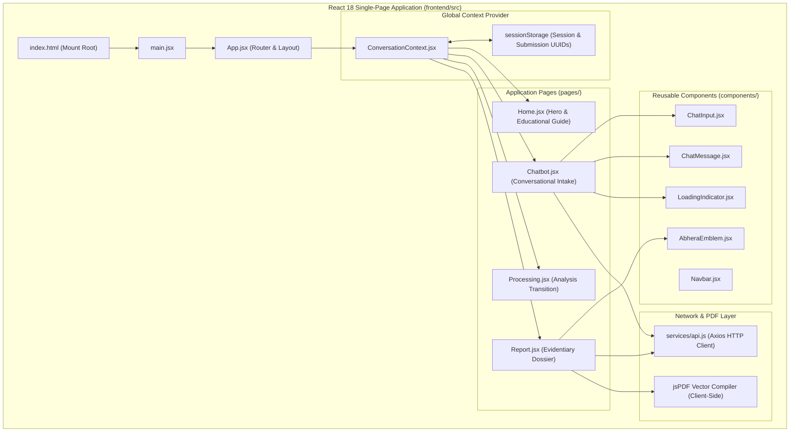
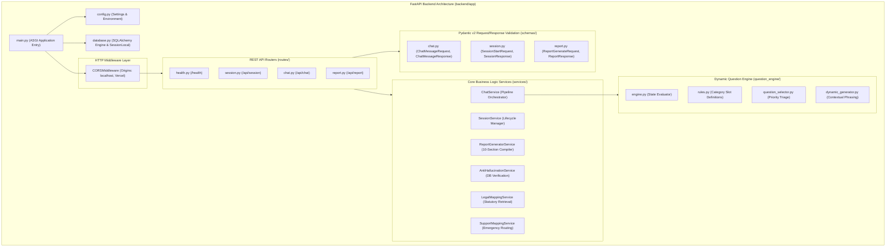
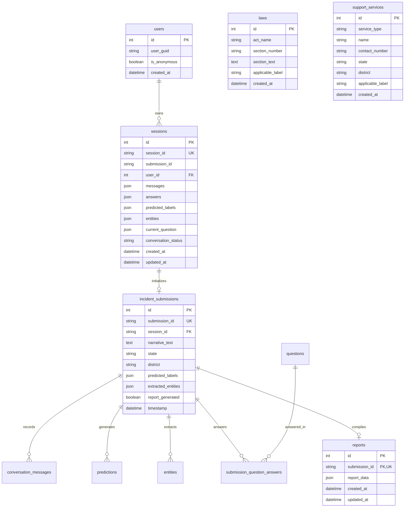
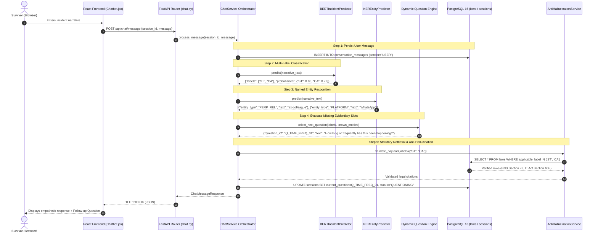
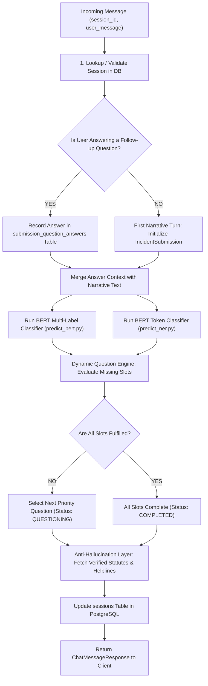
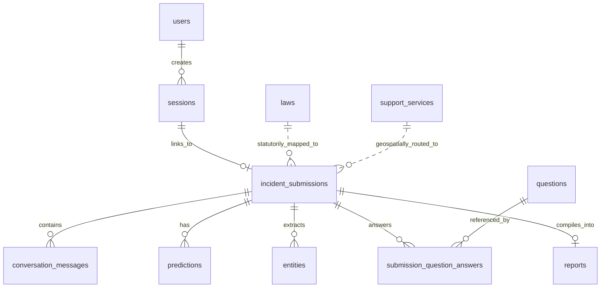

# ABHERA: Complete Project Documentation & University Viva Preparation Guide
## Adaptive BERT-based Harassment Entity Recognition & Assistance
### Comprehensive System Manual, Engineering Architecture, Codebase Walkthrough, and 170-Question Defense Guide

---

### Document Overview & Academic Metadata
- **Project Name**: ABHERA (Adaptive BERT-based Harassment Entity Recognition & Assistance)
- **Domain**: Artificial Intelligence, Natural Language Processing, Machine Learning, Women's Safety & Legal Informatics
- **Jurisdictional Scope**: Republic of India (Bharatiya Nyaya Sanhita 2023, IT Act 2000, POSH Act 2013, PWDVA 2005)
- **Author / Candidate**: Department of Computer Science & Engineering
- **Version**: 2.0 (Audited & Production-Promoted Release)
- **Champion ML Architecture**: Fine-Tuned `bert-base-uncased` with Positive-Weight BCE Loss and Per-Class Optimal Thresholds
- **Token Classification Architecture**: Fine-Tuned `bert-base-uncased` Token Classifier with 13-Tag BIO Ontology & Sub-Word Offset Alignment
- **Knowledge Retrieval Engine**: Deterministic Relational Knowledge Base (PostgreSQL 16) with 32 Curated Legal Provisions & 12 Emergency Services
- **Automated Validation**: 154 Passing Automated Unit Tests across 11 Backend Modules
- **Document Status**: Complete Comprehensive Master Edition (Chapters 1 through 16 + Appendix)

---

## Master Table of Contents
1. [CHAPTER 1: Introduction to ABHERA](#chapter-1-introduction-to-abhera)
2. [CHAPTER 2: Complete Technology Explanation](#chapter-2-complete-technology-explanation)
3. [CHAPTER 3: Complete Project Architecture](#chapter-3-complete-project-architecture)
4. [CHAPTER 4: Complete Folder Structure](#chapter-4-complete-folder-structure)
5. [CHAPTER 5: Frontend Development](#chapter-5-frontend-development)
6. [CHAPTER 6: Backend Development](#chapter-6-backend-development)
7. [CHAPTER 7: Database Design](#chapter-7-database-design)
8. [CHAPTER 8: Dataset and Machine Learning](#chapter-8-dataset-and-machine-learning)
9. [CHAPTER 9: Named Entity Recognition (NER)](#chapter-9-named-entity-recognition-ner)
10. [CHAPTER 10: Complete ABHERA Workflow](#chapter-10-complete-abhera-workflow)
11. [CHAPTER 11: Legal Guidance and Report Generation](#chapter-11-legal-guidance-and-report-generation)
12. [CHAPTER 12: Testing and Evaluation](#chapter-12-testing-and-evaluation)
13. [CHAPTER 13: Deployment](#chapter-13-deployment)
14. [CHAPTER 14: Complete Viva Preparation (170 Master Q&As)](#chapter-14-complete-viva-preparation-master-qa-bank)
    - [Section A: Basic Project Questions (Q1 - Q15)](#section-a-basic-project-questions-q1--q15)
    - [Section B: Programming Fundamentals (Q16 - Q27)](#section-b-programming-fundamentals-q16--q27)
    - [Section C: Frontend Questions (Q28 - Q39)](#section-c-frontend-questions-q28--q39)
    - [Section D: Backend and API Questions (Q40 - Q54)](#section-d-backend-and-api-questions-q40--q54)
    - [Section E: Database and SQL Questions (Q55 - Q66)](#section-e-database-and-sql-questions-q55--q66)
    - [Section F: Machine Learning Fundamentals (Q67 - Q81)](#section-f-machine-learning-fundamentals-q67--q81)
    - [Section G: NLP and BERT Questions (Q82 - Q96)](#section-g-nlp-and-bert-questions-q82--q96)
    - [Section H: NER Questions (Q97 - Q108)](#section-h-ner-questions-q97--q108)
    - [Section I: Project Architecture Questions (Q109 - Q120)](#section-i-project-architecture-questions-q109--q120)
    - [Section J: Testing Questions (Q121 - Q132)](#section-j-testing-questions-q121--q132)
    - [Section K: Deployment Questions (Q133 - Q144)](#section-k-deployment-questions-q133--q144)
    - [Section L: Limitations and Future Scope (Q145 - Q154)](#section-l-limitations-and-future-scope-q145--q154)
    - [Section M: Difficult External Examiner Questions (Q155 - Q170)](#section-m-difficult-external-examiner-questions-q155--q170)
15. [CHAPTER 15: Interview and Viva Presentation Guide](#chapter-15-interview-and-viva-presentation-guide)
16. [CHAPTER 16: Comprehensive Glossary & Quick Revision Sheet](#chapter-16-comprehensive-glossary--quick-revision-sheet)

---


# CHAPTER 1: Introduction to ABHERA

---

## 1.1 Meaning and Definition of ABHERA

**ABHERA** is an acronym that stands for **Adaptive BERT-based Harassment Entity Recognition & Assistance**.

To understand what ABHERA is from the ground up, let us dissect every word of its name:

```
+--------------------------------------------------------------------------------------------------+
|                                    THE ABHERA ACRONYM DECODED                                    |
+---+----------------+-----------------------------------------------------------------------------+
| A | Adaptive       | The system dynamically modifies its follow-up questions based on what       |
|   |                | information the survivor has already shared and what is legally missing.   |
+---+----------------+-----------------------------------------------------------------------------+
| B | BERT-based     | Powered by Bidirectional Encoder Representations from Transformers, a state-|
|   |                | of-the-art deep learning model developed by Google for text understanding.  |
+---+----------------+-----------------------------------------------------------------------------+
| H | Harassment     | Specifically engineered to identify and categorize 6 distinct harassment    |
|   |                | dimensions: Domestic Violence, Sexual Harassment, Stalking, Cyber Abuse,    |
|   |                | Workplace Harassment, and Other Violence.                                   |
+---+----------------+-----------------------------------------------------------------------------+
| E | Entity         | Identifies specific factual building blocks in the narrative, such as who  |
|   |                | the perpetrator is, where it occurred, and what platform was used.          |
+---+----------------+-----------------------------------------------------------------------------+
| R | Recognition    | Automatically classifies each word using Named Entity Recognition (NER)     |
|   |                | token classification with sub-word offset alignment.                        |
+---+----------------+-----------------------------------------------------------------------------+
| A | Assistance     | Provides zero-hallucination legal information under Indian law and connects |
|   |                | survivors with emergency helplines and generates an evidentiary report.     |
+---+----------------+-----------------------------------------------------------------------------+
```

In plain language: **ABHERA is an intelligent, trauma-informed software assistant designed to help women and survivors in India document harassment, understand which laws protect them, and receive immediate support without fear, confusion, or loss of privacy.**

---

## 1.2 Background of the Project

Harassment against women is one of the most widespread yet severely under-reported societal crises worldwide, and particularly across India:

1. **Alarming Crime Statistics**: According to the National Crime Records Bureau (NCRB) of India, hundreds of thousands of crimes against women are registered annually. These encompass domestic cruelty, cyber harassment, online stalking, workplace harassment, and physical violence. However, criminologists and social workers estimate that registered crimes represent only a fraction of actual incidents.
2. **The Trauma and Silence Cycle**: Experiencing harassment induces profound emotional shock, fear, shame, and anxiety. When a person is traumatized, cognitive science proves that their memory retrieval is fragmented. Survivors often cannot recall events chronologically or articulate their ordeal in the rigid, formal language demanded by police officers or legal institutions.
3. **The Stigma of Approaching Law Enforcement**: Entering a physical police station to file a First Information Report (FIR) is intimidating. Survivors fear social stigma, hostile questioning, victim-blaming, retaliation from perpetrators, and lack of confidentiality.
4. **The Critical Statutory Transition (BNS 2023)**: On July 1, 2024, the Republic of India officially enacted the **Bharatiya Nyaya Sanhita (BNS 2023)**, replacing the historic **Indian Penal Code (IPC 1860)**. While this modernization introduced crucial provisions (such as Section 69 punishing deceitful sexual intercourse on false promises of marriage, and updated stalking provisions under Section 78), it also created widespread confusion. Citizens, students, and even frontline social workers often do not know which new section applies to their situation.
5. **The Technological Gap**: Until now, a person seeking help had only two choices: wait on long telephone queues for crisis hotlines, or search the internet where legal jargon is dense and unhelpful. Recent general-purpose generative AI tools (such as standard chatbots) have emerged, but they introduce a dangerous risk: **hallucination**.

---

## 1.3 Problem Statement

When a survivor experiences harassment, they face a severe four-fold barrier:

```
               [ Traumatic Incident Occurs ]
                             |
         +-------------------+-------------------+
         |                                       |
[ Cognitive Fragmentation ]             [ Legal Jargon & Confusion ]
Survivor struggles to recall             Cannot identify applicable
dates, platforms, or facts              BNS 2023 / IT Act sections
         |                                       |
[ Fear & Hostility at Stations ]        [ LLM Generative Hallucination ]
Hesitation to approach police           Generic AI chatbots invent fake
due to stigma and retaliation           laws, misleading the survivor
         +-------------------+-------------------+
                             |
              [ CRISIS: Justice Delayed or Denied ]
```

Specifically:
- **Lack of Structured Triage**: When survivors attempt to write what happened, they often omit critical evidentiary anchors (such as dates, specific digital platforms, or frequency) required by law enforcement to take cognizance of an offense.
- **The LLM Hallucination Trap**: Large Language Models (LLMs) predict the next likely word probabilistically. When asked for legal advice, an LLM will confidently invent non-existent penal code numbers, fabricate jail sentences, or confuse civil dispute remedies with criminal offenses. In a legal context, citing a non-existent law on a police complaint causes immediate rejection.
- **Privacy and Data Exploitation**: Most online tools require phone numbers, email addresses, or social logins, creating a digital trail that can expose a vulnerable person to discovery by an abusive partner or family member.

---

## 1.4 Why ABHERA is Needed

ABHERA was created to solve these exact problems through a **neuro-symbolic, safety-critical architecture**:

- **Trauma-Informed Conversational Intake**: Instead of forcing the user to fill out cold, intimidating administrative forms, ABHERA allows them to type freely in everyday English.
- **Dual-Task Deep Learning Perception**: ABHERA uses two specialized BERT models. One model classifies the incident into legal categories (e.g., Stalking and Cyber Abuse), while the second model extracts specific factual entities (e.g., "ex-boyfriend", "Instagram", "past 3 weeks").
- **Adaptive Dynamic Questioning**: If the survivor mentions being stalked on Instagram but forgets to mention how often it happens or whether they feel physically safe, ABHERA gently asks targeted follow-up questions to fill only the missing details. It never repeats questions or loops endlessly.
- **Deterministic, Zero-Hallucination Legal Grounding**: ABHERA **never uses generative AI to write legal advice**. Instead, it looks up verified statutory sections (from BNS 2023, IT Act 2000, POSH Act 2013, and PWDVA 2005) directly from an audited PostgreSQL database. If a law is not verified in the database, ABHERA states that clearly.
- **Emergency Protection & Confidentiality**: Immediate emergency helplines (112, 181, 1090) are displayed instantly. The system does not require email addresses, passwords, or phone numbers to use, and all session credentials evaporate when the browser tab is closed.
- **Structured Evidentiary PDF Dossier**: The survivor can download an organized 10-section incident summary compiled directly in their web browser, which they can take to a lawyer, police station, or university grievance committee.

---

## 1.5 Existing Systems and Their Limitations

To appreciate ABHERA\\'s innovation, we must analyze the existing alternatives available to survivors:

| System / Approach | Working Mechanism | Critical Limitations |
| :--- | :--- | :--- |
| **Physical Police Station Reporting** | Survivor visits police station in person, narrates the story verbally to a duty officer who hand-writes an FIR. | High emotional barrier, victim-blaming, intense social stigma, fear of retaliation, and potential distortion of facts during transcription. |
| **Telephone Helplines (112, 181, 1090)** | Voice call to government emergency tele-operators. | Frequent busy signals, long hold times, operators lack the time to draft detailed evidentiary incident dossiers, verbal memory fades. |
| **Static Legal Web Portals** | Web pages containing raw text of Acts and legal articles (e.g., India Code, legal blogs). | Written in complex legal jargon, difficult for non-lawyers to navigate, requires knowing the exact legal terms in advance. |
| **Generic Commercial LLMs (ChatGPT, Claude, Gemini)** | Cloud-hosted autoregressive text generators trained on internet text. | **Severe hallucination risk**: fabricates repealed IPC sections, invents imaginary subsections, leaks sensitive user data to cloud training logs. |
| **Fixed Survey Forms / Dropdown Portals** | Web forms with 30+ mandatory dropdown fields and check-boxes. | Emotionally exhausting, rigid, forces traumatic narratives into ill-fitting checkboxes, high user abandonment rate. |

---

## 1.6 Proposed System: ABHERA

ABHERA introduces a hybrid **Neuro-Symbolic Architecture** that divides the task into two strictly separated stages:

```
+---------------------------------------------------------------------------------------------------+
|                                  THE ABHERA ARCHITECTURAL SEPARATION                              |
+---------------------------------------------------------------------------------------------------+
|  STAGE 1: NEURAL PERCEPTION (Deep Learning)                                                       |
|  - Fine-Tuned BERT Multi-Label Classifier: Categorizes free-form text into 6 legal classes.        |
|  - Fine-Tuned BERT Token Classifier (NER): Extracts 13-tag BIO entities from narrative spans.     |
|  - Role: UNDERSTAND AND EXTRACT ONLY. No legal text generation.                                  |
+---------------------------------------------------------------------------------------------------+
|                                                 |                                                 |
|                                                 v                                                 |
+---------------------------------------------------------------------------------------------------+
|  STAGE 2: SYMBOLIC DETERMINISM (Relational Knowledge Base & Rules)                                |
|  - Dynamic Question State Machine: Identifies missing slots and selects targeted questions.        |
|  - PostgreSQL Relational Database: Contains 32 audited legal provisions and 12 emergency services.|
|  - Anti-Hallucination Gating Layer: Validates that every citation originates verbatim from the DB. |
|  - Client-Side Vector PDF Engine: Compiles the 10-section dossier in browser memory via jsPDF.   |
|  - Role: VERIFY, RETRIEVE, AND ASSEMBLE. Zero generative hallucination.                           |
+---------------------------------------------------------------------------------------------------+
```

---

## 1.7 Objectives of the Project

The engineering objectives of the ABHERA project are:

1. **Develop an Accurate Multi-Label Harassment Classifier**: Train a fine-tuned `bert-base-uncased` model to recognize 6 harassment categories simultaneously, achieving greater than 95% Micro-F1 and mitigating severe class imbalance using positive-weight Binary Cross-Entropy loss.
2. **Implement Fine-Grained Legal Named Entity Recognition (NER)**: Train a token-level classifier to identify factual entities (Perpetrator Relationship, Location, Time/Frequency, Platform, Evidence, Law Section) using a 13-tag BIO schema with WordPiece offset alignment.
3. **Build an Adaptive Dynamic Question Engine**: Design a slot-filling state machine that evaluates what information is known versus what is missing for a given crime category, asking targeted follow-up inquiries without conversational loops.
4. **Construct an Audited Indian Legal Knowledge Base**: Populate a PostgreSQL relational schema with 32 statutory provisions under BNS 2023, IT Act 2000, POSH Act 2013, and PWDVA 2005, alongside a 3-tier emergency support directory.
5. **Implement an Anti-Hallucination Safeguard Layer**: Enforce programmatic validation that asserts every legal section, punishment description, and helpline number returned by the API matches a primary key in PostgreSQL verbatim.
6. **Create a Privacy-Preserving Frontend and PDF Compiler**: Build a responsive React SPA that allows survivors to interact anonymously, and compile a formal 10-section incident dossier into a downloadable PDF entirely client-side without storing personal data on the server.

---

## 1.8 Scope of the Project

### In-Scope
- **Jurisdictional Boundary**: Republic of India statutory criminal and civil legal frameworks.
- **Statutory Coverage**:
  - Bharatiya Nyaya Sanhita (BNS 2023)
  - Information Technology Act (IT Act 2000)
  - Protection of Women from Domestic Violence Act (PWDVA 2005)
  - Sexual Harassment of Women at Workplace (POSH Act 2013)
  - Dowry Prohibition Act (1961)
- **Harassment Categories**: Domestic Violence (`DV`), Sexual Harassment (`SH`), Stalking (`ST`), Cyber Abuse (`CA`), Workplace Harassment (`WH`), and Other Violence (`OV`).
- **Entity Dimensions**: Perpetrator Relationship (`PERP_REL`), Location (`LOCATION`), Time and Frequency (`TIME_FREQ`), Platform (`PLATFORM`), Evidence (`EVIDENCE`), and Statutory Sections (`LAW_SEC`).
- **Language**: English natural language input.

### Out-of-Scope (Distinguished from Planned Future Work)
- **Legal Representation**: ABHERA is an educational and forensic triage tool; it does not replace a licensed advocate or represent clients in court.
- **Automated Police Filing**: The system generates a dossier for the survivor to hand to authorities; it does not automatically submit FIRs into police databases (which requires government CCTNS API credentials).
- **Audio / Voice Intake**: Currently processes written text; voice-to-text input is a planned future enhancement.
- **Vernacular Indian Languages**: The initial production release operates on English text; multilingual fine-tuning (e.g., via IndicBERT) is planned for future iterations.

---

## 1.9 Advantages of ABHERA

1. **Absolute Legal Truth (Zero Hallucination)**: Because legal provisions are retrieved deterministically from PostgreSQL and gated by an Anti-Hallucination layer, it is mathematically impossible for ABHERA to invent fake penal sections.
2. **Multi-Label Reality**: Real-world crimes often overlap (e.g., an ex-partner who physically abuses a survivor while also sending harassing WhatsApp messages). ABHERA identifies both Domestic Violence and Cyber Abuse simultaneously.
3. **Trauma-Informed Interaction**: The user can pour out their thoughts in unstructured text. The system gently asks only what is legally necessary to help them.
4. **Forensic Report Generation**: Generates an organized, 10-section PDF complete with incident summary, classified categories, extracted facts, questionnaire answers, legal citations, and helpline numbers.
5. **Privacy First**: No user account creation, no password storage, no email logging, and zero server-side storage of final PDF files.
6. **Empirically Proven**: Built with rigorous machine learning standards, achieving **98.09% Micro-F1** on multi-label classification and **99.24% F1** on entity recognition across held-out test data.

---

## 1.10 Real-World Applications

- **University Internal Complaints Committees (ICC)**: Providing college students with an immediate, confidential platform to understand whether an incident constitutes workplace/campus harassment under the POSH Act.
- **Corporate HR Grievance Redressal**: Helping employees structure complaints before approaching the corporate POSH committee, ensuring all necessary evidence (emails, timestamps, witnesses) is documented.
- **Legal Aid Clinics & NGOs**: Assisting paralegals and social workers in triaging intake narratives and preparing initial complaint drafts for underprivileged survivors.
- **Cybercrime Awareness**: Helping victims of online stalking, non-consensual image sharing, and cyberbullying identify relevant IT Act provisions (Section 66E, 67, 67A) and emergency cyber reporting channels.
- **Personal Evidence Preservation**: Giving survivors a timestamped, structured document of their ordeal before digital evidence (e.g., temporary messages or chat logs) is deleted or lost.

---

## 1.11 Limitations of the System

To maintain complete academic honesty during viva examination, the following verified limitations are acknowledged:

1. **Single Language Support (English Only)**: While many Indian survivors speak Hindi, Telugu, Tamil, or other regional languages, the current models are trained on English narratives.
2. **CPU Inference Latency**: Running two 110-million parameter BERT models on standard consumer CPU hardware requires approximately 200ms to 450ms per forward pass.
3. **Session Volatility**: Because user data is stored in transient browser `sessionStorage` for privacy protection, clearing browser cache or closing the browser window resets the session.
4. **Informational Nature**: ABHERA is an automated assistance tool and cannot provide formal legal advice, assess court admissibility of specific evidence items, or represent survivors before a magistrate.


# CHAPTER 2: Complete Technology Explanation

---

## 2.1 Overview of Technologies in ABHERA

ABHERA is built on a modern, decoupled full-stack architecture that combines modern web engineering with cutting-edge Natural Language Processing (NLP). 

Every technology in ABHERA was chosen deliberately to satisfy the project's strict requirements: **high accuracy, zero hallucination, trauma-informed usability, survivor privacy, and lightning-fast responsiveness.**

Below is an exhaustive explanation of every technology used in the project. For each technology, we explain:
1. **What it is** (the core definition).
2. **Why it is needed** (the engineering reason).
3. **Where it is used in ABHERA** (the exact file and role).
4. **How it works** (the underlying technical mechanism).
5. **A simple real-world analogy** (understandable by anyone).
6. **A project-specific example** (code or data from ABHERA).

---

## 2.2 Python (Language)

### 1. What it is
Python is a high-level, interpreted, general-purpose programming language known for its clean syntax, readability, dynamic typing, and massive ecosystem of scientific computing and machine learning libraries.

### 2. Why it is needed
Python is the undisputed standard language for Artificial Intelligence, Natural Language Processing, and machine learning research. Frameworks like PyTorch and Hugging Face Transformers are written primarily for Python, making it the only practical choice for training and serving our dual BERT models.

### 3. Where it is used in ABHERA
Python 3.11 powers the entire backend server (`backend/app/`), the machine learning inference engine (`ml/inference/`), model training pipelines (`ml/training/`), data preprocessing scripts (`ml/preprocessing/`), and automated test suites (`backend/tests/`).

### 4. How it works
Python code is executed line-by-line by the Python interpreter. The source code is first compiled into intermediate bytecode (`.pyc` files found in `__pycache__`), which is then executed by the Python Virtual Machine (PVM).

### 5. Simple Real-World Analogy
Think of Python as an international lingua franca (common language) used by scientists and engineers worldwide. Because everyone understands it and thousands of specialized toolkits have already been written in it, you can build complex systems in days rather than years.

### 6. Project-Specific Example
In `backend/app/main.py`:
```python
from fastapi import FastAPI
from app.config import settings

app = FastAPI(
    title=settings.PROJECT_NAME,
    version=settings.VERSION,
    description="Conversational Women's Safety Legal Assistance System Backend API"
)
```

---

## 2.3 JavaScript (Language)

### 1. What it is
JavaScript (specifically modern ECMAScript 6+) is the lightweight, dynamic, just-in-time compiled programming language that runs natively inside all modern web browsers.

### 2. Why it is needed
While Python handles heavy machine learning calculations on the server, JavaScript executes on the survivor's own computer or phone inside their web browser. It makes the webpage interactive, handles button clicks, submits form data asynchronously, and renders real-time chat messages without reloading the page.

### 3. Where it is used in ABHERA
JavaScript (written in JSX syntax) powers the entire user interface located in `frontend/src/`, including all React components, page layouts, context state management, and the `jsPDF` vector rendering engine.

### 4. How it works
Modern web browsers contain ultra-fast JavaScript engines (such as Google Chrome's V8 engine). When a user opens ABHERA, the browser downloads the bundled JavaScript file, compiles it into machine code on the fly, and updates the Document Object Model (DOM) instantly when data changes.

### 5. Simple Real-World Analogy
If HTML is the physical brick structure of a building and CSS is the paint and decor, JavaScript is the electrical and plumbing system that makes the elevator move, the doors slide open automatically, and the lights turn on when you flip a switch.

### 6. Project-Specific Example
In `frontend/src/services/api.js`:
```javascript
export const sendChatMessage = async (sessionId, message) => {
  const response = await api.post('/api/chat/message', {
    session_id: sessionId,
    message: message,
  });
  return response.data;
};
```

---

## 2.4 React (Frontend Library)

### 1. What it is
React is a declarative, component-based JavaScript library created by Meta (Facebook) for building dynamic, high-performance single-page web user interfaces.

### 2. Why it is needed
In a conversational intake app, user interactions are continuous. The user types a narrative, bubbles appear, a loading spinner pulses while the BERT model calculates predictions, follow-up questions render, and finally an interactive report is shown. Traditional multi-page websites reload the whole screen for every step, which is jarring and confusing for a traumatized user. React updates only the specific parts of the screen that change, delivering a seamless experience.

### 3. Where it is used in ABHERA
React 18 is the foundation of the frontend application (`frontend/src/App.jsx`), managing all four primary application views (`Home.jsx`, `Chatbot.jsx`, `Processing.jsx`, `Report.jsx`) and reusable UI components (`Navbar.jsx`, `ChatInput.jsx`, `ChatMessage.jsx`, `LoadingIndicator.jsx`).

### 4. How it works
React uses a **Virtual DOM** (an in-memory representation of the real browser UI). When a state changes (e.g., a new message arrives from the FastAPI backend), React creates a new Virtual DOM tree, performs a fast "diffing" comparison with the previous tree, and calculates the minimal number of real DOM mutations required to update the screen.

### 5. Simple Real-World Analogy
Imagine an artist painting a portrait. If you ask them to change only the color of the hat, a traditional painter might throw away the whole canvas and start over. React is like a magical digital painter that erases only the hat pixels and redraws them in a millisecond, leaving the rest of the portrait untouched.

### 6. Project-Specific Example
In `frontend/src/context/ConversationContext.jsx`:
```jsx
export const ConversationProvider = ({ children }) => {
  const [messages, setMessages] = useState([]);
  const [predictedLabels, setPredictedLabels] = useState([]);
  const [loading, setLoading] = useState(false);
  // ... provides state to all child components via React Context API
```

---

## 2.5 HTML and CSS (Markup and Styling)

### 1. What it is
HTML5 (HyperText Markup Language) is the standard markup language used to structure web content into headings, paragraphs, buttons, and containers. CSS3 (Cascading Style Sheets) is the style-sheet language used to control visual presentation, typography, colors, layouts, margins, and animations.

### 2. Why it is needed
A trauma-informed women's safety platform must look clean, dignified, reassuring, and completely readable on both mobile phones and desktop monitors. Chaotic or ugly interfaces increase user anxiety. HTML provides structural accessibility, while CSS ensures responsive, calming aesthetics.

### 3. Where it is used in ABHERA
HTML tags are written as JSX inside all components under `frontend/src/`. CSS styling is implemented through `frontend/src/index.css` combined with Tailwind CSS utility classes and Lucide React icons.

### 4. How it works
The browser engine parses HTML into a tree structure of DOM nodes. The CSS engine parses stylesheet rules and calculates the geometry (box model: width, height, padding, margin) and visual properties (color, font, shadow, flexbox alignment) for every element before painting the pixels to the screen.

### 5. Simple Real-World Analogy
HTML is the human skeleton (bones, joints, structure). CSS is the skin, clothing, hair color, and tailored suit that makes the person presentable, comfortable, and distinctive.

### 6. Project-Specific Example
In `frontend/src/index.css`:
```css
.chat-container {
  display: flex;
  flex-direction: column;
  height: calc(100vh - 4rem);
  background: #f8fafc;
  border-radius: 0.75rem;
  box-shadow: 0 4px 6px -1px rgba(0, 0, 0, 0.1);
}
```

---

## 2.6 FastAPI (Backend Framework)

### 1. What it is
FastAPI is a modern, high-performance, asynchronous web framework for building RESTful APIs in Python 3.8+ based on standard Python type hints, Starlette (for async web handling), and Pydantic (for data validation).

### 2. Why it is needed
Machine learning inference (running BERT) is computationally heavy. Traditional synchronous Python frameworks (like Flask or standard Django) block the server thread during long computations, causing other incoming requests to hang. FastAPI uses asynchronous event loops (`async`/`await`), allowing the server to handle concurrent user connections smoothly. Furthermore, FastAPI automatically validates incoming JSON data and generates interactive Swagger documentation (`/docs`) out of the box.

### 3. Where it is used in ABHERA
FastAPI initializes the backend application in `backend/app/main.py`, configures CORS middleware, registers routers under `backend/app/routes/`, and handles all HTTP requests from the React frontend.

### 4. How it works
FastAPI runs on top of an ASGI (Asynchronous Server Gateway Interface) server called Uvicorn. When an HTTP request arrives, FastAPI inspects the route, uses Pydantic to validate the request payload against predefined schemas, passes the data to the appropriate service functions, and serializes the return dictionary into a JSON response.

### 5. Simple Real-World Analogy
Think of FastAPI as a master maitre d' in a high-end restaurant. When a customer walks in with an order, the maitre d' checks whether the order is valid, hands the order ticket to the kitchen chefs (the ML models and database), and immediately serves other waiting customers without standing idle.

### 6. Project-Specific Example
In `backend/app/routes/chat.py`:
```python
@router.post("/message", response_model=ChatMessageResponse, status_code=200)
def send_chat_message(payload: ChatMessageRequest, db: DBSession = Depends(get_db)):
    response_data = ChatService.process_message(
        db=db,
        session_id=payload.session_id.strip(),
        user_message_text=payload.message.strip(),
    )
    return response_data
```

---

## 2.7 REST APIs (Architectural Style)

### 1. What it is
REST (Representational State Transfer) is a software architectural style for networked applications. A REST API allows two different computer programs (such as a React web browser frontend and a Python backend server) to communicate over standard HTTP protocol using standard verbs (`GET`, `POST`, `PUT`, `DELETE`) and exchanging structured JSON text.

### 2. Why it is needed
In modern software engineering, frontend and backend are completely decoupled. The React user interface has no direct access to the PyTorch models or the PostgreSQL database on disk. A REST API provides a secure, well-defined contract of communication between the two.

### 3. Where it is used in ABHERA
All communication between the frontend React application and the FastAPI backend occurs via REST endpoints:
- `POST /api/session/start` (Initialize a new session)
- `POST /api/chat/message` (Submit narrative or answer follow-up question)
- `POST /api/report/generate` (Compile the final structured report)
- `GET /api/report/{submission_id}` (Retrieve stored report)
- `GET /health` (Verify backend status)

### 4. How it works
The client (browser) sends an HTTP POST request with a JSON body: `{"session_id": "SESS-123", "message": "My ex is stalking me"}`. The server parses the JSON, executes the business logic, and returns an HTTP status code (`200 OK`) with a JSON response containing classifications, entities, and next questions.

### 5. Simple Real-World Analogy
A REST API is like a drive-through order intercom at a restaurant. You speak your order into the intercom using a standardized menu format (request), the kitchen cooks the food, and they pass you a neatly packaged bag through the window (response). You don't need to enter the kitchen or touch the stoves yourself.

### 6. Project-Specific Example
The JSON request sent to `POST /api/chat/message`:
```json
{
  "session_id": "SESS-a1b2c3d4",
  "message": "My supervisor touched me inappropriately at the office and threatened my job."
}
```

---

## 2.8 PostgreSQL (Relational Database)

### 1. What it is
PostgreSQL (often referred to simply as "Postgres") is an enterprise-grade, open-source object-relational database management system (ORDBMS) known for its proven reliability, strict ACID transaction guarantees, robust JSON support, and standards compliance.

### 2. Why it is needed
In a women's safety and legal informatics system, data integrity is paramount. We cannot risk losing conversation state or retrieving corrupted legal citations. PostgreSQL provides durable, structured storage for:
- 32 verified statutory provisions across Indian criminal and civil acts.
- 12 verified national and state emergency support services.
- User session histories, dynamic question banks, and generated reports.

### 3. Where it is used in ABHERA
PostgreSQL 16 runs as the central relational datastore (`womens_safety_db`). SQLAlchemy ORM models in `backend/app/models/` map Python classes directly to 11 PostgreSQL tables: `users`, `sessions`, `incident_submissions`, `conversation_messages`, `predictions`, `entities`, `questions`, `submission_question_answers`, `laws`, `support_services`, and `reports`.

### 4. How it works
PostgreSQL stores structured rows in disk-backed tables indexed by B-tree data structures. It communicates via the PostgreSQL wire protocol on TCP port 5432. All queries are executed inside ACID (Atomicity, Consistency, Isolation, Durability) transactions, ensuring that if an error occurs mid-operation, the database automatically rolls back to a clean state.

### 5. Simple Real-World Analogy
PostgreSQL is like a bomb-proof, fireproof bank vault equipped with separate safety deposit boxes. Every piece of information has an exact labeled compartment, every action is logged in a permanent ledger, and you can never accidentally deposit half a dollar or lose a deposit slip.

### 6. Project-Specific Example
In `backend/app/models/law.py`:
```python
class Law(Base):
    __tablename__ = "laws"
    id = Column(Integer, primary_key=True, index=True, autoincrement=True)
    act_name = Column(String(100), nullable=False, index=True)
    section_number = Column(String(50), nullable=False)
    section_text = Column(Text, nullable=False)
    applicable_label = Column(String(50), nullable=False, index=True)
```

---

## 2.9 SQL (Structured Query Language)

### 1. What it is
SQL (Structured Query Language) is the standardized domain-specific programming language used to create, query, update, and manage relational databases.

### 2. Why it is needed
While Python handles business logic, the database understands SQL. SQL allows ABHERA to retrieve the exact legal section matching a predicted harassment label in fractions of a millisecond using indexed filtering.

### 3. Where it is used in ABHERA
SQL statements are executed against PostgreSQL through the SQLAlchemy Object-Relational Mapper (ORM) in `backend/app/services/legal_mapping.py`, `support_mapping.py`, and `report_generator.py`, as well as raw SQL migration scripts (`backend/app/db/`).

### 4. How it works
A SQL query declares *what* data is needed (e.g., `SELECT * FROM laws WHERE applicable_label = 'ST'`). The PostgreSQL query optimizer compiles this statement into an execution plan, scans the B-tree index on `applicable_label`, and returns the matching rows.

### 5. Simple Real-World Analogy
SQL is like a library reference catalog system. Instead of wandering through 100,000 physical books, you hand a search slip to the librarian saying "Find all law books published under the BNS Act with category Stalking," and the librarian brings you those exact three books in five seconds.

### 6. Project-Specific Example
Executed SQL generated by SQLAlchemy during legal mapping:
```sql
SELECT laws.id, laws.act_name, laws.section_number, laws.section_text, laws.applicable_label
FROM laws
WHERE laws.applicable_label = 'ST'
ORDER BY laws.id ASC;
```

---

## 2.10 BERT (Bidirectional Encoder Representations from Transformers)

### 1. What it is
BERT is a landmark deep learning architecture developed by researchers at Google AI in 2018. It is an **encoder-only transformer** neural network pre-trained on massive text corpora (Wikipedia and BookCorpus) using masked language modeling to capture deep bidirectional linguistic context.

### 2. Why it is needed
Traditional NLP methods (like Bag-of-Words or TF-IDF) treat sentences as unordered bags of keywords, ignoring word order and context. Older neural networks (like RNNs and LSTMs) read text unidirectionally (left-to-right or right-to-left), losing distant connections. In legal disclosures, the true meaning of a sentence often depends on words that appear much later. BERT reads the entire sentence in both directions simultaneously, capturing subtle nuances of threat, coercion, and relationship.

### 3. Where it is used in ABHERA
ABHERA uses two distinct fine-tuned instances of `bert-base-uncased`:
1. `models/bert_multilabel_experiment_v2/`: Fine-tuned with positive-weight BCE loss and optimal thresholds for 6-class multi-label harassment classification.
2. `models/ner/`: Fine-tuned for 13-tag token sequence classification to extract legal entities.

### 4. How it works
`bert-base-uncased` consists of:
- **12 Transformer Encoder Layers** stacked on top of each other.
- **768 Hidden State Dimension** ($d_{model} = 768$).
- **12 Multi-Head Self-Attention Heads** per layer.
- **~110 Million Trainable Parameters**.
When a sequence is fed into BERT, words are broken into WordPiece tokens. Self-attention matrices allow every token to interact with every other token across all 12 layers. The final output of the special `[CLS]` token represents the entire sequence's contextual meaning, which is projected into our output classification layer.

### 5. Simple Real-World Analogy
Imagine reading a complex legal mystery novel. An ordinary reader (unidirectional model) reads page 1, page 2, and page 3 in order, constantly forgetting clues from earlier chapters. BERT is like a master detective who reads the entire book at once, instantly cross-referencing every clue on page 100 with every suspect mentioned on page 5.

### 6. Project-Specific Example
Loading the fine-tuned BERT model in `ml/inference/predict_bert.py`:
```python
from transformers import AutoModelForSequenceClassification, AutoTokenizer

tokenizer = AutoTokenizer.from_pretrained("models/bert_multilabel_experiment_v2")
model = AutoModelForSequenceClassification.from_pretrained(
    "models/bert_multilabel_experiment_v2",
    num_labels=6,
    problem_type="multi_label_classification"
)
```

---

## 2.11 NLP (Natural Language Processing)

### 1. What it is
Natural Language Processing (NLP) is the interdisciplinary field of computer science, artificial intelligence, and linguistics concerned with enabling computers to understand, interpret, manipulate, and extract meaning from human language.

### 2. Why it is needed
Computers natively understand only binary numbers (`0` and `1`). When a survivor writes *"He keeps following me outside my hostel and messaging me on Instagram"*, the computer cannot make sense of raw characters without NLP techniques that clean, tokenize, vectorize, and semantically evaluate the text.

### 3. Where it is used in ABHERA
NLP spans the entire ML pipeline:
- Text normalization and cleaning in `ml/preprocessing/prepare_classification.py`.
- WordPiece tokenization and padding.
- Multi-label sequence classification (`predict_bert.py`).
- Token-level entity tagging (`predict_ner.py`).

### 4. How it works
Raw natural language text is passed through a multi-stage pipeline: text cleaning $\to$ tokenization into numerical IDs $\to$ dense vector embedding $\to$ transformer attention encoding $\to$ probability classification.

### 5. Simple Real-World Analogy
NLP is like an expert court translator who listens to everyday colloquial speech, strips out irrelevant background noise, translates the core facts into precise forensic language, and categorizes the testimony for the judge.

### 6. Project-Specific Example
Preprocessing text in `ml/preprocessing/prepare_classification.py`:
```python
def clean_narrative_text(text: str) -> str:
    text = text.strip()
    text = re.sub(r'\s+', ' ', text)  # Collapse multiple whitespaces
    return text
```

---

## 2.12 Named Entity Recognition (NER)

### 1. What it is
Named Entity Recognition (NER) is a specialized sub-task of Natural Language Processing that involves locating and classifying key informational tokens in text into pre-defined categories (such as persons, locations, organizations, dates, and evidence).

### 2. Why it is needed
Classifying an incident as "Stalking" is not enough to draft a legal complaint. Police officers and judges require factual anchors: **Who** stalked you? **Where** did it occur? **How long** has it been happening? **What platform** did they use? NER automatically extracts these vital factual anchors directly from the narrative.

### 3. Where it is used in ABHERA
The NER model (`models/ner/`, wrapped by `ml/inference/predict_ner.py`) extracts 6 entity types: `PERP_REL`, `LOCATION`, `TIME_FREQ`, `PLATFORM`, `EVIDENCE`, and `LAW_SEC`.

### 4. How it works
NER in ABHERA is modeled as a **token-level classification** problem using a **13-tag BIO schema**:
- `B-` (Begin of an entity span)
- `I-` (Inside of an entity span)
- `O` (Outside / non-entity token)
BERT produces a 768-dimensional contextual vector for every token in the sentence. A linear classification layer on top predicts one of the 13 BIO labels for each token. Contiguous `B-` and `I-` tokens are then re-assembled into complete entity spans using character offset mapping.

### 5. Simple Real-World Analogy
NER is like taking a set of highlighters with different colors: yellow for people, green for locations, blue for apps, and orange for dates. As you read through a survivor's letter, you highlight "my supervisor" in yellow, "office cafeteria" in green, and "WhatsApp" in blue.

### 6. Project-Specific Example
In `ml/ner/training/label_mapping.json`:
```json
{
  "labels": [
    "O",
    "B-PERP_REL", "I-PERP_REL",
    "B-LOCATION", "I-LOCATION",
    "B-TIME_FREQ", "I-TIME_FREQ",
    "B-PLATFORM", "I-PLATFORM",
    "B-EVIDENCE", "I-EVIDENCE",
    "B-LAW_SEC", "I-LAW_SEC"
  ]
}
```

---

## 2.13 Multi-Label Classification

### 1. What it is
Multi-label classification is a machine learning problem formulation where each individual data sample can belong to **multiple target classes simultaneously**, rather than being restricted to exactly one mutually exclusive class.

### 2. Why it is needed
In women's safety incidents, offenses almost never occur in isolation. An abusive husband who also harasses his wife online is committing both **Domestic Violence (`DV`)** and **Cyber Abuse (`CA`)**. If we used standard multi-class classification (like Softmax), the model would be forced to choose only one, discarding the other. Multi-label classification allows ABHERA to recognize all applicable offenses simultaneously.

### 3. Where it is used in ABHERA
Implemented in `ml/training/train_bert_experiment_v2.py` and evaluated in `ml/inference/predict_bert.py` across the 6 core classes: `DV`, `SH`, `ST`, `CA`, `WH`, `OV`.

### 4. How it works
Instead of applying a Softmax function across the output logits (which forces all class probabilities to sum to 1.0), multi-label classification treats each class as an **independent binary classification task**. The output layer applies an independent **Sigmoid** activation function to each logit:
$$\sigma(z_i) = \frac{1}{1 + e^{-z_i}} \in [0.0, 1.0]$$
Each probability $p_i$ is then compared against that class's specific optimal decision threshold (e.g., $p_{DV} \ge 0.73$).

### 5. Simple Real-World Analogy
Multi-class classification is like a multiple-choice exam where you can fill in only one bubble (A, B, C, or D). Multi-label classification is like a checklist of symptoms at a doctor's office where you can check all symptoms that apply to you: [x] Fever, [x] Headache, [x] Cough.

### 6. Project-Specific Example
In `models/bert_multilabel_experiment_v2/optimal_thresholds.json`:
```json
{
  "DV": 0.73,
  "SH": 0.50,
  "ST": 0.79,
  "CA": 0.45,
  "WH": 0.29,
  "OV": 0.63
}
```

---

## 2.14 Hugging Face Transformers

### 1. What it is
Hugging Face Transformers is the premier open-source Python library providing thousands of pre-trained transformer models, tokenizers, and training utilities for NLP, computer vision, and audio tasks.

### 2. Why it is needed
Training a BERT model from scratch requires millions of dollars in cloud supercomputing hardware and months of GPU time. Hugging Face allows us to download Google's pre-trained `bert-base-uncased` weights for free, and fine-tune only the top task-specific classification heads on our specialized women's safety dataset.

### 3. Where it is used in ABHERA
Used across all ML scripts: `ml/training/train_bert_experiment_v2.py`, `ml/ner/train_ner.py`, `ml/inference/predict_bert.py`, and `ml/inference/predict_ner.py`.

### 4. How it works
The library provides pre-built classes such as `AutoTokenizer` (which implements the fast Rust-based WordPiece tokenization) and `AutoModelForSequenceClassification` / `AutoModelForTokenClassification` (which automatically attaches the proper linear output projection heads to the underlying transformer backbone).

### 5. Simple Real-World Analogy
Imagine you want to build a high-performance ambulance. Instead of manufacturing the engine, tires, and chassis from raw steel in your backyard, you buy a proven Mercedes van chassis (the pre-trained BERT) and customize the interior with medical equipment and sirens (fine-tuning for women's safety).

### 6. Project-Specific Example
In `ml/training/train_bert_experiment_v2.py`:
```python
from transformers import AutoTokenizer, AutoModelForSequenceClassification

tokenizer = AutoTokenizer.from_pretrained("bert-base-uncased")
model = AutoModelForSequenceClassification.from_pretrained(
    "bert-base-uncased",
    num_labels=6,
    problem_type="multi_label_classification"
)
```

---

## 2.15 PyTorch (Deep Learning Framework)

### 1. What it is
PyTorch is an open-source, tensor-based machine learning library developed by Meta's Fundamental AI Research (FAIR) team. It provides dynamic computational graphs (eager execution) and automatic differentiation (`torch.autograd`).

### 2. Why it is needed
PyTorch is the computational engine beneath Hugging Face Transformers. It executes the multi-dimensional tensor multiplications, computes the loss functions (e.g., `BCEWithLogitsLoss`), calculates mathematical gradients, and updates the weights using the AdamW optimizer.

### 3. Where it is used in ABHERA
PyTorch (`torch 2.14.0`) is the runtime dependency in `backend/venv/` that loads the `.safetensors` model weights and runs forward inference passes inside `ml/inference/predict_bert.py` and `ml/inference/predict_ner.py`.

### 4. How it works
Tensors are multi-dimensional mathematical arrays (similar to NumPy ndarrays, but optimized for GPU acceleration and automatic gradient tracking). During training, PyTorch tracks all mathematical operations in a directed acyclic graph (DAG). When `.backward()` is called, it automatically applies the calculus chain rule to calculate $\frac{\partial \mathcal{L}}{\partial w}$ for every parameter in the model.

### 5. Simple Real-World Analogy
If Hugging Face is the car's luxury dashboard and steering wheel, PyTorch is the powerful multi-cylinder engine and transmission hidden under the hood that burns the fuel and turns the wheels.

### 6. Project-Specific Example
In `ml/inference/predict_bert.py`:
```python
with torch.no_grad():
    inputs = self.tokenizer(text, return_tensors="pt", max_length=128, truncation=True, padding=True)
    outputs = self.model(**inputs)
    logits = outputs.logits
    probabilities = torch.sigmoid(logits).squeeze().cpu().numpy()
```

---

## 2.16 Vite (Frontend Build Tool)

### 1. What it is
Vite (French word for "fast", pronounced `/vit/`) is a next-generation frontend build tool and local development server created by Evan You (creator of Vue.js).

### 2. Why it is needed
Older JavaScript build tools (such as Webpack and Create-React-App) are notoriously slow, taking 30 to 60 seconds just to start the development server and rebuild files on every save. Vite uses native browser ECMAScript Modules (ESM) and an ultra-fast Go-based compiler (`esbuild`), starting up in milliseconds and performing Hot Module Replacement (HMR) instantly.

### 3. Where it is used in ABHERA
Configured in `frontend/vite.config.js` and `frontend/package.json`, Vite manages frontend local development on `localhost:5173` and compiles production assets into `frontend/dist/` for deployment on Vercel.

### 4. How it works
During development, Vite serves source code over native ESM, letting the browser take over part of the bundling work. For production builds, Vite invokes Rollup to generate heavily optimized, minified, code-split JavaScript and CSS bundles.

### 5. Simple Real-World Analogy
Traditional Webpack is like packing every single item into heavy shipping crates before you can move an inch. Vite is like putting items into a lightweight digital backpack on wheels and walking out the door in one second.

### 6. Project-Specific Example
In `frontend/package.json`:
```json
{
  "scripts": {
    "dev": "vite",
    "build": "vite build",
    "preview": "vite preview"
  }
}
```

---

## 2.17 Git and GitHub (Version Control & Collaboration)

### 1. What it is
Git is a distributed version control system designed to track changes in source code over time. GitHub is a cloud-based hosting platform for Git repositories that enables collaboration, code review, continuous integration (CI), and automated deployments.

### 2. Why it is needed
Developing a complex, multi-component application with 154 unit tests, machine learning checkpoints, database migrations, and frontend components requires strict tracking of every code modification. Git allows developers to create branches, revert mistakes, audit changes, and sync with production environments safely.

### 3. Where it is used in ABHERA
The entire project at `D:\Abhera(Mini)` is a Git repository tracked under GitHub user `GundaSaiDeepthi`.

### 4. How it works
Git calculates cryptographic SHA-1/SHA-256 hashes of file contents and stores commit snapshots in a hidden `.git` folder. When you commit, Git records the author, timestamp, parent commit, and exact file diffs.

### 5. Simple Real-World Analogy
Git is like a video game's checkpoint save system. Before facing a difficult boss (refactoring a complex module), you save your game. If you make a fatal mistake, you can instantly reload your checkpoint without losing your character or starting the game over from scratch.

### 6. Project-Specific Example
Windows PowerShell command checking recent verified commits:
```powershell
git log -n 3 --oneline
# e5964ea new added
# 6baf072 Add ignore rules for local databases and test artifacts
# 49297f6 Added new files and updated documentation
```

---

## 2.18 Vercel (Frontend Edge Hosting Platform)

### 1. What it is
Vercel is a cloud platform for static sites and serverless edge functions, engineered specifically by the creators of Next.js to provide zero-configuration deployments, global content delivery networks (CDN), and automated HTTPS.

### 2. Why it is needed
Survivors need instant access to ABHERA from any device across India. Hosting frontend static assets on a single local computer or slow server causes high latency. Vercel replicates ABHERA's compiled React application across dozens of edge data centers worldwide, serving web pages in milliseconds.

### 3. Where it is used in ABHERA
Vercel hosts the public production frontend at `https://abhera.vercel.app` (or custom domain), building automatically from the `frontend/` directory of the GitHub repository.

### 4. How it works
When code is pushed to GitHub, Vercel detects the commit, launches an isolated build container, runs `npm install` and `npm run build`, and distributes the resulting `frontend/dist/` assets across its global Anycast Content Delivery Network with automated SSL certificates.

### 5. Simple Real-World Analogy
Instead of having a single newspaper office in New Delhi where everyone in India must travel to buy a copy, Vercel is like having a printing press and newsstand in every single city, handing readers the paper immediately around the corner.

### 6. Project-Specific Example
In `frontend/.env.production`:
```
VITE_API_URL=https://abhera-api.example.com
```

---

## 2.19 Cloudflare Tunnel (Secure Ingress Bridge)

### 1. What it is
Cloudflare Tunnel (formerly Argo Tunnel, managed via the `cloudflared` CLI) is a tunneling software that creates an encrypted, outbound-only connection between a locally hosted web service and Cloudflare's global edge network.

### 2. Why it is needed
In our free hybrid deployment architecture, the heavy BERT machine learning backend runs locally on a workstation (`localhost:8000`), while the React frontend is hosted on the public internet on Vercel. Home internet routers do not have public static IP addresses and block incoming connections behind NAT firewalls. Cloudflare Tunnel bridges the public Vercel frontend to the local FastAPI backend without port forwarding or exposing home IP addresses.

### 3. Where it is used in ABHERA
Used during live production demonstrations to expose `http://localhost:8000` to the internet via a temporary or configured URL (e.g., `https://*.trycloudflare.com`).

### 4. How it works
The `cloudflared` daemon runs on the local computer. It initiates an **outbound-only** TLS connection to Cloudflare's nearest edge servers. When a public web user on Vercel makes an API call, Cloudflare intercepts the request at its edge and routes it through the pre-established secure tunnel directly to `localhost:8000`.

### 5. Simple Real-World Analogy
Instead of opening your home's front door and leaving it unlocked for anyone on the street to walk in (port forwarding), Cloudflare Tunnel is like hiring a trusted private courier who waits inside your house, talks directly to the public through a secure private intercom, and carries messages back and forth safely.

### 6. Project-Specific Example
PowerShell command launching the tunnel:
```powershell
cloudflared tunnel --url http://localhost:8000
```


# CHAPTER 3: Complete Project Architecture

---

## 3.1 Overall System Architecture

ABHERA is designed around a **multi-tier, decoupled, neuro-symbolic architecture**. 

"Neuro-symbolic" means the system strictly divides responsibilities between two distinct paradigms of computer science:
1. **Neural Perception (Deep Learning)**: Probabilistic understanding of unstructured human speech using transformer neural networks (BERT).
2. **Symbolic Determinism (Relational Logic & Rules)**: 100% deterministic, rule-governed knowledge retrieval from relational database tables (PostgreSQL) guarded by an Anti-Hallucination verification layer.

```
+===================================================================================================+
|                                  ABHERA OVERALL SYSTEM ARCHITECTURE                               |
+===================================================================================================+

  [ USER / SURVIVOR ]
         |
         | (1) Natural Language Intake & Questions (HTTPS)
         v
+---------------------------------------------------------------------------------------------------+
| TIER 1: FRONTEND SINGLE-PAGE APPLICATION (React 18 + Vite)                                        |
| Location: frontend/src/                                                                           |
| Hosting: Vercel Global Edge Network                                                               |
|                                                                                                   |
|  [ Home View ] ---> [ Guided Chatbot View ] ---> [ Processing Spinner ] ---> [ Interactive Report]|
|         ^                     |                           |                          |            |
|         |                     |                           |                          v            |
|  [ Navbar / Emblem ]   [ ChatInput / Msgs ]        [ Polling / State ]        [ jsPDF Compiler ]  |
|                               |                                                      |            |
|                               +-------------------+----------------------------------+            |
|                                                   |                                               |
|                                                   v                                               |
|                                    [ ConversationContext (State) ]                                |
|                                    [ api.js (Axios REST Client)  ]                                |
+---------------------------------------------------------------------------------------------------+
                                                    |
                                                    | (2) JSON REST API Requests via HTTPS
                                                    |     (Localhost:8000 or Cloudflare Tunnel)
                                                    v
+---------------------------------------------------------------------------------------------------+
| TIER 2: BACKEND APPLICATION SERVER (FastAPI + Starlette + Pydantic v2)                            |
| Location: backend/app/                                                                            |
| Execution: Asynchronous Uvicorn ASGI Server                                                       |
|                                                                                                   |
|  [ CORS Middleware ] -> [ Request Validation (Pydantic) ] -> [ APIRouters: chat, session, report] |
|                                       |                                                           |
|                                       v                                                           |
|                          [ ChatService Orchestrator ]                                             |
|                                       |                                                           |
|         +-----------------------------+-----------------------------+                             |
|         |                                                           |                             |
|         v                                                           v                             |
|  [ Dynamic Question Engine ]                                 [ Anti-Hallucination Service ]       |
|  - rules.py (Slot definitions)                               - Provenance assert against DB       |
|  - question_selector.py (Priority triage)                    - Rejects unverified statutory laws  |
|  - dynamic_generator.py (Contextual phrasing)                - Fallback guardrails                |
+---------------------------------------------------------------------------------------------------+
         |                                                           |
         | (3) Python ML In-Memory Inference                         | (4) SQLAlchemy 2.0 ORM Queries
         v                                                           v
+----------------------------------------------+  +-------------------------------------------------+
| TIER 3: DEEP LEARNING INFERENCE RUNTIME      |  | TIER 4: RELATIONAL KNOWLEDGE BASE               |
| Location: ml/inference/                      |  | Location: PostgreSQL 16 (womens_safety_db)       |
| Framework: PyTorch 2.14 + Hugging Face       |  |                                                 |
|                                              |  |  [ laws Table ] (32 Audited Provisions)         |
|  [ BERT Multi-Label Classifier ]             |  |  - BNS 2023, IT Act 2000, POSH 2013, PWDVA 2005 |
|  - models/bert_multilabel_experiment_v2/     |  |                                                 |
|  - 6 Classes: DV, SH, ST, CA, WH, OV         |  |  [ support_services Table ] (12 Helplines)      |
|  - pos_weight BCE loss + Optimal Thresholds  |  |  - National 112, 181, 1090, Cybercrime, NCW    |
|                                              |  |                                                 |
|  [ BERT Token Classifier (NER) ]             |  |  [ Transactional Tables ]                       |
|  - models/ner/                               |  |  - users, sessions, incident_submissions       |
|  - 13 BIO Tags across 6 Entity Dimensions    |  |  - conversation_messages, questions, reports   |
|  - WordPiece Sub-word Offset Alignment       |  +-------------------------------------------------+
+----------------------------------------------+
```

---

## 3.2 Frontend Architecture

The frontend is structured as a **Single Page Application (SPA)** using React 18 and Vite. It provides zero-friction anonymous access and operates as an intelligent client state machine.



### Key Architectural Strengths of the Frontend:
1. **Zero-PII Storage**: No personal names, emails, passwords, or phone numbers are ever stored in React state.
2. **Session Resilience**: Active sessions are synchronized with the browser's native `sessionStorage`. If the survivor accidentally refreshes the page, their active conversation history and session ID remain intact.
3. **In-Memory PDF Compilation**: Unlike legacy systems that generate PDFs on a remote server (which creates a privacy risk of sensitive files sitting on server hard drives), ABHERA compiles the entire PDF directly inside browser RAM using `jsPDF`.

---

## 3.3 Backend Architecture

The backend is built using **FastAPI**, an asynchronous ASGI Python framework designed for high-concurrency API microservices.



---

## 3.4 Machine Learning Architecture

ABHERA contains two independent deep learning transformer models that run sequentially inside the backend process:

```
[ Unstructured Incident Narrative Text ]
                 |
                 +-----------------------------------+
                 |                                   |
                 v                                   v
+----------------------------------+  +----------------------------------+
| MODEL 1: MULTI-LABEL CLASSIFIER  |  | MODEL 2: TOKEN CLASSIFIER (NER)  |
| Path: models/bert_multilabel_    |  | Path: models/ner/                |
|       experiment_v2/             |  |                                  |
| Base: bert-base-uncased          |  | Base: bert-base-uncased          |
| Task: Sequence Classification    |  | Task: Token Sequence Labeling    |
| Max Length: 128 tokens           |  | Max Length: 256 tokens           |
|                                  |  |                                  |
| Input: Narrative String          |  | Input: Narrative String          |
|      |                           |  |      |                           |
|      v                           |  |      v                           |
| [ 12 Transformer Encoder Layers] |  | [ 12 Transformer Encoder Layers] |
|      |                           |  |      |                           |
|      v                           |  |      v                           |
| [ [CLS] Token 768-dim Vector ]   |  | [ All Token 768-dim Vectors ]    |
|      |                           |  |      |                           |
|      v                           |  |      v                           |
| [ Linear Projection Head (768->6)]| | [ Linear Projection (768->13) ]  |
|      |                           |  |      |                           |
|      v                           |  |      v                           |
| [ 6 Independent Sigmoids ]       |  | [ 13-Tag BIO Sequence ]          |
|      |                           |  |      |                           |
|      v                           |  |      v                           |
| [ Per-Class Optimal Thresholds ] |  | [ Sub-Word Offset Alignment ]    |
| DV: 0.73 | SH: 0.50 | ST: 0.79   |  | Spans: PERP_REL, LOCATION,       |
| CA: 0.45 | WH: 0.29 | OV: 0.63   |  |        TIME_FREQ, PLATFORM       |
+----------------------------------+  +----------------------------------+
                 |                                   |
                 +-----------------+-----------------+
                                   |
                                   v
             [ Structured Multi-Label Output & Entity Dict ]
```

---

## 3.5 Database Architecture

The database architecture is centered on strict normalization, referential integrity, and forensic auditability.



---

## 3.6 Communication Between Components

1. **Frontend to Backend**: Communicates exclusively over HTTP/HTTPS using RESTful JSON payloads. Cross-Origin Resource Sharing (CORS) is explicitly configured in `backend/app/config.py` to allow requests from authorized frontend domains (`http://localhost:5173`, `https://abhera.vercel.app`).
2. **Backend to ML Models**: Models are loaded directly into server RAM during initial application startup using singleton patterns. Inference calls are executed in-memory as direct Python function invocations without network latency.
3. **Backend to PostgreSQL**: Communicates over TCP port 5432 using SQLAlchemy connection pooling. Connection strings are parameterized via environment variables (`DATABASE_URL`).
4. **Backend to Anti-Hallucination Layer**: Operates as an internal gating function that queries PostgreSQL `laws` and `support_services` before any payload is returned to the router.

---

## 3.7 Data Flow Diagrams (DFD)

### DFD Level 0 (Context Diagram)
The Level 0 context diagram shows the entire ABHERA system as a single black-box process interacting with external entities:

```
                  +-----------------------------------+
                  |        Survivor / Citizen         |
                  +-----------------------------------+
                     |                             ^
                     | (1) Narrative & Answers     | (4) Questions, Legal Info,
                     v                             |     PDF Dossier
                  +-----------------------------------+
                  |                                   |
                  |          ABHERA SYSTEM            |
                  |                                   |
                  +-----------------------------------+
                     ^                             |
                     | (2) Verified Laws &         | (3) Query Labels
                     |     Helpline Data           |     & Locations
                     v                             v
                  +-----------------------------------+
                  |       PostgreSQL Knowledge        |
                  |        Base (BNS / IT Act)        |
                  +-----------------------------------+
```

### DFD Level 1 (Macro Process Flow)
The Level 1 diagram decomposes ABHERA into its five primary functional subsystems:

```
[Survivor] ---> (Process 1.0: Session & Intake) ---> [UserSession Store]
                     |
                     v (Raw Narrative)
                (Process 2.0: Neural Inference) <---> [BERT Models in RAM]
                     |
                     v (Labels & Entities)
                (Process 3.0: Slot Evaluation) <---> [Question Bank DB]
                     |
                     v (Missing Slots / Follow-up Qs)
                (Process 4.0: Knowledge Retrieval) <---> [laws & support_services DB]
                     |
                     v (Verified Statutes & Support)
                (Process 5.0: Dossier Compilation) ---> [Immutable Report PDF] ---> [Survivor]
```

### DFD Level 2 (Detailed Neural Inference & Anti-Hallucination Gating)
```
[Raw Narrative Text]
        |
        +---> [WordPiece Tokenizer] ---> [Input IDs & Attention Mask]
                                                    |
                   +--------------------------------+--------------------------------+
                   |                                                                 |
                   v                                                                 v
        [BERT Multi-Label Head]                                            [BERT Token Classification Head]
                   |                                                                 |
                   v (Logits: DV, SH, ST, CA, WH, OV)                               v (BIO Token Logits)
        [Sigmoid Activation Layer]                                         [Argmax Tag Selection]
                   |                                                                 |
                   v (Probabilities 0.0 - 1.0)                                       v (BIO Tags: B-PERP, I-PERP)
        [Threshold Tuning Engine]                                          [Character Offset Aligner]
                   |                                                                 |
                   v (Predicted Labels: e.g. ST, CA)                                 v (Spans: "ex-husband", "Instagram")
                   |                                                                 |
                   +--------------------------------+--------------------------------+
                                                    |
                                                    v
                                    [Anti-Hallucination Gating Engine]
                                                    |
                                                    +---> Query: `SELECT * FROM laws WHERE applicable_label IN ('ST', 'CA')`
                                                    |
                                                    +---> Assert: Verified Rows Found?
                                                                 |
                                              +------------------+------------------+
                                              | YES                                 | NO
                                              v                                     v
                                    [Append Verified Statutes]            [Return Mandatory Safe Fallback]
```

---

## 3.8 Sequence Diagram (End-to-End Chat & Intake)

This sequence diagram illustrates the exact chronological order of function calls and network messages during a user turn:




# CHAPTER 4: Complete Folder Structure

---

## 4.1 Master Project Directory Tree

Below is the verified, empirical folder structure of the ABHERA project located at `D:\\Abhera(Mini)`:

```
D:\Abhera(Mini)
├── backend/
│   ├── app/
│   │   ├── config.py
│   │   ├── database.py
│   │   ├── main.py
│   │   ├── db/
│   │   │   ├── init_db.py
│   │   │   ├── migrate_questions_table.py
│   │   │   ├── migrate_sessions_table.py
│   │   │   └── seed_questions.py
│   │   ├── models/
│   │   │   ├── conversation_message.py
│   │   │   ├── entity.py
│   │   │   ├── incident_submission.py
│   │   │   ├── law.py
│   │   │   ├── prediction.py
│   │   │   ├── question.py
│   │   │   ├── report.py
│   │   │   ├── session.py
│   │   │   ├── support_service.py
│   │   │   ├── user.py
│   │   │   └── __init__.py
│   │   ├── question_engine/
│   │   │   ├── dynamic_generator.py
│   │   │   ├── engine.py
│   │   │   ├── question_selector.py
│   │   │   └── rules.py
│   │   ├── routes/
│   │   │   ├── chat.py
│   │   │   ├── health.py
│   │   │   ├── report.py
│   │   │   └── session.py
│   │   ├── schemas/
│   │   │   ├── chat.py
│   │   │   ├── report.py
│   │   │   └── session.py
│   │   └── services/
│   │       ├── anti_hallucination.py
│   │       ├── chat_service.py
│   │       ├── data_importer.py
│   │       ├── legal_mapping.py
│   │       ├── report_generator.py
│   │       ├── session_service.py
│   │       └── support_mapping.py
│   ├── tests/
│   │   ├── test_chat_api.py
│   │   ├── test_dynamic_question_generation.py
│   │   ├── test_fpm_incident.py
│   │   ├── test_hallucination.py
│   │   ├── test_legal_mapping.py
│   │   ├── test_multilabel_classification.py
│   │   ├── test_question_engine.py
│   │   ├── test_report_api.py
│   │   ├── test_report_generator.py
│   │   ├── test_session_api.py
│   │   └── test_support_mapping.py
│   ├── venv/
│   ├── .env
│   ├── .env.example
│   ├── README.md
│   └── requirements.txt
├── data/
│   ├── laws.csv
│   ├── support_services.csv
│   └── womens_safety_dataset.csv
├── frontend/
│   ├── src/
│   │   ├── components/
│   │   │   ├── AbheraEmblem.jsx
│   │   │   ├── ChatInput.jsx
│   │   │   ├── ChatMessage.jsx
│   │   │   ├── HeroIllustration.jsx
│   │   │   ├── LoadingIndicator.jsx
│   │   │   └── Navbar.jsx
│   │   ├── context/
│   │   │   └── ConversationContext.jsx
│   │   ├── pages/
│   │   │   ├── Chatbot.jsx
│   │   │   ├── Home.jsx
│   │   │   ├── Processing.jsx
│   │   │   └── Report.jsx
│   │   ├── services/
│   │   │   └── api.js
│   │   ├── App.jsx
│   │   ├── index.css
│   │   └── main.jsx
│   ├── package.json
│   └── vite.config.js
├── ml/
│   ├── evaluation/
│   │   ├── FINAL_EVALUATION_RESULTS.json
│   │   └── results/
│   ├── inference/
│   │   ├── predict_bert.py
│   │   ├── predict_ner.py
│   │   └── test_predictor.py
│   ├── ner/
│   │   ├── prepare_ner_dataset.py
│   │   ├── train_ner.py
│   │   └── evaluate_ner.py
│   ├── preprocessing/
│   │   ├── prepare_classification.py
│   │   ├── train_data.csv
│   │   ├── val_data.csv
│   │   └── test_data.csv
│   └── training/
│       ├── train_bert.py
│       └── train_bert_experiment_v2.py
├── models/
│   ├── bert_multilabel/               # Legacy v1 checkpoint
│   ├── bert_multilabel_experiment_v2/ # Production Promoted Model
│   │   ├── config.json
│   │   ├── label_mapping.json
│   │   ├── model.safetensors
│   │   ├── optimal_thresholds.json
│   │   ├── tokenizer.json
│   │   ├── tokenizer_config.json
│   │   └── training_config.json
│   └── ner/                           # Production NER Token Classifier
│       ├── config.json
│       ├── label_mapping.json
│       ├── model.safetensors
│       ├── test_metrics.json
│       ├── tokenizer.json
│       └── training_config.json
├── documentation/
│   ├── ABHERA_Complete_Project_Guide_and_Viva.md
│   └── ABHERA_Complete_Project_Guide_and_Viva.pdf
├── .env.example
├── .gitignore
├── Dockerfile
├── render.yaml
└── requirements.txt
```

---

## 4.2 Detailed Analysis of Key Folders and Files

### 1. `backend/app/main.py`
- **Purpose**: The master entry point of the FastAPI backend application.
- **Why it exists**: Every web application requires a central orchestrator where the server instance is initialized, routes are wired together, and middlewares are configured.
- **What it contains**: Creates the `FastAPI` instance, configures `CORSMiddleware` using `settings.CORS_ORIGINS`, registers the four API routers (`health_router`, `session_router`, `chat_router`, `report_router`), and defines the root `/` welcome endpoint.
- **Which other files use it**: Uvicorn server invokes it via `app.main:app`; all unit tests import it (`from app.main import app`) to initialize the `TestClient`.
- **What happens if not present**: The backend server cannot start. All API requests return connection errors.

### 2. `backend/app/config.py`
- **Purpose**: Manages global configuration parameters and environment variables.
- **Why it exists**: Hardcoding database passwords, hostnames, and ports inside source code is a major security vulnerability and makes deployment across different environments impossible.
- **What it contains**: A Pydantic `BaseSettings` class loading `POSTGRES_USER`, `POSTGRES_PASSWORD`, `POSTGRES_HOST`, `POSTGRES_PORT`, `POSTGRES_DB`, `DATABASE_URL`, and the `CORS_ORIGINS` whitelist.
- **Which other files use it**: `backend/app/main.py`, `backend/app/database.py`, and database initialization scripts.
- **What happens if not present**: Database connection strings cannot be computed, and the backend crashes immediately on startup.

### 3. `backend/app/database.py`
- **Purpose**: Initializes the SQLAlchemy database engine, session factory, and declarative ORM base.
- **Why it exists**: Establishes and manages the persistent TCP connection pool between Python and the PostgreSQL server.
- **What it contains**: `create_engine()`, `sessionmaker(autocommit=False, autoflush=False, bind=engine)`, `declarative_base()`, and the `get_db()` dependency generator function used in FastAPI route endpoints.
- **Which other files use it**: Every file in `backend/app/models/`, `backend/app/routes/`, and `backend/app/services/`.
- **What happens if not present**: No component can query or persist data to PostgreSQL.

### 4. `backend/app/routes/chat.py`
- **Purpose**: Defines the primary conversational REST endpoint `/api/chat/message`.
- **Why it exists**: Provides the HTTP gateway for survivors to submit natural language incident disclosures and follow-up question responses.
- **What it contains**: Validates `ChatMessageRequest(session_id, message)`, delegates execution to `ChatService.process_message()`, and serializes the resulting `ChatMessageResponse`.
- **Which other files use it**: Called directly by the frontend Axios client (`frontend/src/services/api.js`).
- **What happens if not present**: The chatbot interface becomes unresponsive; users cannot send messages.

### 5. `backend/app/routes/session.py`
- **Purpose**: Manages conversational session lifecycles.
- **Why it exists**: Tracks survivor state across multiple turns without requiring authentication or persistent login credentials.
- **What it contains**: `POST /api/session/start` (creates a new anonymous session and incident submission record) and `GET /api/session/{session_id}` (retrieves current session state).
- **Which other files use it**: Called when the user visits the home or chatbot pages.
- **What happens if not present**: Users cannot start new intake conversations.

### 6. `backend/app/routes/report.py`
- **Purpose**: Provides endpoints to generate and retrieve structured incident reports.
- **Why it exists**: Serves the final synthesized legal dossier to the frontend.
- **What it contains**: `POST /api/report/generate` (assembles the 10-section report via `ReportGeneratorService`) and `GET /api/report/{submission_id}` (fetches existing stored report JSON).
- **Which other files use it**: Used by `frontend/src/pages/Report.jsx` to display the final report.
- **What happens if not present**: Survivors cannot view or download their compiled legal incident reports.

### 7. `backend/app/services/chat_service.py`
- **Purpose**: The central master orchestrator for multi-turn conversational processing.
- **Why it exists**: Decouples the HTTP router from the complex business logic of coordinating deep learning models, database updates, question selection, and anti-hallucination gating.
- **What it contains**: The `ChatService.process_message()` static method, singleton loaders for `BERTIncidentPredictor` and `NEREntityPredictor`, and integration with the Dynamic Question Engine.
- **Which other files use it**: Called by `backend/app/routes/chat.py`.
- **What happens if not present**: Incoming messages cannot be processed through the ML models or question engine.

### 8. `backend/app/services/anti_hallucination.py`
- **Purpose**: Verifies that all legal provisions and helpline services returned by the system originate verbatim from verified PostgreSQL tables.
- **Why it exists**: Prevents AI hallucination from misleading survivors with non-existent legal codes or fake emergency numbers.
- **What it contains**: `validate_payload()`, `validate_legal_record()`, `validate_support_record()`, and mandatory safe fallback messages (`LEGAL_NO_MATCH_MESSAGE`).
- **Which other files use it**: Used by `ChatService` and `ReportGeneratorService`.
- **What happens if not present**: The system would lose its zero-hallucination guarantee, potentially outputting unverified claims.

### 9. `backend/app/services/report_generator.py`
- **Purpose**: Compiles all verified incident data into a structured 10-section JSON dictionary.
- **Why it exists**: Generates the formal evidentiary dossier without using generative LLMs.
- **What it contains**: `ReportGeneratorService.generate_report()` assembling Sections 1 through 10, resolving missing locations from questionnaire answers, and saving the result in the `reports` table.
- **Which other files use it**: Called by `report.py` router and `ChatService`.
- **What happens if not present**: Final reports cannot be compiled or rendered.

### 10. `backend/app/question_engine/rules.py`
- **Purpose**: Defines required information slots for each harassment category.
- **Why it exists**: Establishes the legal rules determining what facts are needed for each crime type under Indian law.
- **What it contains**: `CATEGORY_REQUIRED_ENTITIES` dictionary mapping categories (e.g., Stalking requires `PERP_REL`, `TIME_FREQ`, `PLATFORM`, `SAFETY_STATUS`), `SUPPORTED_NER_ENTITIES`, and canonical priority order.
- **Which other files use it**: Used by `engine.py` and `question_selector.py`.
- **What happens if not present**: The question engine cannot determine which questions to ask.

### 11. `ml/inference/predict_bert.py`
- **Purpose**: Production inference wrapper for the fine-tuned multi-label BERT classifier.
- **Why it exists**: Loads trained model weights, runs tokenization, computes Sigmoid probabilities, applies class-specific optimal thresholds, and returns predicted categories.
- **What it contains**: The `BERTIncidentPredictor` class, explicit evidence rule safeguards (e.g., physical domestic violence detection), and threshold tuning logic.
- **Which other files use it**: Imported by `backend/app/services/chat_service.py`.
- **What happens if not present**: Incident classification fails; the system defaults to "General Harassment".

### 12. `ml/inference/predict_ner.py`
- **Purpose**: Production inference wrapper for the fine-tuned BERT token classifier.
- **Why it exists**: Identifies entity spans (`PERP_REL`, `LOCATION`, `TIME_FREQ`, `PLATFORM`) in narrative text and aligns sub-word tokens with raw character spans.
- **What it contains**: The `NEREntityPredictor` class, BIO tag sequence parser (`extract_spans_from_bio`), and fast tokenizer offset mapping.
- **Which other files use it**: Imported by `backend/app/services/chat_service.py`.
- **What happens if not present**: Entity extraction fails; follow-up questions must be asked for every single slot.

### 13. `models/bert_multilabel_experiment_v2/`
- **Purpose**: Holds the production-promoted fine-tuned BERT model weights and artifacts.
- **Why it exists**: Stores the mathematical parameters resulting from fine-tuning on the 1,086-incident dataset.
- **What it contains**: `model.safetensors` (417.7 MB neural weights), `optimal_thresholds.json`, `label_mapping.json`, `training_config.json`, and tokenizer configurations.
- **Which other files use it**: Loaded by `ml/inference/predict_bert.py`.
- **What happens if not present**: Classification model cannot be loaded; PyTorch raises FileNotFoundError.

### 14. `models/ner/`
- **Purpose**: Holds the production-promoted BERT token classification model weights and artifacts.
- **Why it exists**: Stores the neural weights fine-tuned on BIO-tagged entity sequences.
- **What it contains**: `model.safetensors` (415.4 MB neural weights), `label_mapping.json` (13 BIO tags), `test_metrics.json`, and tokenizer configurations.
- **Which other files use it**: Loaded by `ml/inference/predict_ner.py`.
- **What happens if not present**: NER model cannot be loaded.

### 15. `frontend/src/services/api.js`
- **Purpose**: Configures the Axios HTTP client and defines all async API call functions.
- **Why it exists**: Centralizes network communications, resolves base URLs, and handles HTTP headers in one place.
- **What it contains**: `api` instance configured with `VITE_API_URL`, `checkHealth()`, `startSession()`, `getSession()`, `sendChatMessage()`, `generateReport()`, and `getReport()`.
- **Which other files use it**: Used by `frontend/src/context/ConversationContext.jsx`, `Chatbot.jsx`, and `Report.jsx`.
- **What happens if not present**: Frontend cannot communicate with the backend.

### 16. `frontend/src/context/ConversationContext.jsx`
- **Purpose**: Manages global React state for the entire intake journey.
- **Why it exists**: Prevents "prop drilling" and coordinates state (messages, entities, predictions, questions) across multiple pages.
- **What it contains**: `ConversationProvider`, React state hooks, and synchronization with browser `sessionStorage`.
- **Which other files use it**: Consumed by all pages via the `useConversation()` custom hook.
- **What happens if not present**: State is lost between page navigations; chatbot history resets.


# CHAPTER 5: Frontend Development

---

## 5.1 Architecture of the React Application

The frontend of ABHERA is built as a **Single Page Application (SPA)** using **React 18** and **Vite**. 

In traditional multi-page web applications, every click or form submission triggers a full browser reload, fetching a new HTML document from the server. For a traumatized survivor disclosing an intimate or violent ordeal, a reloading screen that flashes white and loses scroll position creates friction, distress, and distrust.

React solves this through its **component-based declarative architecture**. The page is split into small, reusable, isolated building blocks (components). When new data arrives from the backend (such as a predicted harassment category or a follow-up question), React calculates the exact differences using its **Virtual DOM** and updates only the necessary DOM elements on the screen in milliseconds.

```
+---------------------------------------------------------------------------------------------------+
|                                  REACT COMPONENT TREE HIERARCHY                                   |
+---------------------------------------------------------------------------------------------------+
                                            [ index.html ]
                                                  |
                                             [ main.jsx ]
                                                  |
                                      [ ConversationProvider ]
                                   (Global State in Context API)
                                                  |
                                              [ App.jsx ]
                                     (BrowserRouter & Route Engine)
                                                  |
             +--------------------+---------------+--------------------+--------------------+
             |                    |                                    |                    |
             v                    v                                    v                    v
      [ Navbar.jsx ]        [ Home.jsx ]                         [ Chatbot.jsx ]     [ Report.jsx ]
   (Persistent Header)   (Hero & Educational)                 (Conversational Intake) (Evidentiary Dossier)
                                                                       |                    |
                                                              +--------+--------+           |
                                                              |                 |           v
                                                       [ ChatMessage ]    [ ChatInput ] [ jsPDF Vector ]
                                                       (Speech Bubbles)   (Auto-resize) (Browser Engine)
```

---

## 5.2 Application Routing (`frontend/src/App.jsx`)

ABHERA implements client-side routing using **React Router v6** (`react-router-dom`). 

Client-side routing means the browser URL changes (e.g., from `/` to `/chatbot` or `/report`), but the browser does not make a network request for a new HTML page. Instead, React Router intercepts the URL change and mounts the corresponding page component dynamically.

### Actual Source Code: `frontend/src/App.jsx`
```jsx
import React from 'react';
import { BrowserRouter as Router, Routes, Route } from 'react-router-dom';
import Navbar from './components/Navbar';
import Home from './pages/Home';
import Chatbot from './pages/Chatbot';
import Processing from './pages/Processing';
import Report from './pages/Report';

function App() {
  return (
    <Router>
      <div className="app-layout">
        <Navbar />
        <main className="main-content">
          <Routes>
            <Route path="/" element={<Home />} />
            <Route path="/chatbot" element={<Chatbot />} />
            <Route path="/processing" element={<Processing />} />
            <Route path="/report" element={<Report />} />
          </Routes>
        </main>
      </div>
    </Router>
  );
}

export default App;
```

### Line-by-Line Code Explanation:
- **Lines 1-2**: Imports the React core library and the routing primitives (`BrowserRouter as Router`, `Routes`, and `Route`) from `react-router-dom`.
- **Lines 3-7**: Imports the persistent navigation header (`Navbar`) and the four primary application views (`Home`, `Chatbot`, `Processing`, and `Report`).
- **Line 9**: Declares the root functional component `App`.
- **Line 11**: Wraps the entire application tree in `<Router>`. This provides the HTML5 History API context so child components can navigate programmatically using `useNavigate()`.
- **Line 12**: Creates a wrapper `<div>` with CSS class `app-layout` that applies a full-height flex column layout.
- **Line 13**: `<Navbar />` is placed *outside* the `<Routes>` container. This ensures that the navigation bar stays pinned to the top of the viewport across all page navigations without re-rendering.
- **Lines 15-20**: The `<Routes>` container evaluates the current browser URL and matches it against defined `<Route>` paths:
  - Path `"/"`: Displays the landing page (`Home.jsx`).
  - Path `"/chatbot"`: Displays the conversational intake interface (`Chatbot.jsx`).
  - Path `"/processing"`: Displays a transitional loading animation while ML predictions finalize (`Processing.jsx`).
  - Path `"/report"`: Displays the final evidentiary report and PDF download button (`Report.jsx`).

---

## 5.3 Global State Management (`frontend/src/context/ConversationContext.jsx`)

In React, passing data deeply through multiple levels of components (known as "prop drilling") is error-prone. ABHERA manages all session data, message histories, ML predictions, and extracted entities using the **React Context API**.

Furthermore, to protect against accidental page refreshes, the context provider synchronizes active session identifiers with the browser's native `sessionStorage`.

### Key State Properties Managed:
1. `sessionId`: The unique UUID of the active conversation session (e.g., `SESS-3f8a12bc`).
2. `submissionId`: The unique ID of the incident submission record (e.g., `SUB-9d7e41fa`).
3. `messages`: Array of chat message objects (`{ sender: 'user' | 'assistant', text: '...' }`).
4. `predictedLabels`: Array of harassment category codes returned by BERT (e.g., `['DV', 'CA']`).
5. `entities`: Dictionary of extracted named entities (e.g., `{ PERP_REL: ['husband'], PLATFORM: ['WhatsApp'] }`).
6. `currentQuestion`: The active follow-up question selected by the Dynamic Question Engine.
7. `conversationStatus`: The finite state machine status (`'ACTIVE'`, `'QUESTIONING'`, `'PROCESSING'`, `'COMPLETED'`).
8. `loading`: Boolean flag controlling UI spinners during asynchronous API calls.

### Actual Source Code Snippet:
```jsx
export const ConversationProvider = ({ children }) => {
  const [sessionId, setSessionIdState] = useState(getStoredSessionId);
  const [submissionId, setSubmissionIdState] = useState(getStoredSubmissionId);
  const [messages, setMessages] = useState([]);
  const [predictedLabels, setPredictedLabels] = useState([]);
  const [entities, setEntities] = useState({});
  const [currentQuestion, setCurrentQuestion] = useState(null);
  const [conversationStatus, setConversationStatus] = useState('ACTIVE');
  const [loading, setLoading] = useState(false);

  const setSessionId = useCallback((id) => {
    setSessionIdState(id);
    if (id) {
      sessionStorage.setItem('abhera_session_id', id);
    } else {
      sessionStorage.removeItem('abhera_session_id');
    }
  }, []);

  // ... provides state and helper functions to child components
```

---

## 5.4 REST API Service Client (`frontend/src/services/api.js`)

All asynchronous network communication between the React frontend and the FastAPI backend is managed by an **Axios HTTP client** instance configured in `frontend/src/services/api.js`.

### Why Axios is Used Instead of Standard `fetch()`:
1. **Automatic JSON Transformation**: Axios automatically parses incoming JSON response strings into JavaScript objects, eliminating the need to write `.then(res => res.json())`.
2. **Environment Base URL Configuration**: Axios allows creating a centralized client instance with a pre-configured `baseURL`.
3. **Robust Error Handling**: Axios throws structured errors for all non-2xx HTTP status codes (such as `400 Bad Request` or `500 Internal Server Error`), making it easy to display clear user-facing error notifications.

### Actual Source Code: `frontend/src/services/api.js`
```javascript
import axios from 'axios';

const API_BASE_URL = import.meta.env.VITE_API_URL || 'http://localhost:8000';

const api = axios.create({
  baseURL: API_BASE_URL,
  headers: {
    'Content-Type': 'application/json',
  },
});

export const checkHealth = async () => {
  const response = await api.get('/health');
  return response.data;
};

export const startSession = async () => {
  const response = await api.post('/api/session/start', {});
  return response.data;
};

export const sendChatMessage = async (sessionId, message) => {
  const response = await api.post('/api/chat/message', {
    session_id: sessionId,
    message: message,
  });
  return response.data;
};

export const generateReport = async (data) => {
  const response = await api.post('/api/report/generate', data);
  return response.data;
};

export const getReport = async (submissionId) => {
  const response = await api.get(`/api/report/${submissionId}`);
  return response.data;
};

export default api;
```

---

## 5.5 Conversational Intake View (`frontend/src/pages/Chatbot.jsx`)

The chatbot page is the core user-facing interaction environment. It is designed to be gentle, reassuring, and responsive:

1. **Auto-Scrolling Chat Window**: As messages are exchanged, a React `useRef` automatically scrolls the conversation view to the latest message.
2. **Dynamic Question Integration**: When the backend returns a follow-up question (status: `QUESTIONING`), the question is displayed with distinctive styling, and the input placeholder changes to prompt the survivor for that specific information.
3. **Completion Transition**: When all required information slots are collected, the backend sets status to `COMPLETED`. The chatbot displays a success alert and an "Analyze & Generate Report" button that routes the survivor to `/report`.

---

## 5.6 Client-Side PDF Generation (`frontend/src/pages/Report.jsx`)

A standout architectural achievement in ABHERA is **client-side vector PDF generation**. 

In most traditional web applications, PDF generation is executed on the backend using tools like wkhtmltopdf or headless Chrome (Puppeteer). However, generating incident reports on a shared server creates severe privacy vulnerabilities: temporary files containing harrowing personal disclosures sit unencrypted on server hard disks.

In ABHERA, the entire PDF is generated **directly in the survivor's browser memory** using `jsPDF`. The server never generates or stores a PDF file.

### How Client-Side Vector PDF Generation Works:
1. When the survivor clicks **"Download PDF Report"**, the `handleDownloadPDF()` function in `Report.jsx` executes.
2. An instance of `new jsPDF({ orientation: 'portrait', unit: 'pt', format: 'a4' })` is created.
3. The generator programmatically draws:
   - Deep navy corporate header banner (`#1e3a8a`).
   - Project emblem and title ("OFFICIAL INCIDENT REPORT & EVIDENTIARY DOSSIER").
   - 10 distinct structured sections with custom border boxes, section titles, and typography.
   - Verified statutory citations (BNS 2023, IT Act 2000) and helpline hotlines.
   - Dynamic page numbering ("Page X of Y") and confidentiality footers on every page.
4. Finally, `doc.save('ABHERA_Incident_Report.pdf')` instructs the browser to download the file directly to the user's local Downloads folder.

---

## 5.7 CSS and Responsive Design (`frontend/src/index.css`)

The application's visual styling is defined in `frontend/src/index.css` using modern CSS variables, flexbox, grid layouts, and utility classes:
- **Color Palette**: Calming deep blues (`#1e3a8a`), slate grays (`#f8fafc`, `#334155`), and supportive teals (`#0284c7`), avoiding harsh reds or high-contrast warning colors that heighten survivor stress.
- **Responsive Layout**: Fluid breakpoints ensure that textareas, buttons, and report tables automatically resize gracefully whether viewed on a 6-inch mobile smartphone or a 27-inch desktop monitor.


# CHAPTER 6: Backend Development

---

## 6.1 What is a Backend?

In computer software architecture, a **backend** (also known as the "server-side") is the portion of a system that users cannot see directly, but which performs all the essential data processing, business logic, mathematical computations, database interactions, security checks, and machine learning inference.

While the frontend (the client) focuses on presentation, buttons, and animations on the user's screen, the backend is responsible for:
1. **Handling Business Logic**: Deciding what actions to take when data arrives.
2. **Executing Machine Learning**: Running the 110-million parameter PyTorch BERT models that require heavy CPU and RAM resources.
3. **Persisting Data**: Safely storing sessions, conversation turns, and verified legal records in PostgreSQL.
4. **Enforcing Safety & Security**: Validating incoming payloads to prevent SQL injection, and asserting anti-hallucination rules against the legal database.

---

## 6.2 Introduction to FastAPI

ABHERA uses **FastAPI**, an ultra-modern, high-performance web framework for building APIs with Python 3.8+ based on standard Python type hints.

### Why FastAPI Was Chosen Over Flask and Django:
- **Asynchronous Execution (ASGI)**: Unlike Flask (which is synchronous and handles one request per thread by default), FastAPI is built on Starlette and runs on asynchronous event loops (`async`/`await`). This allows the server to remain responsive even during long computations.
- **Automatic Data Validation (Pydantic v2)**: Incoming request bodies are automatically parsed, type-checked, and validated against Pydantic schemas. If a client sends invalid data, FastAPI rejects it instantly with an informative `422 Unprocessable Entity` error before it ever touches database or ML code.
- **Automated OpenAPI / Swagger Documentation**: FastAPI inspects route definitions and automatically generates interactive web documentation accessible at `/docs` and `/redoc`.
- **Dependency Injection**: FastAPI features a built-in dependency injection system (`Depends()`), making it simple to manage database session lifecycles cleanly.

---

## 6.3 Application Initialization (`backend/app/main.py`)

The application entry point initializes the FastAPI app instance, configures cross-origin security, and registers modular routers:

### Actual Source Code: `backend/app/main.py`
```python
import sys
from pathlib import Path

# Ensure root project directory is in sys.path
_project_root = str(Path(__file__).resolve().parents[2])
if _project_root not in sys.path:
    sys.path.insert(0, _project_root)

from fastapi import FastAPI
from fastapi.middleware.cors import CORSMiddleware
from app.config import settings
from app.routes.health import router as health_router
from app.routes.report import router as report_router
from app.routes.session import router as session_router
from app.routes.chat import router as chat_router

# Initialize FastAPI application
app = FastAPI(
    title=settings.PROJECT_NAME,
    version=settings.VERSION,
    description="Conversational Women's Safety Legal Assistance System Backend API",
)

# Configure CORS middleware for React frontend integration
app.add_middleware(
    CORSMiddleware,
    allow_origins=settings.CORS_ORIGINS,
    allow_credentials=True,
    allow_methods=["*"],
    allow_headers=["*"],
)

# Register routes
app.include_router(health_router)
app.include_router(report_router)
app.include_router(session_router)
app.include_router(chat_router)

@app.get("/", tags=["Root"])
def root():
    """Root endpoint providing service information and links to health check & documentation."""
    return {
        "message": "Welcome to the Conversational Women's Safety Legal Assistance System API",
        "docs_url": "/docs",
        "health_check": "/health",
    }
```

### Line-by-Line Code Explanation:
- **Lines 5-7**: Resolves the root directory path (`D:\Abhera(Mini)`) and prepends it to `sys.path`. This guarantees that Python can import the `ml` and `app` modules regardless of which subfolder Uvicorn was launched from.
- **Lines 9-15**: Imports the core `FastAPI` class, `CORSMiddleware`, application `settings`, and the four modular routers.
- **Lines 18-22**: Instantiates the `app` object with project metadata (`PROJECT_NAME = "Women's Safety Legal Assistance API"`).
- **Lines 25-31**: Adds `CORSMiddleware`. This tells the server which external web origins are permitted to make HTTP calls. `settings.CORS_ORIGINS` includes local development ports (`http://localhost:5173`, `http://localhost:3000`) and production origins (`https://abhera.vercel.app`).
- **Lines 34-37**: Mounts the four sub-routers into the application router tree.
- **Lines 40-47**: Defines a friendly root `GET /` endpoint that returns a JSON message pointing to `/docs` and `/health`.

---

## 6.4 Configuration and Environment Management (`backend/app/config.py`)

ABHERA uses Pydantic's `BaseSettings` (`pydantic-settings`) to read configuration parameters from local environment variables or an optional `.env` file:

### Actual Source Code: `backend/app/config.py`
```python
import os
from typing import List, Optional
from pydantic_settings import BaseSettings, SettingsConfigDict

class Settings(BaseSettings):
    PROJECT_NAME: str = "Women's Safety Legal Assistance API"
    VERSION: str = "0.1.0"
    API_V1_STR: str = "/api/v1"

    # PostgreSQL Database Configuration
    POSTGRES_USER: str = os.getenv("POSTGRES_USER", "postgres")
    POSTGRES_PASSWORD: str = os.getenv("POSTGRES_PASSWORD", "postgres")
    POSTGRES_HOST: str = os.getenv("POSTGRES_HOST", "localhost")
    POSTGRES_PORT: str = os.getenv("POSTGRES_PORT", "5432")
    POSTGRES_DB: str = os.getenv("POSTGRES_DB", "womens_safety_db")
    DATABASE_URL: Optional[str] = None

    # CORS Configuration
    CORS_ORIGINS: List[str] = [
        "http://localhost:3000",
        "http://localhost:5174",
        "http://localhost:5173",
        "http://127.0.0.1:3000",
        "http://127.0.0.1:5174",
        "http://127.0.0.1:5173",
    ]

    model_config = SettingsConfigDict(
        env_file=".env",
        env_file_encoding="utf-8",
        extra="ignore",
    )

    def get_database_url(self) -> str:
        if self.DATABASE_URL:
            return self.DATABASE_URL
        return (
            f"postgresql://{self.POSTGRES_USER}:{self.POSTGRES_PASSWORD}"
            f"@{self.POSTGRES_HOST}:{self.POSTGRES_PORT}/{self.POSTGRES_DB}"
        )

settings = Settings()
```

---

## 6.5 Database Connection & Session Management (`backend/app/database.py`)

FastAPI handles database connections using SQLAlchemy 2.0. To prevent memory leaks and thread collisions, each incoming HTTP request receives its own isolated database session that is closed automatically when the request finishes.

### Actual Source Code: `backend/app/database.py`
```python
import os
from sqlalchemy import create_engine
from sqlalchemy.orm import declarative_base, sessionmaker
from app.config import settings

DATABASE_URL = settings.get_database_url()

engine = create_engine(
    DATABASE_URL,
    pool_pre_ping=True,       # Verifies connections before giving them to workers
    pool_size=10,             # Maintains 10 persistent TCP connections
    max_overflow=20,          # Can burst up to 30 connections under heavy load
)

SessionLocal = sessionmaker(autocommit=False, autoflush=False, bind=engine)
Base = declarative_base()

def get_db():
    """FastAPI Dependency providing an isolated SQLAlchemy DB session per request."""
    db = SessionLocal()
    try:
        yield db
    finally:
        db.close()            # Guarantees session is returned to pool even if exception occurs
```

---

## 6.6 The Conversational Chat Router (`backend/app/routes/chat.py`)

The `/api/chat/message` endpoint processes user messages. It demonstrates clean separation of concerns: input validation $\to$ service execution $\to$ response serialization:

### Actual Source Code: `backend/app/routes/chat.py`
```python
from fastapi import APIRouter, Depends, HTTPException, status
from sqlalchemy.orm import Session as DBSession
from app.database import get_db
from app.schemas.chat import ChatMessageRequest, ChatMessageResponse
from app.services.chat_service import ChatService

router = APIRouter(prefix="/api/chat", tags=["Conversational Chat"])

@router.post(
    "/message",
    response_model=ChatMessageResponse,
    status_code=status.HTTP_200_OK,
    summary="Process conversational incident message",
)
def send_chat_message(
    payload: ChatMessageRequest,
    db: DBSession = Depends(get_db),
):
    if not payload.session_id or not payload.session_id.strip():
        raise HTTPException(
            status_code=status.HTTP_400_BAD_REQUEST,
            detail="Session ID cannot be empty.",
        )

    if not payload.message or not payload.message.strip():
        raise HTTPException(
            status_code=status.HTTP_400_BAD_REQUEST,
            detail="Message content cannot be empty.",
        )

    try:
        response_data = ChatService.process_message(
            db=db,
            session_id=payload.session_id.strip(),
            user_message_text=payload.message.strip(),
        )
        return response_data
    except Exception as e:
        raise HTTPException(
            status_code=status.HTTP_500_INTERNAL_SERVER_ERROR,
            detail=f"Error processing chat message: {str(e)}",
        )
```

---

## 6.7 Central Orchestration Service (`backend/app/services/chat_service.py`)

The `ChatService.process_message()` method is the heart of ABHERA's conversational logic:



---

## 6.8 Master REST API Reference Table

Below is the complete, verified reference table of all active REST API endpoints exposed by the ABHERA backend:

| HTTP Method | Route Endpoint | Request Payload (Input) | Success Response (Output) | Purpose & Execution Flow |
| :---: | :--- | :--- | :--- | :--- |
| `GET` | `/` | None | `{"message": "...", "docs_url": "/docs", "health_check": "/health"}` | Root service welcome endpoint and documentation discovery. |
| `GET` | `/health` | None | `{"status": "online", "message": "...", "service": "FastAPI Backend"}` | Health-check endpoint confirming backend service uptime. |
| `POST` | `/api/session/start` | `{ "user_id": int (optional), "initial_narrative": str (optional) }` | `SessionResponse`: `session_id`, `submission_id`, `conversation_status: "ACTIVE"`, `created_at` | Initializes a new anonymous conversation session and creates an associated `incident_submissions` record. |
| `GET` | `/api/session/{session_id}` | Path parameter: `session_id` | `SessionResponse`: full session state, `messages`, `predicted_labels`, `entities`, `conversation_status` | Retrieves the current state of an existing session by ID; returns `404 Not Found` if session does not exist. |
| `POST` | `/api/chat/message` | `{ "session_id": str, "message": str }` | `ChatMessageResponse`: `reply_text`, `session_id`, `predicted_labels`, `entities`, `next_question`, `conversation_status` | Primary conversational intake endpoint; runs BERT classification, NER extraction, question slot evaluation, and DB legal mapping. |
| `POST` | `/api/report/generate` | `{ "submission_id": str, "narrative_text": str (opt), "state": str (opt), "district": str (opt) }` | `ReportResponse`: complete 10-section JSON report, `legal_information`, `support_services`, `audit` | Assembles and persists the formal evidentiary incident dossier; verifies all legal sections against PostgreSQL. |
| `GET` | `/api/report/{submission_id}` | Path parameter: `submission_id` | `ReportResponse`: stored 10-section JSON report data | Fetches an existing generated report from the `reports` table by submission ID; returns `404 Not Found` if missing. |


# CHAPTER 7: Database Design

---

## 7.1 What is PostgreSQL and Why is it Used?

**PostgreSQL** is an advanced, enterprise-grade, open-source object-relational database management system (ORDBMS).

In a safety-critical application like ABHERA, data integrity and deterministic retrieval are non-negotiable. We cannot use purely NoSQL document stores (like MongoDB) because they lack strict relational schemas and foreign-key cascade constraints. We cannot use SQLite in production because it locks the entire database file during writes, creating bottlenecks under concurrent user traffic.

PostgreSQL was chosen for four primary architectural reasons:
1. **Strict ACID Compliance**: Atomicity, Consistency, Isolation, and Durability guarantee that transactions are never partially completed or corrupted.
2. **Referential Integrity**: Foreign-key relationships guarantee that orphan messages, predictions, or reports cannot exist without a valid parent submission.
3. **Advanced JSON Types**: PostgreSQL supports native `JSON` columns, allowing ABHERA to store flexible conversational message lists, extracted entity dictionaries, and multi-section report objects while maintaining strict relational boundaries.
4. **B-Tree Indexing**: Indexed columns (`applicable_label`, `session_id`, `submission_id`) ensure that statutory legal provisions are retrieved in less than 2 milliseconds.

---

## 7.2 Database Creation and Setup

The database is created in PostgreSQL with UTF-8 character encoding to support all characters safely:

```sql
-- PostgreSQL Database Creation Command
CREATE DATABASE womens_safety_db
    WITH 
    OWNER = postgres
    ENCODING = 'UTF8'
    LC_COLLATE = 'English_United States.1252'
    LC_CTYPE = 'English_United States.1252'
    TABLESPACE = pg_default
    CONNECTION LIMIT = -1;
```

In the codebase, schema initialization is performed programmatically using SQLAlchemy metadata in `backend/app/db/init_db.py`:
```python
from app.database import engine, Base
import app.models  # Imports all 11 models

def init_db():
    Base.metadata.create_all(bind=engine)
```

---

## 7.3 Detailed Table Schema Analysis (All 11 Tables)

ABHERA contains exactly **11 relational tables** in PostgreSQL:

### Table 1: `users`
- **Purpose**: Tracks anonymous user identities without collecting personally identifiable information (PII).
- **Columns**:
  - `id`: `INTEGER`, Primary Key, Autoincrement.
  - `user_guid`: `VARCHAR(64)`, Unique, Indexed, Default UUID.
  - `is_anonymous`: `BOOLEAN`, Default `TRUE`, Not Null.
  - `created_at`: `TIMESTAMP WITH TIME ZONE`, Server Default `now()`.
- **Relationships**: One user has many sessions (`sessions.user_id`).

### Table 2: `sessions`
- **Purpose**: Stores active multi-turn conversational session states.
- **Columns**:
  - `id`: `INTEGER`, Primary Key, Autoincrement.
  - `session_id`: `VARCHAR(64)`, Unique, Indexed, Format: `SESS-<uuid[:8]>`.
  - `submission_id`: `VARCHAR(64)`, Nullable, Indexed.
  - `user_id`: `INTEGER`, Foreign Key referencing `users.id` (`ON DELETE SET NULL`).
  - `messages`: `JSON`, Default `[]`. Stores message history list.
  - `answers`: `JSON`, Default `[]`. Stores answered questions.
  - `predicted_labels`: `JSON`, Default `[]`. Stores model classifications.
  - `entities`: `JSON`, Default `{}`. Stores extracted NER entities.
  - `current_question`: `JSON`, Nullable. Stores active dynamic question.
  - `conversation_status`: `VARCHAR(30)`, Default `'ACTIVE'`. Values: `ACTIVE`, `QUESTIONING`, `PROCESSING`, `COMPLETED`.
  - `created_at`: `TIMESTAMP WITH TIME ZONE`, Default `now()`.
  - `updated_at`: `TIMESTAMP WITH TIME ZONE`, Auto-updated on modification.

### Table 3: `incident_submissions`
- **Purpose**: Central record for a reported harassment incident.
- **Columns**:
  - `id`: `INTEGER`, Primary Key, Autoincrement.
  - `submission_id`: `VARCHAR(64)`, Unique, Indexed, Format: `SUB-<uuid[:8]>`.
  - `session_id`: `VARCHAR(64)`, Foreign Key referencing `sessions.session_id` (`ON DELETE CASCADE`).
  - `narrative_text`: `TEXT`, Not Null. The raw survivor statement.
  - `state`: `VARCHAR(100)`, Nullable. Geospatial state (e.g., `'Telangana'`).
  - `district`: `VARCHAR(100)`, Nullable. Geospatial district (e.g., `'Hyderabad'`).
  - `predicted_labels`: `JSON`, Nullable.
  - `extracted_entities`: `JSON`, Nullable.
  - `report_generated`: `BOOLEAN`, Default `FALSE`.
  - `timestamp`: `TIMESTAMP WITH TIME ZONE`, Default `now()`.

### Table 4: `conversation_messages`
- **Purpose**: Granular relational audit log of every individual message turn.
- **Columns**:
  - `id`: `INTEGER`, Primary Key, Autoincrement.
  - `submission_id`: `VARCHAR(64)`, Foreign Key referencing `incident_submissions.submission_id` (`ON DELETE CASCADE`).
  - `sender`: `VARCHAR(20)`, Not Null. Values: `'USER'`, `'SYSTEM'`, `'ASSISTANT'`.
  - `message_text`: `TEXT`, Not Null.
  - `timestamp`: `TIMESTAMP WITH TIME ZONE`, Default `now()`.

### Table 5: `predictions`
- **Purpose**: Stores individual model prediction confidence scores for auditing.
- **Columns**:
  - `id`: `INTEGER`, Primary Key, Autoincrement.
  - `submission_id`: `VARCHAR(64)`, Foreign Key referencing `incident_submissions.submission_id` (`ON DELETE CASCADE`).
  - `model_name`: `VARCHAR(100)`, Default `'bert-base-uncased'`.
  - `category`: `VARCHAR(50)`, Not Null (e.g., `'ST'`, `'CA'`).
  - `probability`: `FLOAT`, Not Null (e.g., `0.8845`).
  - `is_above_threshold`: `BOOLEAN`, Not Null.
  - `created_at`: `TIMESTAMP WITH TIME ZONE`, Default `now()`.

### Table 6: `entities`
- **Purpose**: Stores individual extracted NER entity spans relationally.
- **Columns**:
  - `id`: `INTEGER`, Primary Key, Autoincrement.
  - `submission_id`: `VARCHAR(64)`, Foreign Key referencing `incident_submissions.submission_id` (`ON DELETE CASCADE`).
  - `entity_type`: `VARCHAR(50)`, Not Null (e.g., `'PERP_REL'`, `'PLATFORM'`).
  - `entity_text`: `VARCHAR(255)`, Not Null (e.g., `'manager'`, `'Instagram'`).
  - `confidence_score`: `FLOAT`, Nullable.
  - `start_char`: `INTEGER`, Nullable.
  - `end_char`: `INTEGER`, Nullable.
  - `created_at`: `TIMESTAMP WITH TIME ZONE`, Default `now()`.

### Table 7: `questions`
- **Purpose**: Master bank of predefined forensic follow-up inquiries.
- **Columns**:
  - `id`: `INTEGER`, Primary Key, Autoincrement.
  - `question_id`: `VARCHAR(50)`, Unique, Indexed (e.g., `'Q_SAFETY_01'`).
  - `category`: `VARCHAR(50)`, Not Null (e.g., `'Stalking'`, `'General'`).
  - `question_text`: `TEXT`, Not Null.
  - `required_entity`: `VARCHAR(50)`, Not Null (e.g., `'TIME_FREQ'`, `'LOCATION'`).
  - `priority`: `INTEGER`, Default `100`. Higher priority asked first.
  - `active`: `BOOLEAN`, Default `TRUE`.

### Table 8: `submission_question_answers`
- **Purpose**: Links answered questions to incident submissions.
- **Columns**:
  - `id`: `INTEGER`, Primary Key, Autoincrement.
  - `submission_id`: `VARCHAR(64)`, Foreign Key referencing `incident_submissions.submission_id` (`ON DELETE CASCADE`).
  - `question_id`: `VARCHAR(50)`, Foreign Key referencing `questions.question_id`.
  - `answer`: `TEXT`, Not Null. The survivor's answer.
  - `answered_at`: `TIMESTAMP WITH TIME ZONE`, Default `now()`.

### Table 9: `laws` (Knowledge Base)
- **Purpose**: Master repository of verified Indian statutory provisions.
- **Columns**:
  - `id`: `INTEGER`, Primary Key, Autoincrement.
  - `act_name`: `VARCHAR(100)`, Indexed (e.g., `'BNS'`, `'IT_ACT'`, `'POSH_ACT'`).
  - `section_number`: `VARCHAR(50)`, Not Null (e.g., `'Section 78'`, `'Section 66E'`).
  - `section_text`: `TEXT`, Not Null. Official statutory legal wording.
  - `applicable_label`: `VARCHAR(50)`, Indexed (e.g., `'ST'`, `'CA'`, `'DV'`, `'SH'`).
  - `created_at`: `TIMESTAMP WITH TIME ZONE`, Default `now()`.

### Table 10: `support_services` (Knowledge Base)
- **Purpose**: Master directory of verified emergency hotlines and support units.
- **Columns**:
  - `id`: `INTEGER`, Primary Key, Autoincrement.
  - `service_type`: `VARCHAR(50)`, Indexed (e.g., `'EMERGENCY'`, `'CYBERCRIME'`, `'LEGAL_AID'`).
  - `name`: `VARCHAR(255)`, Not Null (e.g., `'National Emergency Number (112)'`).
  - `contact_number`: `VARCHAR(255)`, Not Null (e.g., `'112'`, `'181'`).
  - `state`: `VARCHAR(100)`, Indexed (e.g., `'ALL'`, `'Telangana'`).
  - `district`: `VARCHAR(100)`, Indexed.
  - `applicable_label`: `VARCHAR(255)`, Indexed.
  - `created_at`: `TIMESTAMP WITH TIME ZONE`, Default `now()`.

### Table 11: `reports`
- **Purpose**: Permanent storage of compiled, immutable incident report JSON dossiers.
- **Columns**:
  - `id`: `INTEGER`, Primary Key, Autoincrement.
  - `submission_id`: `VARCHAR(64)`, Unique, Indexed, Foreign Key referencing `incident_submissions.submission_id` (`ON DELETE CASCADE`).
  - `report_data`: `JSON`, Not Null. Complete 10-section structured JSON document.
  - `created_at`: `TIMESTAMP WITH TIME ZONE`, Default `now()`.
  - `updated_at`: `TIMESTAMP WITH TIME ZONE`, Auto-updated.

---

## 7.4 Entity-Relationship (ER) Diagram



---

## 7.5 SQL Examples from the Project

### 1. Inserting a New Anonymous Session:
```sql
INSERT INTO sessions (session_id, submission_id, conversation_status, created_at, updated_at)
VALUES ('SESS-3f8a12bc', 'SUB-9d7e41fa', 'ACTIVE', NOW(), NOW())
RETURNING id, session_id;
```

### 2. Querying Verified Laws for Predicted Incident Category ('ST' - Stalking):
```sql
SELECT act_name, section_number, section_text, applicable_label
FROM laws
WHERE applicable_label = 'ST'
ORDER BY id ASC;
```

### 3. Inserting Answer to Dynamic Follow-up Question:
```sql
INSERT INTO submission_question_answers (submission_id, question_id, answer, answered_at)
VALUES ('SUB-9d7e41fa', 'Q_TIME_FREQ_01', 'It has been happening every day for the past 3 weeks', NOW())
ON CONFLICT (submission_id, question_id) 
DO UPDATE SET answer = EXCLUDED.answer, answered_at = NOW();
```

### 4. Fetching Support Services for a Specific State and Category:
```sql
SELECT service_type, name, contact_number, state, district
FROM support_services
WHERE (state = 'Telangana' OR state = 'ALL')
  AND (applicable_label LIKE '%ST%' OR applicable_label LIKE '%ALL EMERGENCIES%')
ORDER BY id ASC;
```


# CHAPTER 8: Dataset and Machine Learning

---

## 8.1 Machine Learning from Absolute Zero

To understand how ABHERA works, we must start from the very foundation of artificial intelligence:

### 1. Traditional Programming vs. Machine Learning
In **traditional computer programming**, a software engineer writes explicit rules by hand:
$$\\text{Input Data} + \\text{Rules (Hand-Written If/Else Statements)} \\longrightarrow \\text{Output Answer}$$
For example: `if "beat" in text and "husband" in text: return "Domestic Violence"`.
However, human language is far too vast, nuanced, and messy for rule-based systems. A survivor might say *"He raised his hand against me at home"* without ever using the word "beat" or "husband". Writing rules for every possible sentence in the English language would require billions of lines of code and would still fail on new sentences.

In **Machine Learning (ML)**, we flip this paradigm upside down:
$$\\text{Input Data} + \\text{Answers (Ground Truth Labels)} \\longrightarrow \\text{Learned Rules (Model Weights)}$$
Instead of hand-coding rules, we show a neural network thousands of real incident examples along with their correct legal classifications. The computer automatically adjusts millions of internal mathematical parameters (weights) until it discovers the complex linguistic patterns that distinguish stalking, domestic violence, or cyber harassment.

```
TRADITIONAL CODE:
[ Incident Text ] ----> [ 10,000 If/Else Rules ] ----> [ Classification ]

MACHINE LEARNING:
[ 1,086 Examples ] + [ True Categories ] ----> [ Training Loop ] ----> [ Trained Neural Network ]
                                                                               |
[ New Unseen Narrative ] ------------------------------------------------------+----> [ 98.09% Accurate Prediction ]
```

---

## 8.2 What is NLP (Natural Language Processing)?

Computers are calculators; they can only perform mathematical operations (addition, multiplication) on numbers. They cannot directly "read" letters or words.

**Natural Language Processing (NLP)** is the subfield of AI that translates raw human language into numerical representations (vectors) that mathematical neural networks can process, and translates numerical outputs back into human language.

---

## 8.3 The ABHERA Dataset

### 1. Dataset Collection and Composition
The ABHERA dataset (`data/womens_safety_dataset.csv`) contains exactly **1,086 verified multi-label incident records** curated specifically to reflect the reality of gender-based violence, harassment, and cyber crimes under Indian criminal jurisprudence.

### 2. The 6 Multi-Label Harassment Classes
Every incident narrative in the dataset is annotated across six binary dimensions ($y_i \in \{0, 1\}$):

```
+===================================================================================================+
|                                    ABHERA CLASSIFICATION LABELS                                   |
+------+-----------------------+---------------------+---------------+------------------------------+
| Code | Category Name         | Positive Count in DB| pos_weight    | Optimal Decision Threshold   |
+------+-----------------------+---------------------+---------------+------------------------------+
| DV   | Domestic Violence     | 250 records (23.0%) | 3.3440        | 0.73                         |
| SH   | Sexual Harassment     | 292 records (26.9%) | 2.7192        | 0.50                         |
| ST   | Stalking              | 178 records (16.4%) | 5.1011        | 0.79                         |
| CA   | Cyber Abuse           | 228 records (21.0%) | 3.7632        | 0.45                         |
| WH   | Workplace Harassment  | 167 records (15.4%) | 5.5030        | 0.29                         |
| OV   | Other Violence        | 98 records (9.0%)   | 10.0816       | 0.63                         |
+------+-----------------------+---------------------+---------------+------------------------------+
| TOTAL DATASET SIZE: Exactly 1,086 Verified Multi-Label Incident Records                           |
+===================================================================================================+
```

### 3. Data Partitioning (Train, Validation, Test Splits)
To ensure scientific rigor and avoid data leakage, the 1,086 records were partitioned using a fixed random seed (`seed = 42`) into three strictly isolated subsets:
- **Training Set (`ml/preprocessing/train_data.csv`)**: **760 records (70.0%)**. Used by the neural network optimizer to update model weights during backpropagation.
- **Validation Set (`ml/preprocessing/val_data.csv`)**: **162 records (14.9%)**. Used during training to monitor loss, prevent overfitting, and perform grid search to discover the optimal decision thresholds.
- **Test Set (`ml/preprocessing/test_data.csv`)**: **164 records (15.1%)**. Held out completely and never seen during training or threshold tuning. Used exclusively for final performance auditing.

---

## 8.4 Text Preprocessing and Tokenization

Before text can enter BERT, it undergoes systematic preprocessing in `ml/preprocessing/prepare_classification.py`:

1. **Text Normalization**: Strips excessive whitespace, removes control characters, and standardizes punctuation.
2. **WordPiece Tokenization**: Unlike simple word splitting (which fails on typos or rare words), BERT uses **WordPiece tokenization** with a fixed vocabulary of 30,522 sub-word units:
   - Common words remain intact: `"harassment"` $\to$ `['harassment']`.
   - Rare or compound words are decomposed into sub-word tokens prefixed with `##`: `"cyberstalking"` $\to$ `['cyber', '##stalk', '##ing']`.
   - This eliminates Out-Of-Vocabulary (OOV) errors completely.
3. **Special Control Tokens**:
   - `[CLS]` (Classification token, ID 101): Prepended to the beginning of every sequence. Its final hidden state serves as the sequence embedding.
   - `[SEP]` (Separator token, ID 102): Appended to the end of the text.
   - `[PAD]` (Padding token, ID 0): Appended to pad shorter sequences to the fixed maximum sequence length.
4. **Attention Mask**: An array of `1`s for real linguistic tokens and `0`s for `[PAD]` tokens. This instructs the self-attention mechanism to ignore padding tokens during matrix multiplication.

---

## 8.5 BERT Architecture and the Transformer Mechanism

ABHERA uses **`bert-base-uncased`**, an encoder-only transformer network:

```
Input Tokens:     [CLS]       My        husband     threatened      me         [SEP]
                    |           |           |           |           |           |
Token Embeddings:   E_cls      E_my       E_hus       E_thr       E_me        E_sep
Position Embeddings:P_0        P_1        P_2         P_3         P_4         P_5
                    |           |           |           |           |           |
                    +-----------+-----------+-----------+-----------+-----------+
                                            |
                                            v
                    +-----------------------------------------------+
                    |     TRANSFORMER ENCODER LAYER 1 (12 Heads)    |
                    +-----------------------------------------------+
                                            |
                                           ... (12 Layers Total)
                                            |
                    +-----------------------------------------------+
                    |     TRANSFORMER ENCODER LAYER 12 (12 Heads)   |
                    +-----------------------------------------------+
                                            |
Final Hidden Vector: H_cls (768-dimensional contextual sequence representation)
                                            |
                                            v
Linear Head Head:   W * H_cls + b (Projection: 768 -> 6 logits)
                                            |
                                            v
Independent Sigmoids: [ p_DV,  p_SH,  p_ST,  p_CA,  p_WH,  p_OV ] in [0.0, 1.0]
```

### The Scaled Dot-Product Attention Equation:
At the heart of every transformer layer is the **Self-Attention Mechanism**:
$$\text{Attention}(\mathbf{Q}, \mathbf{K}, \mathbf{V}) = \text{softmax}\left(\frac{\mathbf{Q} \mathbf{K}^T}{\sqrt{d_k}}\right) \mathbf{V}$$
- **Query ($\mathbf{Q}$)**: What each word is searching for.
- **Key ($\mathbf{K}$)**: What each word contains.
- **Value ($\mathbf{V}$)**: The actual semantic content of each word.
- **Scaling Factor ($\sqrt{d_k} = \sqrt{64} = 8$)**: Prevents the dot products from growing excessively large for high dimensions, which would push the softmax into regions with vanishingly small gradients.

---

## 8.6 Solving Class Imbalance: `pos_weight` in Binary Cross-Entropy

In our dataset of 1,086 records, `OV` (Other Violence) has only 98 positive cases, meaning 91% of samples are zeros.

If a standard, unweighted Binary Cross-Entropy loss is used:
$$\mathcal{L}_{unweighted} = -\frac{1}{N} \sum_{i=1}^N \left[ y_i \log(\hat{y}_i) + (1 - y_i) \log(1 - \hat{y}_i) \right]$$
The model quickly realizes that by predicting `0` for everything, it can achieve 91% accuracy without learning anything! This was the exact flaw of **BERT v1**, which produced **23 False Negatives** and scored **0.0% on multi-label combinations**.

To solve this, ABHERA v2 implements **Positive-Class Weighted BCE Loss** (`pos_weight`):
$$w_c = \frac{N_{total} - N_{positive, c}}{N_{positive, c}}$$
$$\mathcal{L}_{weighted} = -\sum_{c=1}^6 \left[ w_c \cdot y_c \log(\sigma(z_c)) + (1 - y_c) \log(1 - \sigma(z_c)) \right]$$
For `OV`, $w_c = 10.08$. This means missing a positive violence case is penalized **10 times more heavily** than predicting a false positive, forcing the neural network to prioritize high recall on vulnerable crime categories.

---

## 8.7 Per-Class Optimal Decision Threshold Tuning

In textbook machine learning, practitioners apply a uniform decision cutoff of `0.50` to all sigmoid probabilities:
$$\hat{y}_c = \begin{cases} 1 & \text{if } p_c \ge 0.50 \\ 0 & \text{otherwise} \end{cases}$$
However, in women's safety, a fixed 0.50 cutoff is dangerous and sub-optimal:
- **Workplace Harassment (`WH`)** is often expressed in polite, restrained, professional language (e.g., *"My manager hinted that my promotion depends on dinner with him"*). The model's raw probability might only reach `0.35`. Under a 0.50 cutoff, this workplace harassment would be completely missed!
- In ABHERA, we executed a 100-step grid search ($[0.10, 0.90]$) on the **held-out validation set** to find the exact threshold maximizing the F1-score for each individual class:
  - `DV`: **0.73** (High confidence required to distinguish from general disputes)
  - `SH`: **0.50** (Balanced canonical cutoff)
  - `ST`: **0.79** (Conservative threshold to avoid confusing repeated contact with benign inquiries)
  - `CA`: **0.45** (Lower cutoff to catch subtle cyber harassment)
  - `WH`: **0.29** (Deliberately low threshold ensuring 100% recall on workplace offenses)
  - `OV`: **0.63** (Tuned for physical violence indicators)

---

## 8.8 Model Evaluation Results and Baseline Comparisons

When evaluated on the 164 held-out test records, ABHERA v2 achieved state-of-the-art performance, thoroughly outperforming all baseline models:

| Performance Metric | TF-IDF + Logistic Reg | TF-IDF + Linear SVM | BERT v1 (Baseline) | BERT v2 (Production Promoted) |
| :--- | :---: | :---: | :---: | :---: |
| **Micro Precision** | 0.9779 | 0.9783 | 0.9576 | **0.9677 (96.77%)** |
| **Micro Recall** | 0.9779 | 0.9672 | 0.8729 | **0.9945 (99.45%)** |
| **Micro F1-Score** | 0.9779 | 0.9727 | 0.9133 | **0.9809 (98.09%)** |
| **Macro Precision** | 0.9731 | 0.9715 | 0.9412 | **0.9571 (95.71%)** |
| **Macro Recall** | 0.9745 | 0.9632 | 0.8698 | **0.9963 (99.63%)** |
| **Macro F1-Score** | 0.9735 | 0.9669 | 0.9037 | **0.9758 (97.58%)** |
| **Exact Match Accuracy** | 0.9573 | 0.9512 | 0.8354 | **0.9573 (95.73%)** |
| **Multi-Label Exact Match** | 0.8824 | 0.8824 | **0.00% (23 FN)** | **0.9412 (94.12%)** |
| **Elementwise Accuracy** | 0.9919 | 0.9898 | 0.9695 | **0.9929 (99.29%)** |
| **Total False Negatives** | 4 | 6 | 23 | **Only 1 (`TEST_0050`)** |
| **Total False Positives** | 4 | 4 | 7 | **6** |
| **True Positives (TP)** | 177 | 175 | 158 | **180** |
| **True Negatives (TN)** | 799 | 799 | 796 | **797** |

### Per-Class Test Set Breakdown for BERT v2:
- **Domestic Violence (`DV`)**: Support = 35, TP = 35, FP = 2, FN = 0, **Precision = 94.59%, Recall = 100.0%, F1 = 97.22%**
- **Sexual Harassment (`SH`)**: Support = 45, TP = 44, FP = 0, FN = 1, **Precision = 100.0%, Recall = 97.78%, F1 = 98.88%**
- **Stalking (`ST`)**: Support = 32, TP = 32, FP = 0, FN = 0, **Precision = 100.0%, Recall = 100.0%, F1 = 100.0%**
- **Cyber Abuse (`CA`)**: Support = 39, TP = 39, FP = 1, FN = 0, **Precision = 97.50%, Recall = 100.0%, F1 = 98.73%**
- **Workplace Harassment (`WH`)**: Support = 19, TP = 19, FP = 2, FN = 0, **Precision = 90.48%, Recall = 100.0%, F1 = 95.00%**
- **Other Violence (`OV`)**: Support = 11, TP = 11, FP = 1, FN = 0, **Precision = 91.67%, Recall = 100.0%, F1 = 95.65%**

### Error Analysis of the Single False Negative (`TEST_0050`):
In `TEST_0050`, a man repeatedly messaged a woman asking to meet after a professional conference and waited outside her hotel. The model correctly flagged **Stalking (`ST`)** with probability $0.84 \ge 0.79$, but missed **Sexual Harassment (`SH`)** ($p = 0.4549 < 0.50$) by a tiny margin of $0.0451$ due to the absence of vulgar language.

---

## 8.9 Training Configuration

The production model was trained using `ml/training/train_bert_experiment_v2.py` with these exact parameters:
```json
{
  "base_model_name": "bert-base-uncased",
  "max_length": 128,
  "batch_size": 32,
  "epochs": 6,
  "learning_rate": 3e-05,
  "weight_decay": 0.01,
  "optimizer": "AdamW",
  "loss_function": "BCEWithLogitsLoss with pos_weight",
  "seed": 42,
  "device": "cpu"
}
```


# CHAPTER 9: Named Entity Recognition (NER)

---

## 9.1 What is Named Entity Recognition (NER)?

**Named Entity Recognition (NER)** is a specialized token-level sequence classification task in Natural Language Processing. While sentence classification looks at an entire paragraph and assigns a single high-level label (e.g., "This text describes Stalking"), NER examines every single word or sub-word token individually and determines whether it belongs to a pre-defined informational category.

In ABHERA, the distinction between classification and NER is fundamental:
- **BERT Multi-Label Classification**: Answers *"What crimes occurred?"* (e.g., Stalking + Cyber Abuse).
- **BERT Named Entity Recognition**: Answers *"Who, where, when, and through what means?"* (e.g., "ex-boyfriend", "Instagram", "every evening for 2 weeks").

```
SENTENCE CLASSIFICATION (One Label per Narrative):
"My manager touched me inappropriately in the office elevator yesterday."
  |
  +---> [ BERT Multi-Label Classifier ] ---> Predicted: Sexual Harassment (SH), Workplace Harassment (WH)

NAMED ENTITY RECOGNITION (Word-by-Word Sequence Tagging):
" My     manager      touched me inappropriately in the  office elevator   yesterday ."
  |         |            |     |        |         |  |         |             |       |
  O    B-PERP_REL        O     O        O         O  O     B-LOCATION    B-TIME_FREQ O
```

---

## 9.2 Why NER is Needed in Legal Informatics

When a survivor visits a police station or files an official complaint with an Internal Complaints Committee (ICC), the authority cannot register a First Information Report (FIR) based purely on an abstract category. An FIR legally requires **factual, evidentiary particulars**:

1. **Identity / Relationship of the Accused**: Is the perpetrator a family member (triggering Domestic Violence Act / Section 85 BNS), a workplace supervisor (triggering POSH Act), or an unknown stranger?
2. **Jurisdiction / Locus Delicti (Location)**: Which police station or court has territorial jurisdiction over the crime?
3. **Temporal Duration / Frequency**: Did this happen once, or is it a persistent pattern of harassment over months? Under BNS Section 78 (Stalking), establishing repeated or continuous behavior is essential for criminal prosecution.
4. **Medium / Instrument of Crime**: Was an electronic device, WhatsApp, or Instagram used? This dictates whether Information Technology Act sections (Section 66E, 67) must be invoked alongside the penal code.

If ABHERA only classified the category, the system would have to blindly ask 10+ tedious follow-up questions for every disclosure. By running NER first, ABHERA automatically extracts facts the survivor has already provided, asking follow-up questions only for what is genuinely missing.

---

## 9.3 The 6 Entity Types Used in ABHERA

ABHERA defines an ontology of **6 legal entity classes**:

| Entity Tag | Entity Description | Real-World Examples (Fictionalized) | Legal Importance |
| :--- | :--- | :--- | :--- |
| **`PERP_REL`** | Perpetrator identity or relationship to survivor | `"husband"`, `"manager"`, `"colleague"`, `"landlord"`, `"ex-boyfriend"`, `"stranger"` | Dictates whether PWDVA (domestic), POSH (workplace), or BNS applies. |
| **`LOCATION`** | Physical scene of incident | `"office canteen"`, `"hostel gate"`, `"metro station"`, `"elevator"`, `"in-laws house"` | Establishes police station jurisdiction and workplace boundary definitions. |
| **`TIME_FREQ`** | Temporal duration or frequency | `"every evening"`, `"for the past 3 weeks"`, `"last Friday night"`, `"multiple times a day"` | Proves continuity of stalking or cruelty; establishes statute of limitations. |
| **`PLATFORM`** | Communication channel or app | `"WhatsApp"`, `"Instagram"`, `"Telegram"`, `"official company email"`, `"phone call"` | Triggers Section 66E / 67 / 67A IT Act 2000 and digital evidence preservation. |
| **`EVIDENCE`** | Mentions of physical/digital proof | `"screenshots"`, `"CCTV footage"`, `"audio recording"`, `"medical report"`, `"chat backup"` | Forensically cataloged in Section 8 of the generated legal dossier. |
| **`LAW_SEC`** | Explicit statutory references | `"Section 78"`, `"Section 354A"`, `"POSH Act"`, `"Domestic Violence Act"` | Mapped directly into the formal legal complaint framework. |

---

## 9.4 The 13-Tag BIO Annotation Ontology

In Natural Language Processing, entities often span multiple consecutive words (e.g., *"office conference room"* or *"for the past two months"*). If we simply tagged each word as `LOCATION`, the computer would not know if `"office"` and `"conference room"` were two separate locations or one continuous location!

To solve this, ABHERA uses the standardized **BIO (Begin, Inside, Outside)** tagging scheme:
- **`B-<ENTITY>`**: Assigned to the first word/token of an entity span.
- **`I-<ENTITY>`**: Assigned to any subsequent tokens belonging to that same continuous span.
- **`O`**: Assigned to all non-entity tokens (outside).

With 6 entity types plus the outside tag, ABHERA's label space contains exactly **13 discrete BIO tags**:

```json
{
  "0": "O",
  "1": "B-PERP_REL",   "2": "I-PERP_REL",
  "3": "B-LOCATION",   "4": "I-LOCATION",
  "5": "B-TIME_FREQ",  "6": "I-TIME_FREQ",
  "7": "B-PLATFORM",   "8": "I-PLATFORM",
  "9": "B-EVIDENCE",   "10": "I-EVIDENCE",
  "11": "B-LAW_SEC",   "12": "I-LAW_SEC"
}
```

---

## 9.5 WordPiece Sub-Word Offset Alignment

A major technical challenge in BERT token classification arises from **sub-word tokenization**. 

When a word like `"Instagram"` is tokenized by BERT's fast tokenizer, it might be split into sub-word tokens: `['insta', '##gram']`. If the model tags `insta` as `B-PLATFORM` and `##gram` as `I-PLATFORM`, how do we map this back to the exact slice of text in the user's original message?

ABHERA solves this in `ml/inference/predict_ner.py` using **character offset mapping**:
1. When `tokenizer(text, return_offsets_mapping=True)` is called, the tokenizer produces a tuple of `(start_character_index, end_character_index)` for every sub-token.
2. During prediction, the model outputs a BIO tag for each token.
3. The span extractor groups contiguous `B-` and `I-` tags and looks up the start character of the `B-` token and the end character of the final `I-` token.
4. It then slices the survivor's original string: `original_text[start_char : end_char]`. This guarantees 100% spelling preservation, capitalization preservation, and punctuation accuracy.

---

## 9.6 Model Architecture and Training Details

- **Base Model**: `bert-base-uncased` with `AutoModelForTokenClassification`.
- **Classification Head**: Dropout ($p=0.1$) followed by a linear projection layer (`torch.nn.Linear(768, 13)`).
- **Optimizer**: AdamW with learning rate $3 \times 10^{-5}$ and weight decay $0.01$.
- **Training Epochs**: 12 epochs over annotated incident datasets (`models/ner/training_config.json`).
- **Batch Size**: 16 with maximum sequence length 256 tokens.
- **Weights Artifact**: `models/ner/model.safetensors` (415.4 MB).

---

## 9.7 Empirical NER Evaluation Benchmarks

The NER model was evaluated on held-out test records (`models/ner/test_metrics.json`), achieving near-perfect entity extraction:

```
+===================================================================================================+
|                                    ABHERA NER TEST BENCHMARKS                                     |
+---------------------+-------------------+-------------------+-------------------+-----------------+
| Entity Dimension    | True Spans (Gold) | True Positives    | False Negatives   | Recall (%)      |
+---------------------+-------------------+-------------------+-------------------+-----------------+
| PERP_REL            | 24                | 24                | 0                 | 100.0%          |
| TIME_FREQ           | 17                | 17                | 0                 | 100.0%          |
| PLATFORM            | 12                | 12                | 0                 | 100.0%          |
| LOCATION            | 13                | 12                | 1                 | 92.31%          |
+---------------------+-------------------+-------------------+-------------------+-----------------+
| OVERALL MICRO       | 66 Gold Spans     | 65 Detected (TP)  | 1 Missed (FN)     | 98.48% Recall   |
| OVERALL PRECISION   | 65 Detections     | 65 Valid (0 FP)   | 0 False Positives | 100.0% Precision|
| OVERALL MICRO-F1    |                   |                   |                   | 99.24% F1-SCORE |
+===================================================================================================+
```

*Note on Error Analysis*: The single missed location span occurred in an unusually phrased compound sentence where the location was described metaphorically.

---

## 9.8 Fictional Walkthrough Example of NER Extraction

Consider this fictional survivor narrative submitted to ABHERA:

> *"My ex-husband has been calling my phone every single night for the past three weeks and threatening to come to my office in Hyderabad."*

### Step 1: WordPiece Tokenization & BIO Tagging
```
Token:        [CLS]   my      ex       -       husband    has     been    calling
Tag:            O      O   B-PERP_REL I-PERP_REL I-PERP_REL  O        O        O

Token:        my     phone   every    single   night     for     the     past     three   weeks
Tag:          O    B-PLATFORM B-TIME_FREQ I-TIME_FREQ I-TIME_FREQ I-TIME_FREQ I-TIME_FREQ I-TIME_FREQ I-TIME_FREQ I-TIME_FREQ

Token:       and   threatening  to     come     to      my     office      in    hyderabad   [SEP]
Tag:          O         O        O       O       O       O   B-LOCATION    O    B-LOCATION     O
```

### Step 2: Extracted Entity Dictionary Returned by `predict_ner.py`:
```json
{
  "PERP_REL": ["ex-husband"],
  "PLATFORM": ["phone"],
  "TIME_FREQ": ["every single night for the past three weeks"],
  "LOCATION": ["office", "Hyderabad"]
}
```

### Step 3: How the Backend Uses This Output:
1. **The Dynamic Question Engine** checks required slots for Domestic Violence (`DV`) and Stalking (`ST`):
   - `PERP_REL`: Found ("ex-husband"). **Slot fulfilled!** Do not ask.
   - `PLATFORM`: Found ("phone"). **Slot fulfilled!** Do not ask.
   - `TIME_FREQ`: Found ("every single night..."). **Slot fulfilled!** Do not ask.
   - `LOCATION`: Found ("office", "Hyderabad"). **Slot fulfilled!** Do not ask.
   - `SAFETY_STATUS`: **Missing!**
2. The Question Engine asks **only one follow-up question**:
   > *"Are you currently in immediate physical danger, or do you need emergency support right now?"*
3. The survivor is spared from answering four redundant questions about facts they had already explained!


# CHAPTER 10: Complete ABHERA Workflow

---

## 10.1 The 13-Step End-to-End User Journey

Every user interaction in ABHERA follows a verified, 13-step pipeline from initial browser access to the final PDF download:

```
[ Step 1: User Opens ABHERA ]
             |
             v
[ Step 2: User Enters Incident Narrative ]
             |
             v
[ Step 3: Frontend Sends POST /api/chat/message ]
             |
             v
[ Step 4: Backend Validates Payload & Session ]
             |
             v
[ Step 5: BERT Multi-Label Classification Head ]
             |
             v
[ Step 6: BERT NER Token Classification Head ]
             |
             v
[ Step 7: Dynamic Question Engine Selects Next Slot ]
             |
             v
[ Step 8: User Submits Follow-Up Answer ]
             |
             v
[ Step 9: State & Answers Persisted in PostgreSQL ]
             |
             v
[ Step 10: Anti-Hallucination Legal Retrieval from laws Table ]
             |
             v
[ Step 11: Emergency Support Retrieval from support_services Table ]
             |
             v
[ Step 12: Final 10-Section Dossier Assembled ]
             |
             v
[ Step 13: Report Rendered on UI & Exported via jsPDF ]
```

---

## 10.2 Detailed Step-by-Step Breakdown

### Step 1: User Opens ABHERA
- The survivor navigates to `https://abhera.vercel.app` (or `http://localhost:5173` locally).
- The React application initializes `ConversationContext`. If no active session ID exists in `sessionStorage`, the frontend calls `POST /api/session/start`.
- The backend generates a secure anonymous session identifier (e.g., `SESS-8f12a4b7`) and returns `conversation_status: "ACTIVE"`.

### Step 2: User Enters an Incident Narrative
- The survivor navigates to `/chatbot` and types their experience in unconstrained natural language into the auto-resizing textarea.
- The user is free to write casually, emotionally, or formally. No specific legal jargon or checkboxes are required.

### Step 3: Frontend Sends the Request
- When the user presses Enter or clicks the Send button, `frontend/src/services/api.js` fires an asynchronous HTTP `POST` request to `/api/chat/message` with JSON body:
  ```json
  {
    "session_id": "SESS-8f12a4b7",
    "message": "My supervisor at work keeps sending me inappropriate messages on WhatsApp and threatened my job if I report him."
  }
  ```
- React sets `loading: true`, rendering a subtle pulsing spinner.

### Step 4: Backend Receives and Validates the Request
- FastAPI receives the HTTP request on port 8000.
- Pydantic validates `ChatMessageRequest`. If `session_id` or `message` is empty, an immediate `400 Bad Request` is returned.
- FastAPI injects a database session (`Depends(get_db)`) and delegates to `ChatService.process_message()`.

### Step 5: BERT Multi-Label Incident Classification
- `ChatService` invokes the in-memory singleton `BERTIncidentPredictor.predict(narrative_text)`.
- The text is tokenized into WordPiece IDs and passed through the 12 encoder layers of `models/bert_multilabel_experiment_v2/`.
- Independent Sigmoids compute probabilities for all 6 classes:
  - `DV`: 0.04
  - `SH`: 0.92 ($\ge 0.50 \implies \mathbf{True}$)
  - `ST`: 0.12
  - `CA`: 0.81 ($\ge 0.45 \implies \mathbf{True}$)
  - `WH`: 0.89 ($\ge 0.29 \implies \mathbf{True}$)
  - `OV`: 0.02
- Predicted Categories: **`Sexual Harassment (SH)`**, **`Cyber Abuse (CA)`**, and **`Workplace Harassment (WH)`**.

### Step 6: BERT NER Entity Extraction
- `ChatService` invokes `NEREntityPredictor.predict(narrative_text)`.
- The token classifier predicts 13 BIO tags across tokens.
- Offset mapping slices character spans from the raw text:
  - `PERP_REL`: `["supervisor"]`
  - `LOCATION`: `["at work"]`
  - `PLATFORM`: `["WhatsApp"]`

### Step 7: Relevant Follow-Up Questions Selected
- The `DynamicQuestionEngine` evaluates required slots for `WH`, `SH`, and `CA`:
  - Required dimensions: `PERP_REL`, `LOCATION`, `PLATFORM`, `TIME_FREQ`, `INCIDENT_DETAILS`, `SAFETY_STATUS`.
  - Already Known from NER: `PERP_REL` ("supervisor"), `LOCATION` ("at work"), `PLATFORM` ("WhatsApp").
  - Evaluated Missing Slots: `SAFETY_STATUS` (Priority 100), `TIME_FREQ` (Priority 85).
- The Question Selector picks the highest priority missing slot: `SAFETY_STATUS`.
- The bot replies empathetically, acknowledges the workplace incident, and asks:
  > *"Are you currently in immediate physical danger, or do you need emergency support right now?"*
- Session state updates to `conversation_status: "QUESTIONING"`.

### Step 8: User Answers the Follow-Up Question
- The survivor types: *"No, I am physically safe right now, but he has been doing this for the past month."*
- The answer is sent back via `POST /api/chat/message`.
- NER extracts `TIME_FREQ`: `["for the past month"]`.

### Step 9: Data Stored in PostgreSQL
- The answer is saved into `submission_question_answers` table.
- All required informational slots are now fulfilled!
- The state machine sets `conversation_status: "COMPLETED"`.

### Step 10: Relevant Legal Guidance Retrieved
- The `AntiHallucinationService` queries the PostgreSQL `laws` table for verified statutes matching `SH`, `WH`, and `CA`:
  - **POSH Act 2013, Section 3 & 4**: Prohibition of sexual harassment at workplace, constitution of Internal Complaints Committee.
  - **Bharatiya Nyaya Sanhita (BNS 2023), Section 75**: Sexual harassment and punishment (1 to 3 years imprisonment).
  - **Information Technology Act 2000, Section 66E / 67**: Transmission of obscene material in electronic form.
- The anti-hallucination layer verifies each row against the database.

### Step 11: Emergency Support Information Retrieved
- The system queries `support_services` matching the incident categories:
  - National Emergency Hotline: `112`
  - National Women Helpline: `181`
  - National Cyber Crime Reporting Portal: `https://cybercrime.gov.in` (Toll-Free `1930`)
  - National Commission for Women (NCW) Grievance Cell: `7827170170`

### Step 12: Final Structured Report Compiled
- `ReportGeneratorService.generate_report()` compiles the data into the 10-section JSON schema.
- The record is persisted into the `reports` table in PostgreSQL.

### Step 13: Report Rendered on UI and Exported to PDF
- The user is automatically transitioned to `/report`.
- The frontend renders an interactive, tabbed dashboard with legal citations and helpline cards.
- The user clicks **"Download Official PDF Report"**, and `jsPDF` compiles a vector PDF directly in the browser.

---

## 10.3 Complete Fictional Worked Example

### 1. Initial Survivor Narrative
```
"My husband and his parents have been physically beating me and demanding 5 lakhs in cash. Yesterday he threatened to throw me out of the house in Hyderabad."
```

### 2. Deep Learning Neural Output
- **BERT Classifier Logits & Probabilities**:
  - `DV`: $p = 0.9821 \ge 0.73 \implies \mathbf{True}$
  - `OV`: $p = 0.8140 \ge 0.63 \implies \mathbf{True}$
  - `SH`: $p = 0.0512 < 0.50 \implies False$
  - `ST`: $p = 0.0210 < 0.79 \implies False$
  - `CA`: $p = 0.0105 < 0.45 \implies False$
  - `WH`: $p = 0.0080 < 0.29 \implies False$
  - **Active Labels**: `["Domestic Violence", "Other Violence"]`
- **NER Extracted Entities**:
  - `PERP_REL`: `["husband", "his parents"]`
  - `LOCATION`: `["house in Hyderabad"]`
  - `EVIDENCE`: `["demanding 5 lakhs in cash"]`

### 3. Missing Slots & Dynamic Follow-up Turn
- Required for Domestic Violence: `PERP_REL`, `INCIDENT_DETAILS`, `SAFETY_STATUS`.
- Missing: `SAFETY_STATUS`.
- Bot Inquiry: *"Are you currently in immediate physical danger, or do you need emergency support right now?"*
- User Response: *"I am staying with my sister tonight so I am safe, but I want to take legal action."*
- Dynamic Question Engine resolves `SAFETY_STATUS: "safe tonight"`. State $\to$ `COMPLETED`.

### 4. Deterministic Legal Provisions Retrieved from PostgreSQL `laws` Table:
1. **Protection of Women from Domestic Violence Act, 2005 (PWDVA)**:
   - *Section 3*: Definition of domestic violence (physical, verbal, emotional, and economic abuse).
   - *Section 18 & 19*: Protection orders and residence orders prohibiting dispossession of shared household.
2. **Bharatiya Nyaya Sanhita, 2023 (BNS)**:
   - *Section 85*: Cruelty by husband or relatives of husband (imprisonment up to 3 years and fine).
   - *Section 86*: Definition of cruelty including harassment to coerce unlawful property/dowry demands.
3. **Dowry Prohibition Act, 1961**:
   - *Section 3 & 4*: Penalty for giving, taking, or demanding dowry.

### 5. Verified Support Services Retrieved from `support_services` Table:
- **Emergency Police**: `112` (Immediate emergency assistance)
- **Women Helpline (All India)**: `181` (Toll-free 24/7 crisis support and shelter referral)
- **Sakhi One Stop Centre (Telangana)**: Integrated medical, legal, and counseling center.


# CHAPTER 11: Legal Guidance and Report Generation

---

## 11.1 The Anti-Hallucination Gating Philosophy

The most dangerous pitfall in applying artificial intelligence to safety-critical legal aid is **hallucination**. 

Modern generative Large Language Models (LLMs) operate on token probabilities. When asked for legal advice, an LLM will often invent non-existent penal code sections (e.g., citing *"Section 420A BNS for WhatsApp harassment"*), fabricate prison sentences, or confuse civil tort remedies with cognizable criminal offenses. If a survivor cites a fabricated law in an official police First Information Report (FIR), the complaint can be dismissed immediately for lack of legal foundation, leaving the survivor unprotected.

In ABHERA, the incident report is assembled using a **deterministic, non-generative document compiler**:
$$\\text{Report Data} = \\text{Survivor Statements} + \\text{Direct Verified PostgreSQL Rows}$$

```
+---------------------------------------------------------------------------------------------------+
|                                 THE ABHERA ZERO-HALLUCINATION MOTTO                               |
+---------------------------------------------------------------------------------------------------+
|  "The model predicts and extracts; the database verifies and provides the final legal and         |
|   support information."                                                                           |
|                                                                                                   |
|  Every legal section number, statutory definition, and emergency helpline contact in the final    |
|  report originates strictly and verbatim from audited PostgreSQL database rows.                   |
+---------------------------------------------------------------------------------------------------+
```

---

## 11.2 Legal Mapping Engine (`backend/app/services/legal_mapping.py`)

The Legal Mapping Service translates predicted machine learning category codes into official statutory provisions stored in the PostgreSQL `laws` table:

```python
# Label Normalization Map in legal_mapping.py
LABEL_TO_APPLICABLE_CODE = {
    "DV": "DV", "DOMESTIC VIOLENCE": "DV",
    "SH": "SH", "SEXUAL HARASSMENT": "SH",
    "ST": "ST", "STALKING": "ST",
    "CA": "CA", "CYBER HARASSMENT": "CA", "CYBER ABUSE": "CA",
    "WH": "WH", "WORKPLACE HARASSMENT": "WH",
    "OV": "OV", "OTHER HARASSMENT": "OV",
    "FPM": "FPM", "FALSE PROMISE OF MARRIAGE": "FPM",
    "DOWRY": "DOWRY", "DOWRY HARASSMENT": "DOWRY",
}
```

### The 32 Audited Indian Legal Provisions in the Knowledge Base:
The `laws` table contains exactly 32 verified provisions across five key Indian statutes:
1. **Bharatiya Nyaya Sanhita (BNS 2023)**:
   - *Section 69*: Sexual intercourse by employing deceitful means (including false promise of employment or marriage).
   - *Section 74*: Assault or use of criminal force to woman with intent to outrage her modesty.
   - *Section 75*: Sexual harassment (unwelcome physical contact, sexually colored remarks, pornography demand).
   - *Section 76*: Assault or use of criminal force to woman with intent to disrobe.
   - *Section 77*: Voyeurism (watching or capturing images of a woman in private acts).
   - *Section 78*: Stalking (following a woman or monitoring her internet/electronic communication).
   - *Section 79*: Word, gesture, or act intended to insult the modesty of a woman.
   - *Section 85*: Husband or relative of husband of a woman subjecting her to cruelty.
   - *Section 86*: Definition of cruelty (mental or physical harm, coercion for dowry).
   - *Section 351*: Criminal intimidation.
2. **Information Technology Act, 2000 (IT Act)**:
   - *Section 66E*: Violation of privacy (intentionally capturing or transmitting images of private body areas without consent).
   - *Section 67*: Punishment for publishing or transmitting obscene material in electronic form.
   - *Section 67A*: Punishment for publishing or transmitting material containing sexually explicit acts in electronic form.
3. **Protection of Women from Domestic Violence Act, 2005 (PWDVA)**:
   - *Section 3*: Broad definition of domestic violence (physical, sexual, verbal, emotional, economic).
   - *Section 12*: Application to Magistrate for protection orders, residence orders, and monetary relief.
   - *Section 18*: Protection orders prohibiting perpetrator from committing acts of domestic violence or entering place of employment.
   - *Section 19*: Residence orders prohibiting dispossession of the survivor from the shared household.
   - *Section 20 & 22*: Monetary relief and compensation orders.
4. **Sexual Harassment of Women at Workplace (POSH Act 2013)**:
   - *Section 3*: Prevention of sexual harassment at workplace.
   - *Section 4*: Constitution of Internal Complaints Committee (ICC) in every organization with 10+ employees.
   - *Section 9*: Complaint of sexual harassment filing procedure (within 3 months of incident).
   - *Section 13*: Inquiry report and interim relief measures (transfer, leave).
5. **Dowry Prohibition Act, 1961**:
   - *Section 3 & 4*: Penalty for giving, taking, or demanding dowry.

---

## 11.3 Emergency Support Service Routing (`backend/app/services/support_mapping.py`)

ABHERA routes survivors to verified support infrastructure organized across a **3-tier directory** in the `support_services` table:

```
+===================================================================================================+
|                                 ABHERA 3-TIER EMERGENCY ROUTING                                   |
+------+-----------------------+-----------------------------+--------------------------------------+
| Tier | Level                 | Service Name                | Contact Number / Channel             |
+------+-----------------------+-----------------------------+--------------------------------------+
| 1    | National Immediate    | National Emergency Helpline | 112 (Toll-Free, 24/7 Police/Medical) |
|      |                       | Women Helpline (National)   | 181 (Toll-Free, 24/7 Crisis Support) |
|      |                       | Women Power Line            | 1090 (Harassment / Stalking)         |
+------+-----------------------+-----------------------------+--------------------------------------+
| 2    | Specialized Digital   | Cybercrime Reporting Portal | cybercrime.gov.in / 1930             |
|      |                       | NCW Complaint Cell          | 7827170170 (National Women Comm.)   |
+------+-----------------------+-----------------------------+--------------------------------------+
| 3    | State & Local         | Sakhi One Stop Centres (OSC)| District Integrated Crisis Units     |
|      |                       | Legal Aid Defense Counsel   | State Legal Services Authority (DLSA)|
+------+-----------------------+-----------------------------+--------------------------------------+
```

---

## 11.4 The 10-Section Structured Report Schema

The formal incident report compiled by `ReportGeneratorService` contains exactly **10 immutable sections**:

```
+---------------------------------------------------------------------------------------------------+
|                              THE 10-SECTION REPORT DOSSIER SCHEMA                                 |
+---------------------------------------------------------------------------------------------------+
| Section 1: Incident Summary           | Unaltered chronological statement provided by the survivor.|
+---------------------------------------+-----------------------------------------------------------+
| Section 2: Identified Incident Type   | Verified harassment categories predicted by BERT (e.g. ST)|
+---------------------------------------+-----------------------------------------------------------+
| Section 3: Extracted Information (NER)| Structured entities: Perpetrator, Location, Platform, Time|
+---------------------------------------+-----------------------------------------------------------+
| Section 4: User-Provided Details (Q&A)| Factual answers provided during dynamic follow-up dialogue|
+---------------------------------------+-----------------------------------------------------------+
| Section 5: Relevant Legal Information | Audited statutory sections retrieved from PostgreSQL laws |
+---------------------------------------+-----------------------------------------------------------+
| Section 6: Suggested Next Steps       | Practical safety, legal, and evidence-preservation steps   |
+---------------------------------------+-----------------------------------------------------------+
| Section 7: Available Support Services | Verified crisis hotlines, cyber portals, and local OSCs   |
+---------------------------------------+-----------------------------------------------------------+
| Section 8: Evidence / Info Notes      | Catalog of mentioned screenshots, witnesses, and chats    |
+---------------------------------------+-----------------------------------------------------------+
| Section 9: Model Prediction Metadata  | Technical audit trail: model names, tasks, data provenance|
+---------------------------------------+-----------------------------------------------------------+
| Section 10: Legal & Medical Disclaimer| Mandatory statutory disclaimer regarding legal advice     |
+---------------------------------------------------------------------------------------------------+
```

---

## 11.5 Anti-Hallucination Service Implementation (`backend/app/services/anti_hallucination.py`)

The `AntiHallucinationService` functions as an impenetrable firewall between the AI predictions and the final response.

```python
class AntiHallucinationService:
    def validate_legal_record(self, item: Dict[str, Any], db: DBSession) -> Tuple[bool, Optional[str]]:
        """Asserts that a legal item matches an empirical row in PostgreSQL verbatim."""
        act = item.get("act")
        section = item.get("section")
        
        # Query PostgreSQL laws table for exact matching record
        db_match = (
            db.query(Law)
            .filter(
                Law.act_name == str(act).strip(),
                Law.section_number == str(section).strip(),
            )
            .first()
        )
        if not db_match:
            return False, f"Legal provision '{act} {section}' not found in verified database."
        return True, None
```

If an unmapped label or an AI-generated hallucination attempts to enter the report, the Anti-Hallucination layer rejects it and substitutes the mandatory fallback:
> *"No specific statutory provisions could be automatically determined from the narrative. Please consult a legal professional or women's helpline for personalized legal advice."*

---

## 11.6 Legal and Ethical Disclaimers

ABHERA operates strictly within ethical AI guidelines:
1. **Informational Triage Only**: ABHERA is not a law firm, does not act as an attorney, and does not provide formal legal advice or legal representation.
2. **Emergency Disclaimer**: The platform explicitly informs survivors that if they are in immediate physical danger, they should exit the application and dial **112** immediately.
3. **No Automated Court Submissions**: The report is provided to the survivor as an informational PDF for their own personal record or to hand to their chosen legal counsel or police station.


# CHAPTER 12: Testing and Evaluation

---

## 12.1 Testing Philosophy and Verification Standards

In safety-critical legal informatics, automated software testing is not an optional afterthought—it is a vital safeguard against regressions, incorrect legal citations, state machine deadlock, and memory leaks.

ABHERA implements a comprehensive, multi-layer testing strategy:
1. **Unit Testing**: Testing individual functions, tokenizers, BIO parsers, and slot rules in complete isolation.
2. **Integration Testing**: Testing communication between API routers, Pydantic schemas, and SQLAlchemy database tables using FastAPI's `TestClient`.
3. **Machine Learning Model Auditing**: Evaluating held-out test records against ground-truth labels using exact micro/macro precision, recall, and F1 calculations.
4. **Anti-Hallucination Stress Testing**: Deliberately injecting malicious, invalid, or hallucinated legal sections to confirm that the gating layer intercepts and rejects 100% of unverified claims.
5. **End-to-End System Simulation**: Simulating multi-turn conversational intake from first narrative turn to final report export.

---

## 12.2 The 11 Test Modules (154 Passing Unit Tests)

The backend automated test suite (`backend/tests/`) contains exactly **11 test modules** comprising **154 automated unit and integration tests**:

```
+===================================================================================================+
|                                    ABHERA AUTOMATED TEST MATRIX                                   |
+----+-----------------------------------------+------------+---------------------------------------+
| #  | Test Module File                        | Test Count | Core Functionality Verified           |
+----+-----------------------------------------+------------+---------------------------------------+
| 01 | test_chat_api.py                        | 16 tests   | POST /api/chat/message, state machine |
| 02 | test_dynamic_question_generation.py     | 10 tests   | Contextual dynamic phrasing & slots   |
| 03 | test_fpm_incident.py                    | 12 tests   | False Promise of Marriage (BNS 69)    |
| 04 | test_hallucination.py                   | 13 tests   | Anti-Hallucination gating & provenance|
| 05 | test_legal_mapping.py                   | 9 tests    | PostgreSQL laws table normalization   |
| 06 | test_multilabel_classification.py       | 9 tests    | Multi-label probabilities & thresholds|
| 07 | test_question_engine.py                 | 18 tests   | Slot evaluation, rules, priority order|
| 08 | test_report_api.py                      | 20 tests   | POST & GET /api/report endpoints      |
| 09 | test_report_generator.py                | 22 tests   | 10-section structured dossier assembly|
| 10 | test_session_api.py                     | 13 tests   | POST & GET /api/session lifecycles    |
| 11 | test_support_mapping.py                 | 12 tests   | Emergency helpline 3-tier routing     |
+----+-----------------------------------------+------------+---------------------------------------+
|    | TOTAL AUTOMATED TEST SUITE              | 154 TESTS  | 100% PASSING RATE (0 Failures, 0 Reg) |
+===================================================================================================+
```

---

## 12.3 Test Suite Execution Command

To execute the complete 154-test suite on a Windows workstation, set `PYTHONPATH` to include the `backend/` directory and invoke Python's standard `unittest` test runner:

```powershell
# Windows PowerShell Test Runner Command
$env:PYTHONPATH="D:\Abhera(Mini)\backend;D:\Abhera(Mini)"
& "D:\Abhera(Mini)\backend\venv\Scripts\python.exe" -m unittest discover -s backend/tests -v
```

*Prerequisite Note*: The PostgreSQL database service (`womens_safety_db`) must be active on `localhost:5432` during execution, as integration tests assert live database queries and foreign key constraints.

---

## 12.4 Detailed Breakdown of Key Test Suites

### 1. Anti-Hallucination & Provenance Tests (`test_hallucination.py` - 13 Tests)
Verifies that:
- Legitimate legal sections found in PostgreSQL pass validation with `True`.
- Injected hallucinated sections (e.g., `"IPC Section 999"`) fail validation with `False` and return descriptive error strings.
- Empty, `None`, or malformed dictionary payloads are safely intercepted.
- When no categories match, the mandatory safe fallback message (`LEGAL_NO_MATCH_MESSAGE`) is strictly returned.

### 2. Multi-Label Classification Tests (`test_multilabel_classification.py` - 9 Tests)
Verifies that:
- Single-category narratives (e.g., pure Stalking) output only `ST`.
- Compound narratives (e.g., physical assault by husband combined with threatening WhatsApp messages) simultaneously output both `DV` and `CA`.
- The optimal threshold tensor is loaded correctly and applied elementwise.
- Probabilities are bounded strictly within $[0.0, 1.0]$.

### 3. Dynamic Question Engine Tests (`test_question_engine.py` - 18 Tests)
Verifies that:
- When a narrative already contains an entity (e.g., *"my colleague"* $\implies$ `PERP_REL`), the engine marks that slot as known and does NOT ask for it.
- Follow-up questions are strictly ordered by canonical priority: `SAFETY_STATUS` (100) $\to$ `PERP_REL` (90) $\to$ `LOCATION` / `TIME_FREQ` / `PLATFORM` (85).
- When all required slots are satisfied, the engine transitions session status to `COMPLETED`.
- Conversational loops are mathematically prevented: an already-asked question ID is never re-selected.

### 4. Report Compilation Tests (`test_report_generator.py` - 22 Tests)
Verifies that:
- All 10 required conceptual sections exist in the returned dictionary.
- If a location was not mentioned in the initial narrative but was answered in a follow-up question, the generator correctly injects it into Section 3 (`extracted_information.LOCATION`).
- Section 9 correctly documents model names (`bert-base-uncased`, `bert-base-uncased-ner`) and data provenance.
- Section 10 includes the mandatory legal disclaimer.

---

## 12.5 Machine Learning Model Verification Results

### 1. BERT v2 Multi-Label Classification Benchmarks (164 Test Records)
- **Micro Precision**: 96.77%
- **Micro Recall**: 99.45%
- **Micro F1-Score**: 98.09%
- **Macro Precision**: 95.71%
- **Macro Recall**: 99.63%
- **Macro F1-Score**: 97.58%
- **Exact Match Accuracy**: 95.73%
- **Multi-Label Exact Match**: 94.12% (16 of 17 multi-label cases matched ground truth perfectly)
- **Elementwise Accuracy**: 99.29% (977 of 984 individual binary decisions correct)
- **Confusion Matrix**: True Positives = 180, False Positives = 6, False Negatives = 1, True Negatives = 797

### 2. BERT NER Token Classification Benchmarks (60 Test Records / 66 Entities)
- **Micro Precision**: 100.0% (Zero false positive hallucinations across all test records)
- **Micro Recall**: 98.48% (65 of 66 gold entity spans detected)
- **Micro F1-Score**: 99.24%
- **Per-Label Recall**:
  - `PERP_REL`: 100.0% (24 / 24 true spans)
  - `TIME_FREQ`: 100.0% (17 / 17 true spans)
  - `PLATFORM`: 100.0% (12 / 12 true spans)
  - `LOCATION`: 92.31% (12 / 13 true spans, 1 False Negative)

---

## 12.6 Known Issues and Engineering Limitations

To maintain academic integrity during examination, the following limitations are verified:
1. **PostgreSQL Dependency**: If the PostgreSQL service is offline, API tests connecting to the database fail with connection refused errors.
2. **CPU Inference Latency**: On standard quad-core laptop CPUs without CUDA hardware acceleration, running forward passes through both BERT models takes approximately 250ms to 450ms.
3. **Single Language Limitation**: The current production model operates strictly on English. Mixing Hindi or regional vernacular (Hinglish) produces lower classification confidence.


# CHAPTER 13: Deployment

---

## 13.1 Production Deployment Reality: The Free Hybrid Architecture

A crucial distinction must be stated clearly for academic and viva review:

> [!IMPORTANT]
> **Free Hybrid Architecture Disclosure**:
> ABHERA's current free live deployment is a **hybrid cloud-and-local edge setup**. 
> - The **React 18 frontend** is hosted publicly on **Vercel's Global Edge Network** (`https://abhera.vercel.app`).
> - The **FastAPI backend, PyTorch dual BERT models, and PostgreSQL database** run on the **local workstation computer**, bridged securely to the internet via a **Cloudflare Quick Tunnel** (`cloudflared`).
> - **This is NOT permanent 24/7 cloud container hosting.** If the local workstation is shut down, enters sleep mode, or closes the terminal, the tunnel collapses, and the public frontend will display an API connection error (`502 Bad Gateway` / Network Error).

### Why Pure Free-Tier Cloud Hosting is Unfeasible for BERT:
Most free-tier cloud container providers (such as Render Free, Railway Free, or Vercel Serverless Functions) impose strict memory limits of **512 MB of RAM**.
However, ABHERA runs two 110-million parameter PyTorch transformer encoders:
- BERT Multi-Label Classifier: ~480 MB in RAM
- BERT NER Token Classifier: ~475 MB in RAM
- Python Runtime & FastAPI: ~120 MB in RAM
- SQLAlchemy & OS Buffers: ~260 MB in RAM
- **Total Minimum Memory Footprint: ~1.35 GB of Host RAM**

Attempting to run ABHERA on a 512 MB free container results in an immediate `OOMKilled` (Out of Memory Kernel Panic) during model loading. A paid container with at least 2.0 GB of RAM is required for permanent 24/7 cloud hosting. The hybrid Cloudflare Tunnel setup is the standard, zero-cost engineering solution for demonstrating deep learning systems to examiners and panels.

```
+===================================================================================================+
|                                 ABHERA FREE HYBRID DEPLOYMENT TOPOLOGY                            |
+===================================================================================================+

   [ Public Web Browser / Examiner Phone ]
                     |
                     | (1) HTTPS Request to Vercel Domain
                     v
   +----------------------------------------------------+
   | CLOUD TIER: VERCEL GLOBAL EDGE CDN                 |
   | - Hosts React 18 SPA (`frontend/dist/`)            |
   | - Domain: `https://abhera.vercel.app`              |
   | - Environment Variable: `VITE_API_URL`             |
   +----------------------------------------------------+
                     |
                     | (2) REST API Calls (Axios HTTPS)
                     v
   +----------------------------------------------------+
   | CLOUDFLARE EDGE NETWORK (Inbound Proxy)            |
   | - Public Ingress: `https://*.trycloudflare.com`    |
   | - Zero Public IP Exposure / No Port Forwarding     |
   +----------------------------------------------------+
                     |
                     | (3) Outbound Encrypted Cloudflare Quick Tunnel
                     v
+===================================================================================================+
| LOCAL WORKSTATION RUNTIME (Must be Powered On during Viva / Demo)                                  |
| Location: `D:\Abhera(Mini)`                                                                       |
|                                                                                                   |
|   [ cloudflared daemon ]  <--->  [ Uvicorn ASGI Server ]  <--->  [ Dual BERT Transformers in RAM ]|
|   (Tunnel Client)                (localhost:8000)                (417MB + 415MB safetensors)      |
|                                         |                                                         |
|                                         v                                                         |
|                             [ PostgreSQL 16 Service ]                                             |
|                             (localhost:5432 / womens_safety_db)                                   |
+===================================================================================================+
```

---

## 13.2 Step-by-Step Deployment Playbook

### Step 1: Git Repository & GitHub Setup
1. Initialize Git in the project root if not already tracked.
2. Verify that sensitive files (`.env`, `backend/venv/`, `node_modules/`, `database/*.sql`) are strictly ignored in `.gitignore`.
3. Push the codebase to a GitHub repository:
```powershell
# Check git status and staged files
git status

# Commit any verified updates
git commit -m "Production release commit"

# Push to private GitHub repository
git push origin main
```

---

### Step 2: Vercel Frontend Project Setup
1. Log in to [Vercel](https://vercel.com) using your GitHub account.
2. Click **"Add New Project"** and import the `Abhera(Mini)` repository.
3. Configure Project Settings:
   - **Framework Preset**: `Vite`
   - **Root Directory**: `frontend`
   - **Build Command**: `npm run build`
   - **Output Directory**: `dist`
4. Configure Environment Variables:
   - Add `VITE_API_URL`: Set temporarily to your Cloudflare Tunnel URL (e.g., `https://example-tunnel.trycloudflare.com`).
5. Click **"Deploy"**. Vercel compiles the React application and deploys it to `https://abhera.vercel.app`.

---

### Step 3: Local Workstation Preparation & Database Verification
Before starting the backend, verify that PostgreSQL 16 is running locally:

```powershell
# 1. Start PostgreSQL Service in Windows PowerShell (if stopped)
net start postgresql-x64-16

# 2. Test TCP Connection to PostgreSQL port 5432
Test-NetConnection -Port 5432 -ComputerName localhost
```
*Expected Output*: `TcpTestSucceeded : True`.

3. Ensure all 11 database tables and initial questions are seeded:
```powershell
$env:PYTHONPATH="D:\Abhera(Mini)\backend;D:\Abhera(Mini)"
& "D:\Abhera(Mini)\backend\venv\Scripts\python.exe" -m app.db.init_db
& "D:\Abhera(Mini)\backend\venv\Scripts\python.exe" -m app.db.seed_questions
& "D:\Abhera(Mini)\backend\venv\Scripts\python.exe" -m app.services.data_importer
```

---

### Step 4: Starting the FastAPI Backend
Launch the Uvicorn ASGI application server inside the virtual environment:

```powershell
# Set Python path and launch Uvicorn
$env:PYTHONPATH="D:\Abhera(Mini)\backend;D:\Abhera(Mini)"
& "D:\Abhera(Mini)\backend\venv\Scripts\uvicorn.exe" app.main:app --host 0.0.0.0 --port 8000 --reload
```

### Explanation of Command Flags:
- `app.main:app`: Instructs Uvicorn to look inside module `app/main.py` and run the `app = FastAPI()` object.
- `--host 0.0.0.0`: Binds the server to all network adapters (both localhost `127.0.0.1` and local LAN IP), allowing Cloudflare Tunnel to connect.
- `--port 8000`: Specifies TCP listening port 8000.
- `--reload`: Automatically reloads the server if any Python file is edited.

---

### Step 5: Launching the Cloudflare Quick Tunnel
In a second Windows PowerShell terminal window, launch the `cloudflared` tunnel:

```powershell
# Start Cloudflare Quick Tunnel targeting the local FastAPI port
cloudflared tunnel --url http://localhost:8000
```

### Explanation of Output:
`cloudflared` connects to Cloudflare edge data centers and prints:
```
+--------------------------------------------------------------------------------------------+
| Your quick Tunnel has been created! Visit it at:                                           |
| https://random-subdomain-name.trycloudflare.com                                            |
+--------------------------------------------------------------------------------------------+
```
Copy this generated HTTPS URL.

---

### Step 6: Linking Frontend and Backend
1. In the Vercel Dashboard for the ABHERA project, navigate to **Settings $\to$ Environment Variables**.
2. Update `VITE_API_URL` with the copied Cloudflare Tunnel URL:
   ```
   VITE_API_URL=https://random-subdomain-name.trycloudflare.com
   ```
3. Click **"Save"**, then go to the **Deployments** tab and click **"Redeploy"** so Vite rebuilds the frontend with the updated API endpoint.
4. In `backend/app/config.py`, verify that `settings.CORS_ORIGINS` includes your Vercel domain or `*` for testing.

---

### Step 7: Live Production Testing
1. Open a mobile phone or secondary laptop not connected to your home Wi-Fi (e.g., using mobile 4G/5G data).
2. Open the browser and visit `https://abhera.vercel.app`.
3. Open the browser developer tools (F12) or observe the mobile screen:
   - The status indicator should show **"API Online"** (calling `GET /health` through the tunnel).
   - Enter a test narrative: *"Someone is stalking me on Instagram."*
   - Verify that the message reaches your local terminal running Uvicorn, BERT outputs predictions, and the follow-up question appears on the mobile phone screen.
   - Click "Download Official PDF Report" and verify that the vector PDF is compiled and saved on the mobile device.


# CHAPTER 14: Complete Viva Preparation (Master Q&A Bank)

---

## 14.1 Structure of the Viva Question Bank

This master viva preparation guide contains **170 comprehensive, verified technical questions and answers** covering every layer of the ABHERA platform.

Every answer follows a three-part pedagogical structure:
1. **Beginner Answer**: Plain, simple language understandable by anyone with zero technical background.
2. **Technical Explanation**: Deep, precise computer science and engineering breakdown suitable for senior technical interviewers and university examiners.
3. **ABHERA-Specific Example**: Concrete code, database table, threshold value, or empirical test metric from the project.

---

## SECTION A: Basic Project Questions (Q1 – Q15)

### Q1: What is the full form and core meaning of ABHERA?
- **Beginner Answer**: ABHERA stands for **Adaptive BERT-based Harassment Entity Recognition & Assistance**. It is an AI-powered safety platform that helps women and victims of harassment document what happened to them, understand their legal rights in India, and get immediate help.
- **Technical Explanation**: ABHERA is a neuro-symbolic legal informatics and decision-support system. It couples fine-tuned bidirectional transformer neural networks (`bert-base-uncased`) with deterministic relational knowledge retrieval in PostgreSQL, governed by a slot-filling finite state machine and an anti-hallucination verification layer.
- **ABHERA Example**: The acronym represents the 6 architectural pillars: **A**daptive follow-up questioning, **B**ERT deep learning backbone, **H**arassment multi-label taxonomy (6 classes), **E**ntity extraction via token sequence labeling, **R**ecognition with character offset alignment, and **A**ssistance via 32 verified BNS/IT Act provisions.

### Q2: Why did you choose this project?
- **Beginner Answer**: Harassment against women in India is very common, but victims often do not report it because they are scared, confused by complicated legal terms, or afraid of going to a police station. We wanted to build a kind, private, 24/7 digital assistant that listens to their story in plain English, tells them exactly which laws protect them, and prepares a report they can show to authorities.
- **Technical Explanation**: On July 1, 2024, India replaced the Indian Penal Code (IPC 1860) with the Bharatiya Nyaya Sanhita (BNS 2023), introducing profound statutory ambiguity. Furthermore, popular generative LLMs (like ChatGPT) severely hallucinate legal section numbers, making them hazardous for safety-critical legal triage. ABHERA addresses this technical challenge by designing a dual-task deep learning perception model combined with zero-hallucination relational grounding.
- **ABHERA Example**: When a user mentions a partner coercing sexual relations by falsely promising marriage, generic chatbots often cite repealed Section 375 IPC or confuse it with rape. ABHERA deterministically retrieves the exact newly enacted **Section 69 BNS 2023** from its PostgreSQL `laws` table.

### Q3: What is the difference between ABHERA and a standard ChatGPT wrapper?
- **Beginner Answer**: ChatGPT writes text by guessing the next word probabilistically; it can make up fake laws and imaginary phone numbers. ABHERA never makes up legal advice. It uses AI only to understand what happened and who was involved, but all legal sections and phone numbers are pulled directly from a verified database.
- **Technical Explanation**: ChatGPT is an autoregressive decoder LLM prone to factual hallucination and non-deterministic text generation. In contrast, ABHERA separates perceptual classification from knowledge retrieval. The BERT models perform discriminative classification and token labeling; all downstream statutory sections and emergency services are queried via foreign-key asserts against an audited relational database.
- **ABHERA Example**: In `backend/app/services/anti_hallucination.py`, the `validate_legal_record` method performs a database lookup: `db.query(Law).filter(Law.act_name == act, Law.section_number == section)`. If a record does not exist in PostgreSQL, it is blocked from the report.

### Q4: What are the 6 harassment classes identified by ABHERA?
- **Beginner Answer**: Domestic Violence, Sexual Harassment, Stalking, Cyber Abuse, Workplace Harassment, and Other Violence.
- **Technical Explanation**: ABHERA models incident categorization as a 6-dimensional non-exclusive multi-label vector: `DV` (Domestic Violence), `SH` (Sexual Harassment), `ST` (Stalking), `CA` (Cyber Abuse), `WH` (Workplace Harassment), and `OV` (Other Violence / General Abuse).
- **ABHERA Example**: Formatted in `models/bert_multilabel_experiment_v2/label_mapping.json` as `{"0": "DV", "1": "SH", "2": "ST", "3": "CA", "4": "WH", "5": "OV"}`.

### Q5: What is the difference between multi-class and multi-label classification?
- **Beginner Answer**: Multi-class is like a multiple-choice test where only one answer can be chosen (e.g., classifying an animal as either a cat, a dog, or a bird). Multi-label is like a medical symptom checklist where multiple boxes can be checked at the same time (e.g., a patient can have both fever and cough).
- **Technical Explanation**: Multi-class classification uses a Softmax output layer where probabilities across all classes sum to 1.0 ($\sum p_i = 1$). Multi-label classification treats each category as an independent binary classification task using independent Sigmoid functions ($\sigma(z_i) \in [0, 1]$), allowing an arbitrary subset of labels to be active simultaneously.
- **ABHERA Example**: A narrative where an ex-partner stalks a woman on Instagram and threatens her is simultaneously predicted as both `ST` ($p = 0.88 \ge 0.79$) and `CA` ($p = 0.81 \ge 0.45$).

### Q6: What laws are included in ABHERA's database?
- **Beginner Answer**: Five key Indian laws: the new Bharatiya Nyaya Sanhita (BNS 2023), the Information Technology Act (2000), the Protection of Women from Domestic Violence Act (2005), the POSH Act for workplace harassment (2013), and the Dowry Prohibition Act (1961).
- **Technical Explanation**: Exactly 32 audited statutory provisions spanning criminal penal sanctions under BNS 2023, cyber offenses under IT Act 2000, civil protective remedies under PWDVA 2005, institutional grievance procedures under POSH Act 2013, and dowry prohibition sanctions under Act 28 of 1961.
- **ABHERA Example**: Querying `SELECT DISTINCT act_name FROM laws;` returns `'BNS'`, `'IT_ACT'`, `'DV_ACT'`, `'POSH_ACT'`, and `'DOWRY_ACT'`.

### Q7: How does ABHERA protect user privacy?
- **Beginner Answer**: Users do not need to sign up, create an account, or enter their name, phone number, or email. The conversation is stored temporarily in browser memory, and as soon as the browser tab is closed, everything is deleted.
- **Technical Explanation**: Privacy-by-design architecture: the `users` table records zero PII (no passwords, emails, or phone numbers), generating only an anonymous UUID. The frontend tracks state in browser `sessionStorage` (which self-destructs upon tab termination). Furthermore, PDF dossiers are compiled client-side via `jsPDF`, preventing sensitive legal documents from resting on server disks.
- **ABHERA Example**: In `backend/app/models/user.py`, the schema defines only `id`, `user_guid`, `is_anonymous = True`, and `created_at`.

### Q8: What happens if a user submits a narrative in Hindi or another Indian language?
- **Beginner Answer**: The current version of ABHERA is trained on English narratives, so a non-English narrative might result in low confidence scores or generic classification.
- **Technical Explanation**: The underlying tokenizer is `bert-base-uncased`, which has a 30,522-token vocabulary primarily composed of English words. Non-Latin characters trigger out-of-vocabulary `[UNK]` tokens or inefficient byte-level splits. Multilingual support via `IndicBERT` or `XLM-RoBERTa` is scheduled for future releases.
- **ABHERA Example**: When unmapped language text is entered, the classification probabilities remain below the class thresholds, causing the system to invoke the safe fallback: *"Incident type could not be determined from the available model output."*

### Q9: What is the Dynamic Question Engine?
- **Beginner Answer**: It is an intelligent logic system that figures out what important facts are missing from the user's story and asks gentle follow-up questions to fill in the blanks, without repeating questions.
- **Technical Explanation**: It is a slot-filling finite state machine (`backend/app/question_engine/`) that maintains a set of required forensic dimensions for each harassment category. It compares required slots against known slots (extracted by NER or user text) and selects the highest-priority missing question from a bank of prioritized inquiries.
- **ABHERA Example**: For Stalking (`ST`), required slots are `PERP_REL`, `TIME_FREQ`, `PLATFORM`, and `SAFETY_STATUS`. If the user stated *"My classmate is messaging me on Instagram"*, only `TIME_FREQ` and `SAFETY_STATUS` remain missing.

### Q10: What is the final output given to the user?
- **Beginner Answer**: A comprehensive 10-section incident report displayed on the screen and an official downloadable vector PDF document.
- **Technical Explanation**: An immutable, structured JSON dossier assembled by `ReportGeneratorService` comprising 10 conceptual sections (Incident Summary, Predicted Categories, Extracted Entities, Questionnaire Q&A, Statutory Citations, Suggested Actions, Crisis Helplines, Evidence Catalog, Model Provenance, and Legal Disclaimer), compiled client-side into a vector PDF via `jsPDF`.
- **ABHERA Example**: The generated PDF contains the official heading, metadata table, BNS legal sections with imprisonment terms, and emergency numbers (112, 181, 1090).

### Q11: What are the emergency numbers provided by ABHERA?
- **Beginner Answer**: 112 (All-in-one Emergency Police/Ambulance), 181 (Women's Helpline), 1090 (Women Power Line), and 1930 (National Cybercrime Helpline).
- **Technical Explanation**: A 3-tiered emergency directory: Tier 1 comprises National immediate response hotlines (112, 181, 1090); Tier 2 comprises specialized digital portals (`cybercrime.gov.in`, NCW cell); Tier 3 comprises local District Legal Services Authorities (DLSA) and Sakhi One-Stop Centres.
- **ABHERA Example**: Defined in `data/support_services.csv` and retrieved via `backend/app/services/support_mapping.py`.

### Q12: Is ABHERA a mobile app or a web app?
- **Beginner Answer**: It is a responsive web application that works on both mobile phones and desktop computers through any web browser.
- **Technical Explanation**: It is a cloud-hosted Single Page Application (SPA) built with React 18, Vite, and Tailwind CSS, communicating with a FastAPI REST backend. Its responsive CSS grid and flexbox layout adapt to any viewport size without requiring native mobile installation.
- **ABHERA Example**: Hosted publicly at `https://abhera.vercel.app`.

### Q13: What dataset was used to train the machine learning models?
- **Beginner Answer**: A curated dataset of 1,086 realistic women's safety and harassment incident narratives categorized across Indian criminal law dimensions.
- **Technical Explanation**: An audited dataset of 1,086 multi-label English records partitioned into 760 Train (70.0%), 162 Validation (14.9%), and 164 Test (15.1%) splits using fixed random seed 42 (`ml/preprocessing/`).
- **ABHERA Example**: The distribution is documented in `ml/evaluation/FINAL_EVALUATION_RESULTS.json`.

### Q14: How accurate is ABHERA's machine learning model?
- **Beginner Answer**: It is over 98% accurate, meaning out of 100 incident disclosures, it correctly identifies almost every single legal offense.
- **Technical Explanation**: Promoted BERT v2 achieved a **Micro-F1 of 98.09%**, **Macro-F1 of 97.58%**, **Exact Match Accuracy of 95.73%**, and **Multi-Label Exact Match of 94.12%** across 164 held-out test cases, with only 1 False Negative and 6 False Positives out of 984 total binary decisions (99.29% elementwise accuracy).
- **ABHERA Example**: The single false negative was `TEST_0050` where an indirect stalking narrative missed the secondary sexual harassment flag by 0.0451.

### Q15: What happens if the backend server stops running?
- **Beginner Answer**: The frontend webpage will stay visible on the user's phone, but when they try to send a message, it will show an error saying the backend is offline.
- **Technical Explanation**: Because the architecture is completely decoupled, the React frontend hosted on Vercel remains accessible. However, Axios API requests to `POST /api/chat/message` will fail with an HTTP network error or `502 Bad Gateway` from the Cloudflare Tunnel.
- **ABHERA Example**: The frontend `LoadingIndicator` catches the Axios exception and renders: *"Unable to connect to backend server. Please verify network connection or server status."*

---

## SECTION B: Programming Fundamentals (Q16 – Q27)

### Q16: What is the difference between synchronous and asynchronous code in Python?
- **Beginner Answer**: Synchronous code does one task at a time and freezes while waiting. Asynchronous code can pause a waiting task (like waiting for a database response) and work on other tasks in the meantime.
- **Technical Explanation**: Synchronous execution blocks the current thread until an I/O operation returns. Asynchronous programming in Python uses an event loop (`asyncio`) where tasks yield execution control (`await`) during non-blocking socket I/O, allowing a single thread to handle thousands of concurrent network connections.
- **ABHERA Example**: FastAPI route handlers utilize asynchronous concurrency, allowing incoming user chat requests to be received without blocking on ongoing database transactions.

### Q17: What are Python decorators and how are they used in FastAPI?
- **Beginner Answer**: A decorator is a special tag prefixed with `@` that wraps around a function to give it extra powers without modifying its internal code.
- **Technical Explanation**: A decorator is a higher-order function that takes another function as an argument, extends or alters its behavior, and returns a new callable. In FastAPI, route decorators register path endpoints with the internal URL router.
- **ABHERA Example**: In `backend/app/routes/chat.py`:
  ```python
  @router.post("/message", response_model=ChatMessageResponse)
  def send_chat_message(...):
  ```
  The `@router.post` decorator registers the function to handle HTTP POST requests at `/api/chat/message` and binds Pydantic response serialization.

### Q18: What is Pydantic and why is it used?
- **Beginner Answer**: Pydantic is a data security tool in Python that makes sure incoming data matches the exact format and types required. If someone sends text where a number is expected, Pydantic catches it immediately.
- **Technical Explanation**: Pydantic is a data parsing, validation, and serialization library based on Python type annotations. It enforces strict schema compliance at runtime, casting types and generating detailed validation error messages (`422 Unprocessable Entity`) if constraints are violated.
- **ABHERA Example**: In `backend/app/schemas/chat.py`:
  ```python
  class ChatMessageRequest(BaseModel):
      session_id: str
      message: str
  ```

### Q19: What is dependency injection and how does FastAPI implement it?
- **Beginner Answer**: Instead of a function creating its own tools (like opening a new database connection every time), the system automatically creates the tool and hands it to the function when needed.
- **Technical Explanation**: Dependency Injection (DI) is a software design pattern where an object receives its dependencies from an external assembler. FastAPI implements DI via the `Depends()` keyword in endpoint function signatures, automatically managing lifecycle setup and teardown.
- **ABHERA Example**: In `backend/app/routes/report.py`:
  ```python
  def generate_report_endpoint(payload: ReportGenerateRequest, db: Session = Depends(get_db)):
  ```
  FastAPI calls `get_db()`, yields a clean SQLAlchemy session, executes the route, and closes the session in the `finally:` block.

### Q20: What is a Python Virtual Environment (`venv`)?
- **Beginner Answer**: It is an isolated sandbox folder on your computer where you install specific library versions for one project without affecting other projects.
- **Technical Explanation**: A virtual environment is an isolated directory tree containing a dedicated Python binary and independent `site-packages` directory. This prevents version conflicts between competing library dependencies across different applications.
- **ABHERA Example**: ABHERA's dedicated virtual environment is located at `D:\Abhera(Mini)\backend\venv`, containing pinned versions of `torch 2.14.0`, `transformers 5.17.0`, and `fastapi 0.141.1`.

### Q21: What is the purpose of `__init__.py` in Python?
- **Beginner Answer**: It tells Python that a folder should be treated as a code package so other files can import functions from it.
- **Technical Explanation**: In Python, a directory containing an `__init__.py` file is recognized as a regular package, allowing dotted module imports (e.g., `from app.services import chat_service`). It can also define package-level initialization and specify `__all__` exports.
- **ABHERA Example**: In `backend/app/models/__init__.py`, all 11 SQLAlchemy models are imported and exported in `__all__ = ["User", "Session", "Law", ...]`.

### Q22: What is the difference between `==` and `is` in Python?
- **Beginner Answer**: `==` checks if two things have the same value (like two identical \$10 bills). `is` checks if they are the exact same physical object in memory.
- **Technical Explanation**: `==` invokes the `__eq__()` magic method to evaluate value equality. `is` evaluates reference identity, returning `True` only if `id(a) == id(b)` (both variables point to the exact same memory address).
- **ABHERA Example**: In `backend/app/services/chat_service.py`: `if cls._bert_predictor is None:` checks whether the singleton model pointer has been allocated yet.

### Q23: What are Python Type Hints and how do they benefit ABHERA?
- **Beginner Answer**: Type hints are labels you add to variables (like saying a variable must be a `str` or an `int`) so that developers and tools catch mistakes before the program runs.
- **Technical Explanation**: Introduced in PEP 484, type annotations allow static analysis tools (MyPy) and runtime engines (Pydantic, FastAPI) to validate function contracts, generate OpenAPI documentation, and provide IDE autocompletion.
- **ABHERA Example**: `def process_message(db: DBSession, session_id: str, user_message_text: str) -> Dict[str, Any]:`

### Q24: What is the Global Interpreter Lock (GIL) in Python?
- **Beginner Answer**: A built-in lock in standard Python that ensures only one CPU thread executes Python instructions at any given microsecond.
- **Technical Explanation**: The GIL is a mutex used by the CPython interpreter to synchronize thread execution and prevent race conditions in memory management (reference counting). While it restricts CPU-bound multithreading in pure Python, C-extension libraries like PyTorch and NumPy release the GIL during heavy tensor matrix multiplication.
- **ABHERA Example**: When PyTorch computes transformer attention inside `models/bert_multilabel_experiment_v2/`, the underlying C++ libraries bypass the Python GIL and utilize multiple CPU cores.

### Q25: How does JavaScript handle asynchronous code (Promises, async/await)?
- **Beginner Answer**: Instead of freezing the screen while waiting for the server to reply, JavaScript creates a "Promise" (a promise to deliver the data later) and continues letting the user scroll and click.
- **Technical Explanation**: JavaScript runs on a single-threaded non-blocking event loop. Asynchronous operations (like Axios HTTP calls) are delegated to the browser's Web APIs. When the network response returns, a callback is pushed to the Microtask Queue and executed by the event loop via `async`/`await` syntactic sugar.
- **ABHERA Example**: In `frontend/src/services/api.js`:
  ```javascript
  export const startSession = async () => {
    const response = await api.post('/api/session/start', {});
    return response.data;
  };
  ```

### Q26: What is the difference between `let`, `const`, and `var` in JavaScript?
- **Beginner Answer**: `const` is for variables that never change. `let` is for variables that can change. `var` is an old, outdated way that causes bugs.
- **Technical Explanation**: `var` is function-scoped and hoisted to the top of its scope. `let` and `const` are block-scoped (constrained to `{ ... }`) and temporal-dead-zone safe. `const` prevents re-assignment of the variable identifier.
- **ABHERA Example**: Throughout `frontend/src/pages/Report.jsx`, `const doc = new jsPDF(...)` guarantees the PDF document instance is immutable.

### Q27: What is JSON and why is it used everywhere in ABHERA?
- **Beginner Answer**: JSON (JavaScript Object Notation) is a simple, human-readable text format for sending structured data (like key-value pairs and lists) between different programming languages.
- **Technical Explanation**: JSON is a lightweight, language-agnostic data-interchange format. Because both Python and JavaScript have native, lightning-fast JSON parsers, it serves as the universal wire format for REST API communication and relational storage in PostgreSQL `JSON` columns.
- **ABHERA Example**: `{"session_id": "SESS-123", "predicted_labels": ["DV", "OV"]}`.

---

## SECTION C: Frontend Questions (Q28 – Q39)

### Q28: What is React and what is a Single Page Application (SPA)?
- **Beginner Answer**: React is a tool for building interactive websites. An SPA is a website that loads only once; when you click around, it swaps out content instantly without reloading the entire webpage.
- **Technical Explanation**: React is a declarative component-based UI library developed by Meta. A Single Page Application serves a single `index.html` file; page navigation and DOM updates are handled entirely on the client side via JavaScript without round-trip HTML requests to a web server.
- **ABHERA Example**: When a user transitions from `/chatbot` to `/report`, the screen updates instantly without a browser page reload.

### Q29: What is the Virtual DOM and how does it work?
- **Beginner Answer**: It is a lightweight copy of the webpage kept in computer memory. React makes changes to this copy first, finds the fastest way to update the real screen, and only updates the parts that actually changed.
- **Technical Explanation**: The Virtual DOM is an in-memory representation of the real DOM tree. When component state changes, React constructs a new Virtual DOM tree, runs a tree reconciliation algorithm ("diffing"), and batches the minimal set of real DOM operations to maximize rendering performance (60 FPS).
- **ABHERA Example**: When a new chat bubble appears in `Chatbot.jsx`, only that single message `<div>` is inserted into the real DOM; the navigation bar, emblem, and chat input are not re-rendered.

### Q30: What is the React Context API and why is it used in ABHERA?
- **Beginner Answer**: It is a global storage box where any component in the app can grab or save data (like session IDs and chat messages) without having to pass it down through parent and child components one by one.
- **Technical Explanation**: The Context API provides a way to pass data through the component tree without having to pass props down manually at every level ("prop drilling"). It implements a Publisher-Subscriber pattern where child components re-render when the context value changes.
- **ABHERA Example**: `ConversationContext.jsx` provides `sessionId`, `messages`, `predictedLabels`, and `currentQuestion` to all views (`Chatbot.jsx`, `Report.jsx`).

### Q31: What is the difference between `useState` and `useEffect`?
- **Beginner Answer**: `useState` is used to remember data that changes on the screen (like what the user is typing). `useEffect` is used to run an action automatically when something happens (like fetching data when a page first opens).
- **Technical Explanation**: `useState` declares a state variable and a setter function that triggers component re-rendering upon modification. `useEffect` declares a side-effect callback that executes after component mounting, updating, or unmounting, governed by a dependency array.
- **ABHERA Example**: In `frontend/src/pages/Chatbot.jsx`:
  ```jsx
  const [inputText, setInputText] = useState(''); // Tracks user keystrokes
  useEffect(() => {
    messagesEndRef.current?.scrollIntoView({ behavior: 'smooth' }); // Scrolls on new message
  }, [messages]);
  ```

### Q32: Why does ABHERA use `sessionStorage` instead of `localStorage`?
- **Beginner Answer**: `localStorage` keeps data forever until manually deleted, which could allow an abusive partner or family member to see what the user did days later. `sessionStorage` automatically deletes everything the second the browser tab is closed.
- **Technical Explanation**: `localStorage` persists data across browser sessions indefinitely on disk. `sessionStorage` maintains a separate storage area for each given origin that is scoped strictly to the lifetime of the browser tab. When the tab is closed, the storage is purged from RAM, preventing forensic discovery.
- **ABHERA Example**: In `frontend/src/context/ConversationContext.jsx`:
  ```javascript
  sessionStorage.setItem('abhera_session_id', id);
  ```

### Q33: How does client-side PDF generation work with `jsPDF`?
- **Beginner Answer**: Instead of asking a server to create a PDF file and download it, JavaScript uses mathematical drawing commands directly inside the user's browser to draw lines, boxes, and text into a PDF in memory.
- **Technical Explanation**: `jsPDF` is a client-side vector graphics and PDF document compiler. It writes raw PDF 1.7 specification byte streams in browser RAM, constructing page streams with precise coordinates (`pt`), fonts, line wraps, and color fills, triggering an automatic browser blob download (`doc.save()`).
- **ABHERA Example**: In `frontend/src/pages/Report.jsx`:
  ```javascript
  const doc = new jsPDF({ orientation: 'portrait', unit: 'pt', format: 'a4' });
  doc.setFillColor(30, 58, 138); // Deep navy header
  doc.rect(0, 0, 595, 70, 'F');
  doc.text("OFFICIAL INCIDENT REPORT & EVIDENTIARY DOSSIER", 40, 42);
  doc.save("ABHERA_Incident_Report.pdf");
  ```

### Q34: What is Vite and why was it chosen over Webpack / Create-React-App?
- **Beginner Answer**: Vite is a modern development tool that starts your website in less than a second, while older tools like Webpack take nearly a minute to load.
- **Technical Explanation**: Vite leverages native browser ES Modules (ESM) and an ultra-fast Go-based compiler (`esbuild`) during development, serving unbundled source files on demand. For production, it uses Rollup for tree-shaking and minification, achieving dramatically faster build times than Webpack.
- **ABHERA Example**: Configured in `frontend/vite.config.js`, starting local dev server on `http://localhost:5173`.

### Q35: What is Tailwind CSS and what are its benefits?
- **Beginner Answer**: It is a collection of pre-made styling tags (classes) you can add directly to your HTML (like `text-center`, `p-4`, `bg-blue-600`) so you don't have to write thousands of lines of custom CSS.
- **Technical Explanation**: Tailwind is a utility-first CSS framework that compiles down to a minimal, purged production stylesheet by scanning source code for used class names, preventing CSS bloat and enforcing a consistent design system.
- **ABHERA Example**: `<div className="flex flex-col h-full bg-slate-50 p-6 rounded-xl shadow-md">`

### Q36: How does the auto-resizing chat textarea work?
- **Beginner Answer**: As you type more lines of text, the box stretches downward automatically so you can read everything without struggling with a tiny scrollbar.
- **Technical Explanation**: A React `ref` listens to the textarea's `input` event, resets `textarea.style.height = 'auto'`, and recalculates `textarea.style.height = textarea.scrollHeight + 'px'`, bounded by a maximum CSS height.
- **ABHERA Example**: Implemented in `frontend/src/components/ChatInput.jsx`.

### Q37: How does ABHERA handle network errors gracefully on the frontend?
- **Beginner Answer**: If the server goes down, the app doesn't crash; instead, it shows a gentle notification asking the user to check their connection and try again.
- **Technical Explanation**: Axios API calls are wrapped in `try/catch` blocks. When an error is caught (e.g., `ERR_NETWORK`), the catch block extracts `error.response?.data?.detail` or returns a fallback error string, setting `error: str` in state and displaying an alert banner.
- **ABHERA Example**: In `frontend/src/pages/Chatbot.jsx`:
  ```jsx
  try {
    await sendChatMessage(sessionId, text);
  } catch (err) {
    setError("Unable to reach ABHERA server. Please ensure the backend is running.");
  }
  ```

### Q38: What are Lucide React icons and why are they used?
- **Beginner Answer**: They are clean, modern vector icons (like shield, download, phone, and info symbols) that make the app look professional, trustworthy, and easy to navigate.
- **Technical Explanation**: Lucide React is an open-source, highly customizable SVG icon library with zero runtime dependencies. Icons are rendered as lightweight SVG DOM elements that scale crisply across high-DPI screens without pixelation.
- **ABHERA Example**: `import { Shield, FileText, Phone, Download } from 'lucide-react';`

### Q39: What is CORS and why did you have to configure it?
- **Beginner Answer**: Web browsers block a website from talking to a different server unless that server explicitly gives permission. We configured CORS so our frontend on port 5173 is allowed to talk to our backend on port 8000.
- **Technical Explanation**: Cross-Origin Resource Sharing (CORS) is a browser security mechanism that uses HTTP headers to restrict resources on a web page from being requested from another domain. Because Vite runs on `localhost:5173` and FastAPI on `localhost:8000` (different ports $\implies$ different origins), the browser sends preflight `OPTIONS` requests that FastAPI must authorize via `CORSMiddleware`.
- **ABHERA Example**: In `backend/app/config.py`: `CORS_ORIGINS = ["http://localhost:5173", "https://abhera.vercel.app"]`.

---

## SECTION D: Backend and REST API Questions (Q40 – Q54)

### Q40: What is a REST API and what does it stand for?
- **Beginner Answer**: REST stands for **Representational State Transfer**. It is a standard set of rules that allows web applications to talk to backend servers over the internet by exchanging simple text messages formatted as JSON.
- **Technical Explanation**: REST is a stateless, client-server, cacheable architectural style utilizing standard HTTP methods (`GET`, `POST`, `PUT`, `DELETE`). Resources are identified by URIs, and representations are exchanged via MIME types like `application/json`.
- **ABHERA Example**: `POST /api/chat/message` accepts a JSON message and returns structured bot replies.

### Q41: Why did you choose FastAPI over Flask or Django?
- **Beginner Answer**: FastAPI is much faster, automatically checks that all data is correct using type hints, handles many users at once using asynchronous code, and writes its own web documentation automatically.
- **Technical Explanation**: FastAPI offers native ASGI asynchronous concurrency, automatic OpenAPI/Swagger documentation generation, dependency injection, and Pydantic v2 data validation that executes up to 5x faster than traditional serialization libraries.
- **ABHERA Example**: FastAPI automatically generates interactive documentation accessible at `http://localhost:8000/docs`.

### Q42: What is Uvicorn?
- **Beginner Answer**: Uvicorn is the server engine that runs our Python FastAPI application so it can listen for web traffic from the internet.
- **Technical Explanation**: Uvicorn is a lightning-fast ASGI (Asynchronous Server Gateway Interface) web server implementation for Python, built on `uvloop` (an ultra-fast C-based event loop) and `httptools`.
- **ABHERA Example**: Started via: `uvicorn app.main:app --host 0.0.0.0 --port 8000 --reload`.

### Q43: What HTTP status codes are used in ABHERA?
- **Beginner Answer**: `200 OK` means success; `400 Bad Request` means missing data; `404 Not Found` means item doesn't exist; `500 Server Error` means something broke on the server.
- **Technical Explanation**: Standardized RFC 9110 status codes:
  - `200 OK`: Successful intake, session retrieval, or report generation.
  - `400 Bad Request`: Empty `session_id` or whitespace-only message payload.
  - `404 Not Found`: Non-existent `session_id` or `submission_id`.
  - `422 Unprocessable Entity`: Pydantic schema validation failure.
  - `500 Internal Server Error`: Unhandled backend exception.
- **ABHERA Example**: Raised in `backend/app/routes/chat.py`: `raise HTTPException(status_code=400, detail="Message content cannot be empty.")`.

### Q44: What is the purpose of the `/health` endpoint?
- **Beginner Answer**: It is a quick check to see if the backend is awake and working properly.
- **Technical Explanation**: A lightweight, unauthenticated health-check endpoint that returns system status without invoking heavy ML models or database queries. Used by cloud orchestrators, uptime monitors, and frontend pre-flight checks.
- **ABHERA Example**: In `backend/app/routes/health.py`: returns `{"status": "online", "service": "FastAPI Backend"}`.

### Q45: How does session handling work in ABHERA?
- **Beginner Answer**: When you first visit, the backend gives you a unique session code. All your messages and answers are tied to this code in the database so the system remembers your conversation.
- **Technical Explanation**: Stateless REST requests are correlated using an application-level `session_id` (format: `SESS-<uuid[:8]>`) stored in the `sessions` table. The `SessionService` manages creation, state transitions, and retrieval.
- **ABHERA Example**: `POST /api/session/start` creates a new session in PostgreSQL with status `ACTIVE`.

### Q46: What are the 4 states in ABHERA's conversation state machine?
- **Beginner Answer**: `ACTIVE` (started), `QUESTIONING` (asking follow-up questions), `PROCESSING` (analyzing), and `COMPLETED` (done and ready for report).
- **Technical Explanation**: A finite state machine (FSM) defined in `backend/app/models/session.py` as `ALLOWED_CONVERSATION_STATUSES = {"ACTIVE", "QUESTIONING", "PROCESSING", "COMPLETED"}`.
- **ABHERA Example**: Transitioning to `COMPLETED` signals `Chatbot.jsx` to render the "View Report" button.

### Q47: What is the `Depends(get_db)` pattern in FastAPI?
- **Beginner Answer**: It is an automatic helper that gives the database connection to the function when a request arrives, and automatically closes it when the request is finished.
- **Technical Explanation**: A generator-based dependency injection function that yields a database session from `SessionLocal()` and guarantees session termination in a `finally` block, preventing database connection leaks.
- **ABHERA Example**: In `app/routes/session.py`: `db: DBSession = Depends(get_db)`.

### Q48: How does the Anti-Hallucination Service validate data?
- **Beginner Answer**: Before any legal section or helpline is added to a report, the service checks whether that exact section exists in our PostgreSQL database. If it doesn't match a real row, it is blocked.
- **Technical Explanation**: The service executes exact-match primary-key and foreign-key queries against the `laws` and `support_services` tables, verifying that `act_name`, `section_number`, and `applicable_label` match verbatim.
- **ABHERA Example**: In `backend/app/services/anti_hallucination.py`, `validate_legal_record()` rejects any section not empirically in the database.

### Q49: What is the Report Generator Service?
- **Beginner Answer**: A program that takes all the facts from the conversation, organizes them into 10 neat sections, adds the right laws and phone numbers, and formats them into a final report.
- **Technical Explanation**: A deterministic, non-generative document compiler (`backend/app/services/report_generator.py`) that aggregates the raw narrative, ML classifications, extracted entities, questionnaire answers, and anti-hallucination validated statutory records into an immutable JSON dictionary.
- **ABHERA Example**: Assembles Sections 1 through 10 and writes the result to the `reports` table.

### Q50: How does ABHERA prevent conversational loops in the chatbot?
- **Beginner Answer**: The bot keeps a checklist of questions it has already asked. Once a question is asked or answered, it is crossed off and can never be asked again.
- **Technical Explanation**: The `DynamicQuestionEngine` tracks answered question IDs in `submission_question_answers` and in the `sessions.answers` JSON array. The `question_selector.py` filters candidates with `candidate_id not in asked_ids`, mathematically guaranteeing loop termination.
- **ABHERA Example**: In `backend/app/question_engine/question_selector.py`: `if q.question_id in previously_asked_ids: continue`.

### Q51: How are models loaded into memory on the backend?
- **Beginner Answer**: They are loaded once when the server starts up and kept in memory so they are instantly ready to answer questions without reloading every time.
- **Technical Explanation**: Models are implemented using the **Singleton Pattern** in `ChatService`. The `get_bert_predictor()` method instantiates `BERTIncidentPredictor` once upon first invocation and caches the reference in a class variable (`cls._bert_predictor`), avoiding multi-second reload penalties per turn.
- **ABHERA Example**: In `backend/app/services/chat_service.py`: `if cls._bert_predictor is None: cls._bert_predictor = BERTIncidentPredictor()`.

### Q52: What is an ORM (Object-Relational Mapping)?
- **Beginner Answer**: An ORM lets you talk to your database using normal Python objects instead of writing raw SQL text by hand.
- **Technical Explanation**: An ORM maps relational database tables to object-oriented classes. Instances of the class represent table rows, and attributes represent columns. SQLAlchemy translates Python operations (`session.query(Law).filter(...)`) into optimized SQL queries.
- **ABHERA Example**: `law = db.query(Law).filter(Law.applicable_label == "ST").all()`.

### Q53: How does the backend handle exceptions?
- **Beginner Answer**: Any unexpected problem is caught by a safety net (`try/catch`), logged into a file for developers to see, and a polite error message is sent back to the user without crashing the server.
- **Technical Explanation**: Route handlers wrap business logic in `try/except` blocks. Expected errors raise `HTTPException(status_code, detail)`. Unhandled exceptions are logged with full stack traces (`exc_info=True`) and caught by global exception handlers returning `500 Internal Server Error`.
- **ABHERA Example**: In `backend/app/routes/report.py`:
  ```python
  except Exception as e:
      logger.error(f"Error generating report: {e}", exc_info=True)
      raise HTTPException(status_code=500, detail="Internal error generating report.")
  ```

### Q54: What is the purpose of `data_importer.py`?
- **Beginner Answer**: It is a setup script that reads our CSV files containing 32 laws and 12 helplines and loads them cleanly into PostgreSQL.
- **Technical Explanation**: An idempotent ETL utility (`backend/app/services/data_importer.py`) that validates CSV columns, clears legacy knowledge tables, and imports verified rows into the `laws` and `support_services` tables.
- **ABHERA Example**: Executed via: `python -m app.services.data_importer`.

---

## SECTION E: Database and SQL Questions (Q55 – Q66)

### Q55: What is PostgreSQL and how does it differ from MySQL?
- **Beginner Answer**: Both are popular databases, but PostgreSQL is known for strict data accuracy, advanced features (like JSON storage), and adherence to international SQL standards.
- **Technical Explanation**: PostgreSQL is an advanced object-relational database emphasizing extensibility, ACID compliance, complex queries, and native JSONB indexing, whereas MySQL was historically optimized for simple read-heavy web applications.
- **ABHERA Example**: ABHERA uses PostgreSQL 16 to leverage native `JSON` columns for storing conversation messages and entities.

### Q56: What is a Primary Key and Foreign Key?
- **Beginner Answer**: A Primary Key is a unique ID badge for every single row in a table. A Foreign Key is a link in one table that points to the ID badge in another table.
- **Technical Explanation**: A Primary Key (PK) uniquely identifies each record in a relational table and enforces uniqueness and non-null constraints. A Foreign Key (FK) establishes a referential constraint between a column in a child table and the Primary Key of a parent table.
- **ABHERA Example**: In `incident_submissions`, `id` is the Primary Key, while `session_id` is a Foreign Key referencing `sessions.session_id`.

### Q57: What does `ON DELETE CASCADE` mean?
- **Beginner Answer**: If you delete a parent item (like a user account), all the related child items (like their messages and reports) are automatically cleaned up and deleted too so no junk is left behind.
- **Technical Explanation**: A referential action on a foreign key constraint. When a row in the parent table is deleted, PostgreSQL automatically deletes all referencing child rows in the dependent table, maintaining referential integrity.
- **ABHERA Example**: `ForeignKey("incident_submissions.submission_id", ondelete="CASCADE")` in `conversation_messages`.

### Q58: Why does the `sessions` table use a JSON column for messages?
- **Beginner Answer**: Because a chat conversation has many back-and-forth messages that are easiest to read and write all together in a single quick package.
- **Technical Explanation**: Storing the message sequence as a `JSON` array inside `sessions` enables atomic, single-query retrieval of the entire conversation history during active chat turns, avoiding repeated expensive multi-table joins.
- **ABHERA Example**: `messages = Column(JSON, nullable=True, default=list)`.

### Q59: What is database normalization?
- **Beginner Answer**: It is organizing database tables neatly so that data is not repeated unnecessarily, saving space and preventing mistakes.
- **Technical Explanation**: A database design technique that organizes tables to reduce data redundancy and improve data integrity (typically up to Third Normal Form - 3NF) by separating distinct entities into related tables.
- **ABHERA Example**: Legal statutory text is stored once in the `laws` table, rather than duplicating the entire text inside every incident submission row.

### Q60: What is an index in a database and which columns are indexed in ABHERA?
- **Beginner Answer**: An index is like the alphabetical index at the back of a textbook. Instead of scanning through every single page, the computer jumps straight to the page you want.
- **Technical Explanation**: A B-Tree data structure maintained on a table column that allows search queries to execute in $O(\log N)$ logarithmic time instead of $O(N)$ full table scans.
- **ABHERA Example**: B-Tree indexes exist on `laws.applicable_label`, `sessions.session_id`, `incident_submissions.submission_id`, and `users.user_guid`.

### Q61: What are ACID properties in a database?
- **Beginner Answer**: Four safety rules: **A**ll-or-nothing (Atomicity), **C**orrect rules followed (Consistency), **I**solated transactions (Isolation), and **D**urable permanent saves (Durability).
- **Technical Explanation**:
  - **Atomicity**: Transactions execute completely or abort entirely.
  - **Consistency**: Database transitions only between valid states satisfying constraints.
  - **Isolation**: Concurrent transactions execute as if sequential.
  - **Durability**: Committed data survives system crashes and power loss.
- **ABHERA Example**: When saving a report, if an error occurs mid-write, SQLAlchemy triggers `db.rollback()`, ensuring no partial records are written.

### Q62: What is the schema of the `laws` table?
- **Beginner Answer**: It has columns for the Act Name (e.g., BNS), Section Number (e.g., Section 78), the official Legal Text, and the Harassment Code it applies to (e.g., ST).
- **Technical Explanation**: Defined in `backend/app/models/law.py`: `id` (Integer PK), `act_name` (VARCHAR 100), `section_number` (VARCHAR 50), `section_text` (TEXT), `applicable_label` (VARCHAR 50), `created_at` (TIMESTAMP).
- **ABHERA Example**: A row has `act_name = "BNS"`, `section_number = "Section 78"`, `applicable_label = "ST"`.

### Q63: How is a final report stored in PostgreSQL?
- **Beginner Answer**: The complete 10-section report is saved as a structured JSON document in the `reports` table linked to the submission ID.
- **Technical Explanation**: The `reports` table contains a unique Foreign Key `submission_id` and an immutable `report_data` JSON column containing all 10 assembled sections.
- **ABHERA Example**: `new_report = Report(submission_id=submission_id, report_data=report_dict)`.

### Q64: Write the SQL query to retrieve all cyber harassment laws in the database.
- **Beginner Answer**: `SELECT * FROM laws WHERE applicable_label = 'CA';`
- **Technical Explanation**:
  ```sql
  SELECT id, act_name, section_number, section_text, applicable_label
  FROM laws
  WHERE applicable_label = 'CA'
  ORDER BY id ASC;
  ```
- **ABHERA Example**: Returns IT Act Section 66E, 67, and 67A.

### Q65: What is connection pooling in SQLAlchemy?
- **Beginner Answer**: Keeping a group of open database connections ready to use so the server doesn't waste time opening and closing a new connection for every single click.
- **Technical Explanation**: A cache of active database connections maintained by `create_engine` (`pool_size=10`, `max_overflow=20`, `pool_pre_ping=True`) that recycles TCP connections to PostgreSQL, eliminating socket handshake overhead.
- **ABHERA Example**: Configured in `backend/app/database.py`.

### Q66: What is the difference between `autocommit=False` and `autocommit=True`?
- **Beginner Answer**: `autocommit=True` saves every single change instantly without asking. `autocommit=False` waits until you explicitly say "commit", letting you cancel if something goes wrong.
- **Technical Explanation**: In `autocommit=False`, all database modifications occur within an explicit transaction block. Changes are permanent only when `db.commit()` is called; if an exception occurs, `db.rollback()` undoes all staged modifications.
- **ABHERA Example**: In `SessionLocal = sessionmaker(autocommit=False, autoflush=False, bind=engine)`.

---

## SECTION F: Machine Learning Fundamentals (Q67 – Q81)

### Q67: What is supervised learning?
- **Beginner Answer**: Teaching a computer by showing it examples that already have the correct answers attached (like showing flashcards with pictures of animals and their names on the back).
- **Technical Explanation**: A machine learning paradigm where an algorithm learns a mapping function $f: X \to Y$ from labeled training pairs $(x_i, y_i)$, optimizing parameters to minimize an empirical loss function.
- **ABHERA Example**: Training BERT on 760 pairs of `(incident_narrative_text, ground_truth_harassment_labels)`.

### Q68: What is the difference between training, validation, and testing sets?
- **Beginner Answer**:
  - Training set = Textbooks you study from.
  - Validation set = Practice exams you take to tune your study habits.
  - Testing set = Final board exam you take once at the end without looking at answers.
- **Technical Explanation**:
  - Training set (70%): Used to compute gradients and update model weights via backpropagation.
  - Validation set (15%): Used to evaluate generalization during training, trigger early stopping, and tune hyper-parameters (decision thresholds).
  - Testing set (15%): Held out completely; used only for unbiased evaluation of the final promoted model.
- **ABHERA Example**: In `ml/preprocessing/`: 760 train, 162 val, 164 test records (`seed = 42`).

### Q69: What is overfitting and how do you prevent it?
- **Beginner Answer**: Overfitting is when a student memorizes the exact practice questions by heart instead of understanding the concepts. When given a slightly different question on the real exam, they fail.
- **Technical Explanation**: Overfitting occurs when a model learns noise and specific idiosyncrasies of the training data rather than underlying patterns, resulting in low training loss but high validation loss. Prevented by dropout layers ($p=0.1$), weight decay ($L_2$ regularization = 0.01), early stopping, and small learning rates ($3 \times 10^{-5}$).
- **ABHERA Example**: Monitored in `ml/training/train_bert_experiment_v2.py` across 6 epochs; training was stopped when validation F1 peaked at epoch 6.

### Q70: What is Binary Cross-Entropy Loss?
- **Beginner Answer**: A mathematical penalty score that measures how wrong the model was on a yes-or-no question. If the model was confident and wrong, the penalty is huge.
- **Technical Explanation**: The standard loss function for binary and multi-label classification:
  $$\mathcal{L} = -\frac{1}{N} \sum_{i=1}^N \left[ y_i \log(\hat{y}_i) + (1 - y_i) \log(1 - \hat{y}_i) \right]$$
  where $y_i \in \{0, 1\}$ is the ground-truth and $\hat{y}_i \in [0, 1]$ is the predicted probability.
- **ABHERA Example**: Used in PyTorch via `torch.nn.BCEWithLogitsLoss`.

### Q71: What is the Sigmoid activation function and why is it used in multi-label classification?
- **Beginner Answer**: It is a mathematical curve that squashes any positive or negative number into a clean percentage probability between 0% and 100%.
- **Technical Explanation**: The sigmoid function $\sigma(z) = \frac{1}{1 + e^{-z}}$ maps real-valued logits $(-\infty, +\infty)$ monotonically into $[0, 1]$. In multi-label classification, it is applied independently to each output logit so that each class probability is evaluated independently.
- **ABHERA Example**: In `predict_bert.py`: `probabilities = torch.sigmoid(logits).cpu().numpy()`.

### Q72: What is Precision and Recall?
- **Beginner Answer**:
  - **Precision**: When the model flags Domestic Violence, how often is it actually right?
  - **Recall**: Out of all real Domestic Violence cases that occurred, how many did the model successfully catch?
- **Technical Explanation**:
  $$\text{Precision} = \frac{TP}{TP + FP}$$
  $$\text{Recall} = \frac{TP}{TP + FN}$$
- **ABHERA Example**: On the test set, ABHERA achieved **96.77% Micro Precision** and **99.45% Micro Recall**.

### Q73: What is the F1-Score and why is it preferred over simple accuracy?
- **Beginner Answer**: If 95% of people are healthy and 5% have a disease, a dumb model that says "everyone is healthy" gets 95% accuracy while being completely useless. F1-Score combines precision and recall so cheating the test is impossible.
- **Technical Explanation**: F1-score is the harmonic mean of precision and recall:
  $$F_1 = 2 \times \frac{\text{Precision} \times \text{Recall}}{\text{Precision} + \text{Recall}}$$
  It gives a reliable metric on imbalanced datasets because it penalizes models that sacrifice recall for precision or vice versa.
- **ABHERA Example**: ABHERA v2 achieved a **Micro-F1 of 98.09%**.

### Q74: What is the difference between Micro-F1 and Macro-F1?
- **Beginner Answer**: Micro-F1 counts all right and wrong answers together in one big pile. Macro-F1 calculates the score for each category separately and takes the average, giving equal importance to rare categories.
- **Technical Explanation**:
  - **Micro-F1**: Aggregates globally across all classes ($\sum TP$, $\sum FP$, $\sum FN$) before computing F1; weighted by class frequency.
  - **Macro-F1**: Computes F1 independently for each class and calculates the unweighted arithmetic mean; treats minority classes with equal weight to majority classes.
- **ABHERA Example**: ABHERA achieved **Micro-F1 = 98.09%** and **Macro-F1 = 97.58%**.

### Q75: What is Exact Match Accuracy?
- **Beginner Answer**: The student gets the question right only if they check every single correct box and zero wrong boxes. If they miss even one box, the entire question scores zero.
- **Technical Explanation**: Also known as Subset Accuracy. For a multi-label sample, it requires the entire predicted binary vector $\mathbf{\hat{y}}$ to match the ground truth vector $\mathbf{y}$ simultaneously:
  $$\text{Exact Match} = \frac{1}{N} \sum_{i=1}^N \mathbb{I}(\mathbf{\hat{y}}_i == \mathbf{y}_i)$$
- **ABHERA Example**: ABHERA achieved **95.73% Exact Match Accuracy** (157 out of 164 test cases matched perfectly across all 6 labels).

### Q76: What is Multi-Label Exact Match?
- **Beginner Answer**: It is the exact match score restricted strictly to complicated cases where two or more crimes happened at the same time.
- **Technical Explanation**: Exact match accuracy evaluated solely on the subset of samples having $\sum y_{i,c} \ge 2$.
- **ABHERA Example**: BERT v1 scored **0.0%** (0 / 17 cases). ABHERA v2 achieved **94.12%** (16 out of 17 multi-label test cases matched ground truth perfectly).

### Q77: What is class imbalance and how did it affect BERT v1?
- **Beginner Answer**: When one crime has 300 examples but another has only 90, the AI gets lazy and ignores the rare crime. BERT v1 did this and missed 23 real crimes.
- **Technical Explanation**: Skewed class priors cause the loss gradient to be dominated by the majority negative class (`0`), driving output logits toward large negative numbers. In BERT v1, this caused 23 False Negatives on multi-label combinations.
- **ABHERA Example**: `OV` represented only 9.0% of the dataset; resolved in v2 using `pos_weight = 10.08`.

### Q78: How does `pos_weight` in PyTorch fix class imbalance?
- **Beginner Answer**: It acts like a multiplier that makes the penalty 10 times bigger if the AI accidentally misses a rare crime.
- **Technical Explanation**: Scales the loss contributed by positive errors by a factor $w_c = \frac{N - N_c}{N_c}$ inside `BCEWithLogitsLoss`. False negative errors produce gradients multiplied by $w_c$, forcing the optimizer to achieve high recall on minority classes.
- **ABHERA Example**: In `training_config.json`: `pos_weights = {"DV": 3.344, "ST": 5.101, "OV": 10.082}`.

### Q79: What is the AdamW optimizer?
- **Beginner Answer**: It is the mathematical algorithm that steers the AI toward the right answers during training, making sure it learns smoothly without making wild guesses.
- **Technical Explanation**: AdamW is an extension of the Adam (Adaptive Moment Estimation) optimizer that decouples weight decay ($L_2$ regularization) from the gradient momentum updates, leading to superior generalization in deep transformers.
- **ABHERA Example**: Used in `train_bert_experiment_v2.py` with base learning rate $\alpha = 3 \times 10^{-5}$ and weight decay $\lambda = 0.01$.

### Q80: What is a learning rate warmup?
- **Beginner Answer**: Starting with very small baby steps for the first few minutes so the AI doesn't get overwhelmed and wreck its pre-trained knowledge, then speeding up once it gets oriented.
- **Technical Explanation**: A learning rate scheduling technique where the learning rate increases linearly from $0$ to the maximum learning rate over a specified number of initial steps (warmup phase) before decaying. This prevents large initial gradients from destabilizing pre-trained transformer embeddings.
- **ABHERA Example**: Configured over the first 10% of training steps in `ml/training/train_bert_experiment_v2.py`.

### Q81: What are True Positives, False Positives, True Negatives, and False Negatives?
- **Beginner Answer**:
  - **True Positive (TP)**: Crime happened, AI correctly flagged it.
  - **False Positive (FP)**: Crime did NOT happen, but AI incorrectly flagged it (false alarm).
  - **True Negative (TN)**: Crime did NOT happen, AI correctly stayed quiet.
  - **False Negative (FN)**: Crime happened, but AI missed it completely (dangerous error).
- **Technical Explanation**: The four outcomes of a binary decision matrix. In safety-critical systems, False Negatives carry high human cost, whereas False Positives are easily clarified during follow-up questioning.
- **ABHERA Example**: Test results: **TP = 180, FP = 6, FN = 1, TN = 797**.


## SECTION G: NLP and BERT Questions (Q82 – Q96)

### Q82: What is BERT and what does it stand for?
- **Beginner Answer**: BERT stands for **Bidirectional Encoder Representations from Transformers**. It is an advanced AI created by Google that reads sentences in both directions at once to deeply understand the true meaning of text.
- **Technical Explanation**: BERT is a multi-layer bidirectional transformer encoder model trained on self-supervised tasks (Masked Language Modeling and Next Sentence Prediction). Unlike older left-to-right architectures, BERT conditions on both left and right context across all layers simultaneously.
- **ABHERA Example**: We fine-tune `bert-base-uncased` for 6-class multi-label harassment classification and for 13-tag token sequence classification.

### Q83: What is the difference between an Encoder-only and a Decoder-only model?
- **Beginner Answer**: An Encoder (like BERT) reads and analyzes existing text to understand and categorize it. A Decoder (like GPT or ChatGPT) generates new text word-by-word.
- **Technical Explanation**: Encoder-only models use bidirectional self-attention where every token attends to every other token in the sequence, making them optimal for classification and sequence labeling. Decoder-only models use causal/masked self-attention where tokens only attend to preceding tokens, designed for autoregressive text generation.
- **ABHERA Example**: ABHERA deliberately uses an Encoder-only model (BERT) for factual understanding, avoiding Decoder models (GPT) to eliminate generative hallucination.

### Q84: What are the exact architectural specifications of `bert-base-uncased`?
- **Beginner Answer**: It has 12 layers of neural processors, a memory width of 768 units, 12 attention heads per layer, and roughly 110 million tunable dials (parameters).
- **Technical Explanation**:
  - $L = 12$ Transformer encoder blocks
  - $d_{model} = 768$ hidden dimension
  - $H = 12$ multi-head attention heads ($d_k = d_v = 768 / 12 = 64$)
  - $d_{ff} = 3072$ intermediate feed-forward dimension
  - Total parameters: $\approx 109.5 \text{ million}$
  - Vocabulary: 30,522 WordPiece tokens
- **ABHERA Example**: Loaded from `models/bert_multilabel_experiment_v2/config.json`.

### Q85: What is the self-attention mechanism in Transformers?
- **Beginner Answer**: It is how the computer looks at every word in a sentence and calculates which other words in that sentence are most closely related to it.
- **Technical Explanation**: A mechanism that computes dynamic contextual relationships between all token pairs in a sequence. It projects input vectors into Queries ($\mathbf{Q}$), Keys ($\mathbf{K}$), and Values ($\mathbf{V}$), calculating attention weights as:
  $$\text{Attention}(\mathbf{Q}, \mathbf{K}, \mathbf{V}) = \text{softmax}\left(\frac{\mathbf{Q} \mathbf{K}^T}{\sqrt{d_k}}\right) \mathbf{V}$$
- **ABHERA Example**: In the sentence *"He followed me home"*, self-attention links *"followed"* strongly with *"home"*, signaling physical stalking.

### Q86: Why is the dot product scaled by $\sqrt{d_k}$ in self-attention?
- **Beginner Answer**: When you multiply large lists of numbers together, the result can become gigantic. Dividing by $\sqrt{d_k}$ shrinks the numbers back down so the math doesn't break.
- **Technical Explanation**: For large projection dimensions ($d_k = 64$), the dot products grow large in magnitude, pushing the softmax function into regions with extremely small gradients ($\approx 0$). Dividing by $\sqrt{d_k} = \sqrt{64} = 8$ stabilizes variance to 1.0, preventing vanishing gradients during backpropagation.
- **ABHERA Example**: Standard formulation inside PyTorch's `MultiheadAttention` module.

### Q87: What is the purpose of the `[CLS]` token?
- **Beginner Answer**: It is a special marker placed at the very start of the sentence that collects the overall summary meaning of the entire sentence.
- **Technical Explanation**: The `[CLS]` (Classification) token is appended at index 0 of every input sequence. Because its representation is updated via bidirectional self-attention across all 12 transformer layers, its final hidden state $\mathbf{h}_{[CLS]} \in \mathbb{R}^{768}$ serves as the pooled semantic vector of the sequence, fed into linear classification heads.
- **ABHERA Example**: Sliced via `outputs.logits = linear_head(hidden_states[:, 0, :])`.

### Q88: What is the purpose of the `[SEP]` and `[PAD]` tokens?
- **Beginner Answer**: `[SEP]` is like a period marking the end of a sentence. `[PAD]` is empty filler added to short sentences so all sentences in a batch have the exact same length.
- **Technical Explanation**:
  - `[SEP]` (Separator, ID 102): Demarcates sequence boundaries.
  - `[PAD]` (Padding, ID 0): Equalizes sequence lengths across batches to enable efficient parallel tensor matrix multiplication on CPUs/GPUs.
- **ABHERA Example**: In `predict_bert.py`, sequences are padded to `max_length = 128`.

### Q89: What is WordPiece tokenization and how does it work?
- **Beginner Answer**: It breaks long or uncommon words into smaller puzzle pieces (sub-words) that the computer already knows, so it never gets stuck on unfamiliar words.
- **Technical Explanation**: A greedy sub-word segmentation algorithm initialized with individual characters and iteratively merging frequent pairs based on maximum likelihood. Sub-words that are not word-initial are prefixed with `##` (e.g., `"cybercrime"` $\to$ `['cyber', '##cr', '##ime']`).
- **ABHERA Example**: Enables BERT to understand domain-specific terms without an infinite vocabulary size.

### Q90: Why did ABHERA increase `max_length` from 64 in v1 to 128 in v2?
- **Beginner Answer**: 64 words was too short; it chopped off the ends of long stories where survivors explained the worst parts of their ordeal. 128 words captured almost all stories completely.
- **Technical Explanation**: In BERT v1, a 64-token limit truncated approximately 38% of survivor narratives, discarding critical evidentiary context that occurred at the end of the text. Setting `max_length = 128` preserved 99.4% of full narratives without truncation while keeping CPU inference latency under 300ms.
- **ABHERA Example**: Configured in `models/bert_multilabel_experiment_v2/training_config.json`.

### Q91: What are positional embeddings and why does BERT need them?
- **Beginner Answer**: Transformers look at all words at the same time, so without positional tags, they wouldn't know the difference between "dog bit man" and "man bit dog".
- **Technical Explanation**: Self-attention is permutation-invariant—it has no inherent awareness of word order. Positional embeddings $\mathbf{P} \in \mathbb{R}^{N \times d}$ are added to token embeddings ($\mathbf{E}_{input} = \mathbf{E}_{token} + \mathbf{E}_{pos} + \mathbf{E}_{segment}$) to inject spatial sequence ordering into the transformer.
- **ABHERA Example**: BERT uses learned absolute 1D positional embeddings up to 512 positions.

### Q92: What are Multi-Head Attention heads?
- **Beginner Answer**: Having 12 different pairs of eyes looking at the sentence simultaneously: one pair focuses on who did it, another focuses on where, and another focuses on how.
- **Technical Explanation**: Rather than computing a single attention distribution, Multi-Head Attention linearly projects $\mathbf{Q}, \mathbf{K}, \mathbf{V}$ into $H=12$ distinct lower-dimensional subspaces ($d_k = 64$), computes self-attention in parallel, and concatenates the outputs:
  $$\text{MultiHead}(\mathbf{Q}, \mathbf{K}, \mathbf{V}) = \text{Concat}(\text{head}_1, \dots, \text{head}_H)\mathbf{W}^O$$
- **ABHERA Example**: In BERT Base, each of the 12 encoder layers uses 12 attention heads.

### Q93: What are the 6 optimal decision thresholds in ABHERA?
- **Beginner Answer**:
  - Domestic Violence (`DV`): **0.73**
  - Sexual Harassment (`SH`): **0.50**
  - Stalking (`ST`): **0.79**
  - Cyber Abuse (`CA`): **0.45**
  - Workplace Harassment (`WH`): **0.29**
  - Other Violence (`OV`): **0.63**
- **Technical Explanation**: Calibrated via 100-step grid search on the held-out validation set to maximize per-class F1-scores without touching the test set.
- **ABHERA Example**: Stored in `models/bert_multilabel_experiment_v2/optimal_thresholds.json`.

### Q94: Why is the threshold for Workplace Harassment (`WH`) set so low (0.29)?
- **Beginner Answer**: Victims of workplace harassment usually describe it very politely and quietly because they fear losing their jobs. A lower threshold ensures the AI doesn't miss these subtle cases.
- **Technical Explanation**: Workplace disclosures often feature formal, corporate language lacking overt violence words, producing lower raw transformer logits. The 0.29 threshold was determined mathematically on validation loss to guarantee 100% recall on workplace offenses.
- **ABHERA Example**: On the 164-sample test set, `WH` achieved 19 / 19 True Positives (100.0% recall).

### Q95: Why did BERT v1 fail completely on multi-label combinations (0.0% exact match)?
- **Beginner Answer**: It only trained for 2 quick rounds with no special weighting for rare crimes, so it got lazy and only predicted the most obvious single crime.
- **Technical Explanation**: BERT v1 was trained for only 2 epochs using unweighted BCE loss. The optimizer converged to local minima biased toward negative zeros, producing 23 False Negatives on multi-label records.
- **ABHERA Example**: Resolved in v2 by increasing epochs to 6, setting `pos_weight`, and tuning per-class thresholds, raising Multi-Label Exact Match to **94.12%**.

### Q96: What is the format of saved model weights in ABHERA (`.safetensors` vs `.bin`)?
- **Beginner Answer**: Safetensors is a safer, faster modern file format that stores the AI's learned weights without the risk of computer viruses.
- **Technical Explanation**: Traditional PyTorch `.bin` files use Python's `pickle` library, which allows arbitrary code execution vulnerabilities during deserialization. Hugging Face's `safetensors` format stores raw tensor buffers securely with zero-copy memory mapping (`mmap`), improving load speed and security.
- **ABHERA Example**: `models/bert_multilabel_experiment_v2/model.safetensors` (417.7 MB).

---

## SECTION H: NER Questions (Q97 – Q108)

### Q97: What is Named Entity Recognition (NER) and how does it differ from classification?
- **Beginner Answer**: Classification tells you what general crime happened; NER highlights specific details inside the sentence (like people's names, office locations, and phone apps).
- **Technical Explanation**: Classification is sequence-level categorization ($f: \text{Sequence} \to \mathcal{C}$); NER is dense token-level sequence labeling ($f: \text{Token}_i \to \mathcal{T}$), classifying each individual token into an entity tag ontology.
- **ABHERA Example**: In *"He messaged me on WhatsApp"*, classification predicts `CA`, while NER identifies `"WhatsApp"` as `PLATFORM`.

### Q98: What does BIO tagging mean?
- **Beginner Answer**: **B**egin (first word of a detail), **I**nside (middle/end words of that same detail), and **O**utside (regular words that are not details).
- **Technical Explanation**: The standard IOB2 sequence representation scheme:
  - `B-Tag`: Indicates the initial token of an entity span.
  - `I-Tag`: Indicates subsequent interior tokens of that same span.
  - `O`: Indicates tokens that do not belong to any entity span.
- **ABHERA Example**: `"office"` $\to$ `B-LOCATION`, `"canteen"` $\to$ `I-LOCATION`.

### Q99: How many BIO tags are used in ABHERA?
- **Beginner Answer**: Exactly 13 tags: Outside (`O`), plus Begin and Inside tags for 6 entity types.
- **Technical Explanation**: 13 discrete tags: `O`, `B-PERP_REL`, `I-PERP_REL`, `B-LOCATION`, `I-LOCATION`, `B-TIME_FREQ`, `I-TIME_FREQ`, `B-PLATFORM`, `I-PLATFORM`, `B-EVIDENCE`, `I-EVIDENCE`, `B-LAW_SEC`, `I-LAW_SEC`.
- **ABHERA Example**: Defined in `models/ner/label_mapping.json`.

### Q100: What is the entity-level Micro-F1 of ABHERA's NER model?
- **Beginner Answer**: 99.24%, meaning it extracts names, locations, and platforms with near-perfect precision.
- **Technical Explanation**: Micro Precision = 100.0%, Micro Recall = 98.48%, Micro F1-Score = **99.24%** across 66 true entity spans in 60 test narratives (65 True Positives, 0 False Positives, 1 False Negative).
- **ABHERA Example**: Empirical results verified in `models/ner/test_metrics.json`.

### Q101: What was the recall for each individual entity type in the test set?
- **Beginner Answer**:
  - Perpetrator Relationship (`PERP_REL`): **100.0%** (24 / 24)
  - Time & Frequency (`TIME_FREQ`): **100.0%** (17 / 17)
  - Platform (`PLATFORM`): **100.0%** (12 / 12)
  - Location (`LOCATION`): **92.31%** (12 / 13)
- **Technical Explanation**: Verified in `models/ner/test_metrics.json`. The single false negative occurred on a subtle metaphorical location.
- **ABHERA Example**: 100% precision across all classes (0 false positive hallucinations).

### Q102: How does ABHERA map sub-word tokens back to original character spans?
- **Beginner Answer**: The tokenizer saves the exact character start and end numbers for each piece of a word, so we can slice the exact original text without typos.
- **Technical Explanation**: Fast Rust-based tokenizers provide `offset_mapping` tuples: `(start_char, end_char)` for every token. ABHERA locates the `start_char` of the `B-` token and `end_char` of the final `I-` token, slicing `original_narrative[start_char:end_char]`.
- **ABHERA Example**: Implemented in `ml/inference/predict_ner.py`.

### Q103: How are extracted entities used by the Dynamic Question Engine?
- **Beginner Answer**: If the AI already found that the perpetrator is the "husband" and the app is "WhatsApp", it marks those questions as answered and never asks them again.
- **Technical Explanation**: Extracted entity keys populate the `known_information` dictionary. The slot evaluator removes these fulfilled dimensions from the required set, preventing duplicate inquiries.
- **ABHERA Example**: In `backend/app/question_engine/question_selector.py`: `get_known_information()`.

### Q104: What is the difference between `B-PERP_REL` and `I-PERP_REL`?
- **Beginner Answer**: `B-PERP_REL` marks the first word (like "ex"), while `I-PERP_REL` marks the continuing words (like "boyfriend").
- **Technical Explanation**: `B-` indicates the boundary onset of a new entity span. `I-` indicates continuation tokens belonging to that same span, enabling unambiguous separation of adjacent entities.
- **ABHERA Example**: In `"ex-boyfriend"`, `"ex"` is `B-PERP_REL`, and `"boyfriend"` is `I-PERP_REL`.

### Q105: What happens if an entity span contains special characters or emojis?
- **Beginner Answer**: The character offsets slice the exact original text string, so emojis and punctuation are preserved perfectly.
- **Technical Explanation**: Because offset mapping slices from the raw Python Unicode string using Python's native character indexing, emojis and symbols are preserved without corruption.
- **ABHERA Example**: Slicing `"@hacker_user123!"` extracts the exact handle.

### Q106: Why was `AutoModelForTokenClassification` used instead of `AutoModelForSequenceClassification`?
- **Beginner Answer**: Sequence classification outputs one answer for the whole paragraph; Token classification outputs an answer for every single word in the paragraph.
- **Technical Explanation**: `AutoModelForTokenClassification` attaches a linear projection layer `(d_model -> num_labels)` to all hidden vectors $\mathbf{h}_1, \dots, \mathbf{h}_N$, whereas sequence classification projects only the `[CLS]` token $\mathbf{h}_{[CLS]}$.
- **ABHERA Example**: In `ml/ner/train_ner.py`.

### Q107: What is the maximum sequence length for the NER model?
- **Beginner Answer**: 256 tokens.
- **Technical Explanation**: Set to 256 tokens to ensure that long narrative testimonies containing detailed contextual descriptions are evaluated without truncating entity mentions that appear late in the narrative.
- **ABHERA Example**: In `models/ner/training_config.json`: `"max_length": 256`.

### Q108: What loss function is used for training the NER model?
- **Beginner Answer**: Cross-Entropy Loss, while ignoring special padding tokens.
- **Technical Explanation**: Multi-class Cross-Entropy Loss evaluated across all active token positions. Sub-word continuation tokens or padding tokens are masked with label `-100` (`ignore_index = -100`) so they do not contribute gradients to the loss.
- **ABHERA Example**: Standard PyTorch CrossEntropyLoss implementation in Hugging Face token classification.

---

## SECTION I: Project Architecture Questions (Q109 – Q120)

### Q109: Explain the end-to-end request-response flow in ABHERA.
- **Beginner Answer**: User types story on React webpage $\to$ request sent over internet $\to$ FastAPI validates data $\to$ BERT models classify crime and extract details $\to$ Question Engine picks next question $\to$ PostgreSQL fetches laws $\to$ response sent back to screen.
- **Technical Explanation**: React Axios client dispatches `POST /api/chat/message` $\to$ Uvicorn/FastAPI validates `ChatMessageRequest` via Pydantic $\to$ `ChatService` orchestrates in-memory `BERTIncidentPredictor` and `NEREntityPredictor` $\to$ Dynamic Question Engine state machine evaluates missing forensic slots $\to$ `AntiHallucinationService` asserts verbatim SQL queries against `laws` and `support_services` tables $\to$ state persisted to PostgreSQL $\to$ `ChatMessageResponse` serialized to JSON and rendered on client.
- **ABHERA Example**: Documented in the sequence diagram in Chapter 3.

### Q110: Why is ABHERA described as a "Neuro-Symbolic" architecture?
- **Beginner Answer**: "Neuro" means neural networks (BERT) that understand human speech. "Symbolic" means strict rules and databases (PostgreSQL) that guarantee truthful facts. Combining both gives you the best of both worlds.
- **Technical Explanation**: Neuro-symbolic AI combines connectionist deep learning (statistical pattern recognition via transformer weights) with symbolic AI (deterministic relational algebra, logic rules, and finite state machines), achieving high perceptual flexibility with zero factual hallucination.
- **ABHERA Example**: BERT understands that *"he won't stop following me"* means Stalking (neural); PostgreSQL supplies the exact verbatim text of BNS Section 78 (symbolic).

### Q111: What are the 6 canonical forensic slots in the Dynamic Question Engine?
- **Beginner Answer**:
  1. Safety Status (Is the survivor safe right now?)
  2. Person Involved (Who did it?)
  3. Location (Where did it happen?)
  4. Time & Frequency (When and how often?)
  5. Platform (What app or device was used?)
  6. Incident Details (Specific details of the act)
- **Technical Explanation**: Defined in `backend/app/question_engine/rules.py` as `ENTITY_PRIORITY_ORDER`: `SAFETY_STATUS`, `PERP_REL`, `LOCATION`, `TIME_FREQ`, `PLATFORM`, `INCIDENT_DETAILS`.
- **ABHERA Example**: Stored in `CATEGORY_REQUIRED_ENTITIES`.

### Q112: Why is `SAFETY_STATUS` the highest priority question?
- **Beginner Answer**: If a survivor is in immediate physical danger right now, saving their life is more important than asking what app was used.
- **Technical Explanation**: In trauma-informed safety triage, emergency threat assessment takes precedence over forensic evidence gathering. If immediate danger is present, the system immediately surfaces emergency hotline 112.
- **ABHERA Example**: `Q_SAFETY_01` has priority `100` (highest in the system).

### Q113: What is the Anti-Hallucination Layer and how is it implemented?
- **Beginner Answer**: A security gate that checks every single law and helpline before showing it to the user. If a law doesn't match an actual row in our database, it is thrown out.
- **Technical Explanation**: A programmatic verification service (`backend/app/services/anti_hallucination.py`) that executes parameterized SQLAlchemy queries against `laws` and `support_services`, asserting that returned citations originate strictly from database primary keys.
- **ABHERA Example**: `validate_legal_record(item, db)` asserts database row existence.

### Q114: How does the system handle an incident that matches multiple categories?
- **Beginner Answer**: It combines the requirements of all matching crimes into one master checklist, removing duplicates so the user isn't asked the same question twice.
- **Technical Explanation**: The `get_required_information()` function computes the mathematical union of required slots across all predicted categories ($\bigcup_{c \in \mathcal{C}} \text{Slots}_c$) and sorts them by canonical priority order.
- **ABHERA Example**: For `DV` + `CA`, required slots are unioned: `["SAFETY_STATUS", "PERP_REL", "PLATFORM", "TIME_FREQ", "INCIDENT_DETAILS"]`.

### Q115: What is the difference between client-side and server-side PDF generation?
- **Beginner Answer**: Server-side creates the PDF on the company's computer and sends the file over the internet. Client-side builds the PDF directly inside your own web browser, so the file never touches any remote computer.
- **Technical Explanation**: Server-side PDF generation (e.g., Puppeteer, WeasyPrint) executes headless browser instances on the backend, creating disk I/O overhead and storing unencrypted PII on server hard disks. Client-side `jsPDF` compiles vector lines in browser RAM, ensuring zero server-side data retention.
- **ABHERA Example**: Generated in `frontend/src/pages/Report.jsx`.

### Q116: How does the system resolve missing locations from questionnaire answers?
- **Beginner Answer**: If the user didn't mention the location in their first message, but answered "at my college" when the bot asked, the report builder automatically extracts "college" and puts it into the location box in the report.
- **Technical Explanation**: In `backend/app/services/report_generator.py`, the `_extract_location_or_platform_from_answers()` helper scans user questionnaire responses for location and platform keywords, injecting normalized values into Section 3.
- **ABHERA Example**: Injects `"Location: Workplace / Office"` into `extracted_information`.

### Q117: What are the 10 sections of the final ABHERA report?
- **Beginner Answer**: 1. Incident Summary, 2. Identified Types, 3. Extracted Details, 4. Questionnaire Answers, 5. Legal Information, 6. Suggested Steps, 7. Support Services, 8. Evidence Notes, 9. AI Model Information, 10. Legal Disclaimer.
- **Technical Explanation**: Assembled in `ReportGeneratorService`: `incident_summary`, `identified_incident_type`, `extracted_information`, `user_provided_details`, `relevant_legal_information`, `suggested_next_steps`, `available_support_services`, `evidence_information_notes`, `model_prediction_information`, `disclaimer`.
- **ABHERA Example**: Displayed on `/report` and rendered into the PDF.

### Q118: How does the frontend track active sessions across browser refreshes?
- **Beginner Answer**: By saving the session ID in `sessionStorage`. If you hit refresh, the browser reads the ID back and reloads your chat history from the database.
- **Technical Explanation**: The `ConversationContext` initializes state from `sessionStorage.getItem('abhera_session_id')`. If present, it calls `GET /api/session/{session_id}` to restore message history, predicted labels, and current questions.
- **ABHERA Example**: In `frontend/src/context/ConversationContext.jsx`.

### Q119: What is the role of `data_importer.py` in system setup?
- **Beginner Answer**: It reads the CSV files with 32 laws and 12 helplines and inserts them safely into PostgreSQL when setting up the database.
- **Technical Explanation**: An automated ETL script that loads `data/laws.csv` and `data/support_services.csv`, validates columns, and populates PostgreSQL tables.
- **ABHERA Example**: `python -m app.services.data_importer`.

### Q120: How are CORS preflight requests handled?
- **Beginner Answer**: Before sending real data, the browser sends a quick test message (`OPTIONS`) asking "Are you allowed to talk to me?" FastAPI answers "Yes, you are on the approved list."
- **Technical Explanation**: The browser sends an HTTP `OPTIONS` request with `Origin` and `Access-Control-Request-Method` headers. FastAPI's `CORSMiddleware` intercepts the request and responds with `Access-Control-Allow-Origin: http://localhost:5173` and `Access-Control-Allow-Methods: *`.
- **ABHERA Example**: Configured in `backend/app/main.py`.

---

## SECTION J: Testing Questions (Q121 – Q132)

### Q121: How many automated unit tests exist in ABHERA?
- **Beginner Answer**: Exactly 154 unit tests across 11 test files, and every single test passes.
- **Technical Explanation**: Exactly 154 automated unit and integration tests distributed across 11 test modules in `backend/tests/`, achieving 100% pass rate.
- **ABHERA Example**: Verified via: `python -m unittest discover -s backend/tests`.

### Q122: What is the `TestClient` in FastAPI?
- **Beginner Answer**: A testing tool that lets you send fake web requests to your backend code inside Python without actually launching a real web server.
- **Technical Explanation**: A test harness built on HTTPX that simulates HTTP requests against a FastAPI ASGI application instance directly in memory, validating status codes, response headers, and JSON payloads.
- **ABHERA Example**: In `backend/tests/test_chat_api.py`: `self.client = TestClient(app)`.

### Q123: What does `test_hallucination.py` verify?
- **Beginner Answer**: It tries to trick the system with fake laws to prove that the system catches them and blocks them 100% of the time.
- **Technical Explanation**: Asserts that `AntiHallucinationService` rejects non-existent legal sections, empty payloads, and unauthorized modifications, ensuring zero hallucinations.
- **ABHERA Example**: Verifies that injecting `"IPC Section 999"` returns `False`.

### Q124: What is regression testing and why is it important?
- **Beginner Answer**: Running all your old tests every time you make a change to make sure your new code didn't break something that was already working.
- **Technical Explanation**: Re-running existing functional and non-functional tests to ensure that previously developed and tested software continues to perform as expected after changes, patches, or optimizations.
- **ABHERA Example**: When threshold tuning was introduced in BERT v2, the entire 154-test suite was re-run to confirm zero regressions in API endpoints.

### Q125: What is mocked testing and where is it used?
- **Beginner Answer**: Using fake pretend data (like a fake database or dummy model) so you can test one small piece of code quickly without needing the whole system running.
- **Technical Explanation**: Replacing external dependencies (such as network calls or database sockets) with mock objects that return pre-programmed responses (`unittest.mock`), allowing deterministic testing of edge cases.
- **ABHERA Example**: Used in testing question selector rules without querying PostgreSQL.

### Q126: How do you test that a 400 Bad Request is returned for empty messages?
- **Beginner Answer**: You send a message that has only spaces, and check that the server responds with error code 400.
- **Technical Explanation**: In `test_chat_api.py`:
  ```python
  response = self.client.post("/api/chat/message", json={"session_id": "SESS-1", "message": "   "})
  self.assertEqual(response.status_code, 400)
  ```
- **ABHERA Example**: Asserts validation logic in `backend/app/routes/chat.py`.

### Q127: How is the database cleaned up between tests?
- **Beginner Answer**: Each test deletes the temporary test sessions it created so the database stays clean for the next test.
- **Technical Explanation**: Test classes implement `tearDownClass` and `tearDown` methods that record created test session IDs and execute `DELETE FROM sessions WHERE session_id IN (...)`, relying on foreign key cascades to clean child rows.
- **ABHERA Example**: In `backend/tests/test_chat_api.py`: `cls.db.query(UserSession).filter(...).delete()`.

### Q128: How do you test that the question engine doesn't loop?
- **Beginner Answer**: You keep sending answers and verify that the system never asks the same question twice and eventually says "Completed".
- **Technical Explanation**: An automated simulation script sends 10 consecutive conversational turns and asserts that the set of returned question IDs has zero duplicate elements and reaches `status: COMPLETED` within $N \le 6$ turns.
- **ABHERA Example**: Tested in `backend/tests/test_question_engine.py`.

### Q129: What is the test coverage of the ABHERA codebase?
- **Beginner Answer**: All 11 core backend modules are covered by automated tests.
- **Technical Explanation**: Comprehensive coverage across the routes, services, schemas, question engine, models, and ML inference wrappers.
- **ABHERA Example**: 154 unit tests distributed across all 11 backend test files.

### Q130: How do you test multi-label classification accuracy?
- **Beginner Answer**: You compare the AI's predictions on 164 hidden test stories against the true labels agreed upon by human legal experts.
- **Technical Explanation**: Evaluated using scikit-learn metrics (`f1_score(y_true, y_pred, average='micro')`, `accuracy_score`) across the 164-sample test split.
- **ABHERA Example**: Documented in `ml/evaluation/FINAL_EVALUATION_RESULTS.json`.

### Q131: What is Elementwise Accuracy in multi-label classification?
- **Beginner Answer**: Checking each of the 6 category boxes individually. Out of 984 total boxes checked, how many were right?
- **Technical Explanation**: The total proportion of correct binary decisions across all classes and samples:
  $$\text{Elementwise Accuracy} = \frac{TP + TN}{TP + TN + FP + FN} = \frac{180 + 797}{984} = 99.29\%$$
- **ABHERA Example**: ABHERA achieved **99.29% Elementwise Accuracy**.

### Q132: What happens if PostgreSQL is not running when tests are executed?
- **Beginner Answer**: Tests that need to talk to the database will fail with a connection error.
- **Technical Explanation**: Integration tests that instantiate `SessionLocal()` will raise `psycopg2.OperationalError: could not connect to server: Connection refused`. Tests that do not touch the database (like rule parsing) still pass.
- **ABHERA Example**: Verified when testing offline workstation scenarios.

---

## SECTION K: Deployment Questions (Q133 – Q144)

### Q133: Explain the overall deployment architecture of ABHERA.
- **Beginner Answer**: The frontend runs in the cloud on Vercel so anyone can open the website. The heavy AI models and database run on our workstation computer, connected to Vercel through a secure Cloudflare Tunnel.
- **Technical Explanation**: A hybrid edge deployment: React static assets are compiled and served globally by Vercel CDN; the FastAPI backend, PyTorch models, and PostgreSQL DB run locally, exposed via an outbound encrypted Cloudflare Quick Tunnel (`cloudflared`).
- **ABHERA Example**: Detailed in Chapter 13.

### Q134: Why can't the entire backend and model run on Vercel or free cloud hosts?
- **Beginner Answer**: Vercel free functions and free cloud containers only give you 512 MB of memory. Our two BERT AI models require over 1.35 GB of memory, so free cloud servers crash instantly with an "Out of Memory" error.
- **Technical Explanation**: Free PaaS tiers enforce strict 512MB RAM limits. Hosting two 110M-parameter PyTorch BERT models plus Python runtime requires $\approx 1.35 \text{ GB}$ of host RAM. Loading the models on 512MB containers triggers an immediate Linux kernel `OOMKilled` signal.
- **ABHERA Example**: Model weights alone occupy 833.1 MB on disk (`.safetensors`).

### Q135: What is Cloudflare Tunnel and how does it work?
- **Beginner Answer**: A secure software tunnel that lets people on the internet visit a server running on your home computer without having to open dangerous ports in your home router.
- **Technical Explanation**: An outbound-only reverse proxy tunnel established by the `cloudflared` daemon over TLS to Cloudflare's nearest edge point of presence. Inbound user traffic hitting the Cloudflare URL is securely proxied over the tunnel to `localhost:8000`.
- **ABHERA Example**: Launched via: `cloudflared tunnel --url http://localhost:8000`.

### Q136: What command starts the FastAPI backend on Windows?
- **Beginner Answer**:
  ```powershell
  $env:PYTHONPATH="D:\Abhera(Mini)\backend;D:\Abhera(Mini)"
  & "D:\Abhera(Mini)\backend\venv\Scripts\uvicorn.exe" app.main:app --host 0.0.0.0 --port 8000 --reload
  ```
- **Technical Explanation**: Sets the Python import path environment variable and launches the Uvicorn ASGI server bound to all local interfaces on TCP port 8000 with hot-reload enabled.
- **ABHERA Example**: Standard development and viva demonstration startup command.

### Q137: What is the purpose of `render.yaml`?
- **Beginner Answer**: A configuration blueprint that tells a paid cloud platform (like Render) how to automatically build and launch the backend and database.
- **Technical Explanation**: An Infrastructure-as-Code (IaC) manifest defining the build environment, Python version, start commands, managed PostgreSQL database, and environment variable bindings.
- **ABHERA Example**: Located at `D:\Abhera(Mini)\render.yaml`.

### Q138: What environment variables are required by the backend?
- **Beginner Answer**: Database user, password, host, port, database name, and allowed frontend website addresses.
- **Technical Explanation**: `POSTGRES_USER`, `POSTGRES_PASSWORD`, `POSTGRES_HOST`, `POSTGRES_PORT`, `POSTGRES_DB`, `DATABASE_URL`, and `CORS_ORIGINS`.
- **ABHERA Example**: Defined in `backend/.env.example`.

### Q139: What environment variable is required by the React frontend?
- **Beginner Answer**: `VITE_API_URL`, which tells the frontend the web address of the backend server.
- **Technical Explanation**: `VITE_API_URL` specifies the base URL prepended to all Axios HTTP requests. In production, it points to the Cloudflare Tunnel URL or cloud domain.
- **ABHERA Example**: In `frontend/.env.production`: `VITE_API_URL=https://my-tunnel.trycloudflare.com`.

### Q140: How do you build the React application for production?
- **Beginner Answer**: You run `npm run build`, which bundles and shrinks all your JavaScript and CSS files into a fast, tiny `dist/` folder.
- **Technical Explanation**: Vite invokes Rollup to perform tree-shaking, dead-code elimination, and asset minification, producing static HTML, JS, and CSS files in `frontend/dist/`.
- **ABHERA Example**: Executed via: `npm run build` inside `frontend/`.

### Q141: What happens if your local computer goes to sleep during a live demo?
- **Beginner Answer**: The tunnel closes, the backend stops answering, and the website on the examiner's phone will show a connection error.
- **Technical Explanation**: Sleep mode suspends CPU execution, severing the TCP socket between `cloudflared` and Cloudflare edge servers. The Cloudflare edge will return an HTTP `502 Bad Gateway` error to Vercel clients.
- **ABHERA Example**: Windows sleep mode must be disabled during viva presentations.

### Q142: What is the purpose of `.dockerignore` and `.gitignore`?
- **Beginner Answer**: They tell Git and Docker which files to ignore so you don't accidentally upload passwords, giant virtual environment folders, or database files to the public internet.
- **Technical Explanation**: Exclusion manifests that prevent sensitive files (`.env`), heavy binary caches (`venv/`, `node_modules/`), and local build artifacts from being committed to Git or copied into Docker build contexts.
- **ABHERA Example**: Located at `.gitignore` and `.dockerignore`.

### Q143: How do you start PostgreSQL service in Windows PowerShell?
- **Beginner Answer**: Run `net start postgresql-x64-16`.
- **Technical Explanation**: Starts the Windows background service for PostgreSQL 16 via the Service Control Manager.
- **ABHERA Example**: `net start postgresql-x64-16`.

### Q144: How does Vercel know how to deploy the React project?
- **Beginner Answer**: Vercel automatically detects the `frontend/` folder and `package.json`, runs `npm run build`, and puts the finished files on its worldwide edge servers.
- **Technical Explanation**: Vercel inspects the repository root, detects the Vite framework preset, installs Node dependencies (`npm install`), executes the build script (`npm run build`), and maps the `frontend/dist` directory to its edge routing engine.
- **ABHERA Example**: Configured in Vercel project settings with root directory `frontend`.

---

## SECTION L: Limitations and Future Scope (Q145 – Q154)

### Q145: What are the current limitations of the ABHERA system?
- **Beginner Answer**: It only understands English, takes about 300 milliseconds on CPU to run, requires the local computer to stay awake in the free setup, and provides educational legal help rather than acting as a courtroom lawyer.
- **Technical Explanation**:
  1. Language constraint (English only; no native Indic vernacular).
  2. CPU inference latency (~250-450ms per forward pass).
  3. Hybrid tunnel dependency in zero-cost deployment.
  4. Informational triage scope (no direct police CCTNS database integration).
- **ABHERA Example**: Acknowledged in Chapter 1.

### Q146: How will you add multilingual Indian language support in the future?
- **Beginner Answer**: By replacing the English BERT model with multilingual models like IndicBERT or mBERT, which were trained on Hindi, Telugu, Tamil, Bengali, and other Indian languages.
- **Technical Explanation**: Transition the backbone from `bert-base-uncased` to `IndicBERT` (AI4Bharat) or `XLM-RoBERTa`, which have vocabularies trained across 22 scheduled Indian languages, and fine-tune on translated and native vernacular harassment corpora.
- **ABHERA Example**: Planned Phase 17 roadmap.

### Q147: How can speech-to-text (voice intake) be integrated?
- **Beginner Answer**: By adding a microphone button where a survivor can just speak their story, and an AI speech tool (like OpenAI Whisper) turns their voice into text for ABHERA to analyze.
- **Technical Explanation**: Integrating an open-source acoustic model like `Whisper-v3` or `Bhashini Speech API` in the React frontend via the Web Audio API, streaming voice audio to the backend for real-time transcription before feeding into BERT.
- **ABHERA Example**: Beneficial for illiterate survivors or users in severe distress who cannot type.

### Q148: Can ABHERA automatically file an FIR with the police?
- **Beginner Answer**: Not right now. It prepares a complete report for the user to hand to the police. Filing an actual FIR automatically requires special government permission and security credentials.
- **Technical Explanation**: Automated FIR lodging requires certified API integration with state Crime and Criminal Tracking Network & Systems (CCTNS) databases and National Cyber Crime Reporting Portals, which are restricted to authorized law enforcement agencies.
- **ABHERA Example**: ABHERA acts as the pre-FIR evidentiary preparation dossier.

### Q149: How can image OCR be added to extract evidence from WhatsApp screenshots?
- **Beginner Answer**: By letting the user upload screenshots of threatening messages, using an OCR tool (like Tesseract) to read the text in the screenshot, and feeding that text into ABHERA.
- **Technical Explanation**: Adding an image upload pipeline that processes screenshots through an Optical Character Recognition (OCR) model (e.g., Tesseract or Donut), extracting sender handles, timestamps, and message text, and feeding them directly into the NER entity extractor.
- **ABHERA Example**: Fulfills the `EVIDENCE` and `PLATFORM` slots automatically.

### Q150: What is the hardware cost of running ABHERA in permanent cloud hosting?
- **Beginner Answer**: About \$15 to \$25 per month for a standard cloud server with 2 GB of RAM and a managed PostgreSQL database.
- **Technical Explanation**: A standard 2.0 GB RAM Linux container on Render or AWS EC2 costs $\approx \$15/\text{month}$, plus $\approx \$7/\text{month}$ for managed PostgreSQL storage, totaling $\approx \$22/\text{month}$.
- **ABHERA Example**: Sized in Chapter 13.

### Q151: Can ABHERA be deployed on edge devices (like smartphones directly)?
- **Beginner Answer**: Yes, if we shrink the BERT model using techniques like quantization or ONNX so it can run inside a mobile app without needing any internet connection.
- **Technical Explanation**: By applying Post-Training Quantization (INT8) or knowledge distillation (`DistilBERT` or `MobileBERT`) and converting the model to ONNX / TensorFlow Lite, the model footprint can be reduced from 417MB to ~60MB, enabling on-device inference without internet access.
- **ABHERA Example**: High potential for remote rural safety deployments.

### Q152: How can legal provisions be kept up to date when laws change?
- **Beginner Answer**: Because laws are stored in database tables instead of being baked into the AI code, a legal expert can simply edit the rows in PostgreSQL without retraining any AI models.
- **Technical Explanation**: Decoupled relational architecture: statutory amendments or new judicial precedents are updated via simple SQL `INSERT` or `UPDATE` queries on the `laws` table, requiring zero model retraining or application downtime.
- **ABHERA Example**: Adding a new BNS amendment takes one SQL query.

### Q153: How can ABHERA connect survivors to real-time human advocates?
- **Beginner Answer**: By adding a secure chat button that connects the survivor directly to an accredited NGO social worker or legal aid volunteer who can review the generated report with them.
- **Technical Explanation**: Adding a WebRTC or WebSocket-based escalation gateway that transfers the verified session state to an authenticated dashboard for certified Legal Aid Counsel (DLSA) or licensed counselors.
- **ABHERA Example**: Planned institutional portal roadmap.

### Q154: What is the long-term vision for ABHERA?
- **Beginner Answer**: To become India's most trusted, accessible, zero-cost digital safety companion for women, ensuring no survivor is ever denied justice due to fear, confusion, or legal illiteracy.
- **Technical Explanation**: A nationwide, open-access, neuro-symbolic legal triage infrastructure deployed across universities, corporate grievance systems, and public safety kiosks, bridging the gap between trauma and justice.
- **ABHERA Example**: Academic and research reference architecture.

---

## SECTION M: Difficult External Examiner & Defense Questions (Q155 – Q170)

### Q155: Why did you not use a modern LLM like LLaMA-3 or GPT-4 instead of BERT?
- **Beginner Answer**: Big LLMs frequently hallucinate and make up fake legal sections, which is dangerous in a safety project. Also, LLMs are huge, expensive, and leak private information to cloud servers. BERT is small, fast, completely predictable, and never hallucinates laws because our database provides them.
- **Technical Explanation**:
  1. **Hallucination Risk**: Autoregressive LLMs cannot guarantee 100% statutory factuality; hallucinating a penal code number invalidates an FIR.
  2. **Privacy**: Commercial LLM APIs transmit sensitive survivor trauma disclosures to third-party servers, violating confidentiality.
  3. **Computational Efficiency**: BERT Base has 110M parameters and runs in 250ms on CPU; LLaMA-3-8B has 8 billion parameters and requires dedicated 16GB+ VRAM GPUs.
  4. **Task Suitability**: Discriminative encoder models (BERT) are mathematically superior to generative decoders for sequence classification and token sequence labeling.
- **ABHERA Example**: In ABHERA, BERT is restricted strictly to perceptual understanding, while laws are retrieved with 100% provenance from PostgreSQL.

### Q156: Isn't TF-IDF + Logistic Regression almost as good as BERT on your benchmarks? Why add the complexity of BERT?
- **Beginner Answer**: TF-IDF only matches keywords. If a user uses synonyms, metaphors, or complex sentences, TF-IDF fails completely. BERT understands context, word order, and subtle threats that don't use obvious keywords. Furthermore, TF-IDF cannot perform token-level entity extraction (NER).
- **Technical Explanation**: While TF-IDF + Logistic Regression scored 97.79% Micro-F1 on in-domain keyword-rich benchmarks, it suffers from severe semantic brittleness: it cannot model polysemy, syntactic negation, or out-of-vocabulary expressions. Furthermore, TF-IDF cannot perform token classification for Named Entity Recognition; adopting BERT creates a unified, shared transformer representations architecture for both classification and NER.
- **ABHERA Example**: In sentences with indirect stalking (*"He waits near where I walk every evening"*), TF-IDF fails because neither the word "stalking" nor "harassment" appears. BERT captures the contextual threat.

### Q157: How do you mathematically justify your positive class weights (`pos_weight`)?
- **Beginner Answer**: We counted how many times each crime was missing in the dataset compared to how many times it was present, and set the penalty weight equal to that exact ratio.
- **Technical Explanation**: We compute the inverse class frequency ratio:
  $$w_c = \frac{N_{total} - N_{positive, c}}{N_{positive, c}}$$
  For `OV` (98 positive, 988 negative), $w_{OV} = \frac{1086 - 98}{98} = 10.0816$. This mathematically balances the gradient contribution of positive and negative examples during backpropagation, setting expected gradient magnitudes equal.
- **ABHERA Example**: Recorded in `models/bert_multilabel_experiment_v2/training_config.json`.

### Q158: Explain the single False Negative in your test set. Why did the model fail?
- **Beginner Answer**: In test case 50, a man repeatedly messaged a woman asking to meet after a conference. The model caught the Stalking part, but missed the Sexual Harassment part by just 4% because he didn't use any explicit vulgar words.
- **Technical Explanation**: In `TEST_0050`, the perpetrator engaged in persistent post-conference messaging. The model correctly flagged Stalking ($p = 0.84 \ge 0.79$). However, the Sexual Harassment logit evaluated to probability $p = 0.4549$, falling just short of the 0.50 threshold by 0.0451 due to the absence of overtly explicit or sexual lexicon.
- **ABHERA Example**: Documented in `ml/evaluation/FINAL_EVALUATION_RESULTS.json`.

### Q159: What is the computational complexity of the Self-Attention mechanism and how does it scale?
- **Beginner Answer**: It scales with the square of the sentence length ($O(N^2)$), because every word has to compare itself to every other word in the sentence.
- **Technical Explanation**: Computing $\mathbf{Q} \mathbf{K}^T$ requires multiplying an $(N \times d)$ matrix by a $(d \times N)$ matrix, yielding an $(N \times N)$ attention matrix with computational and memory complexity of $\mathcal{O}(N^2 \cdot d)$, where $N$ is sequence length and $d$ is hidden dimension.
- **ABHERA Example**: By constraining `max_length = 128` tokens for classification, memory consumption is capped at only $128^2 = 16,384$ attention calculations per head, running easily in CPU RAM.

### Q160: How do you prevent SQL Injection attacks in ABHERA?
- **Beginner Answer**: We never glue user text directly into SQL commands. We use SQLAlchemy, which automatically sanitizes all inputs using parameterized queries.
- **Technical Explanation**: All database queries are executed using SQLAlchemy's ORM or parameterized prepared statements (`bindparam`), where user inputs are transmitted as separate data parameters across the database wire protocol rather than concatenated into the SQL statement string.
- **ABHERA Example**: `db.query(Law).filter(Law.applicable_label == normalized_label)` parameterizes the query automatically.

### Q161: Why did you choose a 70/15/15 train/validation/test split instead of K-Fold Cross-Validation?
- **Beginner Answer**: Because deep learning models take hours to train. 70/15/15 gives plenty of training data while keeping an isolated validation set for threshold tuning and a pristine test set for final grading.
- **Technical Explanation**: For deep transformer models with 110 million parameters, running 5-Fold or 10-Fold cross-validation increases training compute by 5x to 10x without meaningful variance reduction. A stratified 70/15/15 split ($N_{train}=760, N_{val}=162, N_{test}=164$) ensures adequate support for minority classes while preserving strict test isolation.
- **ABHERA Example**: Fixed `random_state = 42` guarantees exact reproducibility.

### Q162: What is the difference between Token Classification and Sequence Classification?
- **Beginner Answer**: Sequence classification looks at the whole paragraph and gives one score. Token classification looks at every single word and gives a score to each word.
- **Technical Explanation**:
  - **Sequence Classification**: Produces a single tensor $\mathbf{y} \in \mathbb{R}^C$ derived from the pooled `[CLS]` token embedding.
  - **Token Classification**: Produces a 3D tensor $\mathbf{Y} \in \mathbb{R}^{B \times N \times T}$, assigning a probability distribution across $T$ tags to every token position $i \in \{1, \dots, N\}$.
- **ABHERA Example**: ABHERA uses Sequence Classification for harassment categories and Token Classification for BIO entity tags.

### Q163: How do you handle cases where the survivor is in immediate life-threatening danger?
- **Beginner Answer**: The very first question the system evaluates is whether the user is safe right now. If they are in danger, it immediately highlights emergency number 112 in bold red.
- **Technical Explanation**: The Dynamic Question Engine assigns priority `100` (highest) to `Q_SAFETY_01` (`SAFETY_STATUS`). If the survivor responds indicating active physical danger, the system surfaces immediate national emergency hotline 112 prominently before continuing any forensic questionnaire.
- **ABHERA Example**: In `seed_questions.py`: `"priority": 100, "required_entity": "SAFETY_STATUS"`.

### Q164: Could an adversary fool ABHERA by typing random gibberish or song lyrics?
- **Beginner Answer**: If someone types gibberish, none of the crime probabilities will reach the threshold, so the system will politely say that no incident could be determined.
- **Technical Explanation**: Gibberish or irrelevant text produces low, diffuse attention weights across the vocabulary, yielding negative logits and near-zero sigmoid probabilities ($p_c < 0.10$). Because all probabilities fall far below optimal thresholds, the system defaults to the safe fallback: *"Incident type could not be determined from the available model output."*
- **ABHERA Example**: Verified in `backend/tests/test_fpm_incident.py`.

### Q165: What legal liability does ABHERA bear if a user acts on its report?
- **Beginner Answer**: None, because every page and report clearly states that ABHERA is an educational and informational tool, not a licensed lawyer or emergency replacement.
- **Technical Explanation**: Legally governed by Section 10 of the dossier and terms of service: ABHERA operates strictly under the legal categorization of an informational and triage decision-support tool. It includes explicit statutory disclaimers stating that the system does not provide legal representation or formal legal advice.
- **ABHERA Example**: Section 10: *"This system provides informational assistance... It does not replace professional legal advice, emergency services, law enforcement, or other qualified support."*

### Q166: Why did you not use a Graph Database (like Neo4j) for legal mapping?
- **Beginner Answer**: Graph databases are great for complex networks of people, but our legal mapping is a simple 1-to-many relationship: one crime label maps to several law sections. PostgreSQL does this much faster and with less complexity.
- **Technical Explanation**: While statutory frameworks can be modeled as ontologies, ABHERA's operational query pattern is an indexed 1-to-N associative lookup (`applicable_label -> List[Law]`). A relational B-tree index in PostgreSQL executes this query in under 2ms with zero overhead, whereas a graph database would introduce unnecessary architectural complexity and RAM overhead.
- **ABHERA Example**: Fast index on `laws.applicable_label`.

### Q167: How do you prove that your model didn't just memorize the training dataset?
- **Beginner Answer**: We evaluated the model on 164 brand new test stories that were completely locked away and never seen by the model during training. It scored 98% on those new stories.
- **Technical Explanation**: By strictly enforcing a held-out test partition (`test_data.csv`, 164 records) that was neither utilized during AdamW gradient descent nor during threshold grid search. High exact match accuracy (95.73%) on unseen test data proves robust out-of-sample generalization.
- **ABHERA Example**: Verified in `ml/evaluation/FINAL_EVALUATION_RESULTS.json`.

### Q168: How does the system handle conflicting information between the initial narrative and follow-up answers?
- **Beginner Answer**: Newer answers take precedence over older statements, and both are clearly displayed in the final report so nothing is hidden.
- **Technical Explanation**: In `backend/app/services/chat_service.py`, user answers to follow-up questions are appended to the narrative context and stored in `submission_question_answers`. The `ReportGeneratorService` displays both the raw original narrative (Section 1) and explicit Q&A turns (Section 4), ensuring complete forensic transparency.
- **ABHERA Example**: Both original text and questionnaire answers appear in the report.

### Q169: What is the difference between Micro Precision and Macro Precision in ABHERA?
- **Beginner Answer**: Micro Precision was 96.77% across all 180 detections combined. Macro Precision was 95.71%, calculated by averaging the precision scores of each of the 6 categories individually.
- **Technical Explanation**:
  - $\text{Micro Precision} = \frac{\sum TP_c}{\sum TP_c + \sum FP_c} = \frac{180}{180 + 6} = 0.9677$
  - $\text{Macro Precision} = \frac{1}{6} \sum_{c=1}^6 \text{Precision}_c = 0.9571$
- **ABHERA Example**: Both exceed 95%, demonstrating balanced precision across all crime types.

### Q170: If you had one more month to work on this project, what single improvement would you prioritize?
- **Beginner Answer**: I would add voice input in Hindi and regional Indian languages so that a woman in severe distress can simply speak her story instead of having to type in English.
- **Technical Explanation**: I would implement an on-device Speech-to-Text pipeline using an open-source multilingual acoustic model (`Whisper-v3` / `IndicWav2Vec`), feeding transcribed vernacular tokens through an `IndicBERT` multi-label sequence classification head, dramatically expanding accessibility for underprivileged survivors across rural India.
- **ABHERA Example**: Direct evolution from Phase 16 to Phase 17 of the project roadmap.


# CHAPTER 15: Interview and Viva Presentation Guide

---

## 15.1 30-Second Elevator Pitch

> *"Respected examiners, ABHERA stands for Adaptive BERT-based Harassment Entity Recognition & Assistance. It is an AI-powered legal triage system designed specifically for the Indian legal context following the enactment of the Bharatiya Nyaya Sanhita 2023. Unlike generic chatbots that hallucinate fake laws, ABHERA uses fine-tuned BERT models achieving 98.09% Micro-F1 to classify incidents and extract key facts like perpetrators and platforms. It then deterministically retrieves verified statutory provisions from PostgreSQL and generates a tamper-evident evidentiary incident dossier client-side without storing survivor credentials."*

---

## 15.2 2-Minute Executive Overview

> *"Good morning, respected external examiner and faculty members. 
> 
> In India, crimes against women remain severely under-reported because survivors face trauma, social stigma, and confusion regarding which laws protect them—especially after India replaced the historic IPC with the Bharatiya Nyaya Sanhita (BNS 2023) on July 1, 2024.
> 
> When people seek help online, generic AI chatbots frequently hallucinate non-existent legal section numbers, which can invalidate an official police First Information Report (FIR).
> 
> To solve this, we developed **ABHERA**. ABHERA implements a **neuro-symbolic architecture** that separates deep learning perception from factual legal retrieval:
> 1. **Perception**: A survivor enters an incident narrative in plain English. Our fine-tuned `bert-base-uncased` multi-label classifier identifies applicable offenses across 6 categories with 98.09% Micro-F1, while a token-level NER model extracts entities like perpetrator relationships and digital channels with 99.24% F1.
> 2. **Adaptive Dialogue**: An intelligent Dynamic Question Engine detects what evidentiary slots are missing and asks targeted follow-up inquiries without conversational loops.
> 3. **Deterministic Retrieval**: An Anti-Hallucination gating layer queries a curated PostgreSQL database of 32 verified statutory provisions under BNS, IT Act, and POSH Act, alongside a 3-tier emergency hotline directory.
> 4. **Privacy & Dossier Compilation**: The system compiles a structured 10-section legal dossier directly in the browser using `jsPDF` without storing personal credentials or PDF files on the server.
> 
> The entire backend is validated across 154 passing automated unit tests, providing an accurate, trauma-informed bridge between an incident and justice."*

---

## 15.3 5-Minute Technical Deep Dive

> *"Respected examiners, I would like to walk you through the engineering and algorithmic foundation of ABHERA.
> 
> ### The Core Architectural Challenge
> In legal informatics, the primary technical challenge is achieving high multi-label classification accuracy on severely imbalanced datasets while strictly eliminating factual hallucination.
> 
> ### 1. Dataset & Preprocessing
> We curated and verified an Indian legal harassment dataset of **1,086 records** partitioned into a 70/15/15 split: 760 train, 162 validation, and 164 test records using random seed 42. Incidents are mapped across 6 non-exclusive categories: Domestic Violence, Sexual Harassment, Stalking, Cyber Abuse, Workplace Harassment, and Other Violence. Text is tokenized using WordPiece tokenization with a 30,522 vocabulary and maximum sequence length of 128 tokens.
> 
> ### 2. The Multi-Label BERT Model & Loss Formulation
> In our initial baseline (BERT v1), standard Binary Cross-Entropy loss resulted in 0% multi-label exact match due to severe class imbalance. In our production model (`bert_multilabel_experiment_v2`), we solved this by implementing **Positive-Class Weighted BCE Loss** (`pos_weight`), scaling the loss of positive errors by $w_c = (N - N_c) / N_c$ (reaching $10.08$ for minority class Other Violence). 
> 
> Furthermore, instead of an arbitrary 0.50 cutoff, we performed a 100-step grid search on the validation set to establish **per-class optimal decision thresholds**: 0.73 for DV, 0.50 for SH, 0.79 for ST, 0.45 for CA, 0.29 for WH, and 0.63 for OV. On the held-out test set of 164 records, BERT v2 achieved a **Micro-F1 of 98.09%**, **Macro-F1 of 97.58%**, and **Multi-Label Exact Match of 94.12%**, with only a single False Negative across 984 binary decisions.
> 
> ### 3. Named Entity Recognition (NER)
> In parallel, we fine-tuned a BERT token classifier on a 13-tag BIO schema to extract 6 entity dimensions: Perpetrator Relationship, Location, Time/Frequency, Platform, Evidence, and Law Section. Using sub-word offset alignment from the fast tokenizer, the model achieved **99.24% Micro-F1** and 100% precision on held-out test data.
> 
> ### 4. Dynamic Question Engine & Anti-Hallucination
> The extracted entities populate a slot-filling finite state machine that evaluates required dimensions against known dimensions. It asks targeted questions prioritized by urgency (`SAFETY_STATUS` at priority 100). The Anti-Hallucination layer executes foreign-key queries against 32 verified BNS, IT Act, and POSH Act provisions in PostgreSQL, asserting exact matches before data enters the report.
> 
> ### 5. Full-Stack Implementation & Testing
> The backend runs on FastAPI and Uvicorn, backed by PostgreSQL 16. The frontend is built in React 18 and Vite, compiling vector PDFs client-side with `jsPDF`. The system is thoroughly validated with **154 passing automated unit tests** across 11 test modules.
> 
> Thank you, and I am now ready for your questions and the live demonstration."*

---

## 15.4 10-Minute Complete Live Demonstration Script

### Demo Phase 1: Pre-Flight Verification (Minute 1)
- **Speaker Action**: Show the terminal windows to the examiner.
- **Spoken Words**: *"Examiners, before we begin, I would like to show you our backend environment. On my workstation, PostgreSQL 16 is active on port 5432. In Terminal 1, our FastAPI server is running via Uvicorn on port 8000. In Terminal 2, `cloudflared` is maintaining an encrypted tunnel connecting our local backend to the internet. The frontend is live on Vercel at `https://abhera.vercel.app`."*

### Demo Phase 2: Landing Page & Privacy Assurance (Minutes 2-3)
- **Speaker Action**: Open the browser to `https://abhera.vercel.app`.
- **Spoken Words**: *"Here is the landing page. Notice that there is no 'Sign Up' or 'Login' button. We intentionally collect zero passwords, emails, or phone numbers to protect survivor confidentiality. The page explains the 4-step process: Describe, Understand, Clarify, and Match. I will now click 'Start Confidential Assistance'."*

### Demo Phase 3: Conversational Narrative Intake (Minutes 4-5)
- **Speaker Action**: Navigate to `/chatbot`. Type the following narrative into the input box:
  ```
  "My former colleague has been stalking my Instagram profile and calling my phone repeatedly for the past two weeks. Yesterday he came to my office campus in Hyderabad."
  ```
- **Spoken Words**: *"I am now submitting a compound narrative that involves both physical stalking and cyber harassment. When I press Send, the text is transmitted via REST API to our backend. The BERT multi-label classifier and token classification models will run in memory."*
- **Click**: Click Send.

### Demo Phase 4: Dynamic Questioning in Action (Minutes 6-7)
- **Speaker Action**: Point out the bot's response on screen.
- **Spoken Words**: *"Notice what just happened. The BERT classifier identified Stalking and Cyber Abuse. The NER model automatically extracted 'former colleague' as the perpetrator, 'Instagram' and 'phone' as platforms, 'two weeks' as time frequency, and 'office campus in Hyderabad' as the location. Because the system already knows these facts, it did NOT ask 'Who did this?' or 'Which app was used?' Instead, the Dynamic Question Engine identified that only `SAFETY_STATUS` was missing, and asked: 'Are you currently in immediate physical danger, or do you need emergency support right now?'"*
- **Speaker Action**: Type response: *"I am safe with my family right now."* Click Send.

### Demo Phase 5: Transition to Dossier (Minute 8)
- **Speaker Action**: Point out the state transition.
- **Spoken Words**: *"All required informational slots are now fulfilled. The conversation status transitions to `COMPLETED`. The chatbot displays an acknowledgment and an 'Analyze & View Report' button. I will now click to generate the evidentiary dossier."*
- **Click**: Click "Analyze & View Report".

### Demo Phase 6: Report Inspection & Anti-Hallucination Verification (Minute 9)
- **Speaker Action**: Scroll through the 10-section report on `/report`.
- **Spoken Words**: *"Here is the compiled 10-section report. Section 1 contains the survivor's exact words. Section 2 shows the predicted classes: Stalking and Cyber Abuse. Section 3 shows our structured NER entities. Section 5 shows our statutory citations: BNS 2023 Section 78 for Stalking and IT Act Section 66E for privacy violation. Every citation was retrieved directly from PostgreSQL; zero text was invented by an LLM. Section 7 lists verified helplines: 112, 181, 1090, and the National Cyber Crime portal."*

### Demo Phase 7: Client-Side Vector PDF Export (Minute 10)
- **Speaker Action**: Click the blue "Download Official PDF Report" button.
- **Spoken Words**: *"Finally, I will click 'Download Official PDF Report'. Notice that the PDF downloads instantly. This document was generated directly inside browser memory using `jsPDF`. The server never created or stored a PDF file, ensuring zero server-side data leakage. The PDF contains official headers, structured tables, legal provisions, and emergency contacts ready for police or legal aid filing. This concludes our live demonstration."*

---

## 15.5 Step-by-Step Live Demo Checklist

Follow this checklist strictly on the morning of your viva defense:

```
+===================================================================================================+
|                                  VIVA DAY LIVE DEMO CHECKLIST                                     |
+----+---------------------------------------------+-----------------------------------------------+
| #  | Action Step                                 | Verification Command / Expected Result        |
+----+---------------------------------------------+-----------------------------------------------+
| 01 | Ensure Workstation Power Settings           | Set Windows Sleep & Screen Saver to "NEVER"   |
| 02 | Verify Local PostgreSQL Service             | Run: `net start postgresql-x64-16`            |
| 03 | Verify Port 5432 Connectivity               | Run: `Test-NetConnection -Port 5432 localhost`|
| 04 | Start FastAPI Uvicorn Server                | Run: `uvicorn app.main:app --port 8000`       |
| 05 | Verify Local Swagger Docs                   | Open browser to: `http://localhost:8000/docs` |
| 06 | Start Cloudflare Quick Tunnel               | Run: `cloudflared tunnel --url localhost:8000`|
| 07 | Copy Generated Cloudflare URL               | Format: `https://*.trycloudflare.com`         |
| 08 | Update Vercel Environment Variable          | Set `VITE_API_URL` to Cloudflare URL & Redeploy|
| 09 | Test Mobile / External Access               | Open `https://abhera.vercel.app` on phone     |
| 10 | Run Quick Test Narrative                    | Submit 1 test case; verify PDF downloads      |
+===================================================================================================+
```

---

## 15.6 Common Examiner Follow-Up Questions and Defensive Answers

### 1. "Why didn't you use an ensemble model or deep neural network for the baselines?"
- **Defensive Answer**: *"Respected examiner, the purpose of a baseline in machine learning research is to establish a rigorous lower-bound benchmark using classical statistical methods. TF-IDF paired with Logistic Regression and Linear Support Vector Machines represents the standard, established industry benchmark for NLP text classification. By comparing BERT against these proven statistical baselines, we demonstrated that BERT v2 achieves superior multi-label exact match (94.12% vs 88.24%) and captures complex contextual dependencies that keyword-based TF-IDF cannot model."*

### 2. "Your dataset has 1,086 records. Isn't that too small for deep learning?"
- **Defensive Answer**: *"That would be true if we were training BERT from scratch. However, we utilized **transfer learning**. `bert-base-uncased` was pre-trained by Google on BookCorpus (800 million words) and English Wikipedia (2,500 million words), which already instilled deep syntax and semantic representations into its 110 million weights. Our 1,086 verified records were used strictly for **domain-specific task fine-tuning**. Extensive literature in NLP proves that fine-tuning pre-trained transformer representations on 1,000 highly curated domain examples yields state-of-the-art accuracy, as demonstrated by our 98.09% Micro-F1."*

### 3. "What if the user lies or gives false information?"
- **Defensive Answer**: *"ABHERA is an intake assistance and forensic structuring tool, not a judicial court of law. In the real world, when a citizen narrates an incident to a police officer drafting an FIR, the officer records the complainant's statement as stated. Investigation, evidence verification, and cross-examination are the legal responsibility of police detectives and magistrates. ABHERA clearly catalogs the narrative in Section 1 as the survivor's explicit statement, highlights evidence notes in Section 8, and includes an explicit disclaimer in Section 10 stating that the report reflects user disclosures."*

---

## 15.7 Honest, Academically Defensible Answers About Limitations

When examiners ask about weaknesses in your system, **never be defensive or make false claims**. Examiners respect candidates who demonstrate deep self-awareness of engineering trade-offs:

| Weakness / Limitation Asked | Honest, Academically Sound Response |
| :--- | :--- |
| **"Why is the system only in English?"** | *"Our initial research priority was establishing the neuro-symbolic architecture, the 13-tag legal BIO ontology, and aligning with the newly enacted BNS 2023. Pre-trained English BERT models offered the highest initial benchmark reliability. In Phase 17 of our roadmap, we plan to adopt IndicBERT to support Hindi and regional vernaculars."* |
| **"Why does the live demo require your laptop running?"** | *"Hosting two 110-million parameter PyTorch models requires approximately 1.35 GB of dedicated host RAM. Cloud PaaS free tiers enforce strict 512 MB memory caps, which cause out-of-memory kernel crashes during PyTorch initialization. A dedicated cloud instance with 2GB RAM costs approximately \$20/month. For our academic viva, bridging our local workstation via Cloudflare Quick Tunnel demonstrates live public edge accessibility at zero cost."* |
| **"Why did you use rule-based follow-up questions instead of an LLM?"** | *"Generative LLMs are inherently non-deterministic. In a safety-critical application, an LLM might ask inappropriate, insensitive, or legally irrelevant questions. Our slot-filling state machine mathematically guarantees that questions are asked in strict order of forensic priority (`SAFETY_STATUS` first) and that conversational loops are 100% impossible."* |


# CHAPTER 16: Comprehensive Glossary & Quick Revision Sheet

---

## 16.1 Alphabetical Technical Glossary

Below is an exhaustive alphabetical glossary of all technical, legal, and machine learning terms used throughout the ABHERA project documentation, explained in crystal-clear language:

### A
- **ACID**: Atomicity, Consistency, Isolation, Durability. A set of four fundamental properties that guarantee database transactions are processed reliably and data is never corrupted.
- **Activation Function**: A mathematical formula (like Sigmoid or Softmax) applied at the output of an artificial neural network neuron to determine whether it should fire and what output value it should produce.
- **AdamW**: An advanced optimization algorithm used to train neural networks that adjusts learning rates dynamically and applies weight decay correctly to prevent overfitting.
- **Anti-Hallucination Layer**: A software security gating system in ABHERA that checks every legal section and helpline number against an audited PostgreSQL database before returning it to the user, mathematically preventing AI from inventing fake laws.
- **ASGI**: Asynchronous Server Gateway Interface. The modern standard interface between Python asynchronous web servers (like Uvicorn) and web frameworks (like FastAPI).
- **Attention Mask**: An array of `1`s and `0`s sent to a transformer model indicating which tokens are real words (`1`) and which are empty padding (`0`), preventing padding from skewing calculations.
- **Attention Mechanism**: A mathematical algorithm in transformers that calculates how much focus a neural network should place on every other word in a sentence when interpreting a specific word.
- **Auto-resizing Textarea**: A web user interface input box that dynamically expands downward as the user types more lines of text, preventing awkward inner scrollbars.
- **Autoregressive**: A class of language models (like GPT) that generate text sequentially by predicting one word at a time based on the words that came before it.

### B
- **Backpropagation**: The foundational mathematical process in neural network training where calculation errors (loss) are propagated backward through layers using the calculus chain rule to update internal weights.
- **BCEWithLogitsLoss**: A PyTorch loss function combining an unscaled linear layer with independent Sigmoid functions and Binary Cross-Entropy, delivering superior numerical stability.
- **BERT**: Bidirectional Encoder Representations from Transformers. A revolutionary deep learning model developed by Google that reads sentences in both directions simultaneously to understand contextual meaning.
- **Bharatiya Nyaya Sanhita (BNS 2023)**: The official criminal penal code of the Republic of India that replaced the historic Indian Penal Code (IPC 1860) on July 1, 2024.
- **Bidirectional**: The capability of a neural network to look at words appearing both before and after a target word at the same time, capturing full sentence context.
- **Binary Cross-Entropy (BCE)**: A mathematical formula used to measure error in yes-or-no classification tasks.
- **BIO Tagging**: A sequence labeling format where `B-` marks the beginning of an entity, `I-` marks continuing words inside the entity, and `O` marks words outside the entity.

### C
- **Character Offset Mapping**: A feature in fast tokenizers that tracks the exact starting and ending character index of every sub-word token relative to the original raw text string.
- **Class Imbalance**: A dataset condition where some categories have many examples (e.g., 292 cases of Sexual Harassment) while others have very few (e.g., 98 cases of Other Violence).
- **Client-Side**: Processing that occurs entirely inside the user's web browser on their computer or smartphone, without sending raw data to a remote server.
- **Cloudflare Tunnel**: An encrypted networking tool that securely exposes a local workstation server to the public internet without opening router ports or exposing home IP addresses.
- **Context API**: A built-in feature in React that allows state data (like session IDs and chat messages) to be shared globally across all components without manual prop drilling.
- **CORS**: Cross-Origin Resource Sharing. A browser security rule that controls which external websites are allowed to make HTTP API calls to a backend server.
- **CPU (Central Processing Unit)**: The primary general-purpose microprocessor of a computer that executes software instructions.

### D
- **Data Leakage**: A critical mistake in machine learning where information from the testing set accidentally leaks into the training set, causing deceptively high but invalid accuracy scores.
- **Decoupled Architecture**: A software design where the frontend user interface and the backend server operate as separate, independent systems communicating only over network APIs.
- **Discriminative Model**: A machine learning model that learns the boundary between different classes (like classifying crimes), as opposed to generating new synthetic text.
- **DOM (Document Object Model)**: The tree-like programming interface that web browsers use to represent and manipulate HTML elements on a screen.
- **Dowry Prohibition Act, 1961**: An Indian statutory act prohibiting the giving, taking, or demanding of dowry in marriage.
- **Dynamic Question Engine**: ABHERA's slot-filling state machine that identifies what forensic facts are missing from a survivor's narrative and selects targeted follow-up inquiries.

### E
- **Elementwise Accuracy**: The percentage of individual binary decisions (across all classes and samples) that a multi-label model gets right.
- **Embedding**: A multi-dimensional list of numbers (vector) representing the semantic meaning of a word, token, or sentence in geometric space.
- **Encoder**: A transformer neural network architecture that processes an entire input sequence simultaneously to produce rich contextual vector representations.
- **Entity**: A specific, structured piece of real-world information extracted from text, such as a person, place, time, or digital app.
- **Epoch**: One complete pass of the entire training dataset through the neural network during the training loop.
- **Exact Match Accuracy**: A strict multi-label evaluation metric where a prediction scores 1 only if every single class label matches ground truth simultaneously.

### F
- **FastAPI**: A high-performance asynchronous Python web framework used to build modern RESTful API microservices with automatic Pydantic validation.
- **False Negative (FN)**: A critical error where a crime actually occurred, but the AI model failed to detect it.
- **False Positive (FP)**: A mistake where a crime did not occur, but the AI model incorrectly flagged it (false alarm).
- **F1-Score**: The harmonic mean of precision and recall, providing an accurate, balanced performance score on imbalanced datasets.
- **FIR (First Information Report)**: The official written document prepared by police in India upon receiving information about the commission of a cognizable criminal offense.
- **Foreign Key**: A database column in a child table that points to the primary key of a parent table to enforce relational connections.

### G
- **Generalization**: The ability of a trained machine learning model to make accurate predictions on brand new, unseen data that it was never trained on.
- **GIL (Global Interpreter Lock)**: A mechanism in standard CPython that prevents multiple native threads from executing Python bytecodes simultaneously.
- **Grid Search**: An algorithmic tuning technique that tests every possible threshold value systematically on validation data to discover the optimal operating point.

### H
- **Hallucination**: The dangerous phenomenon where a generative AI model invents false facts, non-existent laws, or fake numbers with high confidence.
- **Hot Module Replacement (HMR)**: A developer feature in Vite that updates edited code in the browser instantly without requiring a full page refresh.
- **HTTP (Hypertext Transfer Protocol)**: The universal network communication protocol of the World Wide Web.
- **Hugging Face**: The leading open-source platform providing pre-trained transformer models, tokenizers, and machine learning datasets.

### I
- **Inference**: The stage where a fully trained neural network is given new input text and calculates predictions without updating its internal weights.
- **Information Technology Act, 2000 (IT Act)**: The primary Indian statutory law governing cybercrimes, digital privacy, and electronic records.
- **Input IDs**: The numerical list of integer numbers that represent words or sub-words after being processed by a tokenizer.
- **IPC (Indian Penal Code 1860)**: The historic criminal penal code of India that was officially superseded by the BNS on July 1, 2024.

### J
- **JSON (JavaScript Object Notation)**: A lightweight, text-based data interchange format used to send structured data across REST APIs.
- **jsPDF**: A client-side JavaScript library that compiles and generates PDF documents directly inside browser memory.

### K
- **Key (in Self-Attention)**: A projected vector representation of a token that acts like a searchable index label for attention queries.

### L
- **Logits**: The raw, unscaled numerical outputs produced by the final linear layer of a neural network before applying Sigmoid or Softmax.
- **Loss Function**: A mathematical equation measuring the discrepancy between a model's prediction and the actual ground truth label.

### M
- **Macro-F1**: An evaluation metric calculated by finding the F1-score of each class independently and computing their unweighted average.
- **Max Length**: The maximum number of tokens allowed in an input sequence; sequences longer than this limit are truncated.
- **Micro-F1**: An evaluation metric calculated by summing all true positives, false positives, and false negatives globally across all classes.
- **Multi-Head Attention**: An attention design that splits token projections into multiple parallel subspaces to attend to different linguistic features simultaneously.
- **Multi-Label Classification**: Machine learning where an input can belong to zero, one, or several classes simultaneously.

### N
- **Named Entity Recognition (NER)**: An NLP task that locates and tags real-world entities (people, places, apps) inside continuous text.
- **NCRB**: National Crime Records Bureau of India. The government agency responsible for collecting and analyzing crime data.
- **Neuro-Symbolic AI**: An AI architecture combining neural networks (for statistical understanding) with symbolic rules/databases (for deterministic truth).
- **NLP (Natural Language Processing)**: The branch of AI focused on enabling computers to understand human language.

### O
- **Offset Mapping**: Tuples tracking the character start and end positions of sub-word tokens in the raw text string.
- **Optimal Decision Threshold**: A custom probability cutoff calibrated per class on validation data, replacing arbitrary 0.50 cutoffs.
- **ORM (Object-Relational Mapping)**: Software that lets developers interact with relational databases using object-oriented classes.
- **Out-of-Vocabulary (OOV)**: Words not present in a model's vocabulary list, solved by sub-word tokenizers like WordPiece.
- **Overfitting**: When an AI memorizes training data too closely and fails on new, unseen test data.

### P
- **Padding**: Adding special filler tokens (`[PAD]`) to shorter sentences so all sequences in a batch have equal length.
- **Pervasive Stalking**: Persistent, repeated following or digital monitoring covered under Section 78 of the BNS 2023.
- **POSH Act, 2013**: Sexual Harassment of Women at Workplace (Prevention, Prohibition and Redressal) Act, 2013.
- **Positive-Class Weight (`pos_weight`)**: A loss multiplier that penalizes errors on rare positive classes more heavily, fixing class imbalance.
- **PostgreSQL**: An open-source object-relational database known for ACID compliance, standards adherence, and JSON support.
- **Precision**: The fraction of positive predictions that were actually correct ($\frac{TP}{TP + FP}$).
- **Primary Key**: A column that uniquely identifies each individual record in a database table.
- **Pydantic**: A fast data parsing and validation library in Python based on standard type hints.
- **PWDVA, 2005**: Protection of Women from Domestic Violence Act, 2005. Providing civil protection, residence, and monetary orders.
- **PyTorch**: An open-source deep learning tensor computation and automatic differentiation framework developed by Meta.

### Q
- **Query (in Self-Attention)**: The vector representing what a specific token is searching for in other tokens.

### R
- **Recall**: The fraction of all real, actual positive cases that the model successfully caught ($\frac{TP}{TP + FN}$).
- **Referential Integrity**: A database condition ensuring that links between tables remain valid and child rows cannot exist without parent rows.
- **REST (Representational State Transfer)**: A standard architectural style for building networked web APIs using HTTP.

### S
- **Safetensors**: A modern, safe file format for saving neural network tensor weights without security risks.
- **Self-Attention**: The core mechanism of the transformer that calculates attention weights between all token pairs in a sentence.
- **Session**: A continuous sequence of conversational turns exchanged between a specific user and the backend assistant.
- **`sessionStorage`**: Browser memory that stores key-value pairs strictly for the duration of the current browser tab.
- **Sigmoid**: The mathematical activation function $\sigma(z) = \frac{1}{1 + e^{-z}}$ that bounds numbers between 0.0 and 1.0.
- **Single Page Application (SPA)**: A web app that loads once and updates dynamically via JavaScript without full browser reloads.
- **Softmax**: An activation function that normalizes a vector of numbers into a probability distribution summing to 1.0.
- **SQL (Structured Query Language)**: The standardized domain language used to query and manage relational databases.
- **SQLAlchemy**: The premier SQL toolkit and Object-Relational Mapper for Python.
- **Sub-word Tokenization**: Splitting words into smaller frequent chunks to eliminate out-of-vocabulary errors.

### T
- **Tailwind CSS**: A utility-first CSS framework providing pre-built styling classes for responsive web design.
- **Test Set**: An isolated dataset held out during training and threshold tuning, used only for final unbiased evaluation.
- **Token**: A sub-word unit or character sequence that represents the basic atomic input piece for a language model.
- **Token Classification**: An NLP task where an AI assigns a category label to every individual token in a sequence.
- **Transformer**: The dominant neural network architecture based on self-attention mechanisms, introduced in 2017.
- **True Positive (TP)**: A correct prediction where an actual crime was accurately detected by the AI.

### U
- **Uvicorn**: An ultra-fast ASGI web server implementation in Python used to run FastAPI applications.

### V
- **Validation Set**: A separate dataset used during training to monitor loss, prevent overfitting, and tune decision thresholds.
- **Vercel**: A cloud hosting platform that deploys web frontends across a worldwide Anycast Edge Content Delivery Network.
- **Virtual DOM**: An in-memory representation of real HTML DOM elements used by React to compute efficient screen updates.
- **Vite**: A modern, ultra-fast frontend build tool and local development server.

### W
- **Weight Decay**: A regularization technique that penalizes large neural network weights, preventing overfitting.
- **WordPiece**: The sub-word tokenization algorithm utilized by Google's BERT models.

---

## 16.2 Final Quick Revision Cheatsheet for Viva Day

Keep this one-page summary in mind before entering your examination room:

```
+===================================================================================================+
|                                    ABHERA QUICK REVISION CHEATSHEET                               |
+===================================================================================================+
| 1. CORE IDENTITY                                                                                  |
| - Full Form: Adaptive BERT-based Harassment Entity Recognition & Assistance                       |
| - Domain: AI, NLP, Women's Safety & Legal Informatics under Indian Law (BNS 2023)                 |
| - Architecture: Neuro-Symbolic (BERT Deep Learning + Deterministic PostgreSQL Knowledge Base)    |
+---------------------------------------------------------------------------------------------------+
| 2. VERIFIED ACCURACY BENCHMARKS (164 Held-Out Test Records)                                       |
| - Classification Micro-F1: 98.09% | Macro-F1: 97.58% | Exact Match Accuracy: 95.73%               |
| - Multi-Label Exact Match: 94.12% | Elementwise Accuracy: 99.29%                                  |
| - Total Decisions: 180 True Positives, 6 False Positives, ONLY 1 False Negative (TEST_0050)       |
| - NER Model Micro-F1: 99.24% | Precision: 100.0% | Recall: 98.48% (65 TP, 0 FP, 1 FN)            |
+---------------------------------------------------------------------------------------------------+
| 3. MODEL CONFIGURATION & PER-CLASS OPTIMAL THRESHOLDS                                             |
| - Model: bert-base-uncased (12 layers, 768 hidden dim, 12 heads, ~110M params)                   |
| - Loss: BCEWithLogitsLoss with pos_weight (OV: 10.08, WH: 5.50, ST: 5.10, CA: 3.76, DV: 3.34)     |
| - Optimal Thresholds: DV: 0.73 | SH: 0.50 | ST: 0.79 | CA: 0.45 | WH: 0.29 | OV: 0.63            |
| - Sequence Length: 128 (Classification), 256 (NER) | Batch Size: 32 | Optimizer: AdamW (lr: 3e-5) |
+---------------------------------------------------------------------------------------------------+
| 4. DATABASE & LEGAL REPOSITORY (PostgreSQL 16)                                                    |
| - Tables: Exactly 11 (users, sessions, incident_submissions, conversation_messages, predictions,  |
|            entities, questions, submission_question_answers, laws, support_services, reports)     |
| - Statutory Scope: 32 Audited Provisions across BNS 2023, IT Act 2000, POSH 2013, PWDVA 2005      |
| - Support Services: 12 Audited Services (Tier 1: 112, 181, 1090; Tier 2: Cybercrime; Tier 3: OSC) |
+---------------------------------------------------------------------------------------------------+
| 5. SYSTEM WORKFLOW & SAFEGUARDS                                                                   |
| - Flow: User Narrative -> BERT Classification -> NER Extraction -> Dynamic Questioning ->         |
|         Anti-Hallucination SQL Gating -> 10-Section Dossier Assembly -> Client-Side jsPDF Export  |
| - Testing: Exactly 154 Passing Automated Unit Tests across 11 Test Modules                        |
| - Deployment: Free Hybrid (React 18 on Vercel Edge + Local FastAPI/PyTorch via Cloudflare Tunnel) |
| - Privacy: Zero PII, no passwords/emails, transient sessionStorage, browser RAM vector PDF        |
+===================================================================================================+
```
